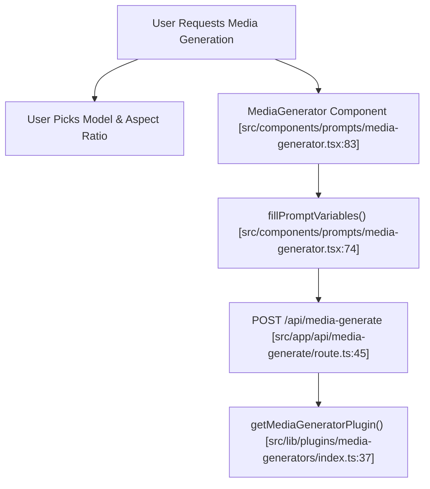
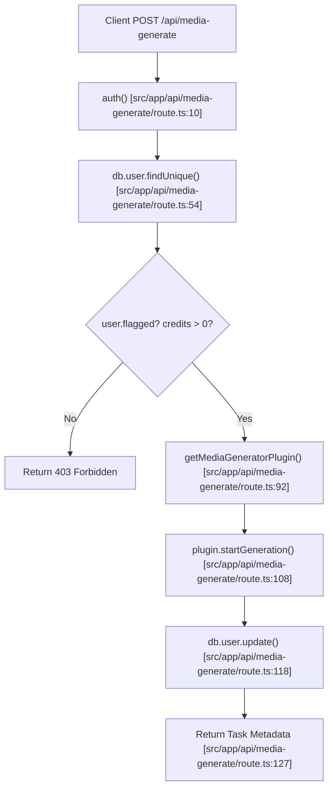
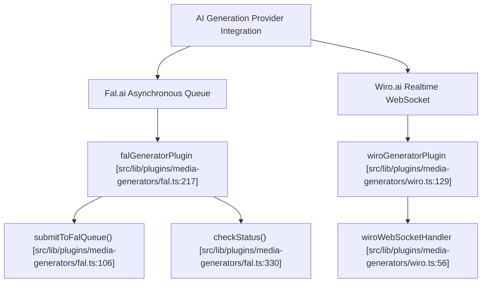
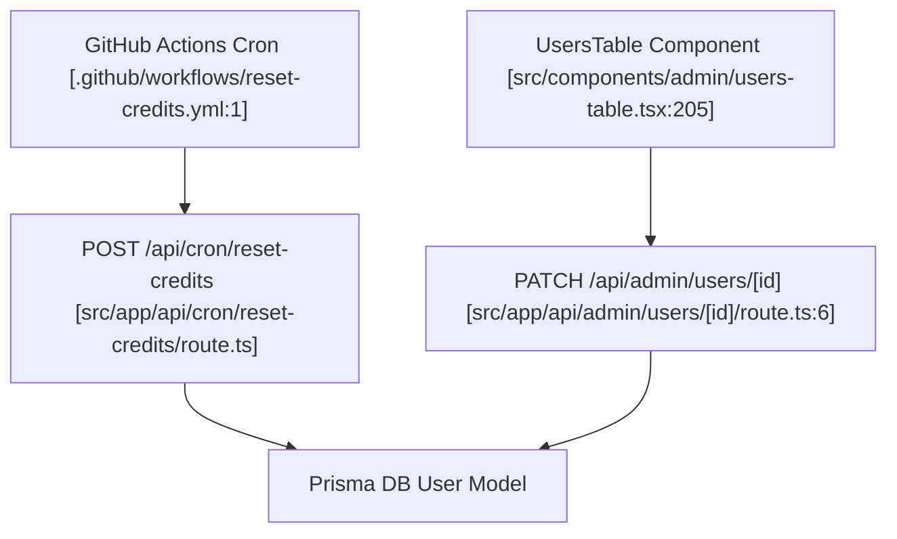
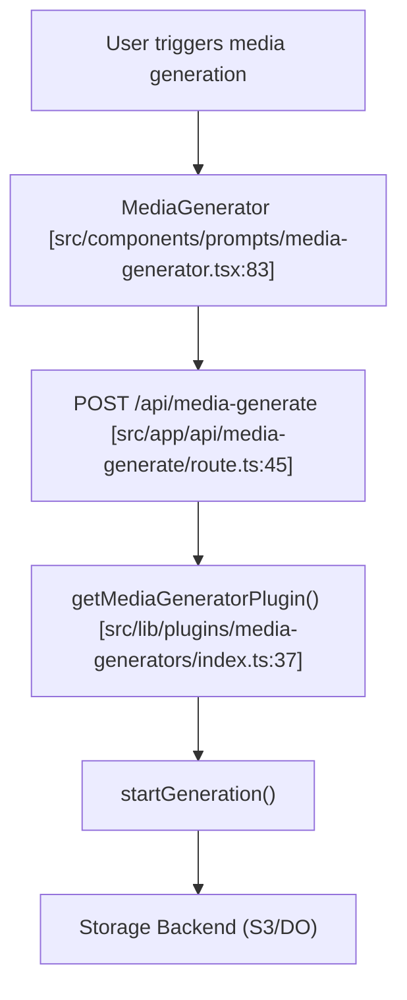

<!-- source: DeepWiki mcp.deepwiki.com · repo f/prompts.chat · page 4.9 Media Generation & Attachments · fetched 2026-11-09 -->

# Media Generation & Attachments

<details>
<summary>Relevant source files</summary>

The following files were used as context for generating this wiki page:

- [.github/workflows/reset-credits.yml](.github/workflows/reset-credits.yml)
- [prisma/migrations/20251222132600_add_user_flagged_and_unusual_activity/migration.sql](prisma/migrations/20251222132600_add_user_flagged_and_unusual_activity/migration.sql)
- [prisma/migrations/20251225000000_add_generation_credits/migration.sql](prisma/migrations/20251225000000_add_generation_credits/migration.sql)
- [src/app/api/admin/users/[id]/route.ts](src/app/api/admin/users/[id]/route.ts)
- [src/app/api/admin/users/route.ts](src/app/api/admin/users/route.ts)
- [src/app/api/cron/reset-credits/route.ts](src/app/api/cron/reset-credits/route.ts)
- [src/app/api/media-generate/route.ts](src/app/api/media-generate/route.ts)
- [src/app/api/media-generate/status/route.ts](src/app/api/media-generate/status/route.ts)
- [src/components/admin/users-table.tsx](src/components/admin/users-table.tsx)
- [src/components/prompts/audio-player.tsx](src/components/prompts/audio-player.tsx)
- [src/components/prompts/media-generator.tsx](src/components/prompts/media-generator.tsx)
- [src/lib/plugins/media-generators/fal.ts](src/lib/plugins/media-generators/fal.ts)
- [src/lib/plugins/media-generators/index.ts](src/lib/plugins/media-generators/index.ts)
- [src/lib/plugins/media-generators/types.ts](src/lib/plugins/media-generators/types.ts)
- [src/lib/plugins/media-generators/wiro.ts](src/lib/plugins/media-generators/wiro.ts)

</details>


## Purpose and Scope
This document provides detailed technical documentation for the media generation and attachment subsystems in `prompts.chat`. It covers the architecture and implementation of media prompt types, the `MediaGenerator` React component (`[src/components/prompts/media-generator.tsx:83-214]()`), the backend API routes (`[src/app/api/media-generate/route.ts:1-141]()`), provider plugins (`fal` and `wiro`), user generation credits enforcement and daily resets, as well as supported storage backends for media assets.

---

## 1. Media Prompt Types & Input Handling
Prompts that extend beyond text output produce media files with types such as:

- `IMAGE` (`[src/lib/plugins/media-generators/types.ts:7]()`)
- `VIDEO` (`[src/lib/plugins/media-generators/types.ts:7]()`)
- `AUDIO` (`[src/lib/plugins/media-generators/types.ts:7]()`)

When a prompt contains template variables (e.g., `${variable}` or `${variable:default}`), the component uses a utility function to fill these placeholders with either default values or example text to ensure valid request payloads (`[src/components/prompts/media-generator.tsx:74-80]()`).

### Prompt Variables Parsing
The `fillPromptVariables` function replaces template variables in prompts with example strings or default values (`[src/components/prompts/media-generator.tsx:74-80]()`). It uses a regular expression to detect all `${}` tokens and replaces them accordingly:

```ts
function fillPromptVariables(prompt: string): string {
  return prompt.replace(/\$\{([^}:]+)(?::([^}]*))?\}/g, (match, varName, defaultValue) => {
    return defaultValue || `(example ${varName})`;
  });
}
```

### Input Images
Some generation requests support an optional `inputImageUrl` field enabling image-conditioned generation pipelines, such as image-to-video or image-to-image generation (`[src/lib/plugins/media-generators/types.ts:21]()`).

Sources: `[src/lib/plugins/media-generators/types.ts:7-21]`, `[src/components/prompts/media-generator.tsx:74-80]()`

---

## 2. The MediaGenerator Component & UI Subsystems

### Overview
The `MediaGenerator` is a React client component that manages the entire UI and client state for AI media generation workflows (`[src/components/prompts/media-generator.tsx:1-3]()`). It presents:

- Model selection dropdown (models filtered by media type) (`[src/components/prompts/media-generator.tsx:111-116]()`)
- Aspect ratio selector for image/video generation (`[src/components/prompts/media-generator.tsx:35-43]()`)
- Generation status and progress feedback (`[src/components/prompts/media-generator.tsx:95-97]()`)
- Error handling and success notifications (`[src/components/prompts/media-generator.tsx:25]()`)
- Integration with provider-specific communication channels (WebSocket or polling) (`[src/components/prompts/media-generator.tsx:186-214]()`)

It notifies its parent component via the `onMediaGenerated` callback with the URL of generated media once production completes (`[src/components/prompts/media-generator.tsx:59]()`).

### Key Component States
- `models`: List of available generation models for selected media type (`[src/components/prompts/media-generator.tsx:91]()`)
- `selectedModel`: Currently selected model object (`[src/components/prompts/media-generator.tsx:93]()`)
- `aspectRatio`: User-selected aspect ratio string (e.g., "1:1", "16:9") (`[src/components/prompts/media-generator.tsx:94]()`)
- `status`: Current generation stage (idle, queued, processing, completed, error) (`[src/components/prompts/media-generator.tsx:95]()`)
- `progress`: Numeric progress percentage (0–100) (`[src/components/prompts/media-generator.tsx:97]()`)
- `statusKey`: Semantic status message identifier for i18n translations (`[src/components/prompts/media-generator.tsx:96]()`)
- `error`: Error message string if any failure occurs (`[src/components/prompts/media-generator.tsx:101]()`)
- `wsRef`: WebSocket connection reference (`[src/components/prompts/media-generator.tsx:102]()`)

### Data Flow

1. On mount, fetches models from `GET /api/media-generate` (`[src/components/prompts/media-generator.tsx:105-125]()`).
2. On user action to generate:
   - Sends `POST /api/media-generate` with filled prompt, selected model, provider, type, and aspect ratio (`[src/components/prompts/media-generator.tsx:140-161]()`).
   - Receives task metadata and connection info (WebSocket URL or token) (`[src/components/prompts/media-generator.tsx:168]()`).
3. Depending on provider:
   - For WebSocket-supporting providers (e.g., Wiro), opens connection to receive live updates (`[src/lib/plugins/media-generators/wiro.ts:56-127]()`).
   - For polling-based providers (e.g., Fal), periodically polls status endpoint (`[src/components/prompts/media-generator.tsx:186-214]()`).
4. Updates status, progress, and messages accordingly (`[src/components/prompts/media-generator.tsx:205-208]()`).
5. Upon completion, triggers `onMediaGenerated` with output URL and resets UI (`[src/components/prompts/media-generator.tsx:171-182]()`).

Diagram: Natural Language to Code Entity Mapping for Media Generation UI

Sources: `[src/components/prompts/media-generator.tsx:64-214]`, `[src/components/prompts/audio-player.tsx:16-211]`, `[src/lib/plugins/media-generators/index.ts:37-40]()`

---

## 3. Generation API Routes

The backend media generation API is implemented under the Next.js route `/api/media-generate` and supports `GET` and `POST` methods (`[src/app/api/media-generate/route.ts:1-141]()`).

### `GET /api/media-generate`
- Authenticates user session via `auth()` (`[src/app/api/media-generate/route.ts:10-15]()`).
- Checks availability of any enabled media generator plugin (`[src/app/api/media-generate/route.ts:17]()`).
- Returns available models grouped by media type (`imageModels`, `videoModels`, `audioModels`) (`[src/app/api/media-generate/route.ts:18-36]()`).
- Returns user generation credits and whether the user is flagged (`[src/app/api/media-generate/route.ts:22-42]()`).

### `POST /api/media-generate`
- Authenticates session (`[src/app/api/media-generate/route.ts:46-50]()`).
- Validates required fields: `prompt`, `model`, `provider`, `type` (`[src/app/api/media-generate/route.ts:85-90]()`).
- Checks user flagged status and remaining `generationCreditsRemaining` (`[src/app/api/media-generate/route.ts:54-80]()`).
- Obtains matching media generator plugin via `getMediaGeneratorPlugin` (`[src/app/api/media-generate/route.ts:92]()`).
- Calls plugin's `startGeneration` with generation parameters (`[src/app/api/media-generate/route.ts:108-115]()`).
- Decrements user's remaining credit by 1 upon successful generation start (`[src/app/api/media-generate/route.ts:117-125]()`).
- Returns task metadata including `taskId`, `socketAccessToken`, `webSocketUrl`, and `provider` (`[src/app/api/media-generate/route.ts:127-133]()`).

Diagram: Generation API Request Flow

Sources: `[src/app/api/media-generate/route.ts:1-141]()`

---

## 4. Provider Plugins: `fal` and `wiro`

`prompts.chat` supports an extensible plugin system for media generation providers located in `src/lib/plugins/media-generators`. Two main providers are implemented: Fal.ai and Wiro.ai (`[src/lib/plugins/media-generators/index.ts:11-22]()`).

### 4.1 Fal.ai Plugin (`fal.ts`)
- Uses Fal.ai's **queue API** hosted at `https://queue.fal.run` (`[src/lib/plugins/media-generators/fal.ts:25]()`).
- Generation is asynchronous with **HTTP polling** for status updates (`[src/lib/plugins/media-generators/fal.ts:5]()`).
- Validates origins with `assertFalOrigin()` to prevent SSRF attacks (`[src/lib/plugins/media-generators/fal.ts:27-48]()`).
- Implements:
  - `submitToFalQueue(modelId, input)` (`[src/lib/plugins/media-generators/fal.ts:106-130]()`)
  - `getFalRequestStatus(statusUrl)` (`[src/lib/plugins/media-generators/fal.ts:135-156]()`)
  - `getFalRequestResult(responseUrl)` (`[src/lib/plugins/media-generators/fal.ts:161-182]()`)
- Statuses map via `falStatusMap` (`[src/lib/plugins/media-generators/fal.ts:64-70]()`).
- The `falWebSocketHandler` is a no-op as Fal.ai uses polling, not WebSockets for status updates (`[src/lib/plugins/media-generators/fal.ts:201-215]()`).

### 4.2 Wiro.ai Plugin (`wiro.ts`)
- Uses realtime **WebSocket API** (`wss://socket.wiro.ai/v1`) alongside REST API at `https://api.wiro.ai/v1` (`[src/lib/plugins/media-generators/wiro.ts:23-24]()`).
- Starts generation via POST with `FormData` parameters (`[src/lib/plugins/media-generators/wiro.ts:163-199]()`).
- WebSocket message types map via `wiroStatusMap` (`[src/lib/plugins/media-generators/wiro.ts:40-54]()`).
- The `wiroWebSocketHandler` processes incoming WebSocket messages to update progress and status (`[src/lib/plugins/media-generators/wiro.ts:56-127]()`).

Diagram: Provider Plugin Mapping

Sources: `[src/lib/plugins/media-generators/fal.ts:1-374]()`, `[src/lib/plugins/media-generators/wiro.ts:1-225]()`, `[src/lib/plugins/media-generators/index.ts:1-95]()`

---

## 5. Generation Credits & Cron Reset

### Credits System
Each user has:
- `dailyGenerationLimit` — Maximum daily generations (`[src/components/admin/users-table.tsx:57]()`).
- `generationCreditsRemaining` — Remaining credits for the current day (`[src/components/admin/users-table.tsx:58]()`).
- `flagged` — Boolean disabling generation if true (`[src/components/admin/users-table.tsx:54]()`).

### Daily Reset Workflow
- A scheduled GitHub Actions workflow (`.github/workflows/reset-credits.yml`) triggers daily at midnight UTC (`[.github/workflows/reset-credits.yml:1-6]()`).
- Calls `POST /api/cron/reset-credits` (`[.github/workflows/reset-credits.yml:13-17]()`).
- The `reset-credits` API route updates all users' `generationCreditsRemaining` to their `dailyGenerationLimit`.
- Admin API routes on `/api/admin/users/[id]` patch user credit limits, also resetting `generationCreditsRemaining` to the new `dailyGenerationLimit` (`[src/app/api/admin/users/[id]/route.ts:53-61]()`).

Diagram: Credit Reset and Admin Patch Architecture

Sources: `[.github/workflows/reset-credits.yml:1-30]()`, `[src/components/admin/users-table.tsx:205-222]()`, `[src/app/api/admin/users/[id]/route.ts:53-61]()`

---

## 6. Storage Backends for Media & Attachments
Generated media assets and user file uploads are stored via configurable storage plugins implementing storage interfaces (`[src/lib/plugins/storage/s3.ts:1]()`).

### 6.1 Amazon S3 Plugin (`src/lib/plugins/storage/s3.ts`)
- Supports AWS S3 and compatible servers (MinIO, DO Spaces).
- Uses AWS SDK's `PutObjectCommand` and `DeleteObjectCommand`.

### 6.2 DigitalOcean Spaces Plugin (`src/lib/plugins/storage/do-spaces.ts`)
- Tailored for DigitalOcean Spaces S3-compatible endpoints with custom CDN configurations.

Sources: `src/lib/plugins/storage/s3.ts`, `src/lib/plugins/storage/do-spaces.ts`

---

## Summary Diagram: Media Generation Flow in prompts.chat


Sources: `[src/components/prompts/media-generator.tsx:83-214]()`, `[src/app/api/media-generate/route.ts:1-141]()`

---

## References
- Media generator UI: `[src/components/prompts/media-generator.tsx:3-214]()`
- Media generation API routes: `[src/app/api/media-generate/route.ts:1-141]()`
- Fal.ai plugin: `[src/lib/plugins/media-generators/fal.ts:1-374]()`
- Wiro.ai plugin: `[src/lib/plugins/media-generators/wiro.ts:1-225]()`
- Plugin registry: `[src/lib/plugins/media-generators/index.ts:1-95]()`
- Credits reset workflow: `[.github/workflows/reset-credits.yml:1-30]()`
- User admin API: `[src/app/api/admin/users/[id]/route.ts:53-61]()`
- Admin user management UI: `[src/components/admin/users-table.tsx:205-222]()`
- Storage plugins: `src/lib/plugins/storage/s3.ts`, `src/lib/plugins/storage/do-spaces.ts`

---

