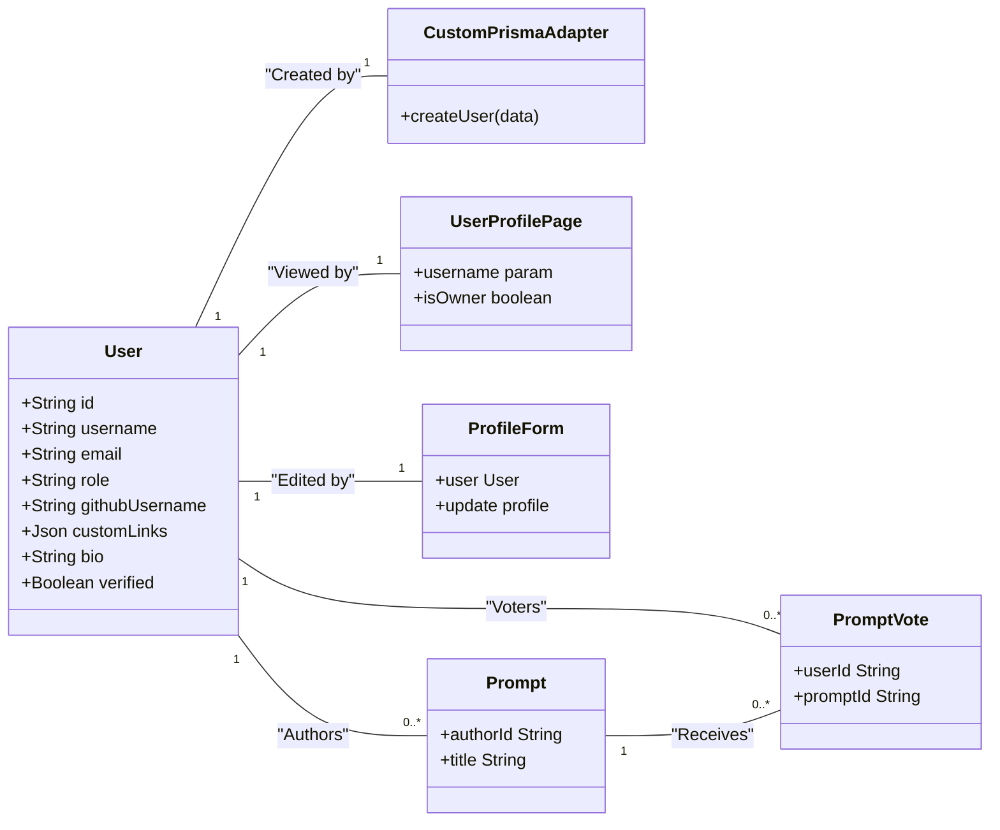
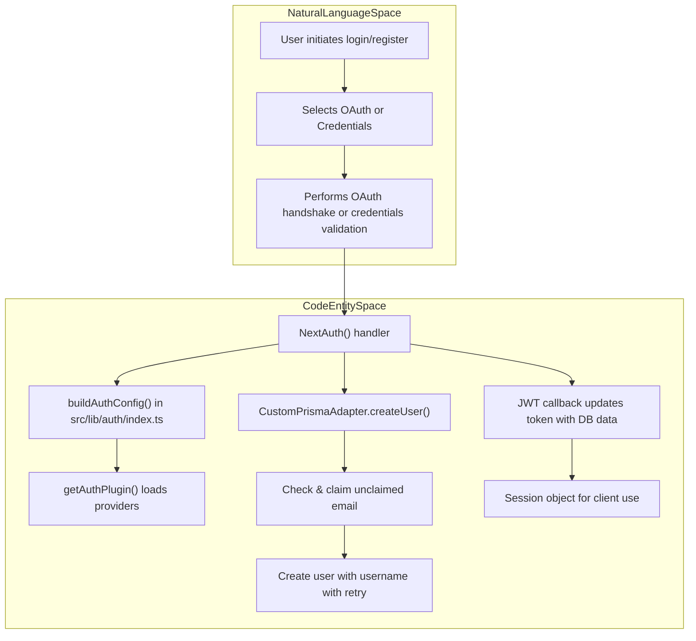
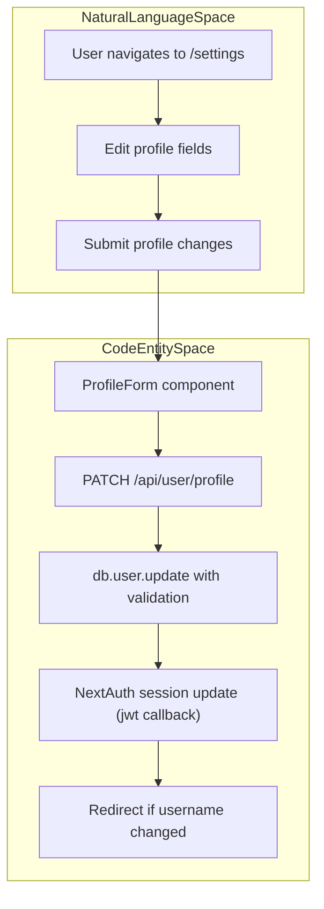
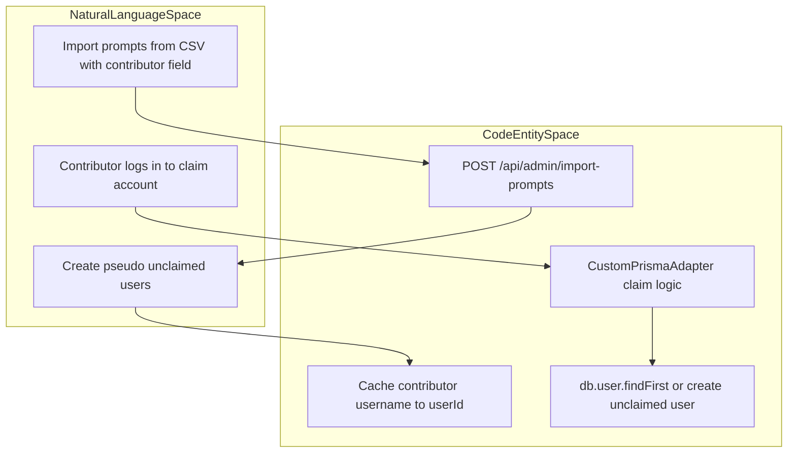

<!-- source: DeepWiki mcp.deepwiki.com · repo f/prompts.chat · page 5 User System · fetched 2026-11-09 -->

# User System

Relevant source files

The following files were used as context for generating this wiki page:

- [prisma/migrations/20251213133000_add_github_username/migration.sql](prisma/migrations/20251213133000_add_github_username/migration.sql)
- [prisma/migrations/20260127100000_add_user_bio_and_custom_links/migration.sql](prisma/migrations/20260127100000_add_user_bio_and_custom_links/migration.sql)
- [src/__tests__/api/user-profile.test.ts](src/__tests__/api/user-profile.test.ts)
- [src/__tests__/lib/plugins/auth/github.test.ts](src/__tests__/lib/plugins/auth/github.test.ts)
- [src/app/[username]/opengraph-image.tsx](src/app/[username]/opengraph-image.tsx)
- [src/app/api/admin/import-prompts/route.ts](src/app/api/admin/import-prompts/route.ts)
- [src/app/api/auth/register/route.ts](src/app/api/auth/register/route.ts)
- [src/app/api/user/profile/route.ts](src/app/api/user/profile/route.ts)
- [src/app/settings/page.tsx](src/app/settings/page.tsx)
- [src/components/auth/register-form.tsx](src/components/auth/register-form.tsx)
- [src/components/settings/profile-form.tsx](src/components/settings/profile-form.tsx)
- [src/components/user/profile-links.tsx](src/components/user/profile-links.tsx)
- [src/lib/auth/index.ts](src/lib/auth/index.ts)
- [src/lib/db-errors.ts](src/lib/db-errors.ts)
- [src/lib/plugins/auth/github.ts](src/lib/plugins/auth/github.ts)

This page serves as the parent overview for user-related features within `prompts.chat`. It covers the core user data model, authentication mechanisms, profile management, settings forms, collections, feeds, and social interaction workflows. 

For deep technical implementation details, refer to the respective child pages linked at the bottom.

---

## User Data Model

The core of the user system is backed by the `User` model managed via Prisma ORM. It tracks essential identity parameters, custom profile configurations, roles, and verification states.

| Field          | Type       | Notes                                                                                     |
|----------------|------------|-------------------------------------------------------------------------------------------|
| `id`           | `String`   | Unique identifier (cuid).                                                                 |
| `email`        | `String`   | Unique; for unclaimed/contributor accounts uses a pseudo email format `@unclaimed.prompts.chat` [src/lib/auth/index.ts:46-48](). |
| `username`     | `String`   | Unique case-insensitive username, used in profile URLs `/@username` [src/lib/auth/index.ts:38-40]().                      |
| `name`         | `String?`  | Optional display name [src/lib/auth/index.ts:55]().                                        |
| `role`         | `UserRole` | User role such as `USER` or `ADMIN` [src/app/api/admin/import-prompts/route.ts:106]().                                     |
| `bio`          | `String?`  | Short biography (max 250 chars) [src/app/api/user/profile/route.ts:21]().                                                         |
| `customLinks`  | `Json?`    | Array of user-defined social/website links [src/app/api/user/profile/route.ts:22]().                                              |
| `githubUsername` | `String?` | Immutable GitHub username for GitHub-authenticated users [src/lib/auth/index.ts:40]().                                |
| `verified`     | `Boolean`  | Indicates if the user is verified (badge status) [src/components/settings/profile-form.tsx:71]().                                        |

This model supports regular users, administrators, and special unclaimed accounts created during CSV prompt imports. These accounts can be claimed later via OAuth logins [src/lib/auth/index.ts:44-67, src/app/api/admin/import-prompts/route.ts:160-169]. Uniqueness of usernames is enforced case-insensitively with automatic retry loops on collision [src/lib/auth/index.ts:70-103].

Diagram: User Data Model and Component Mapping

Sources: [src/lib/auth/index.ts:31-106](), [src/components/settings/profile-form.tsx:64-74](), [src/app/api/user/profile/route.ts:25-86](), [src/app/settings/page.tsx:18-32](), [src/lib/plugins/auth/github.ts:1-24]()

---

## Authentication & Authorization

`prompts.chat` relies on **NextAuth.js 5.0** for handling authentication, supporting multiple OAuth/OIDC provider plugins (such as GitHub, Google, Apple, and Azure) alongside credentials authentication [src/lib/auth/index.ts:108-144]. 

A custom adapter layer (`CustomPrismaAdapter`) extends `PrismaAdapter` to support username management, atomic retry logic for unique constraint violations, unclaimed account claiming via pseudo-emails (`username@unclaimed.prompts.chat`), and session token enrichment through JWT callbacks [src/lib/auth/index.ts:31-196].

Diagram: Authentication Flow Architecture

Sources: [src/lib/auth/index.ts:1-198](), [src/app/api/auth/register/route.ts:1-83](), [src/components/auth/register-form.tsx:23-92]()

For details, see [Authentication & Authorization](#5.1).

---

## User Profiles & Settings

User profile pages are rendered at `/@username` and display the user's details, role badge, join date, prompt count, and total upvotes received [src/app/[username]/opengraph-image.tsx:25-105]. Dynamic OpenGraph images are generated per profile for rich social sharing [src/app/[username]/opengraph-image.tsx:109-245].

The `/settings` route provides form interfaces powered by Zod validation schemas for modifying profiles, biographies, and custom social links [src/app/settings/page.tsx:10-62, src/components/settings/profile-form.tsx:30-46]. Updates are committed through `PATCH /api/user/profile` and trigger a NextAuth session refresh [src/app/api/user/profile/route.ts:25-78, src/components/settings/profile-form.tsx:154-167].

Diagram: Profile Settings Update Pipeline

Sources: [src/app/[username]/opengraph-image.tsx:20-245](), [src/components/settings/profile-form.tsx:36-173](), [src/app/api/user/profile/route.ts:25-86](), [src/app/settings/page.tsx:10-65]()

For details, see [User Profiles & Settings](#5.2).

---

## Collections & Feeds

Users can bookmark prompts into collections, organize favorite items, subscribe to categories, and receive personalized feed updates. This subsystem bridges user activity preferences with content discovery mechanisms across the application.

Sources: [src/app/api/user/profile/route.ts:1-126]()

For details, see [Collections & Feeds](#5.3).

---

## Social Features

Community interactions include prompt voting/upvoting, comment threads, public leaderboards like the promptmasters ranking, and contributor attribution [src/app/api/admin/import-prompts/route.ts:138-173]. During CSV prompt ingestion (`POST /api/admin/import-prompts`), "pseudo-users" are provisioned with unclaimed email addresses so that historical contributions are correctly tied to authors before they register [src/app/api/admin/import-prompts/route.ts:147-169].

Diagram: Contributor Attribution and Pseudo-User Claiming

Sources: [src/app/api/admin/import-prompts/route.ts:135-190](), [src/app/[username]/opengraph-image.tsx:92-99](), [src/lib/auth/index.ts:31-68]()

For details, see [Social Features](#5.4).

---

## Child Pages

- [Authentication & Authorization](#5.1) — Covers NextAuth 5.0 setup, OAuth/OIDC providers, credentials auth, API keys, and role-based access.
- [User Profiles & Settings](#5.2) — Explains the `/@username` profile page, activity metrics, verification badges, profile links, and settings forms.
- [Collections & Feeds](#5.3) — Details bookmarking collections, category subscriptions, notifications, and personalized feed generation.
- [Social Features](#5.4) — Explains voting, comments, leaderboards, and contributor attribution workflows.

Sources:  
[src/lib/auth/index.ts]()  
[src/components/settings/profile-form.tsx]()  
[src/app/api/user/profile/route.ts]()  
[src/app/settings/page.tsx]()  
[src/app/[username]/opengraph-image.tsx]()  
[src/app/api/admin/import-prompts/route.ts]()

---

