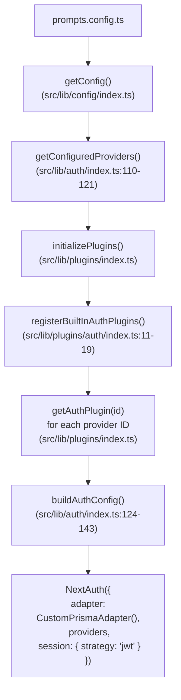
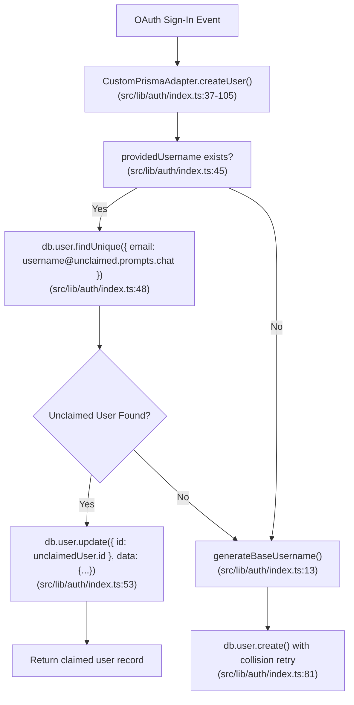

<!-- source: DeepWiki mcp.deepwiki.com · repo f/prompts.chat · page 5.1 Authentication & Authorization · fetched 2026-11-09 -->

# Authentication & Authorization

<details>
<summary>Relevant source files</summary>

The following files were used as context for generating this wiki page:

- [prisma/migrations/20251213133000_add_github_username/migration.sql](prisma/migrations/20251213133000_add_github_username/migration.sql)
- [prisma/migrations/20260127100000_add_user_bio_and_custom_links/migration.sql](prisma/migrations/20260127100000_add_user_bio_and_custom_links/migration.sql)
- [src/__tests__/api/user-profile.test.ts](src/__tests__/api/user-profile.test.ts)
- [src/__tests__/lib/auth/provider-metadata.test.ts](src/__tests__/lib/auth/provider-metadata.test.ts)
- [src/__tests__/lib/plugins/auth/github.test.ts](src/__tests__/lib/plugins/auth/github.test.ts)
- [src/__tests__/lib/plugins/auth/oauth.test.ts](src/__tests__/lib/plugins/auth/oauth.test.ts)
- [src/__tests__/lib/plugins/auth/oidc.test.ts](src/__tests__/lib/plugins/auth/oidc.test.ts)
- [src/app/(auth)/login/page.tsx](src/app/(auth)/login/page.tsx)
- [src/app/(auth)/register/page.tsx](src/app/(auth)/register/page.tsx)
- [src/app/[username]/opengraph-image.tsx](src/app/[username]/opengraph-image.tsx)
- [src/app/api/admin/import-prompts/route.ts](src/app/api/admin/import-prompts/route.ts)
- [src/app/api/auth/register/route.ts](src/app/api/auth/register/route.ts)
- [src/app/api/user/profile/route.ts](src/app/api/user/profile/route.ts)
- [src/app/settings/page.tsx](src/app/settings/page.tsx)
- [src/components/auth/auth-content.tsx](src/components/auth/auth-content.tsx)
- [src/components/auth/oauth-button.tsx](src/components/auth/oauth-button.tsx)
- [src/components/auth/register-form.tsx](src/components/auth/register-form.tsx)
- [src/components/settings/profile-form.tsx](src/components/settings/profile-form.tsx)
- [src/components/user/profile-links.tsx](src/components/user/profile-links.tsx)
- [src/lib/auth/index.ts](src/lib/auth/index.ts)
- [src/lib/auth/provider-metadata.ts](src/lib/auth/provider-metadata.ts)
- [src/lib/db-errors.ts](src/lib/db-errors.ts)
- [src/lib/plugins/auth/github.ts](src/lib/plugins/auth/github.ts)
- [src/lib/plugins/auth/index.ts](src/lib/plugins/auth/index.ts)
- [src/lib/plugins/auth/oauth.ts](src/lib/plugins/auth/oauth.ts)
- [src/lib/plugins/auth/oidc.ts](src/lib/plugins/auth/oidc.ts)
- [src/lib/plugins/index.ts](src/lib/plugins/index.ts)

</details>


This page documents the NextAuth.js 5.0 configuration, the `AuthPlugin` interface and registry, the `CustomPrismaAdapter` (username generation and unclaimed account claiming), JWT and session token lifecycle, credentials authentication, user registration, API key management, and role-based access control (RBAC).

Sources: [src/lib/auth/index.ts:1-122](), [src/lib/plugins/auth/index.ts:1-21]()

---

## Plugin Architecture & Built-in Providers

### The `AuthPlugin` Interface

Authentication in prompts.chat is powered by **NextAuth.js v5.0** using a modular, runtime-configurable architecture. Active authentication providers are loaded dynamically from `prompts.config.ts` via the `AuthPlugin` registry.

### Built-in Authentication Plugins

| Plugin ID    | File Path                        | Required Environment Variables                               |
|--------------|---------------------------------|--------------------------------------------------------------|
| `credentials`| `[src/lib/plugins/auth/credentials.ts]()` | None (database-backed)                                    |
| `google`     | `[src/lib/plugins/auth/google.ts]()`      | `GOOGLE_CLIENT_ID`, `GOOGLE_CLIENT_SECRET`               |
| `azure`      | `[src/lib/plugins/auth/azure.ts]()`       | `AZURE_AD_CLIENT_ID`, `AZURE_AD_CLIENT_SECRET`, `AZURE_AD_TENANT_ID` |
| `github`     | `[src/lib/plugins/auth/github.ts:1-24]()`| `GITHUB_CLIENT_ID`, `GITHUB_CLIENT_SECRET`                |
| `apple`      | `[src/lib/plugins/auth/apple.ts]()`       | `AUTH_APPLE_ID`, `AUTH_APPLE_SECRET`                      |
| `oidc`       | `[src/lib/plugins/auth/oidc.ts]()`        | `AUTH_OIDC_ID`, `AUTH_OIDC_SECRET`, `AUTH_OIDC_ISSUER`    |
| `oauth`      | `[src/lib/plugins/auth/oauth.ts]()`       | `AUTH_OAUTH_ID`, `AUTH_OIDC_SECRET`, `AUTH_OIDC_ISSUER`   |

All built-in plugins are registered at startup via `registerBuiltInAuthPlugins()` in [src/lib/plugins/auth/index.ts:11-19]().

### Plugin Initialization & Configuration Flow

Title: "Plugin Initialization and Configuration Pipeline"


Sources: [src/lib/auth/index.ts:109-146](), [src/lib/plugins/auth/index.ts:11-19](), [src/lib/plugins/index.ts:1-54]()

---

## `CustomPrismaAdapter` & Username Resolution

The application extends the standard `@auth/prisma-adapter` through `CustomPrismaAdapter()` defined in [src/lib/auth/index.ts:31-107]().

### Username Generation & Collision Handling

- Extracts the local part of the email address (before `@`), sanitizing it to lowercase alphanumeric and underscore characters ([src/lib/auth/index.ts:13-15]()).
- Falls back to a sanitized user `name` if the local part is too short ([src/lib/auth/index.ts:17-20]()).
- Defaults to `"user"` if all else fails ([src/lib/auth/index.ts:22-26]()).
- Ensures uniqueness at insert time by running an atomic creation loop that catches unique constraint violations (`isUniqueConstraintViolation`) and appends an incremental numeric counter ([src/lib/auth/index.ts:71-104]()).

### Unclaimed Account Claiming

CSV contributors imported via scripts are pre-created with synthetic emails (`{username}@unclaimed.prompts.chat`). When a user signs in via OAuth (e.g., GitHub using [src/lib/plugins/auth/github.ts:13-22]()), `CustomPrismaAdapter.createUser()` checks if a matching unclaimed account exists ([src/lib/auth/index.ts:44-50]()). If found, it updates the record with the authenticated email, name, and profile image, seamlessly linking contributor attribution to the new account ([src/lib/auth/index.ts:52-68]()).

Title: "CustomPrismaAdapter User Creation and Account Claiming Flow"


Sources: [src/lib/auth/index.ts:13-107](), [src/lib/plugins/auth/github.ts:13-22](), [src/lib/db-errors.ts:1-10]()

---

## JWT & Session Callbacks

Prompts.chat uses stateless JSON Web Tokens (`strategy: "jwt"`).

### JWT Callback Hydration and Validation

- During sign-in, the `jwt` callback queries the database by email to hydrate the token with `id`, `role`, `username`, `locale`, `name`, and `picture` ([src/lib/auth/index.ts:155-172]()).
- On subsequent requests, token existence is verified against `db.user` using `token.id` ([src/lib/auth/index.ts:174-179]()).
- If the user record is deleted, the session token is invalidated ([src/lib/auth/index.ts:180-184]()).
- Explicit update triggers refresh the token payload ([src/lib/auth/index.ts:186-193]()).

Title: "JWT Callback Hydration and Validation Sequence"
```sequence
participant Client as "Client Browser"
participant NextAuth as "NextAuth Framework"
participant JWTCB as "callbacks.jwt()\n(src/lib/auth/index.ts:155-196)"
participant DB as "db.user (Prisma)"

Client->>NextAuth: Request with JWT
NextAuth->>JWTCB: jwt(token, user?, trigger?)
JWTCB->>DB: db.user.findUnique({ id: token.id })
DB-->>JWTCB: User record or null

alt User exists
    JWTCB-->>NextAuth: Return refreshed token with user data
    NextAuth-->>Client: Send new JWT
else User deleted
    JWTCB-->>NextAuth: Return null (invalidate session)
    NextAuth-->>Client: Session invalidated
end
```

Sources: [src/lib/auth/index.ts:154-197]()

---

## Credentials Auth & Registration Pipeline

When the `credentials` provider is enabled, users can register via the credentials endpoint.

### Registration Implementation

- Handled by [src/app/api/auth/register/route.ts:18-83]().
- Validates payload against `registerSchema` using Zod with whitespace preprocessing ([src/app/api/auth/register/route.ts:9-16]()).
- Hashes passwords using `bcryptjs` with 12 salt rounds ([src/app/api/auth/register/route.ts:42]()).
- Enforces atomic database creation and returns `409 Conflict` on email or username collisions ([src/app/api/auth/register/route.ts:45-75]()).
- Respects the `auth.allowRegistration` configuration flag ([src/app/api/auth/register/route.ts:21-27]()).
- UI forms are unified via `AuthContent` ([src/components/auth/auth-content.tsx:24-67]()).

Sources: [src/app/api/auth/register/route.ts:1-83](), [src/components/auth/auth-content.tsx:24-67]()

---

## API Key Generation & Management

Users can manage API keys (format `pchat_*`) and MCP settings on their settings page.

### Profile & API Key Settings

- Settings page UI loaded at [src/app/settings/page.tsx:17-72]().
- API key management component: [src/components/settings/api-key-settings.tsx]().
- Profile updates handled by PATCH requests to `/api/user/profile` ([src/app/api/user/profile/route.ts:25-86]()), validating name, username, avatar, bio, and custom social links ([src/components/settings/profile-form.tsx:36-46]()). The `customLinks` field is an array of objects with `type`, `url`, and optional `label` ([src/components/user/profile-links.tsx:62-66]()).
- Successful profile updates trigger session refreshes ([src/components/settings/profile-form.tsx:155]()).

Sources: [src/app/settings/page.tsx:17-72](), [src/app/api/user/profile/route.ts:25-86](), [src/components/settings/profile-form.tsx:36-46](), [src/components/user/profile-links.tsx:62-66]()

---

## Role-Based Access Control (RBAC)

Authorization relies on the `User.role` enum (`USER` or `ADMIN`).

### Enforcing Administrative Access

Administrative endpoints enforce authorization by checking session roles:

```typescript
const session = await auth();
if (!session?.user || session.user.role !== "ADMIN") {
  return NextResponse.json({ error: "Unauthorized" }, { status: 401 });
}
```
*(Reference: [src/app/api/admin/import-prompts/route.ts:103-108]())*

### UI Integration

- User roles dictate administrative badges in OpenGraph image generation ([src/app/[username]/opengraph-image.tsx:134-149]()).
- Access controls determine whether administrative features render in client layouts.

Sources: [src/app/api/admin/import-prompts/route.ts:103-108](), [src/app/[username]/opengraph-image.tsx:134-149](), [src/lib/auth/index.ts:160-165]()

---

## References

- NextAuth configuration & adapter: [src/lib/auth/index.ts:1-197]()
- Auth plugin registry: [src/lib/plugins/auth/index.ts:1-21]()
- GitHub OAuth provider: [src/lib/plugins/auth/github.ts:1-24]()
- Registration API endpoint: [src/app/api/auth/register/route.ts:1-83]()
- Profile API route: [src/app/api/user/profile/route.ts:1-86]()
- Settings page & Profile form: [src/app/settings/page.tsx:17-72](), [src/components/settings/profile-form.tsx:36-46]()

---

