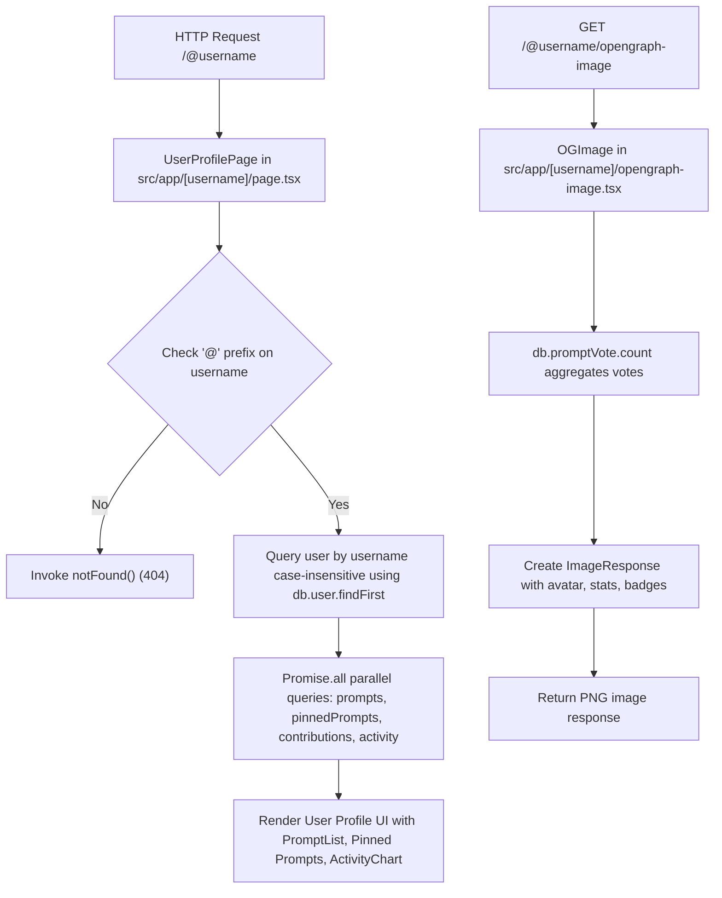
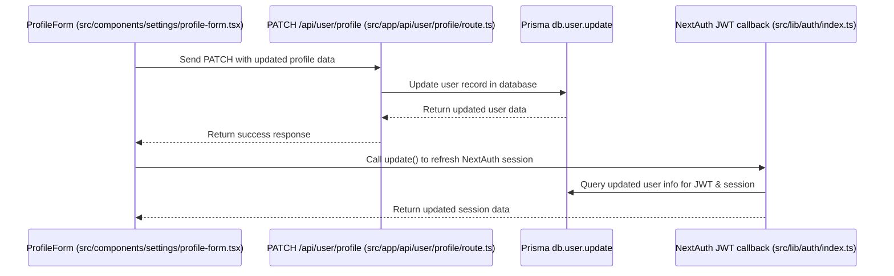

<!-- source: DeepWiki mcp.deepwiki.com · repo f/prompts.chat · page 5.2 User Profiles & Settings · fetched 2026-11-09 -->

# User Profiles & Settings

<details>
<summary>Relevant source files</summary>

The following files were used as context for generating this wiki page:

- [prisma/migrations/20251213133000_add_github_username/migration.sql](prisma/migrations/20251213133000_add_github_username/migration.sql)
- [prisma/migrations/20260127100000_add_user_bio_and_custom_links/migration.sql](prisma/migrations/20260127100000_add_user_bio_and_custom_links/migration.sql)
- [src/__tests__/api/user-profile.test.ts](src/__tests__/api/user-profile.test.ts)
- [src/__tests__/lib/plugins/auth/github.test.ts](src/__tests__/lib/plugins/auth/github.test.ts)
- [src/app/[username]/opengraph-image.tsx](src/app/[username]/opengraph-image.tsx)
- [src/app/[username]/page.tsx](src/app/[username]/page.tsx)
- [src/app/api/admin/import-prompts/route.ts](src/app/api/admin/import-prompts/route.ts)
- [src/app/api/auth/register/route.ts](src/app/api/auth/register/route.ts)
- [src/app/api/prompts/[id]/route.ts](src/app/api/prompts/[id]/route.ts)
- [src/app/api/prompts/route.ts](src/app/api/prompts/route.ts)
- [src/app/api/user/profile/route.ts](src/app/api/user/profile/route.ts)
- [src/app/categories/[slug]/page.tsx](src/app/categories/[slug]/page.tsx)
- [src/app/collection/page.tsx](src/app/collection/page.tsx)
- [src/app/feed/page.tsx](src/app/feed/page.tsx)
- [src/app/prompts/[id]/page.tsx](src/app/prompts/[id]/page.tsx)
- [src/app/settings/page.tsx](src/app/settings/page.tsx)
- [src/app/skills/page.tsx](src/app/skills/page.tsx)
- [src/app/tags/[slug]/page.tsx](src/app/tags/[slug]/page.tsx)
- [src/components/auth/register-form.tsx](src/components/auth/register-form.tsx)
- [src/components/prompts/discovery-prompts.tsx](src/components/prompts/discovery-prompts.tsx)
- [src/components/settings/profile-form.tsx](src/components/settings/profile-form.tsx)
- [src/components/user/profile-links.tsx](src/components/user/profile-links.tsx)
- [src/lib/auth/index.ts](src/lib/auth/index.ts)
- [src/lib/db-errors.ts](src/lib/db-errors.ts)
- [src/lib/plugins/auth/github.ts](src/lib/plugins/auth/github.ts)

</details>


This page explains the user profile system hosted at `/@username`, covering the user profile page structure, activity graph heatmap, pinned prompts, verification badges, profile social links, and user account settings forms. It describes the implementation in detail, including core data flow, key components, API integration, and user account uniqueness management. For related user authentication fundamentals, see [5.1. Authentication & Authorization](). For collections, feeds, and subscriptions visible on profiles, see [5.3. Collections & Feeds]().

---

## Data Model

User profile data is persisted in the `User` Prisma model with key fields supporting display and customization:

| Field | Type | Description |
|---|---|---|
| `name` | `String?` | User's display name [src/lib/auth/index.ts:169]() |
| `username` | `String` (unique) | URL-safe lowercase handle, e.g. `@alice` mapped to `alice` [src/lib/auth/index.ts:169]() |
| `avatar` | `String?` | URL for user profile image [src/lib/auth/index.ts:170]() |
| `bio` | `String?` | Short bio (max 250 chars) supporting URLs and markdown-style bold parsing [src/components/settings/profile-form.tsx:44]() |
| `customLinks` | `Json?` | Array of social/profile links `{type, url, label?}` stored as JSON [src/app/settings/page.tsx:37]() |
| `verified` | `Boolean` | Shows verification badge if true; toggleable by admins [src/app/settings/page.tsx:33]() |
| `role` | `UserRole` | Role assignment, e.g. `USER` or `ADMIN` [src/lib/auth/index.ts:166]() |
| `apiKey` | `String?` | API key for MCP authentication [src/app/settings/page.tsx:34]() |
| `githubUsername` | `String?` | Immutable GitHub username for contributor attribution [src/lib/auth/index.ts:40]() |

Sources: [src/lib/auth/index.ts:165-170](), [src/app/settings/page.tsx:25-38](), [src/components/settings/profile-form.tsx:36-46]()

---

## Profile Page (`/@username`)

The user profile page is a Next.js server component in `src/app/[username]/page.tsx`. It displays user metadata, prompt lists, pinned prompts, and an activity heatmap. This page strictly enforces the `@` prefix in URLs, returning 404 for invalid usernames.

### User Data Fetching

- The page fetches the user case-insensitively by username after stripping the `@` prefix [src/app/[username]/opengraph-image.tsx:50-51]().
- Prompt queries filter to exclude intermediate "flow" prompts and conditionally expose private prompts if viewed by the owner [src/app/[username]/page.tsx:144-148]().

### Concurrent Data Queries

Using `Promise.all`, it fetches concurrently:

- User's prompts (paginated, including related data like author, category, tags) [src/app/[username]/page.tsx:150-181]()
- Count of total prompts and upvotes received on those prompts [src/app/[username]/opengraph-image.tsx:94-100]()
- Pinned prompts sorted by order index, including nested prompt data
- Contributions, liked prompts, and user example data for rendering [src/app/[username]/page.tsx:128-133]()
- Counts for private prompts visible to the user themselves
- Activity metrics for prompts authored, prompt votes, change requests, and comments over the last year [src/app/[username]/page.tsx:183-184]()

### Metadata Generation

The `generateMetadata` function builds a user-friendly page title and description for SEO and displays the user's name or username handle [src/app/[username]/page.tsx:73-83]().

### Verification Badges & UI Features

- A verification badge (`BadgeCheck` icon) appears adjacent to the username when `user.verified` is true [src/app/[username]/page.tsx:7]().
- Pinned prompts are presented with interactive ordering and preview cards using the `PromptCard` UI component [src/app/[username]/page.tsx:18]().
- The page includes the `ActivityChartWrapper` component that visualizes user activity aggregated over a year [src/app/[username]/page.tsx:22]().

Sources: [src/app/[username]/page.tsx:7-184](), [src/app/[username]/opengraph-image.tsx:50-100]()

---

### Open Graph Image Generation

The `/@username/opengraph-image` dynamic route is handled by `src/app/[username]/opengraph-image.tsx`. It generates a custom PNG image rendered server-side with `ImageResponse` showing user name, avatar, role badges (e.g., Admin), joined date formatted, total prompt counts, and total upvotes [src/app/[username]/opengraph-image.tsx:21-109]().

Sources: [src/app/[username]/opengraph-image.tsx:21-109]()

---

### Diagram: Profile Data Resolution & Rendering Flow (Natural Language ↔ Code Entity Space)



Sources: [src/app/[username]/page.tsx:52-193](), [src/app/[username]/opengraph-image.tsx:21-109]()

---

## Activity Graph & Heatmap

User activity is displayed as a heatmap matrix of daily counts covering created prompts, votes given, change requests, and comments aggregated for the prior 12 months.

- The server query aggregates daily counts by date for these activities for the user.
- The `ActivityChartWrapper` component renders this data using `ActivityChart` [src/components/user/activity-chart-wrapper.tsx:1]().
- Intensity (level 0 to 4) is calculated based on max activity using `getIntensity` logic [src/components/user/activity-chart.tsx:113-120]().
- Selecting a date cell on the graph updates the page by appending a `date=YYYY-MM-DD` filter to the search params, filtering the prompt list to those created on that day [src/app/[username]/page.tsx:37]().

Sources: [src/app/[username]/page.tsx:37](), [src/components/user/activity-chart-wrapper.tsx:1](), [src/components/user/activity-chart.tsx:113-120]()

---

## Pinned Prompts & Verification Badges

- Pinned prompts are fetched in order by `db.pinnedPrompt.findMany` with includes for author, category, and tags. They are rendered as card components in a pinned section above the main prompt list.
- A verification badge (`BadgeCheck` icon from Lucide) is conditionally displayed next to the username heading when the `verified` flag is true [src/app/[username]/page.tsx:7]().

Sources: [src/app/[username]/page.tsx:7]()

---

## Settings Page (`/settings`)

The user settings page is implemented as a protected server component in `src/app/settings/page.tsx`. It:

- Verifies session using `auth()`; redirects to login if unauthenticated [src/app/settings/page.tsx:18-23]().
- Fetches the user's profile data, including `name`, `username`, `avatar`, `verified`, `apiKey`, `bio`, and `customLinks` [src/app/settings/page.tsx:25-38]().
- Passes data as props to `ProfileForm` component and conditionally includes `ApiKeySettings` if MCP features enabled [src/app/settings/page.tsx:55-68]().

Sources: [src/app/settings/page.tsx:18-71]()

---

### Diagram: Settings Page Data Flow (Natural Language ↔ Code Entity Space)

```mermaid
graph TD
    subgraph Server_Component
        SettingsPage["SettingsPage at src/app/settings/page.tsx"]
        PrismaUser["db.user.findUnique(userId)"]
    end

    subgraph Client_Components
        ProfileForm["ProfileForm in src/components/settings/profile-form.tsx"]
        ApiKeySettings["ApiKeySettings in src/components/settings/api-key-settings.tsx"]
        ProfileAPI["PATCH /api/user/profile endpoint"]
    end

    SettingsPage --> PrismaUser
    SettingsPage --> ProfileForm
    SettingsPage --> ApiKeySettings

    ProfileForm -->|JSON PATCH payload| ProfileAPI
    ProfileAPI -->|DB Update| PrismaUser
    ProfileAPI -->|200 OK| ProfileForm
    ProfileForm -->|update() triggers NextAuth session refresh| NextAuthJwt["NextAuth JWT callback refetches user"]
```

Sources: [src/app/settings/page.tsx:18-71](), [src/components/settings/profile-form.tsx:139-173](), [src/lib/auth/index.ts:155-196]()

---

## Profile Customization

### ProfileForm Component

The `ProfileForm` component (`src/components/settings/profile-form.tsx`) offers a user-editable form with fields:

- `name`, `username`, `avatar` URL, `bio`, and an array of `customLinks`
- Uses `zod` schemas for validation including username pattern (lowercase letters, numbers, underscores) and URL validity for links [src/components/settings/profile-form.tsx:30-46]().

Custom links support 5 maximum entries from types:
`website`, `github`, `twitter (X)`, `linkedin`, `instagram`, `youtube`, `twitch`, `discord`, `mastodon`, `bluesky`, and `sponsor` [src/components/settings/profile-form.tsx:31-60]().

The form includes interactive helpers to add, remove, reorder, and update custom links [src/components/settings/profile-form.tsx:113-134]().

Submitting triggers a `PATCH` request to `/api/user/profile` [src/app/api/user/profile/route.ts:25-86]() and initiates a NextAuth session refresh to update cached session info [src/components/settings/profile-form.tsx:155]().

Sources: [src/components/settings/profile-form.tsx:30-173](), [src/app/api/user/profile/route.ts:25-86]()

### ProfileLinks Component

`ProfileLinks` (in `src/components/user/profile-links.tsx`) renders:

- The user's bio text parsed for URLs and `**bold**` syntax, transforming links into anchor tags and bold text with `<strong>` elements [src/components/user/profile-links.tsx:94-139]().
- Social media and personal links using platform-specific icons mapped in the `linkIcons` record, including custom SVG icons for X, Discord, Mastodon, Bluesky, and others [src/components/user/profile-links.tsx:15-86]().

Sources: [src/components/user/profile-links.tsx:15-139]()

---

## Implementation Details

### Username Generation & Account Claiming

- The `generateBaseUsername` function creates a base username from the user's email or name during account creation, ensuring minimum length and valid characters [src/lib/auth/index.ts:13-28]().
- The custom Prisma adapter (`CustomPrismaAdapter`) attempts atomic username creation with retries for uniqueness, appending an incremental numeric suffix on conflict [src/lib/auth/index.ts:31-107]().
- Unclaimed accounts are created as pseudo-users with email addresses in the format `username@unclaimed.prompts.chat` during CSV prompt imports. Upon user login, if the chosen username matches an unclaimed account, the adapter claims (updates) that account with the logged-in user's email and data [src/lib/auth/index.ts:45-68](), [src/app/api/admin/import-prompts/route.ts:139-173]().

Sources: [src/lib/auth/index.ts:13-107](), [src/app/api/admin/import-prompts/route.ts:139-173]()

### Pinned Prompts, Activity Data, and Profile Metadata

- Fetching of pinned prompts and metadata is centralized in the profile page component using Prisma queries with includes for nested relationships and counts [src/app/[username]/page.tsx:150-181]().
- Activity over the past year is computed from prompt creation, votes, change requests, and comments tied to the user [src/app/[username]/page.tsx:183-184]().
- The Open Graph image generation composes graphical components server-side for social sharing cards [src/app/[username]/opengraph-image.tsx:21-109]().

Sources: [src/app/[username]/page.tsx:150-184](), [src/app/[username]/opengraph-image.tsx:21-109]()

---

### Diagram: Profile Update Lifecycle & Auth Integration



Sources: [src/components/settings/profile-form.tsx:139-173](), [src/app/api/user/profile/route.ts:25-86](), [src/lib/auth/index.ts:155-196]()

---

## Profile Summary Table

| Feature | Code Location | Description |
|---|---|---|
| Public profile | `src/app/[username]/page.tsx` | Server component rendering profile with username validation, prompt/page queries |
| Open Graph image | `src/app/[username]/opengraph-image.tsx` | Dynamic image generation of profile card and stats for social sharing |
| Verification badge | `user.verified` boolean field | Controls visibility of `BadgeCheck` icon on profile header |
| Activity graph | `ActivityChart` & `ActivityChartWrapper` components | Rendering of yearly contribution heatmap with clickable date filters |
| Social links & bio | `ProfileLinks` component | Renders parsed markdown and social links using platform icons |
| Settings UI | `src/app/settings/page.tsx` + `ProfileForm` | Protected user settings, profile edit form with validations and API integration |
| Username uniqueness | `CustomPrismaAdapter` in auth plugin | Atomic username creation with collision retry and unclaimed account claiming |
| CSV import linking | Admin import route (`src/app/api/admin/import-prompts/route.ts`) | Creates pseudo-users for contributors by username/email format |

Sources: [src/app/[username]/page.tsx](), [src/app/[username]/opengraph-image.tsx](), [src/components/settings/profile-form.tsx](), [src/components/user/profile-links.tsx](), [src/app/settings/page.tsx](), [src/lib/auth/index.ts](), [src/app/api/admin/import-prompts/route.ts]()

---

