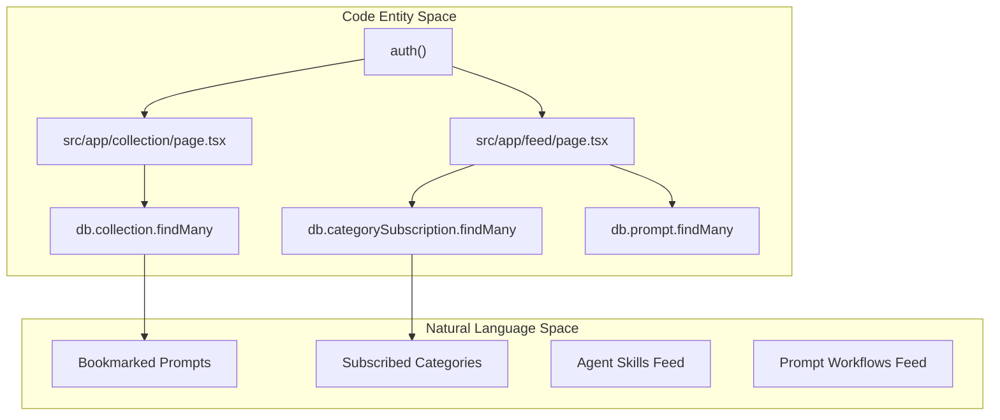
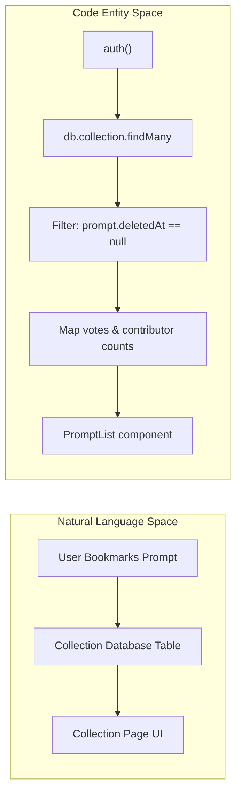
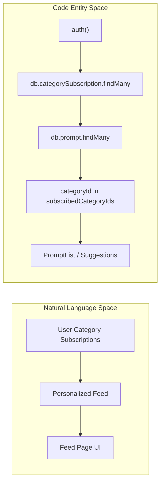

<!-- source: DeepWiki mcp.deepwiki.com · repo f/prompts.chat · page 5.3 Collections & Feeds · fetched 2026-11-09 -->

# Collections & Feeds

Relevant source files

The following files were used as context for generating this wiki page:

- [src/app/[username]/page.tsx](src/app/[username]/page.tsx)
- [src/app/api/prompts/[id]/route.ts](src/app/api/prompts/[id]/route.ts)
- [src/app/api/prompts/route.ts](src/app/api/prompts/route.ts)
- [src/app/categories/[slug]/page.tsx](src/app/categories/[slug]/page.tsx)
- [src/app/collection/page.tsx](src/app/collection/page.tsx)
- [src/app/feed/page.tsx](src/app/feed/page.tsx)
- [src/app/prompts/[id]/page.tsx](src/app/prompts/[id]/page.tsx)
- [src/app/skills/page.tsx](src/app/skills/page.tsx)
- [src/app/tags/[slug]/page.tsx](src/app/tags/[slug]/page.tsx)
- [src/components/comments/comment-form.tsx](src/components/comments/comment-form.tsx)
- [src/components/mcp/mcp-config-tabs.tsx](src/components/mcp/mcp-config-tabs.tsx)
- [src/components/mcp/mcp-server-popup.tsx](src/components/mcp/mcp-server-popup.tsx)
- [src/components/prompts/add-to-collection-button.tsx](src/components/prompts/add-to-collection-button.tsx)
- [src/components/prompts/discovery-prompts.tsx](src/components/prompts/discovery-prompts.tsx)
- [src/components/prompts/translate-button.tsx](src/components/prompts/translate-button.tsx)
- [src/hooks/use-mobile.ts](src/hooks/use-mobile.ts)

## Purpose and Scope

The Collections & Feeds system provides mechanisms for users to organize, track, and discover prompts through structured bookmarking, subscription feeds, notification tracking, and specialized discovery pathways:

1. **Collections**: Personal bookmarked prompt lists accessible at `/collection` [src/app/collection/page.tsx:17-72]() via `AddToCollectionButton` [src/app/prompts/[id]/page.tsx:38]().
2. **Personalized Feeds**: Category subscription-based feeds at `/feed` [src/app/feed/page.tsx:19-105]().
3. **Specialized Discovery**: Dedicated feeds for Agent Skills (`/skills`) and Prompt Workflows (`/workflows`).
4. **Category & Tag Browsing**: Categorized views at `/categories/[slug]` [src/app/categories/[slug]/page.tsx:71-110]() and `/tags/[slug]` [src/app/tags/[slug]/page.tsx:58-85]().
5. **Curated Discovery**: Automated sections for featured, trending, latest, and most upvoted prompts via `DiscoveryPrompts` [src/components/prompts/discovery-prompts.tsx:16-134]().

Sources: [src/app/collection/page.tsx:17-72](), [src/app/feed/page.tsx:19-105](), [src/app/categories/[slug]/page.tsx:71-110](), [src/app/tags/[slug]/page.tsx:58-85](), [src/components/prompts/discovery-prompts.tsx:16-134](), [src/app/prompts/[id]/page.tsx:38]()

---

## System Architecture

### Component Organization & Data Flow

Sources: [src/app/collection/page.tsx:17-64](), [src/app/feed/page.tsx:29-54]()

---

## Collections System

The collection system enables users to bookmark prompts, maintaining a personalized list of saved items at `/collection` [src/app/collection/page.tsx:17-72]().

### Collection Data Flow

### Implementation Details

- **Authentication Check**: Validates user sessions via `auth()` [src/app/collection/page.tsx:19-23](). If unauthenticated, redirects to `/login`.
- **Database Query**: Queries `db.collection.findMany` filtering by `userId` and fetching relational include properties (author, category, tags, and vote/contributor counts) [src/app/collection/page.tsx:25-63]().
- **Validation**: Filters out deleted prompts where `prompt.deletedAt` is non-null [src/app/collection/page.tsx:65-66]().

| Function / Component | File Path | Role |
| :------------------- | :-------- | :--- |
| `CollectionPage` | `src/app/collection/page.tsx` | Main server component rendering user bookmarks |
| `db.collection.findMany` | `src/app/collection/page.tsx` | Prisma query fetching user's saved prompt IDs and relations |

Sources: [src/app/collection/page.tsx:17-72]()

---

## Personalized Feed System

The personalized feed aggregates prompts from categories that an authenticated user has subscribed to, served at `/feed` [src/app/feed/page.tsx:19-105]().

### Feed Generation Logic

1. **Authentication Check**: Requires a valid user session, redirecting to login otherwise [src/app/feed/page.tsx:21-26]().
2. **Subscription Lookup**: Queries `db.categorySubscription.findMany` to retrieve category IDs associated with the user [src/app/feed/page.tsx:29-42]().
3. **Prompt Filtering**: If subscriptions exist, queries public, non-deleted prompts (`NON_BOT_PROMPTS`) matching the subscribed category IDs, ordered by creation date descending with a take limit of 30 [src/app/feed/page.tsx:45-88]().
4. **Fallback Handling**: If no subscriptions are active, displays category suggestion badges allowing quick onboarding [src/app/feed/page.tsx:149-173]().

Sources: [src/app/feed/page.tsx:19-176]()

---

## Category & Tag Browsing

Users can browse collections filtered by specific taxonomy criteria:

- **Categories (`/categories/[slug]`)**:
  - Resolves category records via `db.category.findUnique` [src/app/categories/[slug]/page.tsx:79-89]().
  - Checks subscription status using `db.categorySubscription.findUnique` [src/app/categories/[slug]/page.tsx:98-107]().
  - Supports sorting parameters (`newest`, `oldest`, `most_upvoted`, `most_contributors`) [src/app/categories/[slug]/page.tsx:112-123]().
- **Tags (`/tags/[slug]`)**:
  - Resolves tag metadata via `db.tag.findUnique` [src/app/tags/[slug]/page.tsx:67-69]().
  - Queries prompts associated with the tag via `tagPromptsWhere` [src/app/tags/[slug]/page.tsx:77-85]().

Sources: [src/app/categories/[slug]/page.tsx:71-123](), [src/app/tags/[slug]/page.tsx:58-85]()

---

## Global Discovery & Trending

The `DiscoveryPrompts` component aggregates multi-criteria discovery lists on the homepage and discovery routes [src/components/prompts/discovery-prompts.tsx:16-134]().

| Feed Section | Prisma Query Criteria | Ordering |
| :----------- | :-------------------- | :------- |
| **Trending** | `trendingPromptListWhere()` | `trendingUntil: desc`, `createdAt: desc` [src/components/prompts/discovery-prompts.tsx:55-60]() |
| **Featured** | `isFeatured: true`, public non-bot prompts | `featuredAt: desc` [src/components/prompts/discovery-prompts.tsx:62-73]() |
| **Today's Most Upvoted** | Votes created >= midnight today | `votes: _count: desc` [src/components/prompts/discovery-prompts.tsx:75-96]() |
| **Latest** | Public non-bot prompts | `createdAt: desc` [src/components/prompts/discovery-prompts.tsx:97-107]() |
| **Recently Updated** | Public non-bot prompts | `updatedAt: desc` [src/components/prompts/discovery-prompts.tsx:108-118]() |
| **Most Contributed** | Public non-bot prompts | `contributors: _count: desc` [src/components/prompts/discovery-prompts.tsx:119-133]() |

Sources: [src/components/prompts/discovery-prompts.tsx:16-134]()

---

