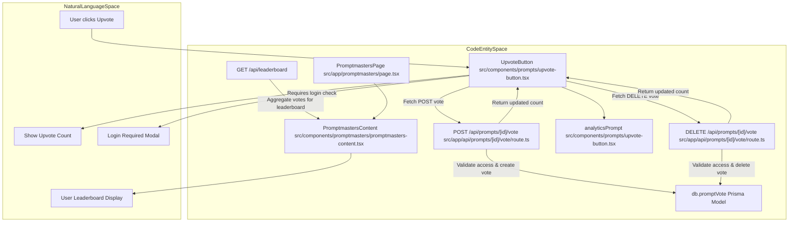
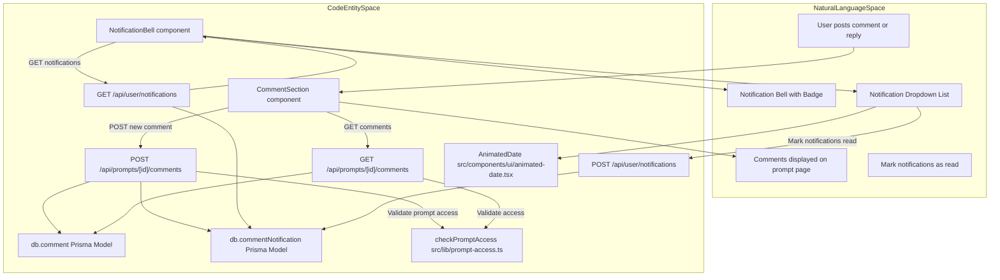
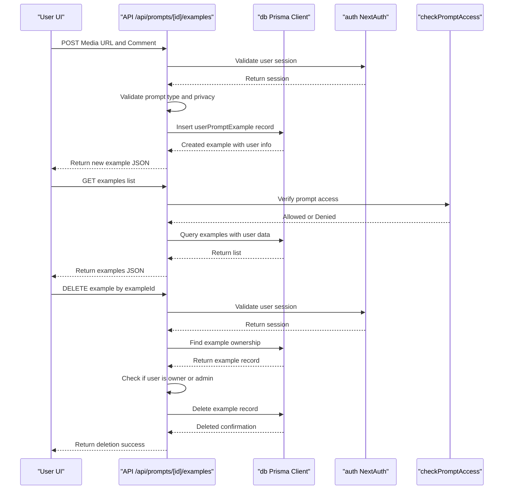
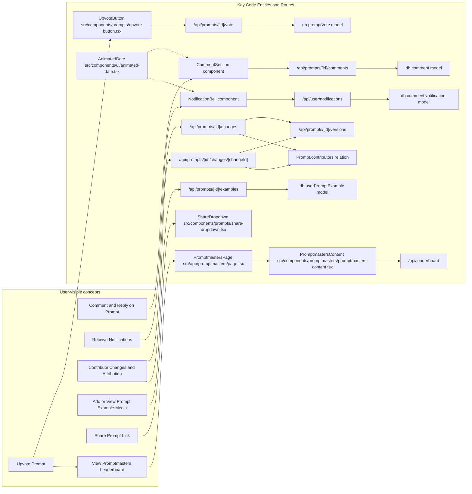

<!-- source: DeepWiki mcp.deepwiki.com · repo f/prompts.chat · page 5.4 Social Features · fetched 2026-11-09 -->

# Social Features

Relevant source files

The following files were used as context for generating this wiki page:

- [src/__tests__/components/classifiers-ui.test.tsx](src/__tests__/components/classifiers-ui.test.tsx)
- [src/__tests__/components/upvote-ui.test.tsx](src/__tests__/components/upvote-ui.test.tsx)
- [src/__tests__/db/classifiers.db.test.ts](src/__tests__/db/classifiers.db.test.ts)
- [src/app/classifiers/[slug]/page.tsx](src/app/classifiers/[slug]/page.tsx)
- [src/app/classifiers/page.tsx](src/app/classifiers/page.tsx)
- [src/app/promptmasters/page.tsx](src/app/promptmasters/page.tsx)
- [src/components/classifiers/classifier-cards.tsx](src/components/classifiers/classifier-cards.tsx)
- [src/components/classifiers/classifier-catalog.tsx](src/components/classifiers/classifier-catalog.tsx)
- [src/components/promptmasters/promptmasters-content.tsx](src/components/promptmasters/promptmasters-content.tsx)
- [src/components/prompts/filter-context.tsx](src/components/prompts/filter-context.tsx)
- [src/components/prompts/upvote-button.tsx](src/components/prompts/upvote-button.tsx)
- [src/lib/classifiers/store.ts](src/lib/classifiers/store.ts)

This page documents the social feature implementations for prompts.chat, including voting/upvoting, comments, promptmasters leaderboard, contributor attribution, and user examples. These features enable users to interact, collaborate, and contribute to the AI prompt library community.

---

## Overview

The social features system supports community engagement and contributor recognition over prompts. The core features are managed through dedicated API endpoints, Prisma database models, and React frontend components:

| Feature | Database Model | API Endpoint | Frontend Component |
| :--- | :--- | :--- | :--- |
| Upvotes | `PromptVote` | `POST/DELETE /api/prompts/:id/vote` [src/app/api/prompts/[id]/vote/route.ts:7-116]() | `UpvoteButton` [src/components/prompts/upvote-button.tsx:38-48]() |
| Comments | `Comment`, `CommentNotification` | `POST/GET /api/prompts/:id/comments` | `CommentSection` [src/app/classifiers/[slug]/page.tsx:23-23]() |
| Notifications | `CommentNotification` | `GET/POST /api/user/notifications` | `NotificationBell` |
| Promptmasters Leaderboard | Aggregated from `PromptVote` and `User` | `GET /api/leaderboard` | `PromptmastersContent` [src/components/promptmasters/promptmasters-content.tsx:151-157]() |
| Contributor Attribution | `ChangeRequest`, `PromptVersion`, contributors relation | `POST /api/prompts/:id/changes` [src/app/api/prompts/[id]/changes/route.ts:13-89]() and versions [src/app/api/prompts/[id]/versions/route.ts:13-110]() | `ChangeRequestForm`, `VersionHistory` [src/app/classifiers/[slug]/page.tsx:35-35]() |
| User Examples | `UserPromptExample` | `POST/GET/DELETE /api/prompts/:id/examples` [src/app/api/prompts/[id]/examples/route.ts:12-161]() | `UserExamplesSection` |
| Sharing | N/A | Client-side utilities | `ShareDropdown` [src/components/prompts/share-dropdown.tsx:37-75]() |

All social interactions enforce prompt privacy and access control using `checkPromptAccess` [src/lib/prompt-access.ts:28-49]() to allow interactions only on public or authorized private prompts.

Sources: [src/lib/prompt-access.ts:1-49](), [src/app/api/prompts/[id]/vote/route.ts:7-116](), [src/components/prompts/upvote-button.tsx:38-48](), [src/components/promptmasters/promptmasters-content.tsx:151-157](), [src/app/api/prompts/[id]/changes/route.ts:13-89](), [src/app/api/prompts/[id]/versions/route.ts:13-110](), [src/app/api/prompts/[id]/examples/route.ts:12-161](), [src/components/prompts/share-dropdown.tsx:37-75]()

---

## Upvoting System

Community upvotes help surface the best prompts and generate a leaderboard to recognize top contributors.

### Diagram: Upvoting & Leaderboard Architecture

Sources: [src/components/prompts/upvote-button.tsx:1-193](), [src/app/api/prompts/[id]/vote/route.ts:1-117](), [src/components/promptmasters/promptmasters-content.tsx:151-247](), [src/app/promptmasters/page.tsx:15-33](), [src/lib/prompt-access.ts:28-49]()

### UpvoteButton Component

The `UpvoteButton` component [src/components/prompts/upvote-button.tsx:38-48]() is a client-side React component responsible for handling user interactions related to upvoting.

- It maintains local state for whether the user has voted (`isVoted`) and the total vote count (`voteCount`) [src/components/prompts/upvote-button.tsx:52-54]().
- Handles optimistic UI updates and displays a login dialog when unauthenticated users attempt to vote [src/components/prompts/upvote-button.tsx:57-61]().
- Supports multiple layout sizes (`sm`, `default`, `circular`) [src/components/prompts/upvote-button.tsx:31-31]().
- Invokes client-side analytics tracking upon voting or removing votes using `analyticsPrompt.upvote` and `analyticsPrompt.removeUpvote` [src/components/prompts/upvote-button.tsx:80-84]().
- The visual representation of the upvote count and icon is handled by the `UpvoteCount` [src/components/prompts/upvote-count.tsx:24-32]() and `UpvoteIcon` [src/components/prompts/upvote-count.tsx:9-16]() components.

Sources: [src/components/prompts/upvote-button.tsx:1-193](), [src/components/prompts/upvote-count.tsx:1-32]()

### API Route & Data Model

The upvoting functionality is managed by the `/api/prompts/[id]/vote` API route.

- `POST /api/prompts/[id]/vote`: Authenticated users create a `PromptVote` record if none exists [src/app/api/prompts/[id]/vote/route.ts:7-69]().
- `DELETE /api/prompts/[id]/vote`: Authenticated users delete their existing vote [src/app/api/prompts/[id]/vote/route.ts:72-116]().
- Access is validated by `checkPromptAccess` [src/lib/prompt-access.ts:28-49]() to ensure proper prompt visibility [src/app/api/prompts/[id]/vote/route.ts:28-29]().
- The `PromptVote` Prisma model uses a composite unique key (`userId`, `promptId`) to enforce single voting limits per user per prompt.
- The Leaderboard API `/api/leaderboard` caches results, groups votes by prompt authors, and supports period filtering (`all`, `month`, `week`) as consumed by `PromptmastersContent` [src/components/promptmasters/promptmasters-content.tsx:158-178]().

Sources: [src/app/api/prompts/[id]/vote/route.ts:1-117](), [src/lib/prompt-access.ts:28-49](), [src/components/promptmasters/promptmasters-content.tsx:151-247]()

---

## Promptmasters Leaderboard

The Promptmasters Leaderboard displays top contributors based on prompt upvotes.

### Implementation Details

- The `/promptmasters` page [src/app/promptmasters/page.tsx:15-33]() renders the `PromptmastersContent` component [src/components/promptmasters/promptmasters-content.tsx:151-247]().
- `PromptmastersContent` [src/components/promptmasters/promptmasters-content.tsx:151-247]() fetches leaderboard data for "all time", "this month", and "this week" from the `/api/leaderboard` endpoint [src/components/promptmasters/promptmasters-content.tsx:159-178]().
- Users can sort the leaderboard by total upvotes or upvotes per prompt using the `sortMode` state [src/components/promptmasters/promptmasters-content.tsx:156-156]() and `LeaderboardList` component [src/components/promptmasters/promptmasters-content.tsx:79-87]().
- Top ranks (1st, 2nd, 3rd) are visually distinguished with `Trophy`, `Medal`, and `Award` icons via the `RankBadge` component [src/components/promptmasters/promptmasters-content.tsx:64-77]().
- Each entry links to the user's profile page (`/@username`) [src/components/promptmasters/promptmasters-content.tsx:110-113]().
- Loading states are handled with `LeaderboardSkeleton` [src/components/promptmasters/promptmasters-content.tsx:46-62]().

Sources: [src/app/promptmasters/page.tsx:15-33](), [src/components/promptmasters/promptmasters-content.tsx:1-247]()

---

## Comments and Notifications

Users can comment on prompts, reply to other comments, and receive notifications about new interactions.

### Diagram: Comment & Notification Flow

Sources: [src/lib/prompt-access.ts:28-49](), [src/components/ui/animated-date.tsx:12-46]()

---

## Contributor Attribution

The system tracks and credits users who contribute prompt improvements via change requests and versioning.

### Change Requests Workflow

- Contributors submit proposed changes using `POST /api/prompts/[id]/changes` [src/app/api/prompts/[id]/changes/route.ts:13-89]().
- The prompt owner reviews and approves or rejects change requests via `PATCH /api/prompts/[id]/changes/[changeId]` [src/app/api/prompts/[id]/changes/[changeId]/route.ts:12-176]().
- Upon approval, a database transaction creates:
  1. A new `PromptVersion` record with the updated content and a `changeNote` crediting the contributor [src/app/api/prompts/[id]/changes/[changeId]/route.ts:134-142]().
  2. Updates the main `Prompt` record content and title [src/app/api/prompts/[id]/changes/[changeId]/route.ts:144-153]().
  3. Connects the contributor user ID in the prompt's many-to-many `contributors` relationship [src/app/api/prompts/[id]/changes/[changeId]/route.ts:149-152]().

Sources: [src/app/api/prompts/[id]/changes/route.ts:13-89](), [src/app/api/prompts/[id]/changes/[changeId]/route.ts:12-176](), [src/app/api/prompts/[id]/versions/route.ts:13-110]()

---

## User Examples

Users can upload and share example media outputs generated by prompts for `IMAGE` and `VIDEO` prompt types.

### Diagram: User Examples Sequence

Sources: [src/app/api/prompts/[id]/examples/route.ts:1-161](), [src/lib/prompt-access.ts:28-49]()

### Constraints and Security

- Supported exclusively for prompt types `IMAGE` and `VIDEO` [src/app/api/prompts/[id]/examples/route.ts:26-29]().
- Examples for private prompts can only be added by the prompt owner [src/app/api/prompts/[id]/examples/route.ts:80-82]().
- Example listing and mutating operations enforce prompt privacy checks [src/app/api/prompts/[id]/examples/route.ts:23-24]().
- Deletion is restricted to the example creator or users with `ADMIN` roles [src/app/api/prompts/[id]/examples/route.ts:147-150]().

Sources: [src/app/api/prompts/[id]/examples/route.ts:1-161]()

---

## Social Sharing and Temporal UI

The platform provides UI components to share prompt links easily and display timestamps in an interactive manner.

### Components

- `ShareDropdown`: Generates pre-filled URLs for social networks such as Twitter/X and Hacker News [src/components/prompts/share-dropdown.tsx:37-75]().
- `AnimatedDate`: Displays relative time formatting by default and transitions smoothly to show exact date and time strings on hover [src/components/ui/animated-date.tsx:12-46]().

Sources: [src/components/prompts/share-dropdown.tsx:37-75](), [src/components/ui/animated-date.tsx:12-46]()

---

## Diagram: Social Features Summary Architecture

Sources: [src/components/prompts/upvote-button.tsx:1-193](), [src/app/api/prompts/[id]/vote/route.ts:1-117](), [src/components/promptmasters/promptmasters-content.tsx:151-247](), [src/app/promptmasters/page.tsx:15-33](), [src/app/api/prompts/[id]/changes/[changeId]/route.ts:12-176](), [src/app/api/prompts/[id]/changes/route.ts:13-89](), [src/app/api/prompts/[id]/examples/route.ts:1-161](), [src/components/prompts/share-dropdown.tsx:37-75](), [src/components/ui/animated-date.tsx:12-46](), [src/lib/prompt-access.ts:1-49]()

---

