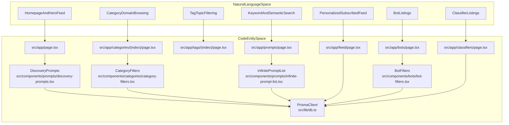
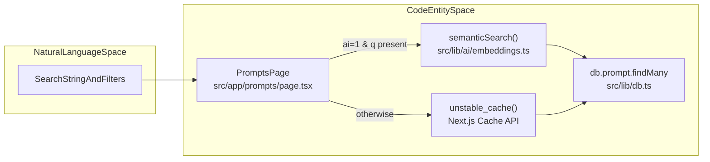
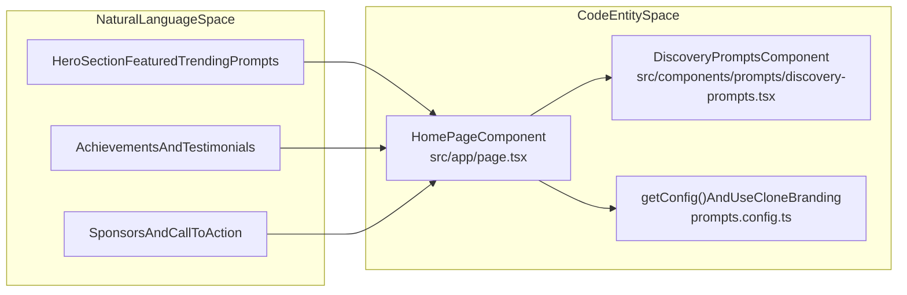
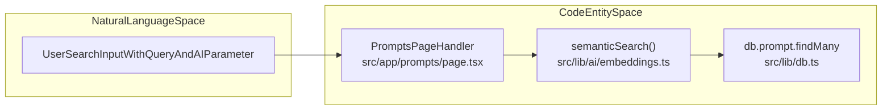

<!-- source: DeepWiki mcp.deepwiki.com · repo f/prompts.chat · page 6 Content Discovery · fetched 2026-11-09 -->

# Content Discovery

Relevant source files

The following files were used as context for generating this wiki page:

- [src/app/bots/page.tsx](src/app/bots/page.tsx)
- [src/app/categories/(index)/page.tsx](src/app/categories/(index)/page.tsx)
- [src/app/discover/page.tsx](src/app/discover/page.tsx)
- [src/app/sitemap.ts](src/app/sitemap.ts)
- [src/app/tags/(index)/page.tsx](src/app/tags/(index)/page.tsx)
- [src/components/seo/structured-data.tsx](src/components/seo/structured-data.tsx)

Content Discovery is the parent system that coordinates how users search, browse, filter, and explore prompts across the platform. It unifies several routing paths, algorithmic matching routines, and UI presentation components. This page provides a high-level architectural overview of these discovery mechanisms; for implementation-specific details, refer to the child pages:

- **[Homepage & Landing](#6.1)** — Document homepage component with hero section, featured prompts, achievements, testimonials, sponsors, and `useCloneBranding` conditional rendering
- **[Categories & Tags](#6.2)** — Explain hierarchical category system, tag system with colors, pinned categories, and category subscription mechanism
- **[Search Systems](#6.3)** — Document keyword search with comma-separated terms, AI semantic search with OpenAI embeddings, and search result ranking
- **[Curated Discovery](#6.4)** — Explain `DiscoveryPrompts` component, featured prompts, trending, today's most upvoted, latest, and widget cards
- **[SEO & Social Metadata](#6.5)** — Document structured data components, `sitemap.ts`, `robots.ts`, opengraph/twitter image generation, and analytics instrumentation

---

## Discovery Pathways & Route Architecture

The discovery system maps user navigation intents expressed in natural language or UI interactions (like browsing categories, filtering tags, or searching keywords) to concrete Next.js route handlers and UI components. These handlers use Prisma ORM queries to retrieve matching prompt data from the database.

### Diagram: Discovery Route Architecture

This structure shows how high-level content discovery concepts — homepage curation, category/tag-based browsing, semantic and keyword search, and personalized feeds — are routed to specific file locations and components that implement the user experience and data fetching. The database client (`src/lib/db.ts`) serves as the common backend data access layer used by these components to execute prompt queries.

Sources: [src/app/page.tsx:21-52](), [src/app/prompts/page.tsx:176-185](), [src/app/feed/page.tsx:11-13](), [src/app/categories/(index)/page.tsx:77-78](), [src/app/tags/(index)/page.tsx:53-54](), [src/components/prompts/discovery-prompts.tsx:13-16](), [src/app/bots/page.tsx:60-61]()

---

## Core Discovery Mechanisms

| Mechanism | Route Path | Primary Component / File | Data Access Pattern |
|-----------|------------|--------------------------|---------------------|
| **Homepage Curation** | `/` | `src/app/page.tsx` | Parallel queries for featured, trending, latest prompts using `DiscoveryPrompts` component [src/components/prompts/discovery-prompts.tsx:50-118]() |
| **Browse & Filter** | `/prompts` | `src/app/prompts/page.tsx` | Cached queries or fallback to `semanticSearch()` AI embeddings [src/app/prompts/page.tsx:82-162](), [src/app/prompts/page.tsx:195-201]() |
| **Category Navigation** | `/categories/:slug` | `src/app/categories/(index)/page.tsx` | `db.category.findMany` with prompt counts and relational queries [src/app/categories/(index)/page.tsx:20-56]() |
| **Tag Navigation** | `/tags/:slug` | `src/app/tags/(index)/page.tsx` | `db.tag.findMany` combined with relational prompt filtering [src/app/tags/(index)/page.tsx:11-35]() |
| **Personalized Feed** | `/feed` | `src/app/feed/page.tsx` | User category subscription lookup + prompt matching [src/app/feed/page.tsx:21-44]() |
| **User Collections** | `/collection` | `src/app/collection/page.tsx` | Collection queries filtering unlisted items [src/app/collection/page.tsx:18-64]() |
| **Specialized Skills** | `/skills` | `src/app/skills/page.tsx` | Cached queries filtering by `type: "SKILL"` [src/app/skills/page.tsx:16-31]() |
| **Sequential Workflows** | `/workflows` | `src/app/workflows/page.tsx` | Workflow connection graph queries [src/app/workflows/page.tsx:23-38]() |
| **Bot Listings** | `/bots` | `src/app/bots/page.tsx` | `listBots` function with filtering and pagination [src/app/bots/page.tsx:67-76]() |
| **Classifier Listings** | `/classifiers` | `src/app/classifiers/page.tsx` | `getClassifierCatalog` for listed classifiers and chains [src/lib/classifiers/store.ts:1-1]() |

Sources: [src/app/page.tsx:8-9](), [src/app/prompts/page.tsx:8-9](), [src/app/categories/(index)/page.tsx:20-56](), [src/app/tags/(index)/page.tsx:11-35](), [src/app/feed/page.tsx:11-44](), [src/app/collection/page.tsx:10-64](), [src/app/skills/page.tsx:16-31](), [src/app/workflows/page.tsx:23-38](), [src/app/bots/page.tsx:67-76](), [src/lib/classifiers/store.ts:1-1]()

---

## Query Pipeline & Entity Mapping

Discovery queries start as natural language inputs (search strings, category slugs, filters), then flow through page route handlers that decide on the query strategy: direct Prisma filtering, cache reads, or invoking AI-driven semantic search.

### Diagram: Discovery Query Pipeline

Sources: [src/app/prompts/page.tsx:73-82](), [src/app/prompts/page.tsx:182-205](), [src/lib/ai/embeddings.ts:1-1]()

---

## Bridging Natural Language Discovery to Code Entities

### Diagram: Natural Language to Homepage Content Discovery Mapping

Sources: [src/app/page.tsx:21-52](), [src/components/prompts/discovery-prompts.tsx:50-118](), [prompts.config.ts:1-30]()

---

### Diagram: Semantic Search Path from User Query to AI Embeddings and Prompt Data

Sources: [src/app/prompts/page.tsx:182-205](), [src/lib/ai/embeddings.ts:1-1](), [src/lib/db.ts:1-21]()

---

## Sub-Topic Summaries & Child Page References

### Homepage & Landing
The homepage (`src/app/page.tsx`) combines a hero section with animated interactive elements, synchronized with prompt discovery feeds displayed via the `DiscoveryPrompts` component. Configuration-driven flags like `useCloneBranding` affect branding and content display. For details, see [Homepage & Landing](#6.1).

### Categories & Tags
Categories are organized hierarchically and expose parent-child relations. Tags provide flat color-coded thematic classifications. Both enable faceted browsing and filtering of prompts. Users may subscribe to categories to tailor their feed, which the personalized feed page (`src/app/feed/page.tsx`) utilizes. The `getCategories` function in [src/app/categories/(index)/page.tsx:20-56]() and `getTags` in [src/app/tags/(index)/page.tsx:11-35]() are used to fetch this data. For details, see [Categories & Tags](#6.2).

Sources: [src/app/categories/(index)/page.tsx:20-56](), [src/app/tags/(index)/page.tsx:11-35]()

### Search Systems
The search page supports traditional keyword search—splitting terms by commas—and AI-powered semantic search leveraging OpenAI embeddings. Search results are ranked accordingly and displayed with infinite scrolling. For details, see [Search Systems](#6.3).

### Curated Discovery
Curated prompt lists such as featured, today's most upvoted, latest, recently updated, and most contributed prompts are retrieved via parallel database queries in `DiscoveryPrompts` and displayed in various widget cards. This provides users a broad swipe of quality content. For details, see [Curated Discovery](#6.4).

### SEO & Social Metadata
This encompasses generating structured data schemas, `sitemap.ts`, `robots.ts`, dynamic OpenGraph and Twitter card image generation, and analytics instrumentation to optimize search engine indexability and social sharing. The `sitemap` function in [src/app/sitemap.ts:30-175]() generates the sitemap, while `robots` in [src/app/robots.ts:4-30]() defines crawling rules. Structured data is handled by components like `JsonLd` and functions like `collectionPageSchema` and `promptSchema` in [src/components/seo/structured-data.tsx:12-179](). OpenGraph and Twitter images for bots are generated by files like [src/app/bots/opengraph-image.tsx:9-13]() and [src/app/bots/twitter-image.tsx:1-2](). Analytics for bot views and clicks are tracked by `BotViewTracker` and `BotCardLink` in [src/components/bots/bot-analytics.tsx:5-32](). For details, see [SEO & Social Metadata](#6.5).

Sources: [src/app/sitemap.ts:30-175](), [src/app/robots.ts:4-30](), [src/components/seo/structured-data.tsx:12-179](), [src/app/bots/opengraph-image.tsx:9-13](), [src/app/bots/twitter-image.tsx:1-2](), [src/app/bots/[slug]/opengraph-image.tsx:9-14](), [src/app/bots/[slug]/twitter-image.tsx:1-2](), [src/components/bots/bot-analytics.tsx:5-32]()

---

