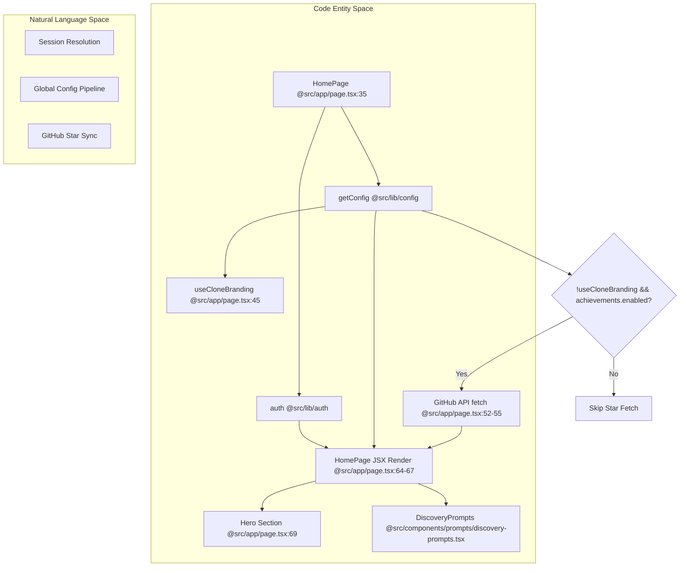
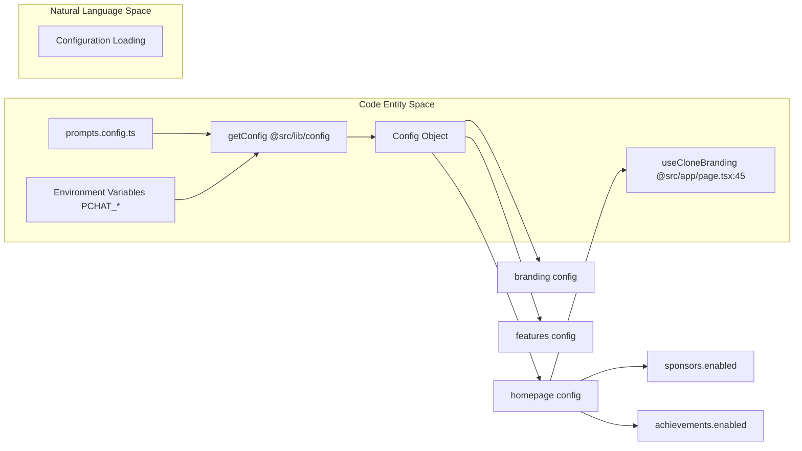
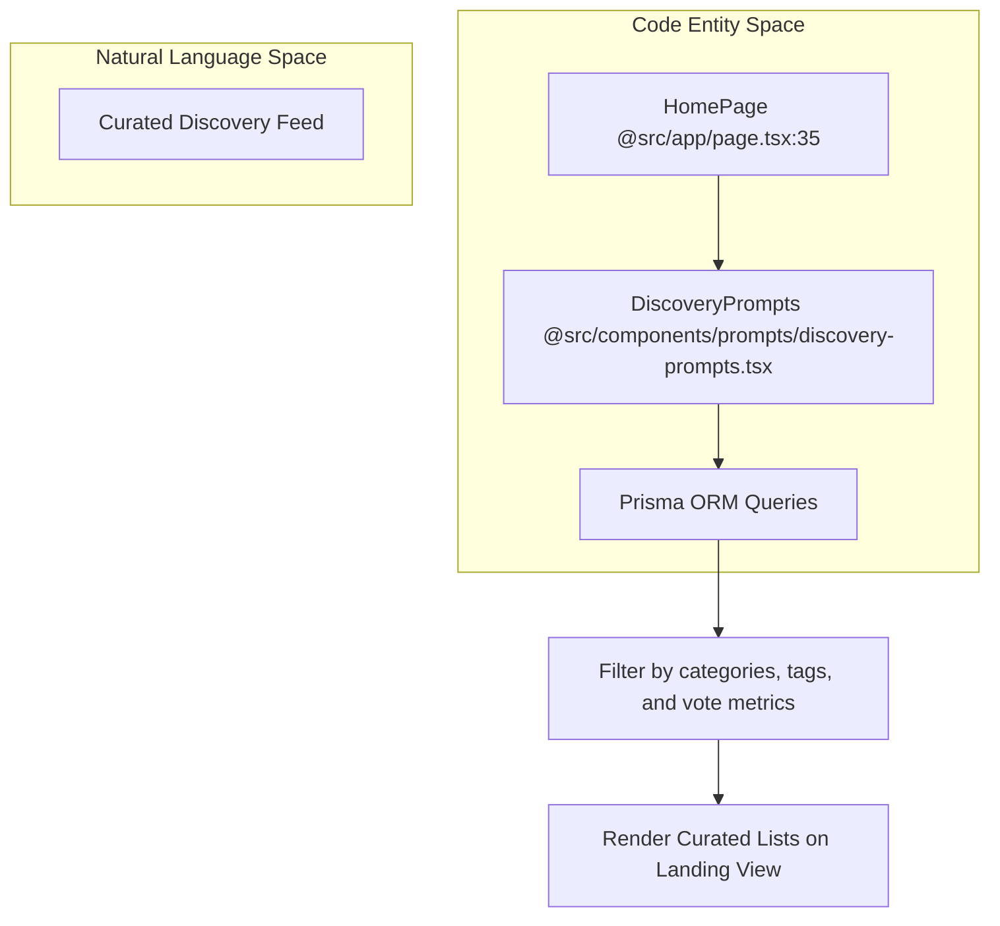

<!-- source: DeepWiki mcp.deepwiki.com · repo f/prompts.chat · page 6.1 Homepage & Landing · fetched 2026-11-09 -->

# Homepage & Landing

Relevant source files

The following files were used as context for generating this wiki page:

- [src/__tests__/components/built-with.test.tsx](src/__tests__/components/built-with.test.tsx)
- [src/app/page.tsx](src/app/page.tsx)
- [src/components/layout/built-with.tsx](src/components/layout/built-with.tsx)

## Purpose and Scope
This page documents the homepage (`/`) implementation in the Prompts.chat codebase, specifically residing in `src/app/page.tsx` [src/app/page.tsx:35-65](). The homepage functions as the primary landing interface for all users—both authenticated and anonymous—delivering the hero banner, client application integration links, featured prompts discovery, community achievements, testimonials, sponsors, and conditional rendering via the `useCloneBranding` configuration flag [src/app/page.tsx:45-45]().

---

## Page Initialization & Data Flow

The homepage is structured as an asynchronous React Server Component (`HomePage`) exported by `src/app/page.tsx` [src/app/page.tsx:35-35](). It resolves global state, user session data, and configuration parameters before executing its rendering pipeline.

The initialization workflow entails:
- Invoking `auth()` from `src/lib/auth` [src/app/page.tsx:6-6]() to check for an active user session [src/app/page.tsx:38-38]().
- Invoking `getConfig()` from `src/lib/config` [src/app/page.tsx:7-7]() to load application-wide configuration values, branding targets, and feature flags [src/app/page.tsx:39-39]().
- Conditionally retrieving the live GitHub star count for the repository `f/prompts.chat` via `https://api.github.com/repos/f/prompts.chat` with a 1-hour revalidation cache [src/app/page.tsx:52-54](), gated by the `useCloneBranding` and achievement visibility toggles [src/app/page.tsx:50-50]().

Sources: `src/app/page.tsx:35-67`

---

## Configuration-Driven Rendering & Clone Branding

The layout adapts dynamically based on the configuration object yielded by `getConfig()` [src/app/page.tsx:39-39](), which merges `prompts.config.ts` specifications with `PCHAT_*` environment variable overrides.

Sources: `src/app/page.tsx:39-47`

### The `useCloneBranding` Flag

When `config.homepage.useCloneBranding` evaluates to `true`, the homepage layout switches to a white-labeled or enterprise-hosted variant:

| Feature | Standard Open-Source Mode (`false`) | Clone Branding Mode (`true`) |
| :--- | :--- | :--- |
| **Hero Title** | Dynamic animated gradient text via `AnimatedText` [src/app/page.tsx:13]() | Static brand title resolved via `config.branding.name` [src/app/page.tsx:75-76]() |
| **Hero Description** | Default open-source value proposition | Custom description from `config.branding.description` |
| **Hero Background** | Looping video animation (`animation_compressed.mp4`) with client widgets [src/app/page.tsx:94-103]() | Watermarked branding logo (`config.branding.logo`) [src/app/page.tsx:74-87]() |
| **Achievements Section** | GitHub stars, contributor counts, metrics grid | Hidden |
| **Sponsors Section** | Rendered if enabled | Rendered if enabled |

Sources: `src/app/page.tsx:39-47`, `src/app/page.tsx:71-88`

---

## Hero Section & Client Integration Links

The hero section presents core value propositions, interactive category navigation pills (`HeroCategories`) [src/app/page.tsx:106-106](), and shortcuts for multi-platform client applications.

Client connectivity options rendered in the hero section:
- `CliCommand`: Renders the `npx prompts.chat` CLI installation command snippet [src/app/page.tsx:111-111]().
- App Store Link: Rendered when `config.branding.appStoreUrl` is configured [src/app/page.tsx:112-124]().
- Browser Extension Link: Rendered via `ExtensionLink` if `config.branding.chromeExtensionUrl` is specified [src/app/page.tsx:125-127]().
- Raycast Extension Link: Direct deep link pointing to `raycast://extensions/fka/prompts-chat?source=prompts.chat` [src/app/page.tsx:128-132]().

Sources: `src/app/page.tsx:69-132`, `src/components/layout/cli-command.tsx`, `src/components/layout/extension-link.tsx`, `src/components/prompts/hero-categories.tsx`

---

## Featured Content & Discovery Integration

Below the hero banner, the homepage embeds the `DiscoveryPrompts` component, aggregating and displaying categorized prompt streams, trending lists, and recently updated records [src/app/page.tsx:9-9]().

Sources: `src/app/page.tsx:9`, `src/components/prompts/discovery-prompts.tsx`

---

## BuiltWith Component & Sponsors Integration

### BuiltWith Component
The `BuiltWith` component (`src/components/layout/built-with.tsx`) manages open-source partner attribution links, displaying light and dark SVG assets for tools like Devin (Cognition), Grok Bot, and the Vercel OSS Program [src/components/layout/built-with.tsx:7-87](). It utilizes flex-row wrapping and non-breaking groupings to ensure graceful reflow on narrow viewports [src/components/layout/built-with.tsx:5-6]().

### Sponsors & Achievements
- Sponsor vector logos are stored under `public/sponsors/` with distinct light and dark variants.
- Achievement metrics fetch live star metrics from the GitHub REST API (`https://api.github.com/repos/f/prompts.chat`) cached with revalidation [src/app/page.tsx:52-54]().
- Numeric counts are formatted with helper functions such as `getOrdinalSuffix` [src/app/page.tsx:29-33]().
- Achievements are omitted when `useCloneBranding` is active [src/app/page.tsx:45-50]().

Sources: `src/app/page.tsx:29-62`, `src/components/layout/built-with.tsx`, `src/__tests__/components/built-with.test.tsx`

---

## Technical References

| Section | Code Symbols & Files |
| :--- | :--- |
| **Page Initialization** | `HomePage`, `src/app/page.tsx:35-65` |
| **Clone Branding Config** | `useCloneBranding`, `src/app/page.tsx:45-50` |
| **Hero Section & Clients** | `HeroCategories`, `CliCommand`, `ExtensionLink`, `src/app/page.tsx:69-132` |
| **Discovery Component** | `DiscoveryPrompts`, `src/components/prompts/discovery-prompts.tsx` |
| **BuiltWith & Sponsors** | `BuiltWith`, `src/components/layout/built-with.tsx`, `src/__tests__/components/built-with.test.tsx` |

Sources: `src/app/page.tsx`, `src/components/layout/built-with.tsx`, `src/__tests__/components/built-with.test.tsx`

---

