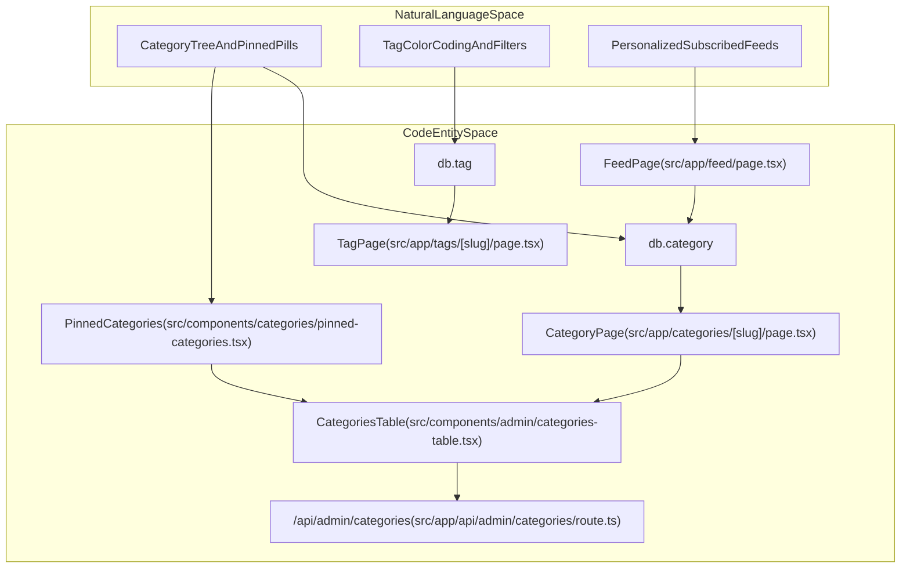
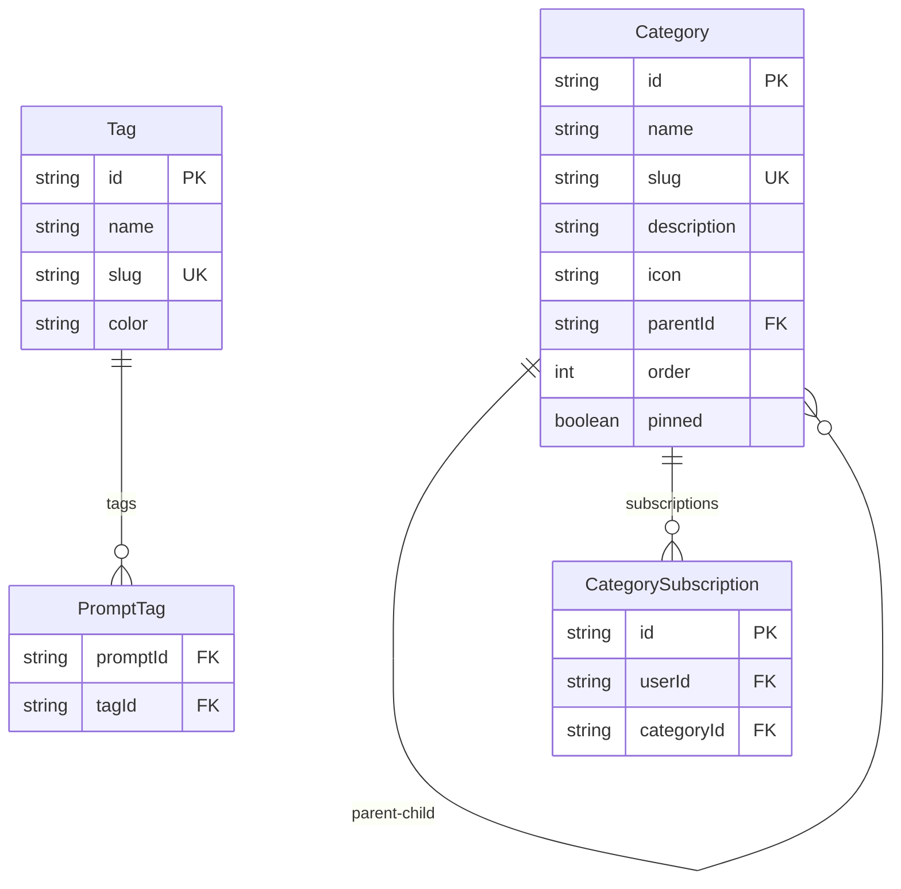
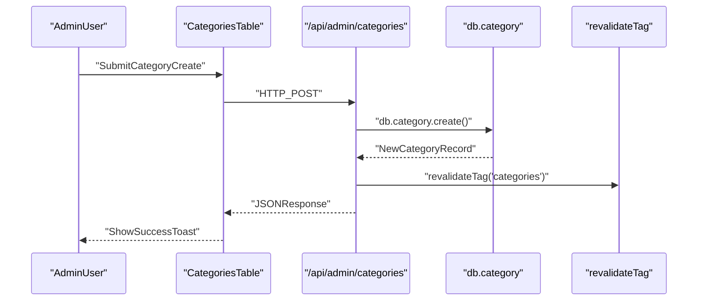

<!-- source: DeepWiki mcp.deepwiki.com · repo f/prompts.chat · page 6.2 Categories & Tags · fetched 2026-11-09 -->

# Categories & Tags

Relevant source files

The following files were used as context for generating this wiki page:

- [prisma/migrations/20251227125700_add_pinned_categories/migration.sql](prisma/migrations/20251227125700_add_pinned_categories/migration.sql)
- [src/app/[username]/page.tsx](src/app/[username]/page.tsx)
- [src/app/api/admin/categories/[id]/route.ts](src/app/api/admin/categories/[id]/route.ts)
- [src/app/api/admin/categories/route.ts](src/app/api/admin/categories/route.ts)
- [src/app/api/prompts/[id]/route.ts](src/app/api/prompts/[id]/route.ts)
- [src/app/api/prompts/route.ts](src/app/api/prompts/route.ts)
- [src/app/categories/[slug]/page.tsx](src/app/categories/[slug]/page.tsx)
- [src/app/collection/page.tsx](src/app/collection/page.tsx)
- [src/app/feed/page.tsx](src/app/feed/page.tsx)
- [src/app/prompts/[id]/page.tsx](src/app/prompts/[id]/page.tsx)
- [src/app/skills/page.tsx](src/app/skills/page.tsx)
- [src/app/tags/[slug]/page.tsx](src/app/tags/[slug]/page.tsx)
- [src/components/admin/categories-table.tsx](src/components/admin/categories-table.tsx)
- [src/components/categories/pinned-categories.tsx](src/components/categories/pinned-categories.tsx)
- [src/components/prompts/discovery-prompts.tsx](src/components/prompts/discovery-prompts.tsx)

This page documents the hierarchical category system and flat tag system used for organizing and filtering prompts in `prompts.chat`. Categories support parent-child relationships, user subscriptions, and pinning for quick access. Tags provide additional labeling with color coding.

---

## Purpose & Scope

The category and tag subsystems provide structural organization for prompts across `prompts.chat`. This document details the database schema, Prisma models, admin hierarchy management, pinned category filtering, color-coded tagging, and the user category subscription architecture.

Sources:  
[src/app/categories/[slug]/page.tsx:79-108]()  
[src/components/admin/categories-table.tsx:89-102]()  

---

## System Overview

The platform uses two complementary organizational systems backed by Prisma models and data fetching layers:

- **Categories**: Hierarchical tree structure managed via `db.category`, supporting root and subcategories through parent-child relationships (`parentId`). Categories can be pinned for quick access via the `pinned` field [prisma/migrations/20251227125700_add_pinned_categories/migration.sql:1-5](), and users can subscribe to categories to receive personalized content feeds [src/app/feed/page.tsx:28-40]().
- **Tags**: A flat list of labels managed via `db.tag`, with customizable hex color codes for visual identification and filtering as seen in [src/app/tags/[slug]/page.tsx:166-169](). They provide additional metadata for prompts that cross-cut categories.

The mapping between natural language concepts and code entities is shown below.

### Diagram: Natural Language Space to Code Entities for Categories & Tags

Sources:  
[prisma/migrations/20251227125700_add_pinned_categories/migration.sql:1-5]()  
[src/app/categories/[slug]/page.tsx:79-108]()  
[src/app/tags/[slug]/page.tsx:166-169]()  
[src/components/admin/categories-table.tsx:83-148]()  
[src/components/categories/pinned-categories.tsx:20-83]()  
[src/app/feed/page.tsx:28-40]()  
[src/app/api/admin/categories/route.ts:7-39]()  

---

## Database Schema & Data Models

### Data Models

The core data structures for categories, tags, and their relationships to users and prompts are implemented as Prisma models:

| Model                  | Description                                   |
|------------------------|-----------------------------------------------|
| `Category`             | Represents hierarchical categories with fields: `id`, `name`, `slug`, `description`, `icon`, `parentId` for parent-child hierarchy, `order` for sorting, and `pinned` boolean flag [prisma/migrations/20251227125700_add_pinned_categories/migration.sql:1-5]() |
| `Tag`                  | Represents non-hierarchical tags with: `id`, `name`, `slug`, and `color` (hex string) |
| `CategorySubscription` | Stores user subscriptions to categories: links `userId` to `categoryId` [src/app/categories/[slug]/page.tsx:98-107]() |
| `PromptTag`             | Join table linking prompts to tags via `promptId` and `tagId` [src/app/api/prompts/route.ts:94-98]() |

### Entity Relationship Diagram

Sources:  
[prisma/migrations/20251227125700_add_pinned_categories/migration.sql:1-5]()  
[src/app/categories/[slug]/page.tsx:98-107]()  
[src/app/api/prompts/route.ts:94-98]()  

---

## Hierarchical Category System

Categories are arranged in a multi-level hierarchy consisting of root categories and subcategories. Root categories have `parentId` set to `null`, while child categories reference their parent's `id` via `parentId` [src/components/admin/categories-table.tsx:82-102]().

### Admin Hierarchy Management

The admin UI component `CategoriesTable` builds a flat ordered list with indentation levels for display, computed from root categories and their children [src/components/admin/categories-table.tsx:89-102](). It filters valid parent options to prevent cyclic assignments [src/components/admin/categories-table.tsx:141-148]().

### Category Mutation API

Categories are mutable through administrative API routes such as `POST /api/admin/categories` [src/app/api/admin/categories/route.ts:7-39](), which update record fields, enforce admin role verification [src/app/api/admin/categories/route.ts:9-12](), and trigger cache invalidation via `revalidateTag` [src/app/api/admin/categories/route.ts:32]().

### Diagram: Category Mutation and Cache Revalidation Workflow

Sources:  
[src/components/admin/categories-table.tsx:83-148]()  
[src/app/api/admin/categories/route.ts:7-39]()  
[src/app/api/admin/categories/route.ts:9-12]()  
[src/app/api/admin/categories/route.ts:32]()  

---

## Pinned Categories & Filtering

Pinned categories provide a quick filtering mechanism in the main prompt discovery UI as clickable pills:
- Rendered by the `PinnedCategories` client component [src/components/categories/pinned-categories.tsx:20-83]().
- Uses `useFilterContext` to manage pending states during query transitions [src/components/categories/pinned-categories.tsx:24]().
- Highlights the active pinned category from URL query parameters.
- Clicking a pinned category pill toggles filtering by that category or clears it [src/components/categories/pinned-categories.tsx:30-51]().
- Administrators can pin or unpin categories via `handleTogglePin` in the `CategoriesTable` component [src/components/admin/categories-table.tsx:121-139]().

Sources:  
[src/components/categories/pinned-categories.tsx:20-83]()  
[src/components/categories/pinned-categories.tsx:24]()  
[src/components/categories/pinned-categories.tsx:30-51]()  
[src/components/admin/categories-table.tsx:121-139]()  

---

## Tag System & Color Coding

Tags are non-hierarchical, color-coded labels assigned to prompts to facilitate cross-cutting topic filtering. Each tag record includes a `color` field storing a hexadecimal color string used inline for visual markers.

The tag page at `/tags/[slug]` queries tags by slug and renders them with their associated badge colors [src/app/tags/[slug]/page.tsx:166-169](). Each tag chip applies inline styles using `tag.color` for background or dot indicators [src/app/tags/[slug]/page.tsx:166-169]().

Sources:  
[src/app/tags/[slug]/page.tsx:67-73]()  
[src/app/tags/[slug]/page.tsx:166-169]()  

---

## Category Subscriptions & Personalized Feeds

Users can subscribe to categories they care about, enabling personalized notifications and feeds.

- **Subscription Storage**: Subscriptions are tracked via `CategorySubscription` records linking a `userId` and `categoryId` [src/app/categories/[slug]/page.tsx:98-107]().
- **Feed Generation**: The feed page (`src/app/feed/page.tsx:28-54`) queries subscribed category IDs for the authenticated session user to populate their personalized prompt stream.

Sources:  
[src/app/categories/[slug]/page.tsx:98-107]()  
[src/app/feed/page.tsx:28-54]()  

---

## Summary of Key Components and Files

| Concept                    | Key File/Component                                               | Description                                      |
|----------------------------|-----------------------------------------------------------------|--------------------------------------------------|
| Category page route        | `src/app/categories/[slug]/page.tsx`                            | Queries category details and prompt subscriptions|
| Category admin UI          | `src/components/admin/categories-table.tsx`                     | Table with hierarchy, editing, and pin toggling  |
| Category creation API      | `src/app/api/admin/categories/route.ts`                         | POST route for category creation with revalidation|
| Pinned categories UI       | `src/components/categories/pinned-categories.tsx`               | Filter pills for pinned categories               |
| Tag page route             | `src/app/tags/[slug]/page.tsx`                                   | Tag details, color indicators, and prompt listing|
| Feed generation route      | `src/app/feed/page.tsx`                                          | Fetches prompts based on user category subscriptions|

Sources:  
[src/app/categories/[slug]/page.tsx:79-108]()  
[src/components/admin/categories-table.tsx:83-148]()  
[src/app/api/admin/categories/route.ts:7-39]()  
[src/components/categories/pinned-categories.tsx:20-83]()  
[src/app/tags/[slug]/page.tsx:67-73]()  
[src/app/feed/page.tsx:28-54]()  

---

## Conclusion

The Categories & Tags system in `prompts.chat` provides a robust mechanism for organizing, filtering, and personalizing prompt discovery. Hierarchical category relationships enable structured browsing, pinned categories highlight popular filters, tags provide cross-cutting metadata with visual colors, and user subscriptions empower personalized workflows.

Sources:  
[src/app/categories/[slug]/page.tsx]()  
[src/components/admin/categories-table.tsx]()  
[src/app/api/admin/categories/route.ts]()  
[src/components/categories/pinned-categories.tsx]()  
[src/app/tags/[slug]/page.tsx]()  
[src/app/feed/page.tsx]()

---

