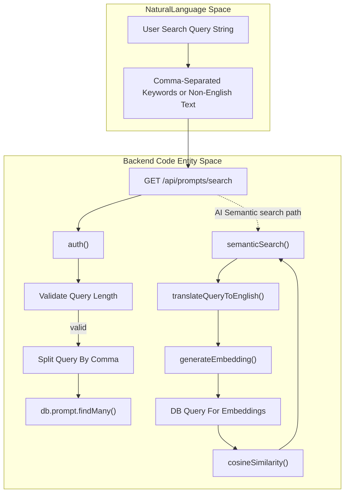
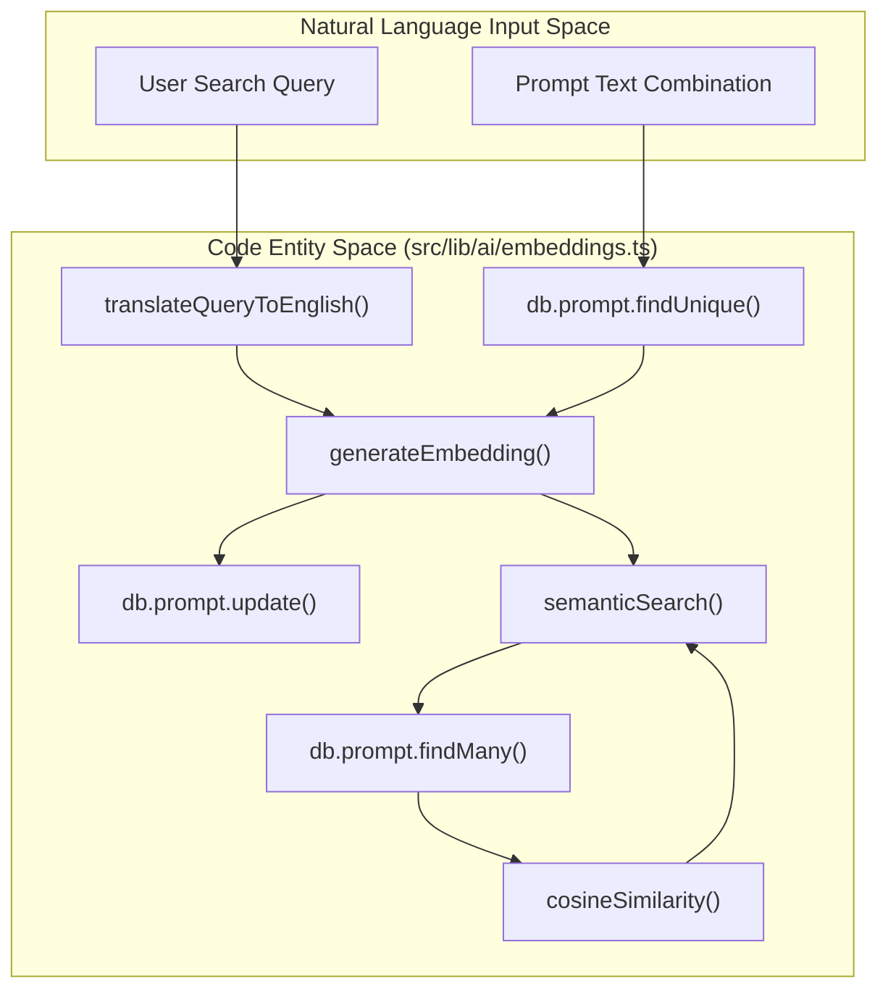

<!-- source: DeepWiki mcp.deepwiki.com · repo f/prompts.chat · page 6.3 Search Systems · fetched 2026-11-09 -->

# Search Systems

<details>
<summary>Relevant source files</summary>

The following files were used as context for generating this wiki page:

- [src/app/api/prompts/search/route.ts](src/app/api/prompts/search/route.ts)
- [src/components/prompts/add-connection-dialog.tsx](src/components/prompts/add-connection-dialog.tsx)
- [src/lib/ai/embeddings.ts](src/lib/ai/embeddings.ts)
- [src/lib/ai/query-translator.prompt.yml](src/lib/ai/query-translator.prompt.yml)

</details>


## Purpose and Scope

This document details the search systems implemented in `prompts.chat`, focusing on two complementary methods:

- **Text-based keyword search** supporting comma-separated terms with case-insensitive matching [src/app/api/prompts/search/route.ts:18-23]().
- **AI-powered semantic search** leveraging OpenAI embeddings for meaning-aware retrieval, including multi-language query translation [src/lib/ai/embeddings.ts:33-79]().

These search mechanisms enable precise and contextually relevant prompt discovery within the platform.

For curated discovery mechanisms and categorical filtering, refer to [6.4 Curated Discovery]() and [6.2 Categories & Tags]().

Sources: [src/app/api/prompts/search/route.ts:5-57](), [src/lib/ai/embeddings.ts:209-233]()

---

## Architecture Overview

The system supports two primary search modes optimized for different use cases:

| Search Type | Implementation | Strengths | Requirements |
| :---------- | :------------- | :-------- | :----------- |
| **Text Search** | PostgreSQL `LIKE` via Prisma filters | Fast, predictable, no extra setup | None |
| **Semantic Search** | OpenAI embeddings + cosine similarity | Context-aware, multi-language support | `OPENAI_API_KEY` |

### Search Data Flow

The diagram below depicts the key components and data flow for the search system, bridging user natural language input and backend code entities, as well as integration points with AI embedding services.

Title: Search System Data Flow


Sources: [src/app/api/prompts/search/route.ts:5-57](), [src/lib/ai/embeddings.ts:32-79](), [src/lib/ai/embeddings.ts:209-233]()

---

## Text-Based Search

### Query Processing and Keyword Handling

Text search functionality is implemented in the `GET` endpoint at `src/app/api/prompts/search/route.ts` which handles incoming search requests with parameters [src/app/api/prompts/search/route.ts:5-10]():

- **`q`**: the query string to search [src/app/api/prompts/search/route.ts:7-7]().
- **`limit`**: maximum number of prompts to return [src/app/api/prompts/search/route.ts:8-8]().
- **`ownerOnly`**: flag to restrict results to the authenticated user [src/app/api/prompts/search/route.ts:9-9]().

The core search logic parses the query string for comma-separated keywords and constructs Prisma query filters accordingly [src/app/api/prompts/search/route.ts:18-23]().

- For multiple keywords: each keyword generates a condition for `title` containing the term, combined with `OR` logic [src/app/api/prompts/search/route.ts:20-22]().
- For a single keyword: a single `contains` filter on `title` with case-insensitive matching [src/app/api/prompts/search/route.ts:22-22]().

This processing appears in lines [18-23] of `src/app/api/prompts/search/route.ts`:

```ts
const keywords = query.split(",").map(k => k.trim()).filter(Boolean);
const titleConditions = keywords.length > 1
  ? keywords.map(keyword => ({ title: { contains: keyword, mode: "insensitive" as const } }))
  : [{ title: { contains: query, mode: "insensitive" as const } }];
```

Sources: [src/app/api/prompts/search/route.ts:5-23]()

### Visibility and Privacy Filters

The database search query enforces visibility constraints to ensure only appropriate prompts are returned:

| Condition | Description | Code Location |
| :-------- | :---------- | :------------ |
| `deletedAt: null` | Exclude soft-deleted prompts | [src/app/api/prompts/search/route.ts:26-26]() |
| `isUnlisted: false` | Exclude unlisted prompts | [src/app/api/prompts/search/route.ts:27-27]() |
| Privacy handling: public or own | Either public prompts or those owned by user | [src/app/api/prompts/search/route.ts:33-37]() |
| Owner-only filter | Restrict to prompts authored by user if set | [src/app/api/prompts/search/route.ts:30-31]() |

Sources: [src/app/api/prompts/search/route.ts:24-41]()

### Search Result Ordering

The endpoint orders matched prompts primarily by:

1. `isFeatured` descending (featured prompts first) [src/app/api/prompts/search/route.ts:54-54]()
2. `viewCount` descending (popular prompts higher) [src/app/api/prompts/search/route.ts:55-55]()

This ranking is implemented via Prisma's `orderBy` clause [src/app/api/prompts/search/route.ts:53-56]().

Sources: [src/app/api/prompts/search/route.ts:53-56]()

### Selected Fields in Response

Only fields required for display in search results are retrieved: `id`, `title`, `slug`, and author's `username` [src/app/api/prompts/search/route.ts:42-51]().

Sources: [src/app/api/prompts/search/route.ts:42-57]()

---

## AI Semantic Search

### Overview

Semantic search leverages OpenAI's embeddings API to provide meaning-based prompt retrieval. This method:

- Converts a natural language query into a vector embedding [src/lib/ai/embeddings.ts:71-80]().
- Matches query embedding against precomputed embeddings of prompt content [src/lib/ai/embeddings.ts:214-233]().
- Ranks prompts by cosine similarity in descending order [src/lib/ai/embeddings.ts:162-174]().

This functionality is implemented mainly in the `semanticSearch` function in `src/lib/ai/embeddings.ts` [src/lib/ai/embeddings.ts:209-233]().

Sources: [src/lib/ai/embeddings.ts:71-80](), [src/lib/ai/embeddings.ts:162-174](), [src/lib/ai/embeddings.ts:209-233]()

### Multi-language Query Translation

To enhance semantic matching for non-English queries, the system automatically translates queries to English keywords before embedding generation. This uses a specialized prompt (`query-translator.prompt.yml`) and a small OpenAI model (`gpt-4o-mini` by default) for cost efficiency [src/lib/ai/embeddings.ts:27-51]().

- The `containsNonEnglish` function checks the query for non-ASCII characters to detect foreign languages [src/lib/ai/embeddings.ts:65-69]().
- If detected, `translateQueryToEnglish` sends the query through a chat completion with a system prompt instructing keyword extraction and English translation [src/lib/ai/embeddings.ts:33-60]().
- Translated keywords replace the original query for embedding generation [src/lib/ai/embeddings.ts:225-231]().

The `src/lib/ai/query-translator.prompt.yml` file defines the system behavior for keyword extraction and translation [src/lib/ai/query-translator.prompt.yml:1-22]().

Sources: [src/lib/ai/embeddings.ts:27-69](), [src/lib/ai/embeddings.ts:225-231](), [src/lib/ai/query-translator.prompt.yml:1-22]()

### Embedding Generation Workflow

Prompt embeddings are created by concatenating the prompt’s:

- `title` [src/lib/ai/embeddings.ts:98-98]()
- `description` [src/lib/ai/embeddings.ts:99-99]()
- `content` [src/lib/ai/embeddings.ts:100-100]()

into a single text blob for input to OpenAI’s embedding model (default: `text-embedding-3-small`) [src/lib/ai/embeddings.ts:26-26]().

Embeddings are stored in the `embedding` field in the prompt database record [src/lib/ai/embeddings.ts:105-108](). Private and deleted prompts are excluded from embedding generation [src/lib/ai/embeddings.ts:93-94]().

A bulk re-generation function `generateAllEmbeddings` handles batch embedding creation with throttling delays (1 second per request) to respect API rate limits [src/lib/ai/embeddings.ts:116-160]().

Sources: [src/lib/ai/embeddings.ts:26-26](), [src/lib/ai/embeddings.ts:93-108](), [src/lib/ai/embeddings.ts:116-160]()

### Semantic Search Algorithm

Given a query string:

1. Translate to English keywords if necessary [src/lib/ai/embeddings.ts:225-228]().
2. Generate the query embedding vector [src/lib/ai/embeddings.ts:231-231]().
3. Fetch all public prompts that have an existing embedding [src/lib/ai/embeddings.ts:233-233]().
4. Compute cosine similarity between the query vector and each prompt embedding using `cosineSimilarity` function [src/lib/ai/embeddings.ts:162-174]().
5. Sort and return the top prompts ranked by similarity [src/lib/ai/embeddings.ts:209-233]().

Sources: [src/lib/ai/embeddings.ts:162-174](), [src/lib/ai/embeddings.ts:209-233](), [src/lib/ai/embeddings.ts:225-233]()

### Embedding Generation and Semantic Search Pipeline Diagram

Title: Embedding Generation and Semantic Search Pipeline


Sources: [src/lib/ai/embeddings.ts:32-79](), [src/lib/ai/embeddings.ts:70-108](), [src/lib/ai/embeddings.ts:115-159](), [src/lib/ai/embeddings.ts:209-233](), [src/lib/ai/query-translator.prompt.yml:1-22]()

---

## Search Result Ranking

### Text Search Ranking

Text search results are sorted primarily by:

- **Featured status**: Featured prompts appear first (`isFeatured` DESC) [src/app/api/prompts/search/route.ts:54-54]().
- **Popularity**: Higher view counts rise in ranking (`viewCount` DESC) [src/app/api/prompts/search/route.ts:55-55]().

This ranking ensures quality and engagement prioritization even without semantic understanding [src/app/api/prompts/search/route.ts:53-56]().

Sources: [src/app/api/prompts/search/route.ts:53-56]()

### Semantic Search Ranking

Semantic search ranking is computed via the cosine similarity metric applied between the user query embedding and each prompt embedding [src/lib/ai/embeddings.ts:162-174]().

The cosine similarity function normalizes the vectors and computes a score between -1 and 1 representing content closeness [src/lib/ai/embeddings.ts:162-174]().

Results are sorted in descending similarity order, returning the top `limit` (default 20) prompts [src/lib/ai/embeddings.ts:209-233]().

Sources: [src/lib/ai/embeddings.ts:161-173](), [src/lib/ai/embeddings.ts:209-233]()

---

## Internal Prompt Search for UI and Workflow Linking

The `AddConnectionDialog` component enables prompt authors to search among their own prompts to add connections to workflows [src/components/prompts/add-connection-dialog.tsx:34-79]().

### Key Features

- Uses a debounced user input to trigger API searches, reducing request frequency [src/components/prompts/add-connection-dialog.tsx:50-50]().
- Calls the `/api/prompts/search` API with `ownerOnly=true` to restrict results to the logged-in user's prompts [src/components/prompts/add-connection-dialog.tsx:61-63]().
- Filters out the current prompt from results to prevent self-referential connections [src/components/prompts/add-connection-dialog.tsx:67-70]().
- Displays results with prompt titles and author usernames for selection [src/components/prompts/add-connection-dialog.tsx:162-180]().

This UI is often used for managing prompt workflows and related prompt connections [src/components/prompts/add-connection-dialog.tsx:34-79]().

Sources: [src/components/prompts/add-connection-dialog.tsx:34-79](), [src/components/prompts/add-connection-dialog.tsx:162-180]()

---

## Performance and Rate Limiting Considerations

- Bulk embedding generation (`generateAllEmbeddings`) pauses 1000 ms between API requests to avoid OpenAI API throttling and GitHub Model limits [src/lib/ai/embeddings.ts:153-156]().
- Semantic search requires precomputing and caching embeddings; private prompts are excluded to reduce unnecessary computation and maintain privacy [src/lib/ai/embeddings.ts:93-95]().
- Text search depends on efficient SQL `LIKE` queries and indexed filters for fast response with moderate load [src/app/api/prompts/search/route.ts:24-41]().

Sources: [src/lib/ai/embeddings.ts:81-155](), [src/app/api/prompts/search/route.ts:24-41]()

---

# Summary

| Layer | Component | Role & Description | Code Reference |
| :---- | :-------- | :----------------- | :------------- |
| API Route | `GET /api/prompts/search` | Handles keyword parsing, visibility filtering, and executes text search queries | [src/app/api/prompts/search/route.ts:5-57]() |
| AI Embedding Lib | `semanticSearch()` | Performs OpenAI embeddings queries, query translation, and cosine similarity | [src/lib/ai/embeddings.ts:209-233]() |
| AI Helpers | `translateQueryToEnglish()` | Translates non-English search queries to English keywords | [src/lib/ai/embeddings.ts:32-59]() |
| Helper Components | `AddConnectionDialog` | UI component for searching user-owned prompts during workflow connection adding | [src/components/prompts/add-connection-dialog.tsx:34-79]() |

Sources: [src/app/api/prompts/search/route.ts:5-57](), [src/lib/ai/embeddings.ts:32-59](), [src/lib/ai/embeddings.ts:209-233](), [src/components/prompts/add-connection-dialog.tsx:34-79]()

---

# Appendix: Relevant Code Symbols

| Symbol | Description | Location |
| :----- | :---------- | :------- |
| `auth()` | Authentication helper for user context | [src/app/api/prompts/search/route.ts:15-15]() |
| `db.prompt.findMany()` | Prisma ORM function querying prompts | [src/app/api/prompts/search/route.ts:24-57]() |
| `split(",")` | Text splitting for comma-separated keywords | [src/app/api/prompts/search/route.ts:19-22]() |
| `generateEmbedding(text)` | Calls OpenAI to generate vector embeddings | [src/lib/ai/embeddings.ts:70-79]() |
| `semanticSearch(query)` | Main semantic search function | [src/lib/ai/embeddings.ts:209-233]() |
| `cosineSimilarity(a,b)` | Computes vector similarity for ranking | [src/lib/ai/embeddings.ts:161-173]() |
| `translateQueryToEnglish()` | Translation and keyword extraction for queries | [src/lib/ai/embeddings.ts:32-59]() |
| `AddConnectionDialog` | Search UI for adding workflow connections | [src/components/prompts/add-connection-dialog.tsx:34-79]() |

Sources: [src/app/api/prompts/search/route.ts:15-57](), [src/lib/ai/embeddings.ts:32-233](), [src/components/prompts/add-connection-dialog.tsx:34-79]()

---

# References

- OpenAI embeddings API integration [src/lib/ai/embeddings.ts:1-240]()
- Search API route implementation [src/app/api/prompts/search/route.ts:1-67]()
- Query translation prompt config [src/lib/ai/query-translator.prompt.yml:1-22]()
- UI search component for prompt connections [src/components/prompts/add-connection-dialog.tsx:1-79]()

Sources:
[src/app/api/prompts/search/route.ts:1-67](),
[src/lib/ai/embeddings.ts:1-240](),
[src/lib/ai/query-translator.prompt.yml:1-22](),
[src/components/prompts/add-connection-dialog.tsx:1-79]()

---

