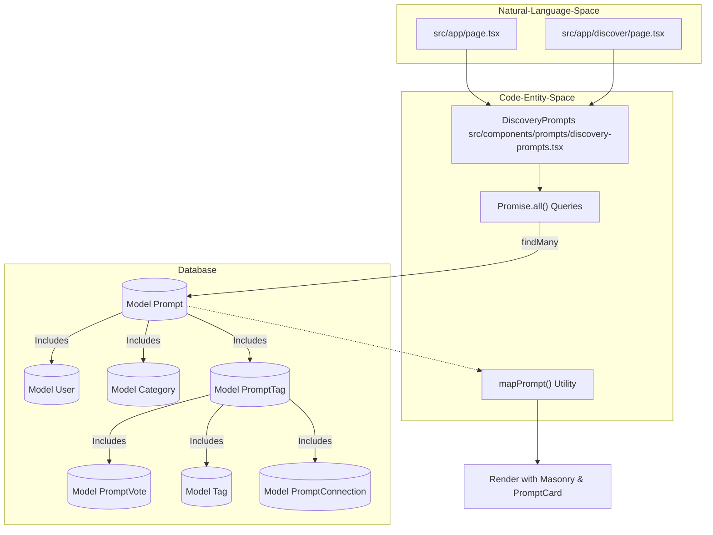
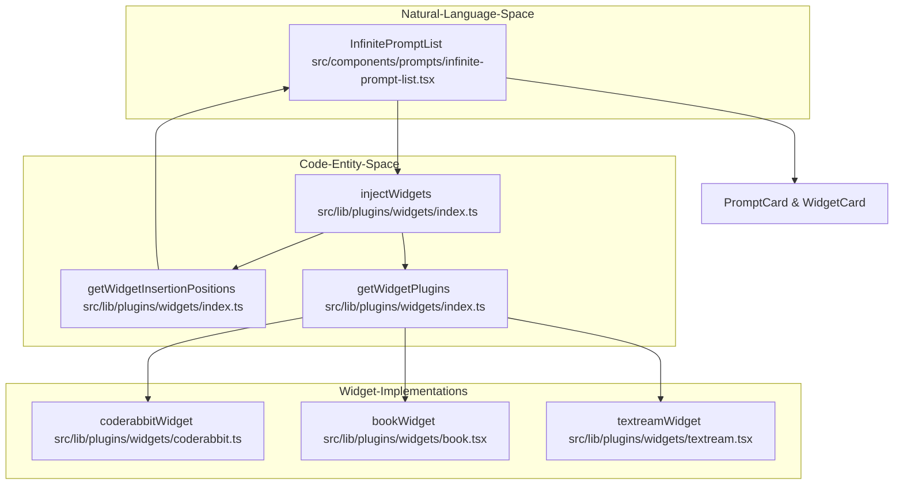

<!-- source: DeepWiki mcp.deepwiki.com · repo f/prompts.chat · page 6.4 Curated Discovery · fetched 2026-11-09 -->

# Curated Discovery

Relevant source files

The following files were used as context for generating this wiki page:

- [src/app/[username]/page.tsx](src/app/[username]/page.tsx)
- [src/app/api/leaderboard/route.ts](src/app/api/leaderboard/route.ts)
- [src/app/api/prompts/[id]/route.ts](src/app/api/prompts/[id]/route.ts)
- [src/app/api/prompts/route.ts](src/app/api/prompts/route.ts)
- [src/app/categories/[slug]/page.tsx](src/app/categories/[slug]/page.tsx)
- [src/app/collection/page.tsx](src/app/collection/page.tsx)
- [src/app/feed/page.tsx](src/app/feed/page.tsx)
- [src/app/prompts/[id]/page.tsx](src/app/prompts/[id]/page.tsx)
- [src/app/skills/page.tsx](src/app/skills/page.tsx)
- [src/app/tags/[slug]/page.tsx](src/app/tags/[slug]/page.tsx)
- [src/components/prompts/discovery-prompts.tsx](src/components/prompts/discovery-prompts.tsx)
- [src/components/prompts/infinite-prompt-list.tsx](src/components/prompts/infinite-prompt-list.tsx)
- [src/components/prompts/prompt-list.tsx](src/components/prompts/prompt-list.tsx)
- [src/components/prompts/widget-card.tsx](src/components/prompts/widget-card.tsx)
- [src/lib/plugins/widgets/book.tsx](src/lib/plugins/widgets/book.tsx)
- [src/lib/plugins/widgets/coderabbit.ts](src/lib/plugins/widgets/coderabbit.ts)
- [src/lib/plugins/widgets/index.ts](src/lib/plugins/widgets/index.ts)
- [src/lib/plugins/widgets/textream.tsx](src/lib/plugins/widgets/textream.tsx)
- [src/lib/plugins/widgets/types.ts](src/lib/plugins/widgets/types.ts)

This wiki page covers the technical implementation of curated content discovery within prompts.chat. The system leverages editor curation, community voting signals, content velocity, collaborative activity, and extensible widget plugins to surface high-quality prompts without requiring manual search.

## Overview

Curated discovery is primarily driven by the `DiscoveryPrompts` component [src/components/prompts/discovery-prompts.tsx:16-150](). This component aggregates multiple distinct prompt lists into a unified browsing experience optimized for the homepage and the dedicated discovery page. It combines editorial curation (featured prompts), social signals (voting), recent activity, and collaborative metrics to showcase quality content.

Additionally, dynamic **widget cards** are programmatically injected into prompt lists via the widget plugin system, enabling sponsor and promotional placements that respond to browsing filters and context [src/lib/plugins/widgets/index.ts:121-182]().

Sources:
- `src/components/prompts/discovery-prompts.tsx:16-150`
- `src/lib/plugins/widgets/index.ts:121-182`

---

## DiscoveryPrompts Component

The `DiscoveryPrompts` component [src/components/prompts/discovery-prompts.tsx:16-150]() is an asynchronous React Server Component responsible for fetching curated prompt collections for discovery views.

### Implementation Details

- The component accepts a boolean prop `isHomepage` to control the number of items per list (9 for homepage, 15 otherwise) [src/components/prompts/discovery-prompts.tsx:13-21]().
- It defines a consistent Prisma `include` object, `promptInclude`, specifying relations and selects necessary for rendering `PromptCard` components [src/components/prompts/discovery-prompts.tsx:23-48]():
  - Author info with selected fields (`id`, `name`, `username`, `avatar`, `verified`) [src/components/prompts/discovery-prompts.tsx:24-26]().
  - Category with its optional parent [src/components/prompts/discovery-prompts.tsx:27-33]().
  - Tags via join table with `tag` details [src/components/prompts/discovery-prompts.tsx:34-36]().
  - Contributors list (users who contributed) [src/components/prompts/discovery-prompts.tsx:37-39]().
  - Aggregate counts of votes, contributors, and workflow connections, excluding AI "related" links [src/components/prompts/discovery-prompts.tsx:40-47]().

- Six parallel Prisma queries using `Promise.all` fetch distinct prompt collections representing curated categories [src/components/prompts/discovery-prompts.tsx:54-135]():
  1. **Trending Prompts** (Homepage only): Filtered via `trendingPromptListWhere()`, ordered by `trendingUntil` and `createdAt` [src/components/prompts/discovery-prompts.tsx:55-62]().
  2. **Featured Prompts**: `isFeatured: true` with descending `featuredAt` date [src/components/prompts/discovery-prompts.tsx:63-74]().
  3. **Today's Most Upvoted**: Prompts with votes recorded since today's midnight, ranked by total vote count [src/components/prompts/discovery-prompts.tsx:75-97]().
  4. **Latest Prompts**: Newly created prompts, ordered by creation date descending [src/components/prompts/discovery-prompts.tsx:98-108]().
  5. **Recently Updated**: Prompts ordered by last update timestamp descending [src/components/prompts/discovery-prompts.tsx:109-119]().
  6. **Most Contributed**: Prompts ordered by descending count of contributors [src/components/prompts/discovery-prompts.tsx:120-134]().

- Each query applies global visibility filters ensuring prompts are public (`isPrivate: false`), listed (`isUnlisted: false`), non-deleted (`deletedAt: null`), and non-bot (`...NON_BOT_PROMPTS`) [src/components/prompts/discovery-prompts.tsx:64-69, 77-82, 99-104, 110-115, 121-126]().

- A helper function `mapPrompt` maps each raw prompt result to add vote and contributor counts explicitly to the returned object along with contributors details [src/components/prompts/discovery-prompts.tsx:137-142]().

- In the JSX output, each section is conditionally rendered based on the presence of results. Each renders a section header with appropriate Lucide icons and an action button linking to the full catalog, followed by a Masonry grid layout displaying all prompt cards in that section [src/components/prompts/discovery-prompts.tsx:151-205]().

Sources:
- `src/components/prompts/discovery-prompts.tsx:13-205`

---

## System Architecture

### Discovery Data Flow

The following diagram illustrates how entry-point pages leverage the `DiscoveryPrompts` component, Database models (`Prompt`, `PromptVote`, `User`, `Category`, `Tag`, `PromptTag`, `PromptConnection`), and helper utilities to render curated prompt lists.

Sources:
- `src/components/prompts/discovery-prompts.tsx:16-150`
- `src/app/feed/page.tsx`

---

## Ranking & Velocity Logic

### Daily Ranking of Most Upvoted Prompts

- The code computes today's date at midnight in local time for filtering votes occurring today [src/components/prompts/discovery-prompts.tsx:51-52]().
- The Prisma query restricts votes to those created on or after this timestamp to isolate today's voting activity [src/components/prompts/discovery-prompts.tsx:82-88]().
- Results are ordered by the count of today's votes descending to surface trending prompts dynamically each day [src/components/prompts/discovery-prompts.tsx:90-94]().

### Content Velocity

- **Latest Prompts** are selected by sorting on the creation timestamp descending to show newly contributed content [src/components/prompts/discovery-prompts.tsx:105]().
- **Recently Updated** prompts use the updated timestamp field, reflecting prompt edits or changes to keep content fresh [src/components/prompts/discovery-prompts.tsx:116]().
- Sorting by these timestamps provides a time-sensitive freshness metric for discovery.

### Collaborative Discovery

- The **Most Contributed** list ranks prompts by the number of distinct contributors participating in their editing or updating [src/components/prompts/discovery-prompts.tsx:127-131]().
- This encourages transparency and highlights heavily community-maintained prompts.
- The contributors count is accessed through a relation count aggregation in Prisma.

Sources:
- `src/components/prompts/discovery-prompts.tsx:51-134`

---

## Widget Cards & Injected Discovery

Beyond curated prompt lists, the system supports **widget cards** for promotional or sponsored content insertion within prompt browsing lists using a widget plugin architecture.

### Widget Plugin System Overview

- Widgets are encapsulated as implementations of the `WidgetPlugin` and `WidgetPrompt` interfaces [src/lib/plugins/widgets/index.ts:1-8]().
- The registry `widgetPlugins` maintains all active widget plugins [src/lib/plugins/widgets/index.ts:18-24]().
- Widget prompts define metadata, rendering components, action links, tags, categories, and importantly, **injection rules**:
  - `shouldInject(context)` is a callback function evaluating if the widget should be included based on filtering context (search query, category, tags, etc.) [src/lib/plugins/widgets/textream.tsx:122-148]().
  - `positioning` configures where and how often the widget should be injected: either "once" at a position or repeating every N items with a maximum count [src/lib/plugins/widgets/book.tsx:157-162](), [src/lib/plugins/widgets/index.ts:72-103]().

### Injection Pipeline (`injectWidgets`)

- The core function `injectWidgets(items, context)` injects widget prompts into a list of items based on filter context and positioning logic [src/lib/plugins/widgets/index.ts:121-182]().
- Injection algorithm:
  1. Fetch all widget prompts from the registry via `getWidgetPrompts()` [src/lib/plugins/widgets/index.ts:36-38]().
  2. Filter widgets by running `shouldInject` with the current search/category/tag context [src/lib/plugins/widgets/index.ts:140-146]().
  3. Calculate insertion positions using `getWidgetInsertionPositions` based on the widget's positioning mode [src/lib/plugins/widgets/index.ts:72-103]():
     - `"once"`: Inserted at a single defined position [src/lib/plugins/widgets/index.ts:81-84]().
     - `"repeat"`: Inserted repeatedly every N items up to a max count [src/lib/plugins/widgets/index.ts:86-100]().
  4. Sort insertions by position and splice them into the original items array, marking injected widgets with `isWidget: true` and `instanceIndex` for identification [src/lib/plugins/widgets/index.ts:153-178]().
- This process enables non-intrusive, context-aware promotional content interspersed with prompt results.

### Widget Plugin Examples

- **Book Widget**: Promotes the "Interactive Book of Prompting," repeating every 60 items, max 4 times, excluded from skills/tastes pages [src/lib/plugins/widgets/book.tsx:142-173]().
- **Textream Widget**: Highlights the Textream macOS teleprompter app, repeats every 45 items, max 3 times, filtered by relevant keywords and categories [src/lib/plugins/widgets/textream.tsx:101-152]().

### Widget Injection Architecture

The following diagram illustrates how the `InfinitePromptList` component interfaces with `injectWidgets`, widget plugin registry functions, and widget implementations.

Sources:
- `src/lib/plugins/widgets/index.ts:1-182`
- `src/lib/plugins/widgets/book.tsx:142-173`
- `src/lib/plugins/widgets/textream.tsx:101-152`
- `src/components/prompts/infinite-prompt-list.tsx:51-200`

---

## Integration with Infinite Prompt List

The `InfinitePromptList` client component [src/components/prompts/infinite-prompt-list.tsx:51-200]() is responsible for client-side infinite scrolling of prompt lists with filtering support. It integrates the widget injection system by passing loaded prompts along with current filter criteria to `injectWidgets()` for display.

- Widgets decide their injection dynamically, ensuring non-conflicting and contextually relevant promo placements.
- Injection only occurs after client-side mount to avoid hydration mismatches [src/components/prompts/infinite-prompt-list.tsx:68-71]().
- The resulting mixed list consists of normal prompt cards and widget cards.

Sources:
- `src/components/prompts/infinite-prompt-list.tsx:51-200`

---

## Summary

- `DiscoveryPrompts` is the core server-side component rendering key sections of curated prompts using Prisma queries with consistent relations and filters.
- Daily voting counts enable fresh trending rankings, while creation and update timestamps provide content velocity signals.
- Contributor counts highlight collaborative community contributions.
- Widget plugins extend discovery with flexible promotional cards, conditionally injected based on browsing context and positioning rules.
- Client-side infinite scrolling integrates widget injection for a seamless mixed browsing experience.

This architecture ensures rich, dynamic, socially-informed prompt discovery combined with extensible promotional capabilities.

---

### Sources

- `src/components/prompts/discovery-prompts.tsx:13-205`
- `src/lib/plugins/widgets/index.ts:1-182`
- `src/lib/plugins/widgets/book.tsx:142-173`
- `src/lib/plugins/widgets/textream.tsx:101-152`
- `src/components/prompts/infinite-prompt-list.tsx:51-200`
- `src/app/feed/page.tsx`

---

