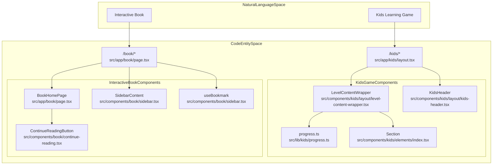
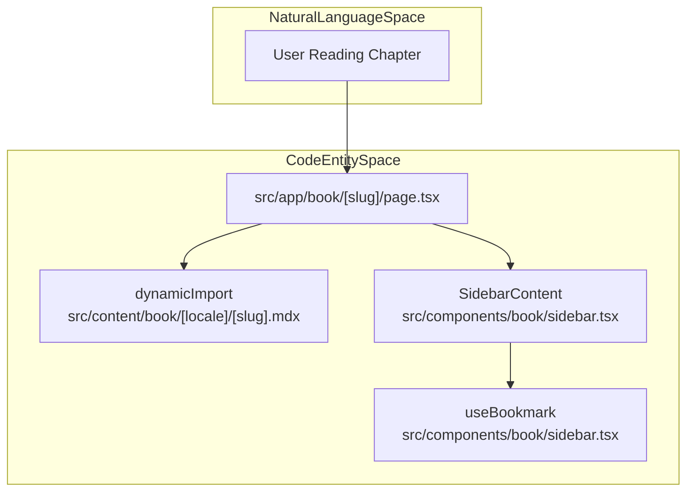

<!-- source: DeepWiki mcp.deepwiki.com · repo f/prompts.chat · page 7 Educational Content · fetched 2026-11-09 -->

# Educational Content

Relevant source files

The following files were used as context for generating this wiki page:

- [src/app/book/[slug]/page.tsx](src/app/book/[slug]/page.tsx)
- [src/app/book/page.tsx](src/app/book/page.tsx)
- [src/components/book/sidebar.tsx](src/components/book/sidebar.tsx)
- [src/content/book/00b-history.mdx](src/content/book/00b-history.mdx)
- [src/content/book/00c-introduction.mdx](src/content/book/00c-introduction.mdx)
- [src/content/book/01-understanding-ai-models.mdx](src/content/book/01-understanding-ai-models.mdx)
- [src/content/book/09-json-yaml-prompting.mdx](src/content/book/09-json-yaml-prompting.mdx)
- [src/content/book/tr/00b-history.mdx](src/content/book/tr/00b-history.mdx)
- [src/content/book/tr/00c-introduction.mdx](src/content/book/tr/00c-introduction.mdx)

The Educational Content system comprises learning-focused features designed to teach users how to effectively write and use AI prompts. This section acts as a parent page for three distinct learning paths: a gamified kids learning game, an interactive book for comprehensive prompt engineering, and in-app prompt writing guides. These features are separate from the core prompt library functionality and provide structured educational experiences for users of all ages.

For detailed information about specific learning features, refer to the child pages:
- [Kids Learning Game](#7.1) — Gamified world-map structure with worlds, levels, and interactive mini-games.
- [Interactive Book](#7.2) — Comprehensive multi-chapter guide with MDX pipeline, interactive demos, translations, and bookmarking.
- [Prompt Writing Guide](#7.3) — In-app guides for writing effective prompts using frameworks like C.R.A.F.T.

---

## Educational Content Architecture

The educational content system is built as a modular vertical feature within the application, utilizing specialized components, localized namespaces, and dedicated routing structures (`/kids/*` and `/book/*`).

### Diagram: Natural Language Space to Code Entity Space (Educational Features)

Sources: [src/app/book/page.tsx:115-137](), [src/components/book/sidebar.tsx:42-72](), [src/components/kids/layout/level-content-wrapper.tsx:13-30](), [src/components/kids/layout/kids-header.tsx:45-53]()

---

## Interactive Book Execution and Pipeline

### Diagram: Interactive Book Rendering and Pipeline Architecture

Sources: [src/app/book/[slug]/page.tsx:89-168](), [src/components/book/sidebar.tsx:42-65](), [src/components/book/sidebar.tsx:67-189]()

---

## 7.1 Kids Learning Game

The kids section provides a gamified environment where younger learners explore prompt concepts through a world-map structure, earning stars and completing interactive mini-games like quizzes, drag-and-drop puzzles, magic words, and word predictors. This component model leverages wrapped level content with progress state and interactive elements to keep engagement high.

For details, see [Kids Learning Game](#7.1).

Sources: [src/components/kids/layout/level-content-wrapper.tsx:13-30](), [src/components/kids/layout/kids-header.tsx:45-53]()

---

## 7.2 Interactive Book

The interactive book serves as a deeply structured educational guide to prompt engineering, with content organized into chapters and parts, authored using MDX files [src/content/book/00c-introduction.mdx:1-125](), [src/content/book/01-understanding-ai-models.mdx:1-110](). The MDX pipeline in `src/app/book/[slug]/page.tsx` allows for rich interactive demos, exercises, and continue-reading features embedded throughout [src/app/book/page.tsx:115-205](), [src/app/book/[slug]/page.tsx:147-168](). Multi-language translations are supported via locale-specific overrides and translation dictionaries.

A client-side bookmarking system tracks reading progress using `localStorage` through the `useBookmark` hook [src/components/book/sidebar.tsx:42-65](), enabling users to easily resume where they left off [src/app/book/page.tsx:137-137](). The sidebar navigation component `SidebarContent` dynamically filters chapters and parts, including search capabilities and bookmark toggling [src/components/book/sidebar.tsx:67-189]().

For details, see [Interactive Book](#7.2).

Sources: [src/app/book/page.tsx:115-205](), [src/app/book/[slug]/page.tsx:89-168](), [src/components/book/sidebar.tsx:42-189](), [src/content/book/00c-introduction.mdx:1-125]()

---

## 7.3 Prompt Writing Guide

Within the application, dedicated prompt writing guides offer step-by-step instructions and frameworks such as C.R.A.F.T. These in-app resources present best practices for crafting effective prompts, covering clarity, relevance, audience consideration, formatting, and testing strategies.

The guides include presentation slide decks and prompt templates that users can apply directly in their workflows, helping bridge theory and practice efficiently.

For details, see [Prompt Writing Guide](#7.3).

Sources: [src/app/book/page.tsx:119-126]()

---

