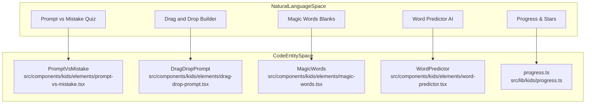
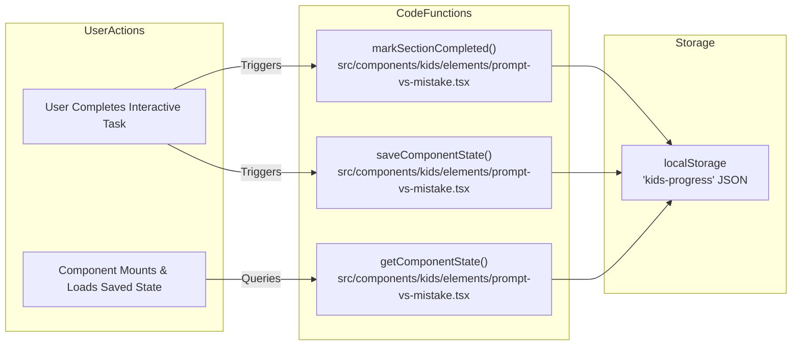

<!-- source: DeepWiki mcp.deepwiki.com · repo f/prompts.chat · page 7.1 Kids Learning Game · fetched 2026-11-09 -->

# Kids Learning Game

Relevant source files

The following files were used as context for generating this wiki page:

- [public/book-cover-photo.jpg](public/book-cover-photo.jpg)
- [public/book-cover.jpg](public/book-cover.jpg)
- [src/app/globals.css](src/app/globals.css)
- [src/components/kids/elements/drag-drop-prompt.tsx](src/components/kids/elements/drag-drop-prompt.tsx)
- [src/components/kids/elements/example-matcher.tsx](src/components/kids/elements/example-matcher.tsx)
- [src/components/kids/elements/magic-words.tsx](src/components/kids/elements/magic-words.tsx)
- [src/components/kids/elements/pixel-art.tsx](src/components/kids/elements/pixel-art.tsx)
- [src/components/kids/elements/progress-map.tsx](src/components/kids/elements/progress-map.tsx)
- [src/components/kids/elements/prompt-vs-mistake.tsx](src/components/kids/elements/prompt-vs-mistake.tsx)
- [src/components/kids/elements/story-scene.tsx](src/components/kids/elements/story-scene.tsx)
- [src/components/kids/elements/word-predictor.tsx](src/components/kids/elements/word-predictor.tsx)
- [src/components/kids/layout/kids-header.tsx](src/components/kids/layout/kids-header.tsx)
- [src/components/kids/layout/kids-home-content.tsx](src/components/kids/layout/kids-home-content.tsx)
- [src/components/kids/layout/level-content-wrapper.tsx](src/components/kids/layout/level-content-wrapper.tsx)
- [src/components/kids/layout/settings-modal.tsx](src/components/kids/layout/settings-modal.tsx)
- [src/components/layout/animated-text.tsx](src/components/layout/animated-text.tsx)
- [src/components/prompts/hero-categories.tsx](src/components/prompts/hero-categories.tsx)

## Purpose and Scope

This document details the architecture and implementation of the Kids Learning Game subsystem within `prompts.chat`. It is a pixel-art themed educational platform designed to teach children and beginners the core concepts of AI prompt engineering through gamified worlds, levels, and interactive exercises. The system comprises multiple worlds containing total levels [src/components/kids/layout/kids-header.tsx:19-24](), a star collection mechanism, multilingual support [src/components/kids/layout/kids-header.tsx:14](), and robust local state persistence [src/components/kids/elements/prompt-vs-mistake.tsx:56-65]().

Sources: [src/components/kids/layout/kids-header.tsx:19-24](), [src/components/kids/elements/prompt-vs-mistake.tsx:56-65]()

---

## System Overview & Architecture

The Kids Learning Game runs as a modular section under the `/kids/*` route space. It leverages Next.js App Router layout patterns, client-side React hooks, and `localStorage` to deliver a responsive, zero-backend persistence gaming experience.

### Architecture Bridge: Concepts to Code Entities

The following diagram bridges high-level game concepts (Natural Language Space) to their concrete implementation classes, files, and functions within the codebase (Code Entity Space).

Title: "Natural Language Space to Code Entity Space Mapping"

Sources: [src/components/kids/elements/prompt-vs-mistake.tsx:24-101](), [src/components/kids/elements/drag-drop-prompt.tsx:24-153](), [src/components/kids/elements/magic-words.tsx:31-180](), [src/components/kids/elements/word-predictor.tsx:25-97]()

---

## Component Architecture & Level Execution

The level runtime is managed by the `LevelContentWrapper` component, which wraps level MDX content, coordinates section progression, and validates interactive requirements [src/components/kids/layout/level-content-wrapper.tsx:19-165]().

### Section Navigation and Completion Guards
- **Section Extraction**: MDX children are parsed into discrete `Section` blocks [src/components/kids/layout/level-content-wrapper.tsx:79-103]().
- **Gated Progression**: Users cannot advance via the footer "Next" button unless `isCurrentSectionComplete` returns `true`, verifying that interactive elements within the section have been successfully completed [src/components/kids/layout/level-content-wrapper.tsx:124-143]().
- **Polling Sync**: `LevelContentWrapper` periodically queries storage status every 500ms to ensure reactive updates when components trigger completion handlers [src/components/kids/layout/level-content-wrapper.tsx:38-51]().

### Interactive Game Elements

| Game Type         | Component File                                              | Core Mechanism                                                                                          |
|-------------------|-------------------------------------------------------------|-------------------------------------------------------------------------------------------------------|
| **Prompt vs Mistake** | [src/components/kids/elements/prompt-vs-mistake.tsx]()      | Binary choice evaluating structured "good" vs "bad" prompt options with immediate feedback [src/components/kids/elements/prompt-vs-mistake.tsx:78-86](). |
| **Drag & Drop**       | [src/components/kids/elements/drag-drop-prompt.tsx]()       | Pointer and touch-driven reordering of sequence tokens with drag offsets and drop target calculations [src/components/kids/elements/drag-drop-prompt.tsx:101-115](). |
| **Magic Words**       | [src/components/kids/elements/magic-words.tsx]()             | Word bank token placement into sentence blank slots (`_` or `{{}}`) with drag/drop and click interaction [src/components/kids/elements/magic-words.tsx:118-165](). |
| **Word Predictor**    | [src/components/kids/elements/word-predictor.tsx]()          | Multiple-choice evaluation simulating AI token generation based on surrounding sentence context [src/components/kids/elements/word-predictor.tsx:79-92](). |

All these components register their interactive sections to the level navigation context and persist per-level progress using component-scoped identifiers, leveraging hooks for synchronized `localStorage` state save/load [src/components/kids/elements/prompt-vs-mistake.tsx:56-76]().

Sources: [src/components/kids/layout/level-content-wrapper.tsx:19-165](), [src/components/kids/elements/prompt-vs-mistake.tsx:24-101](), [src/components/kids/elements/drag-drop-prompt.tsx:24-153](), [src/components/kids/elements/magic-words.tsx:31-180](), [src/components/kids/elements/word-predictor.tsx:25-97]()

---

## Data Flow & Persistent Progress Tracking

Progress persistence is handled entirely on the client side, using wrapper functions around `localStorage`. Interactive elements save and load their state keyed by level slug and component ID, enabling state restoration on page reloads. Completion marking triggers unlocking of next sections or levels in the game world.

### Persistence Data Flow Bridge

Title: "Persistence Data Flow to Storage Space"

### Key Persistence Functions

- `markSectionCompleted(levelSlug: string, sectionIndex: number)`: Marks a particular section of a level as completed, updating progress and star counts [src/components/kids/elements/prompt-vs-mistake.tsx:83-83]().
- `saveComponentState<T>(levelSlug: string, componentId: string, state: T)`: Saves component-specific UI and interaction state for continuity [src/components/kids/elements/prompt-vs-mistake.tsx:71-75]().
- `getComponentState<T>(levelSlug: string, componentId: string)`: Retrieves previously saved component state [src/components/kids/elements/prompt-vs-mistake.tsx:56-56]().

Sources: [src/components/kids/elements/prompt-vs-mistake.tsx:56-86](), [src/components/kids/elements/drag-drop-prompt.tsx:75-98](), [src/components/kids/elements/magic-words.tsx:80-102]()

---

## Visual System, Pixel Art & Theming

The Kids Learning Game uses a retro pixel art style with consistent UI theming:

- **Clip Paths**: Sections use `clip-path` CSS polygons with stepped edges to mimic pixel panel borders, e.g., `pixelClipPath`, `smallPixelClipPath` for framing interactive cards [src/components/kids/elements/prompt-vs-mistake.tsx:104-105]().
- **SVG Pixel Art**: Components such as `PixelRobot`, `PixelStar`, `PixelTree`, and `PixelCastle` are SVGs with `imageRendering: pixelated` for crisp pixel effects [src/components/kids/layout/kids-header.tsx:48-53](), [src/components/kids/elements/pixel-art.tsx:6-26]().
- **Mascot**: The character "Promi" (`PixelRobot`) changes expression moods dynamically based on context [src/components/kids/elements/prompt-vs-mistake.tsx:112]().
- **Settings Modal**: Allows language selection, background music toggle, and progress reset [src/components/kids/layout/settings-modal.tsx:57-91]().

This visual system enhances appeal for kids while maintaining clear and consistent UI affordances for interactivity.

Sources: [src/components/kids/elements/prompt-vs-mistake.tsx:104-105](), [src/components/kids/layout/kids-header.tsx:48-53](), [src/components/kids/elements/pixel-art.tsx:6-26](), [src/components/kids/layout/settings-modal.tsx:57-91]()

---

## Content Structure & MDX Pipeline

The educational content is authored as MDX files localized per language and organized into thematic worlds and levels:

- **World 1**: Introduction to AI and Promi [src/components/kids/layout/kids-header.tsx:19-24]()
- **World 2**: Clarity and Detail
- **World 3**: Context and Formatting
- **World 4**: Roleplay and Creativity
- **World 5**: Advanced Techniques and Graduation

Each level is an MDX document with a filename pattern indicating world and level numbers. The MDX content includes embedded React components for interactive games described above, enabling seamless integration of lessons and exercises.

Sources: [src/components/kids/layout/kids-header.tsx:19-24](), [src/components/kids/layout/level-content-wrapper.tsx:19-103]()

---

## Worlds, Levels & Star Collection Model

### Worlds and Levels

- The game content is split into separate **worlds**, each representing a theme or curriculum module.
- Each world contains multiple **levels**.
- Levels are identified by slugs in the format `w-l` representing world and level number [src/components/kids/layout/kids-header.tsx:24]().
- `LevelContentWrapper` manages progression through sections within each level based on completion status [src/components/kids/layout/level-content-wrapper.tsx:19-176]().

### Star Collection System

- Players earn stars by completing levels or sections correctly.
- Stars are counted globally, aggregated from all completed levels [src/components/kids/layout/kids-header.tsx:27]().
- The header component `KidsHeader` displays total stars and completed levels count, dynamically fetched from local progress stores, giving user progression feedback [src/components/kids/layout/kids-header.tsx:13-30]().

This progression incentivizes exploration and learning with visible rewards and unlocks.

Sources: [src/components/kids/layout/kids-header.tsx:13-30](), [src/components/kids/layout/level-content-wrapper.tsx:19-176]()

---

## Summary

The Kids Learning Game is a fully client-side, gamified educational environment implemented in React and Next.js featuring a gamified world-map structure, localized MDX level content, multiple interactive game modes (quiz, drag-drop, magic words, word predictors), persistent star tracking via local storage, and retro pixel-art UI components.

Sources: [src/components/kids/layout/kids-header.tsx](), [src/components/kids/layout/level-content-wrapper.tsx](), [src/components/kids/elements/prompt-vs-mistake.tsx](), [src/components/kids/elements/drag-drop-prompt.tsx](), [src/components/kids/elements/magic-words.tsx](), [src/components/kids/elements/word-predictor.tsx]()

---

