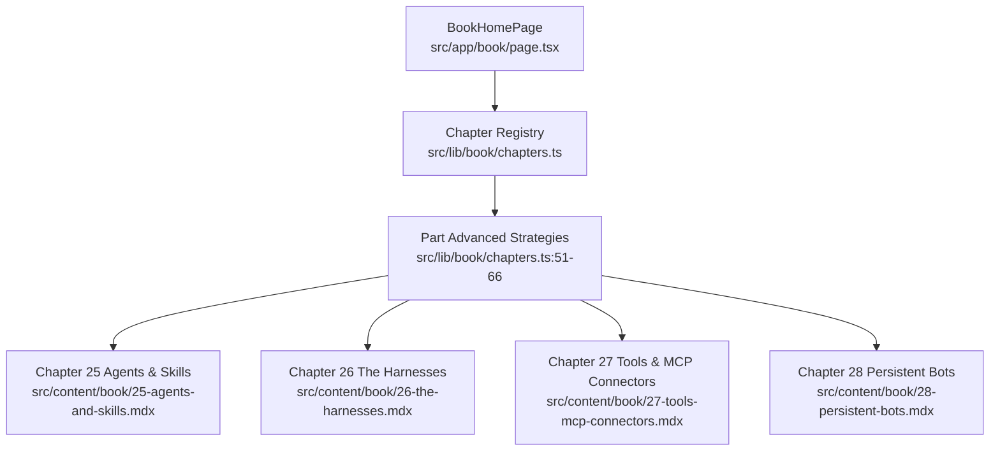
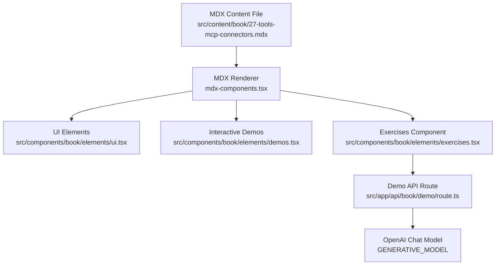
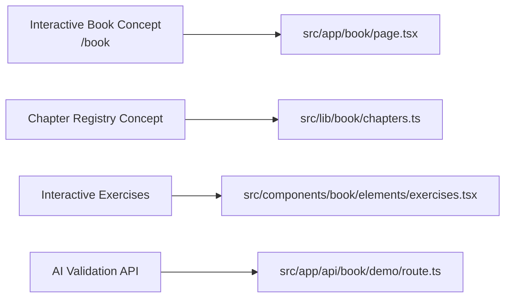

<!-- source: DeepWiki mcp.deepwiki.com · repo f/prompts.chat · page 7.2 Interactive Book · fetched 2026-11-09 -->

# Interactive Book

Relevant source files

The following files were used as context for generating this wiki page:

- [mdx-components.tsx](mdx-components.tsx)
- [src/app/api/book/demo/route.ts](src/app/api/book/demo/route.ts)
- [src/app/book/[slug]/page.tsx](src/app/book/[slug]/page.tsx)
- [src/app/book/page.tsx](src/app/book/page.tsx)
- [src/components/book/elements/builder.tsx](src/components/book/elements/builder.tsx)
- [src/components/book/elements/challenge.tsx](src/components/book/elements/challenge.tsx)
- [src/components/book/elements/exercises.tsx](src/components/book/elements/exercises.tsx)
- [src/components/book/elements/index.ts](src/components/book/elements/index.ts)
- [src/components/book/elements/ui.tsx](src/components/book/elements/ui.tsx)
- [src/components/book/interactive.tsx](src/components/book/interactive.tsx)
- [src/components/book/sidebar.tsx](src/components/book/sidebar.tsx)
- [src/content/book/00a-preface.mdx](src/content/book/00a-preface.mdx)
- [src/content/book/00b-history.mdx](src/content/book/00b-history.mdx)
- [src/content/book/00c-introduction.mdx](src/content/book/00c-introduction.mdx)
- [src/content/book/01-understanding-ai-models.mdx](src/content/book/01-understanding-ai-models.mdx)
- [src/content/book/02-anatomy-of-effective-prompt.mdx](src/content/book/02-anatomy-of-effective-prompt.mdx)
- [src/content/book/03-core-prompting-principles.mdx](src/content/book/03-core-prompting-principles.mdx)
- [src/content/book/05-structured-output.mdx](src/content/book/05-structured-output.mdx)
- [src/content/book/08-iterative-refinement.mdx](src/content/book/08-iterative-refinement.mdx)
- [src/content/book/09-json-yaml-prompting.mdx](src/content/book/09-json-yaml-prompting.mdx)
- [src/content/book/15-common-pitfalls.mdx](src/content/book/15-common-pitfalls.mdx)
- [src/content/book/24-future-of-prompting.mdx](src/content/book/24-future-of-prompting.mdx)
- [src/content/book/25-agents-and-skills.mdx](src/content/book/25-agents-and-skills.mdx)
- [src/content/book/26-the-harnesses.mdx](src/content/book/26-the-harnesses.mdx)
- [src/content/book/27-tools-mcp-connectors.mdx](src/content/book/27-tools-mcp-connectors.mdx)
- [src/content/book/28-persistent-bots.mdx](src/content/book/28-persistent-bots.mdx)
- [src/content/book/ar/26-the-harnesses.mdx](src/content/book/ar/26-the-harnesses.mdx)
- [src/content/book/ar/27-tools-mcp-connectors.mdx](src/content/book/ar/27-tools-mcp-connectors.mdx)
- [src/content/book/ar/28-persistent-bots.mdx](src/content/book/ar/28-persistent-bots.mdx)
- [src/content/book/az/00a-preface.mdx](src/content/book/az/00a-preface.mdx)
- [src/content/book/az/25-agents-and-skills.mdx](src/content/book/az/25-agents-and-skills.mdx)
- [src/content/book/az/26-the-harnesses.mdx](src/content/book/az/26-the-harnesses.mdx)
- [src/content/book/az/27-tools-mcp-connectors.mdx](src/content/book/az/27-tools-mcp-connectors.mdx)
- [src/content/book/az/28-persistent-bots.mdx](src/content/book/az/28-persistent-bots.mdx)
- [src/content/book/de/00a-preface.mdx](src/content/book/de/00a-preface.mdx)
- [src/content/book/de/25-agents-and-skills.mdx](src/content/book/de/25-agents-and-skills.mdx)
- [src/content/book/de/26-the-harnesses.mdx](src/content/book/de/26-the-harnesses.mdx)
- [src/content/book/de/27-tools-mcp-connectors.mdx](src/content/book/de/27-tools-mcp-connectors.mdx)
- [src/content/book/de/28-persistent-bots.mdx](src/content/book/de/28-persistent-bots.mdx)
- [src/content/book/el/00a-preface.mdx](src/content/book/el/00a-preface.mdx)
- [src/content/book/el/26-the-harnesses.mdx](src/content/book/el/26-the-harnesses.mdx)
- [src/content/book/el/27-tools-mcp-connectors.mdx](src/content/book/el/27-tools-mcp-connectors.mdx)
- [src/content/book/el/28-persistent-bots.mdx](src/content/book/el/28-persistent-bots.mdx)
- [src/content/book/es/00a-preface.mdx](src/content/book/es/00a-preface.mdx)
- [src/content/book/es/25-agents-and-skills.mdx](src/content/book/es/25-agents-and-skills.mdx)
- [src/content/book/es/26-the-harnesses.mdx](src/content/book/es/26-the-harnesses.mdx)
- [src/content/book/es/27-tools-mcp-connectors.mdx](src/content/book/es/27-tools-mcp-connectors.mdx)
- [src/content/book/es/28-persistent-bots.mdx](src/content/book/es/28-persistent-bots.mdx)
- [src/content/book/fa/00a-preface.mdx](src/content/book/fa/00a-preface.mdx)
- [src/content/book/fa/26-the-harnesses.mdx](src/content/book/fa/26-the-harnesses.mdx)
- [src/content/book/fa/27-tools-mcp-connectors.mdx](src/content/book/fa/27-tools-mcp-connectors.mdx)
- [src/content/book/fa/28-persistent-bots.mdx](src/content/book/fa/28-persistent-bots.mdx)
- [src/content/book/fr/00a-preface.mdx](src/content/book/fr/00a-preface.mdx)
- [src/content/book/fr/26-the-harnesses.mdx](src/content/book/fr/26-the-harnesses.mdx)
- [src/content/book/fr/27-tools-mcp-connectors.mdx](src/content/book/fr/27-tools-mcp-connectors.mdx)
- [src/content/book/fr/28-persistent-bots.mdx](src/content/book/fr/28-persistent-bots.mdx)
- [src/content/book/he/00a-preface.mdx](src/content/book/he/00a-preface.mdx)
- [src/content/book/he/26-the-harnesses.mdx](src/content/book/he/26-the-harnesses.mdx)
- [src/content/book/he/27-tools-mcp-connectors.mdx](src/content/book/he/27-tools-mcp-connectors.mdx)
- [src/content/book/he/28-persistent-bots.mdx](src/content/book/he/28-persistent-bots.mdx)
- [src/content/book/it/00a-preface.mdx](src/content/book/it/00a-preface.mdx)
- [src/content/book/it/26-the-harnesses.mdx](src/content/book/it/26-the-harnesses.mdx)
- [src/content/book/it/27-tools-mcp-connectors.mdx](src/content/book/it/27-tools-mcp-connectors.mdx)
- [src/content/book/it/28-persistent-bots.mdx](src/content/book/it/28-persistent-bots.mdx)
- [src/content/book/ja/00a-preface.mdx](src/content/book/ja/00a-preface.mdx)
- [src/content/book/ja/26-the-harnesses.mdx](src/content/book/ja/26-the-harnesses.mdx)
- [src/content/book/ja/27-tools-mcp-connectors.mdx](src/content/book/ja/27-tools-mcp-connectors.mdx)
- [src/content/book/ja/28-persistent-bots.mdx](src/content/book/ja/28-persistent-bots.mdx)
- [src/content/book/ko/00a-preface.mdx](src/content/book/ko/00a-preface.mdx)
- [src/content/book/ru/00a-preface.mdx](src/content/book/ru/00a-preface.mdx)
- [src/content/book/tr/00b-history.mdx](src/content/book/tr/00b-history.mdx)
- [src/content/book/tr/00c-introduction.mdx](src/content/book/tr/00c-introduction.mdx)
- [src/content/book/zh/00a-preface.mdx](src/content/book/zh/00a-preface.mdx)
- [src/lib/book/chapters.ts](src/lib/book/chapters.ts)

The Interactive Book is a comprehensive educational feature providing a structured learning path for mastering AI prompt engineering. It organizes over two dozen chapters across several thematic parts—including advanced topics such as *The Harnesses*, *Tools & MCP Connectors*, and *Persistent Bots*—with embedded interactive demos and progress tracking through a client-side bookmark system [src/app/book/page.tsx:1-205](), [src/lib/book/chapters.ts:1-115]().

## Overview

The Interactive Book serves as an in-app learning resource accessible via the `/book` route, implemented in `src/app/book/page.tsx` [src/app/book/page.tsx:115-205](). It presents prompt engineering concepts following a progressive curriculum, allowing users to bookmark chapters, track progress, and interact with live demonstrations of techniques.

The page includes SEO-optimized metadata and JSON-LD structured data enhancing search engine visibility—details are generated in `generateMetadata` function and included in the main React component [src/app/book/page.tsx:16-113]().

Visitors see a cover image, author introduction, highlights of the book's learning goals, and the overall book structure broken into parts and chapters. The book’s textual content is organized and localized via `next-intl` [src/app/book/page.tsx:115-205]().

Sources: [src/app/book/page.tsx:16-205](), [src/lib/book/chapters.ts:1-115]()

## Book Structure and Key Chapters

The book content is structured hierarchically into "Parts" and "Chapters," which are statically defined in `src/lib/book/chapters.ts` as the arrays `parts`, containing `Part` objects with embedded `Chapter[]` arrays [src/lib/book/chapters.ts:17-98]().

### Content Organization Diagram

Sources: [src/lib/book/chapters.ts:17-98](), [src/content/book/27-tools-mcp-connectors.mdx:1-145]()

### Featured Advanced Chapters
- **Tools & MCP Connectors (`27-tools-mcp-connectors.mdx`)**: Details the architectural separation between agent tools, direct APIs, product connectors, and the Model Context Protocol (MCP) standardization layer [src/content/book/27-tools-mcp-connectors.mdx:1-145]().
- **The Harnesses (`26-the-harnesses.mdx`)**: Explores runtime environments, orchestration loops, safety wrappers, and execution harnesses that wrap raw LLM prompts into production-grade agentic systems.
- **Persistent Bots (`28-persistent-bots.mdx`)**: Covers long-running assistant states, state persistence models, routines, and multi-agent coordination teams.

Sources: [src/lib/book/chapters.ts:17-98](), [src/content/book/27-tools-mcp-connectors.mdx:1-145]()

## Navigation and UI Components

- **Sidebar Navigation**: The sidebar component (`SidebarContent` in `src/components/book/sidebar.tsx`) dynamically renders the book’s parts and chapters list [src/components/book/sidebar.tsx:67-188]().
- **Search & Filter**: Search input filters book parts and chapters via caching and `useMemo` that compares query strings against chapter titles, slugs, and descriptions [src/components/book/sidebar.tsx:107-125]().
- **Bookmarking**: Bookmarks persist the last-read chapter slug in `localStorage` under the key `BOOKMARK_KEY` (`book-reading-progress`) [src/components/book/sidebar.tsx:42-65]().
- **MDX Pipeline**: Book content chapters are stored as `.mdx` files rendered using `useMDXComponents` which bundles interactive React components and UI primitives [mdx-components.tsx:8-107]().

Sources: [src/components/book/sidebar.tsx:1-190](), [src/lib/book/chapters.ts:100-115](), [mdx-components.tsx:1-108]()

## MDX Pipeline & Interactive Demos/Exercises

Chapters embed interactive demos and exercises that enrich learning with live AI prompt examples and analysis tools.

### MDX Interactive Components Data Flow

Sources: [mdx-components.tsx:3-107](), [src/components/book/elements/exercises.tsx:86-135](), [src/app/api/book/demo/route.ts:1-179]()

## Natural Language to Code Entity Mapping

To bridge conceptual reading with codebase implementation, the following diagram maps core book entities to their corresponding codebase modules and routes:

Sources: [src/app/book/page.tsx:1-205](), [src/lib/book/chapters.ts:1-115](), [src/components/book/elements/exercises.tsx:1-135](), [src/app/api/book/demo/route.ts:1-179]()

## AI Validation in Exercises

The `FillInTheBlank` interactive component supports semantic answer validation via AI through `/api/book/demo` implemented in `src/app/api/book/demo/route.ts` [src/components/book/elements/exercises.tsx:86-135](), [src/app/api/book/demo/route.ts:1-179](). Rate limiting and request tracking protect against abuse.

Sources: [src/components/book/elements/exercises.tsx:86-135](), [src/app/api/book/demo/route.ts:1-179]()

## Bookmark System and Internationalization

The Interactive Book utilizes `useBookmark()` backed by `localStorage` to save reading continuity [src/components/book/sidebar.tsx:42-63](). Localization is driven by `next-intl` across 17+ locales [src/components/book/sidebar.tsx:22-40](), [src/app/book/page.tsx:8]().

Sources: [src/components/book/sidebar.tsx:22-63](), [src/app/book/page.tsx:8]()

---

