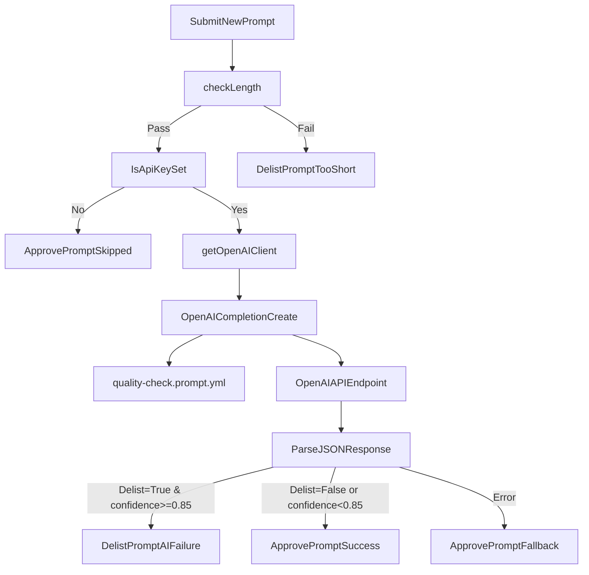

<!-- source: DeepWiki mcp.deepwiki.com · repo f/prompts.chat · page 7.3 Prompt Writing Guide · fetched 2026-11-09 -->

# Prompt Writing Guide

<details>
<summary>Relevant source files</summary>

The following files were used as context for generating this wiki page:

- [src/components/prompts/prompt-builder.tsx](src/components/prompts/prompt-builder.tsx)
- [src/content/book/el/02-anatomy-of-effective-prompt.mdx](src/content/book/el/02-anatomy-of-effective-prompt.mdx)
- [src/content/book/fa/02-anatomy-of-effective-prompt.mdx](src/content/book/fa/02-anatomy-of-effective-prompt.mdx)
- [src/content/book/fa/03-core-prompting-principles.mdx](src/content/book/fa/03-core-prompting-principles.mdx)
- [src/content/book/he/02-anatomy-of-effective-prompt.mdx](src/content/book/he/02-anatomy-of-effective-prompt.mdx)
- [src/content/book/he/03-core-prompting-principles.mdx](src/content/book/he/03-core-prompting-principles.mdx)

</details>


## Purpose and Scope

This guide documents the in-app systems and educational content for writing effective AI prompts on prompts.chat. It covers best practices for prompt design, the C.R.A.F.T. framework, the presentation slide deck used for education, and the implementation of prompt templates, skills, and quality assurance mechanisms. The documentation details the underlying code entities, data flows, and AI-powered features that enable high-quality prompt writing and collaboration.

The platform stores prompts in a dual-sync system between a version-controlled `prompts.csv` and supporting markdown files. Contributor attribution is automated via Git commits with `Co-authored-by` trailers generated by the `scripts/generate-contributors.sh` script. This architecture allows prompts to be programmatically validated and peer-reviewed openly on GitHub.

Sources: [prompts.csv:1-20](), [scripts/generate-contributors.sh:108-114]()

---

## Core Prompting Principles & Presentation Deck

### Overview

Effective prompt engineering within the platform is structured around core principles taught through the **Interactive Book of Prompting** and a dedicated in-app **presentation slide deck**. These resources provide foundational knowledge about the evolving importance of prompts in the agentic AI era, where agents execute instructions autonomously, emphasizing precision and clarity.

The core principles, as outlined in `src/content/book/el/03-core-prompting-principles.mdx`, `src/content/book/he/03-core-prompting-principles.mdx`, and `src/content/book/fa/03-core-prompting-principles.mdx`, include:
1. **Clarity over Cleverness**: Be explicit and avoid ambiguity.
2. **Specificity Yields Quality**: Provide detailed instructions.
3. **Context is King**: Supply all necessary background information.
4. **Guide, Don't Just Ask**: Structure the AI's reasoning process.
5. **Iterate and Refine**: Prompt engineering is an iterative process.

These principles are reinforced with `Compare` and `SpecificitySpectrum` components to illustrate the impact of good prompting practices.

Sources: [src/content/book/el/03-core-prompting-principles.mdx:1-150](), [src/content/book/he/03-core-prompting-principles.mdx:1-176](), [src/content/book/fa/03-core-prompting-principles.mdx:1-165]()

### Presentation Slide Deck Implementation

The interactive slide deck is implemented as a React component set:
- `SlideDeck` manages slide state, keyboard navigation (`ArrowRight`, `ArrowLeft`, `Space`), and transition animations.
- `SlideTitle`, `SlideContent`, and `SlideHighlight` components encapsulate semantic styling of slide text.
- Navigation UI includes next/previous buttons, progress dots, and slide count display.
- The deck supports swipe gestures and accessibility features.

This is implemented in `src/components/presentation/SlideDeck.tsx:1-133`, and rendered by `src/app/presentation/page.tsx:1-139`. The slide content narrates the prompt writing paradigm shift, the agentic need for precise instructions, the rise of Small Language Models (SLMs), structured typed prompts, and community collaboration.

Sources: [src/app/presentation/page.tsx:1-139](), [src/components/presentation/SlideDeck.tsx:1-133]()

---

## Anatomy of an Effective Prompt (C.R.A.F.T.)

The platform promotes the **C.R.A.F.T.** framework for modular prompt writing, representing:

- **Role**: Assigning a persona or expertise to the AI.
- **Context**: Background information or environment setting.
- **Task**: The primary task or instructions.
- **Constraints**: Rules and limitations on output.
- **Format**: Desired output structure (text, JSON, YAML).
- **Examples**: Few-shot input-output pairs.

This framework is detailed in `src/content/book/el/02-anatomy-of-effective-prompt.mdx`, `src/content/book/he/02-anatomy-of-effective-prompt.mdx`, and `src/content/book/fa/02-anatomy-of-effective-prompt.mdx`.

### Components and Mapping

| Component | Purpose | Code Entity / Location |
|---|---|---|
| Role | Defines AI persona or act-as context | `act` field in `prompts.csv` [prompts.csv:2-3]() |
| Context | Background context for prompt | `content` field in `Prompt`, `PromptBuilder.values.context` [src/components/prompts/prompt-builder.tsx:13-25]() |
| Task | Task instructions or prompt body | `prompt` field in CSV, `PromptBuilder.values.content` [prompts.csv:4](), [src/components/prompts/prompt-builder.tsx:13-25]() |
| Constraints | Rules and limitations on output | `PromptBuilder` internal state [src/components/prompts/prompt-builder.tsx:13-25]() |
| Format | Output type (text, structured) | `outputType` field in prompt, `PromptBuilderState.structuredFormat` [src/components/prompts/prompt-builder.tsx:13-25]() |
| Examples | Few-shot input-output pairs | Handled via prompt content structures [src/components/prompts/prompt-builder.tsx:13-25]() |

Sources: [prompts.csv:2-4](), [src/components/prompts/prompt-builder.tsx:13-25](), [src/content/book/el/02-anatomy-of-effective-prompt.mdx:1-195](), [src/content/book/he/02-anatomy-of-effective-prompt.mdx:1-228](), [src/content/book/fa/02-anatomy-of-effective-prompt.mdx:1-211]()

### Constructing Prompt Text

The UI component `PromptBuilder` aggregates these fields into a single prompt string using string concatenation for submission and display, allowing structured prompt editing in the UI.

Sources: [src/components/prompts/prompt-builder.tsx:1-50]()

### Data Flow Diagram: Natural Language C.R.A.F.T. Components to Code Entities to Storage

Title: Natural Language C.R.A.F.T. to Code Entities and Storage

```mermaid
graph TD
  subgraph NaturalLanguageSpace
    Role["Role (\"Act as Persona\")"]
    Context["Context (\"Background\")"]
    Task["Task (\"Task Instructions\")"]
    Constraints["Constraints (\"Rules/Limits\")"]
    Format["Format (\"Desired Output\")"]
    Examples["Examples (\"Few-shot samples\")"]
  end

  subgraph CodeEntitySpace
    PB_Role["PromptBuilderState.title"]
    PB_Context["PromptBuilderState.description"]
    PB_Task["PromptBuilderState.content"]
    PB_Constraints["PromptBuilderState.requiresMediaUpload"]
    PB_Format["PromptBuilderState.structuredFormat"]
    PB_Examples["PromptBuilderState.type"]
  end

  subgraph DatabaseCSV
    DB_Title["Prompt.title (CSV: act)"]
    DB_Content["Prompt.content (CSV: prompt)"]
    DB_OutputType["Prompt.outputType (CSV: type)"]
  end

  Role --> PB_Role
  Context --> PB_Context
  Task --> PB_Task
  Constraints --> PB_Constraints
  Format --> PB_Format
  Examples --> PB_Examples

  PB_Role -->|buildPrompt| DB_Title
  PB_Context -->|buildPrompt| DB_Content
  PB_Task -->|buildPrompt| DB_Content
  PB_Constraints -->|buildPrompt| DB_Content
  PB_Examples -->|buildPrompt| DB_Content
  PB_Format --> DB_OutputType

  DB_Title --> Route["src/app/prompts.csv/route.ts"]
  DB_Content --> Route
  DB_OutputType --> Route

  Route --> CSV["prompts.csv"]
```

Sources: [prompts.csv:2-4](), [src/components/prompts/prompt-builder.tsx:13-50](), [src/app/prompts.csv/route.ts:1-50]()

---

## Advanced Prompting Techniques

The platform's educational content also covers advanced techniques to enhance prompt effectiveness:

### Role-Based Prompting

Role-based prompting, as described in `src/content/book/fa/04-role-based-prompting.mdx` and `src/content/book/he/04-role-based-prompting.mdx`, involves assigning a specific persona or role to the AI. This influences the AI's vocabulary, perspective, depth of expertise, and communication style. The technical explanation highlights that LLMs adjust their statistical probabilities to match patterns seen from that type of author in their training data.

Examples of role patterns include:
- **Expert Pattern**: `You are an expert ${field} with ${years:10} years of experience in ${specialty}.`
- **Professional Pattern**: `You are a ${profession} working at ${organization}.`
- **Teacher Pattern**: `You are a ${subject} teacher who specializes in explaining complex concepts to ${audience}.`

Sources: [src/content/book/fa/04-role-based-prompting.mdx:1-148](), [src/content/book/he/04-role-based-prompting.mdx:1-148]()

### Structured Output

Structured output techniques, detailed in `src/content/book/fa/05-structured-output.mdx` and `src/content/book/he/05-structured-output.mdx`, are crucial for converting AI responses from free-form text into actionable data. This includes:
- **Lists**: Numbered or bulleted lists for step-by-step instructions or related points.
- **Tables**: Markdown tables for comparing multiple items across consistent dimensions.
- **Headings and Sections**: Using hierarchical headings (e.g., `##`, `###`) to organize longer responses.
- **Emphasis with ALL CAPS Directives**: Using keywords like `NEVER`, `ALWAYS`, `IMPORTANT`, `DO NOT`, `MUST`, `ONLY` to highlight critical constraints.
- **JSON Output**: Requesting JSON with a clear schema for machine-readable and widely supported data exchange.
- **YAML Output**: For human-readable configuration files, often used in DevOps contexts.
- **XML Output**: For specific legacy or industry-standard data formats.

Sources: [src/content/book/fa/05-structured-output.mdx:1-173](), [src/content/book/he/05-structured-output.mdx:1-194]()

### Few-Shot Learning

Few-shot learning, explained in `src/content/book/he/07-few-shot-learning.mdx` and `src/content/book/fa/07-few-shot-learning.mdx`, involves providing examples of input-output pairs to the model before asking it to perform a new task. This technique allows the AI to learn patterns for:
- **Format**: How the output should be structured.
- **Style**: Tone, length, and vocabulary.
- **Logic**: The reasoning pattern to follow.
- **Edge Cases**: How to handle specific or unusual situations.

Few-shot prompting is particularly effective for classification tasks (e.g., sentiment analysis, topic classification), conversion tasks (e.g., text rewriting, format conversion), and generation tasks (e.g., product descriptions, code documentation).

Sources: [src/content/book/he/07-few-shot-learning.mdx:1-211](), [src/content/book/fa/07-few-shot-learning.mdx:1-211]()

### Chain of Thought (CoT) Prompting

Chain of Thought (CoT) prompting, covered in `src/content/book/he/06-chain-of-thought.mdx` and `src/content/book/fa/06-chain-of-thought.mdx`, dramatically improves AI performance on complex reasoning tasks by asking the model to show its work step-by-step. Simple activation phrases like "Let's think step by step" can trigger this behavior (Zero-Shot CoT). For more consistent results, providing detailed examples of the reasoning process (Few-Shot CoT) is recommended. Structured CoT formats, such as the `BREAK` framework or a formal `Thought Template`, ensure the model follows a methodical problem-solving cycle.

Sources: [src/content/book/he/06-chain-of-thought.mdx:1-198](), [src/content/book/fa/06-chain-of-thought.mdx:1-198]()

---

## Technical Features for Prompt Quality

### 1. Interactive Learning & Testing

The platform includes interactive prompt testing within the **Interactive Book**:

- The `PromptBuilder` component enables users to run prompts instantly [src/components/prompts/prompt-builder.tsx:62-104]().
- It sends constructed prompts for evaluation to the `/api/prompt-builder/chat` REST API endpoint [src/components/prompts/prompt-builder.tsx:143-155]().
- The endpoint supports conversational prompt building, variable filling, and tool integrations.
- Underlying API uses the OpenAI client to generate completions with structured system messages guiding responses.
- Rate limiting and input guards protect against excessive usage.

Sources: [src/components/prompts/prompt-builder.tsx:62-155](), [src/app/api/book/demo/route.ts:2-50]()

#### Data Flow for Interactive Prompt Runs

Title: Interactive Prompt Execution and Evaluation Data Flow

```mermaid
graph TD
  subgraph NaturalLanguageSpace
    UserInput["UserInput (\"Fill variables & execute\")"]
  end

  subgraph CodeEntitySpace
    PromptBuilder["PromptBuilderComponent"]
    ChatAPI["src/app/api/prompt-builder/chat"]
    OpenAI["OpenAIClient"]
  end

  UserInput -->|POST request with prompt| PromptBuilder
  PromptBuilder --> ChatAPI
  ChatAPI -->|Calls chat.completions.create| OpenAI
  OpenAI --> ChatAPI
  ChatAPI --> PromptBuilder
```

Sources: [src/components/prompts/prompt-builder.tsx:62-155]()

### 2. AI-Powered Quality Checks

Prompts submitted undergo automated quality checks:

- Basic length validation (`checkLength`) ensures a minimum length threshold [src/lib/ai/quality-check.ts:26-50]().
- If too short, the prompt is flagged `TOO_SHORT` and automatically delisted.
- When `OPENAI_API_KEY` is configured, the platform sends the prompt to an OpenAI-powered semantic quality check (`checkPromptQuality`) [src/lib/ai/quality-check.ts:51-120]().
- The check uses a specialized prompt defined in `src/lib/ai/quality-check.prompt.yml` which classifies issues such as non-English content, low quality or generic prompts, and non-instructional content [src/lib/ai/quality-check.prompt.yml:1-56]().
- Prompts are delisted only if model failure confidence is high ($\ge 0.85$). API errors default to approving the prompt to avoid false negatives.

Sources: [src/lib/ai/quality-check.ts:26-164](), [src/lib/ai/quality-check.prompt.yml:1-56]()

#### AI Quality Check Pipeline Workflow

Title: AI Quality Check Pipeline Workflow



Sources: [src/lib/ai/quality-check.ts:26-164](), [src/lib/ai/quality-check.prompt.yml:1-56]()

---

## Contributor Attribution System

### Overview

The platform automates attribution of prompt contributions using the `scripts/generate-contributors.sh` script:

- Contributors are listed in the `contributor` field of `prompts.csv`.
- The script generates a commit log encoding all contributors per prompt as `Co-authored-by` trailers.
- This enables transparent GitHub contributions for community credit.

Sources: [scripts/generate-contributors.sh:38-114]()

---

## Additional Educational Resources: In-App Prompt Templates & Skills

### Prompt Templates

The platform supports in-app prompt templates as CSV entries with metadata and typed variables. These variables use a syntax `${Variable Name:Default}` that the system parses to render user input forms during execution.

Sources: [prompts.csv:2-10]()

### Multi-file Skills

For complex agent workflows, **Skills** are defined as multi-file prompt containers following strict YAML frontmatter (`name`, `description`) and file structure guidance. Skills enable AI agents to perform reusable capabilities and integrate with MCP tools.

Sources: [.windsurf/skills/widget-generator/SKILL.md:1-50]()

---

# Summary

This guide connects the educational, UI, and backend layers of prompts.chat's prompt writing experience. The core principles, slide deck presentation, modular C.R.A.F.T. framework, interactive prompt testing, AI-powered quality assurance, and contributor tracking create a comprehensive ecosystem for effective, community-driven prompt engineering.

Sources: [prompts.csv:1-20](), [scripts/generate-contributors.sh:38-114](), [src/app/presentation/page.tsx:1-139](), [src/components/presentation/SlideDeck.tsx:1-133](), [src/components/prompts/prompt-builder.tsx:13-155](), [src/app/prompts.csv/route.ts:1-50](), [src/app/api/book/demo/route.ts:2-50](), [src/lib/ai/quality-check.ts:26-164](), [src/lib/ai/quality-check.prompt.yml:1-56](), [.windsurf/skills/widget-generator/SKILL.md:1-50](), [src/content/book/el/02-anatomy-of-effective-prompt.mdx:1-195](), [src/content/book/el/03-core-prompting-principles.mdx:1-150](), [src/content/book/he/02-anatomy-of-effective-prompt.mdx:1-228](), [src/content/book/he/03-core-prompting-principles.mdx:1-176](), [src/content/book/he/04-role-based-prompting.mdx:1-148](), [src/content/book/he/05-structured-output.mdx:1-194](), [src/content/book/he/06-chain-of-thought.mdx:1-198](), [src/content/book/he/07-few-shot-learning.mdx:1-211](), [src/content/book/fa/02-anatomy-of-effective-prompt.mdx:1-211](), [src/content/book/fa/03-core-prompting-principles.mdx:1-165](), [src/content/book/fa/04-role-based-prompting.mdx:1-148](), [src/content/book/fa/05-structured-output.mdx:1-173](), [src/content/book/fa/06-chain-of-thought.mdx:1-198](), [src/content/book/fa/07-few-shot-learning.mdx:1-211]()

---

