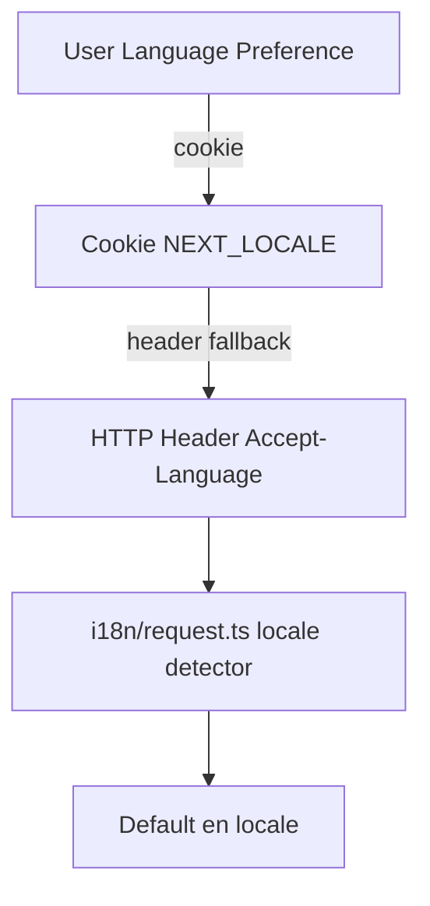
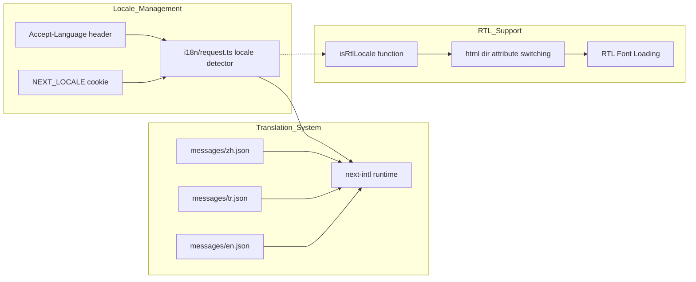

<!-- source: DeepWiki mcp.deepwiki.com · repo f/prompts.chat · page 8 Internationalization · fetched 2026-11-09 -->

# Internationalization

<details>
<summary>Relevant source files</summary>

The following files were used as context for generating this wiki page:

- [messages/ar.json](messages/ar.json)
- [messages/de.json](messages/de.json)
- [messages/en.json](messages/en.json)
- [messages/es.json](messages/es.json)
- [messages/fr.json](messages/fr.json)
- [messages/it.json](messages/it.json)
- [messages/ja.json](messages/ja.json)
- [messages/ko.json](messages/ko.json)
- [messages/pt.json](messages/pt.json)
- [messages/ru.json](messages/ru.json)
- [messages/tr.json](messages/tr.json)
- [messages/zh.json](messages/zh.json)

</details>


This page serves as the parent documentation for the internationalization (i18n) system in `prompts.chat`. The platform supports multiple distinct locales with a multi-level namespace organization across translation files, dynamic request resolution, and comprehensive right-to-left (RTL) script support.

---

## 8.1. Translation System

The translation infrastructure is built around structured JSON message files stored in the `messages/` directory. These files contain thousands of localized keys organized into namespaces such as `common`, `nav`, `brand`, `auth`, and `prompts`, covering core UI elements, domain-specific content, and platform branding [messages/en.json:1-36](), [messages/tr.json:1-36](), [messages/zh.json:1-36]().

At runtime, the `next-intl` library integrates these message files, enabling seamless server-side and client-side rendering of translations. Additionally, the system incorporates AI-powered auto-translation pipelines to keep auxiliary locale files in sync with English (`en.json`), facilitating support for multiple languages [messages/en.json:1-167](), [messages/ar.json:1-168]().

Title: Translation System Code Mapping
```mermaid
graph TD
    NaturalLanguageKey[""common.save", "prompts.create""]
    EnglishMessages["messages/en.json"]
    LocalizedMessages["messages/tr.json", "messages/zh.json", "messages/ja.json", "messages/ar.json", "messages/es.json", "messages/pt.json", "messages/fr.json", "messages/it.json", "messages/de.json", "messages/ko.json", "messages/ru.json"]
    NextIntl["next-intl runtime"]
    Rendering["Server and Client UI Rendering"]

    NaturalLanguageKey --> EnglishMessages
    NaturalLanguageKey --> LocalizedMessages
    EnglishMessages --> NextIntl
    LocalizedMessages --> NextIntl
    NextIntl --> Rendering
```

*Figure: From natural language keys defined in JSON translation files through `next-intl` to rendered user interface translations.*

Sources: [messages/en.json:1-167](), [messages/tr.json:1-163](), [messages/zh.json:1-167](), [messages/ja.json:1-167](), [messages/ar.json:1-168](), [messages/es.json:1-159](), [messages/pt.json:1-162](), [messages/fr.json:1-157](), [messages/it.json:1-162](), [messages/de.json:1-159](), [messages/ko.json:1-194](), [messages/ru.json:1-162]()

For full details on messages file structure, next-intl integration, and AI auto-translation workflows, see [Translation System](#8.1).

---

## 8.2. Locale Management

Locale management in `prompts.chat` handles user locale detection, preference persistence, and fallback resolution. It supports multiple languages including English (`en`), Turkish (`tr`), Chinese (`zh`), Japanese (`ja`), Arabic (`ar`), Spanish (`es`), Portuguese (`pt`), French (`fr`), Italian (`it`), German (`de`), Korean (`ko`), and Russian (`ru`) [messages/en.json:1-10](), [messages/ja.json:1-10](), [messages/ar.json:1-10]().

The detection cascade is managed by core request utilities which examine incoming cookies and headers to determine the correct locale context.

Title: Locale Management Request Cascade


*Figure: User locale resolution from cookie and HTTP headers delegated to core locale detection code.*

Sources: [messages/en.json:1-10](), [messages/ar.json:1-10](), [messages/ja.json:1-10]()

For detailed documentation on supported locales, cookie handling, and the detection cascade, see [Locale Management](#8.2).

---

## 8.3. RTL Language Support

`prompts.chat` supports right-to-left (RTL) languages such as Arabic (`ar`), Hebrew (`he`), and Persian/Farsi (`fa`) by adapting layout and typography via dedicated detection functions and direction attribute management [messages/ar.json:1-35]().

Key components include checking locale strings with helper functions, dynamically altering document direction, and applying appropriate typography styles.

For implementation specifics on RTL locale detection, font loading, and direction attribute management, see [RTL Language Support](#8.3).

Sources: [messages/ar.json:1-35]()

---

# Summary Diagram: Internationalization System Integration Overview

Title: Internationalization Architecture Overview


*Figure: Comprehensive flow from user locale detection to translation runtime and RTL layout support, showing key code components and data flows.*

Sources: [messages/en.json:1-167](), [messages/tr.json:1-163](), [messages/zh.json:1-167](), [messages/ar.json:1-35]()

---

For deep technical insights on each part of the i18n system, consult the respective child pages:  
- [Translation System](#8.1)  
- [Locale Management](#8.2)  
- [RTL Language Support](#8.3)

---

# Sources

- [messages/en.json:1-167]()
- [messages/tr.json:1-163]()
- [messages/zh.json:1-167]()
- [messages/ja.json:1-167]()
- [messages/ar.json:1-168]()
- [messages/es.json:1-159]()
- [messages/pt.json:1-162]()
- [messages/fr.json:1-157]()
- [messages/it.json:1-162]()
- [messages/de.json:1-159]()
- [messages/ko.json:1-194]()
- [messages/ru.json:1-162]()

---

