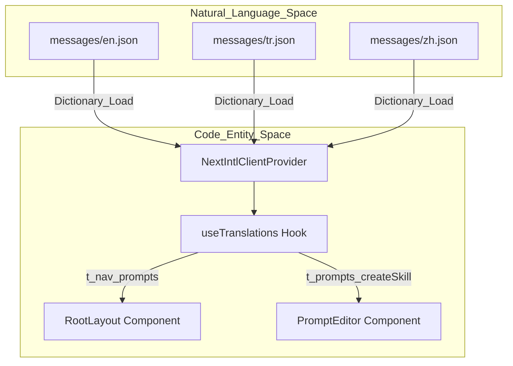
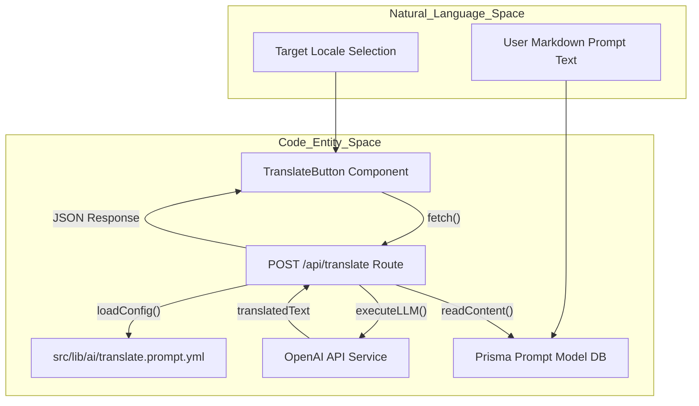
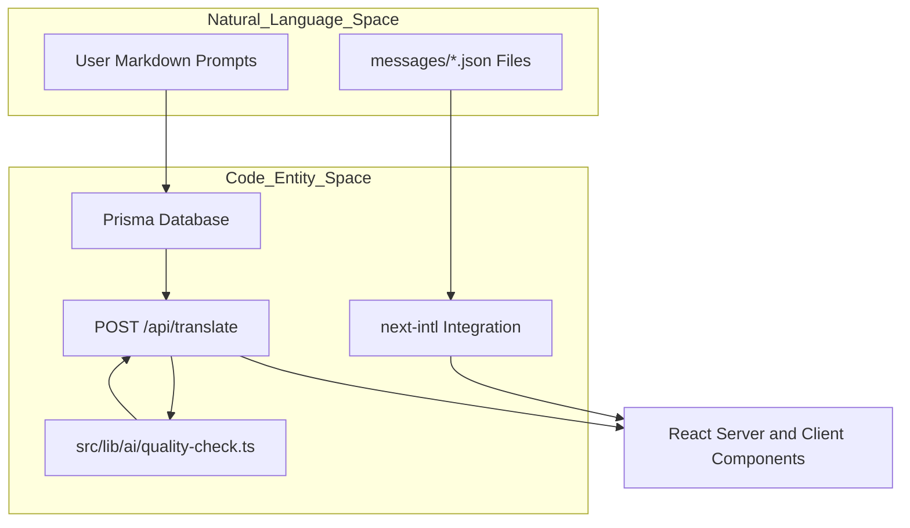

<!-- source: DeepWiki mcp.deepwiki.com · repo f/prompts.chat · page 8.1 Translation System · fetched 2026-11-09 -->

# Translation System

<details>
<summary>Relevant source files</summary>

The following files were used as context for generating this wiki page:

- [messages/ar.json](messages/ar.json)
- [messages/de.json](messages/de.json)
- [messages/en.json](messages/en.json)
- [messages/es.json](messages/es.json)
- [messages/fr.json](messages/fr.json)
- [messages/it.json](messages/it.json)
- [messages/ja.json](messages/ja.json)
- [messages/ko.json](messages/ko.json)
- [messages/nl.json](messages/nl.json)
- [messages/pt.json](messages/pt.json)
- [messages/ru.json](messages/ru.json)
- [messages/tr.json](messages/tr.json)
- [messages/zh.json](messages/zh.json)

</details>


The translation system in prompts.chat provides a complete internationalization (i18n) framework designed to support multi-language user interfaces, localized metadata, and AI-powered translations across the platform. It manages thousands of translation keys structured within locale-specific JSON files under the `messages/` directory, integrates with the `next-intl` library for React rendering, and powers dynamic content translation using prompt templates.

Sources: [messages/en.json:1-36](), [messages/tr.json:1-36]()

---

## File Structure and JSON Message Bundles

Translation content is organized by locale in the `messages/` directory, with `messages/en.json` acting as the structural source of truth. Each locale file mirrors this structure to maintain key parity across thousands of nested translation keys spanning various UI namespaces.

```
messages/
├── en.json        # English (Base schema source of truth)
├── tr.json        # Turkish
├── zh.json        # Chinese (Simplified)
├── ja.json        # Japanese
├── ar.json        # Arabic (RTL)
├── es.json        # Spanish
├── pt.json        # Portuguese
├── fr.json        # French
├── it.json        # Italian
├── de.json        # German
├── ko.json        # Korean
├── ru.json        # Russian
├── nl.json        # Dutch
└── he.json        # Hebrew (RTL)
```

Within these JSON bundles, keys are nested under high-level namespaces. Rich text formatting and ICU message format string interpolation are supported natively:

```json
"moreLines": "+{count} more lines",
"licenseText": "The {name} brand assets are provided under <link>CC0 1.0 Universal</link>."
```

Sources: [messages/en.json:1-36](), [messages/tr.json:1-36](), [messages/zh.json:1-36]()

---

## Namespace Architecture and Code Mapping

Namespaces isolate translation scopes to optimize payload sizes and map directly to specific application component modules.

### Namespace Definitions

| Namespace | Code Role | Example Keys |
|-----------|-----------|--------------|
| `common` | Shared UI buttons, states, and general utilities | `common.loading`, `common.save`, `common.variables` [messages/en.json:2-36]() |
| `nav` | Application header, navigation, and sidebar routing | `nav.prompts`, `nav.skills`, `nav.admin` [messages/en.json:37-69]() |
| `auth` | Authentication forms, hints, and feedback | `auth.login`, `auth.githubAttributionHint` [messages/en.json:96-118]() |
| `prompts` | Prompt creation, metadata labels, and delisting reasons | `prompts.createSkill`, `prompts.delistReasonTooShort` [messages/en.json:119-195]() |
| `brand` | Brand asset guidelines, color codes, and copy triggers | `brand.title`, `brand.copyLogoSvg` [messages/en.json:70-95]() |

Sources: [messages/en.json:2-118](), [messages/tr.json:2-118]()

### Namespace to Code Entity Bridge Diagram

Title: "Namespace to Code Entity Mapping"



Sources: [messages/en.json:2-118](), [messages/tr.json:2-118](), [messages/zh.json:2-118]()

---

## Prompt Metadata, Quality Control, and Delisting Messages

The `prompts` namespace handles advanced domain concepts such as Agent Skills, coding Tastes, and automated quality control messages [messages/en.json:119-200](). When automated background verification pipelines flag content, localized messages explain the precise rejection reason to the author:

- `delistReasonTooShort`: Content length fails minimum structural requirements [messages/zh.json:188]().
- `delistReasonNotEnglish`: Non-English content detected by validation checks [messages/zh.json:189]().
- `delistReasonLowQuality`: Low quality score returned from heuristic or AI evaluation [messages/zh.json:190]().
- `delistReasonNotInstruction`: Content is malformed and does not resemble an LLM instruction [messages/zh.json:191]().

Sources: [messages/en.json:119-200](), [messages/zh.json:185-194]()

---

## Integration with `next-intl`

The platform leverages `next-intl` to handle locale resolution and runtime message rendering:
- **Cookie & Header Cascade**: Automatically detects preferred user locales via `NEXT_LOCALE` cookies and standard browser `accept-language` headers.
- **Server & Client Synchronization**: Locale translation bundles are loaded per-request within server components and safely propagated down via React context to client-side hooks like `useTranslations`.
- **Dynamic Interpolation**: Resolves runtime placeholders such as `{count}` values and rich markup formatting components (`<link>`).

Sources: [messages/en.json:2-95]()

---

## AI-Powered Automatic Translation & Prompt Workflows

User-generated prompt content (markdown instructions, descriptions, skills) utilizes AI translation pipelines alongside static UI strings. The system leverages prompt configuration files and quality validation engines to process translation and automated review tasks.

### AI Translation Data Flow Diagram

Title: "AI Translation Data Flow and Code Entities"



Sources: [messages/en.json:119-141]()

---

## Right-to-Left (RTL) Language Support

For right-to-left languages like Arabic (`ar.json`), Hebrew (`he.json`), and Persian, the system dynamically alters document structure:
- Identifies RTL locales via structural helper functions.
- Dynamically injects the `<html dir="rtl">` attribute during root layout rendering.
- Applies RTL-specific font overrides, alignment rules, and directional padding.

Sources: [messages/ar.json:1-36]()

---

## Summary Architecture Diagram

Title: "Translation System Architecture Overview"



Sources: [messages/en.json:1-160]()

---

