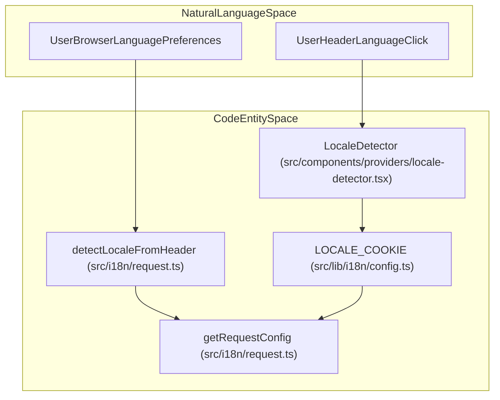
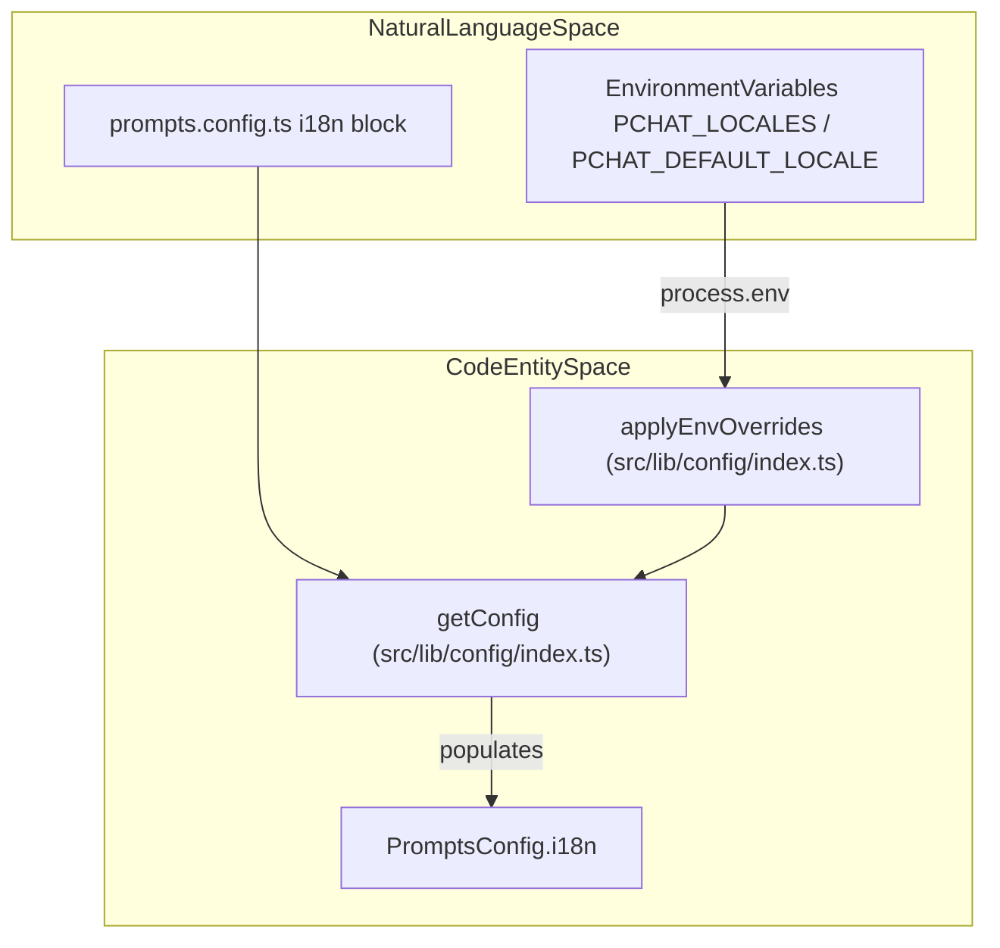

<!-- source: DeepWiki mcp.deepwiki.com · repo f/prompts.chat · page 8.2 Locale Management · fetched 2026-11-09 -->

# Locale Management

<details>
<summary>Relevant source files</summary>

The following files were used as context for generating this wiki page:

- [.env.example](.env.example)
- [messages/az.json](messages/az.json)
- [messages/fa.json](messages/fa.json)
- [prompts.config.ts](prompts.config.ts)
- [src/app/layout.tsx](src/app/layout.tsx)
- [src/components/layout/announcement-banner.tsx](src/components/layout/announcement-banner.tsx)
- [src/components/layout/header.tsx](src/components/layout/header.tsx)
- [src/components/ui/masonry.tsx](src/components/ui/masonry.tsx)
- [src/lib/config/index.ts](src/lib/config/index.ts)
- [src/lib/db.ts](src/lib/db.ts)
- [src/lib/i18n/config.ts](src/lib/i18n/config.ts)

</details>


This document covers the locale detection, storage, and switching mechanisms in `prompts.chat`. For details on translation file format and AI-powered translation features, see [Translation System](8.1). For RTL language support specifics, see [RTL Language Support](8.3).

The locale management system handles interface language selection and persistence across supported locales, including special handling for right-to-left (RTL) scripts.

---

## Supported Locales

Supported locales are centrally defined, used to populate language selectors and to validate active locale settings against configuration definitions.

| Language | Code | Script Direction |
| :------- | :--- | :--------------- |
| English | `en` | LTR |
| Turkish | `tr` | LTR |
| Spanish | `es` | LTR |
| Chinese | `zh` | LTR |
| Japanese | `ja` | LTR |
| Arabic | `ar` | RTL |
| Portuguese | `pt` | LTR |
| French | `fr` | LTR |
| Italian | `it` | LTR |
| German | `de` | LTR |
| Dutch | `nl` | LTR |
| Korean | `ko` | LTR |
| Russian | `ru` | LTR |
| Hebrew | `he` | RTL |
| Greek | `el` | LTR |
| Persian | `fa` | RTL |
| Azerbaijani | `az` | LTR |

### Locale List Source of Truth

- The array `supportedLocales` in `[src/lib/i18n/config.ts:4-5]()` enumerates these codes.
- The same list is synchronized with the `i18n.locales` entry in `[prompts.config.ts:44-47]()`.
- The `defaultLocale` is set as `"en"` in `[src/lib/i18n/config.ts:6-6]()`.

Sources: `[src/components/layout/header.tsx:86-104]`, `[prompts.config.ts:44-47]()`, `[src/lib/i18n/config.ts:4-9]()`

---

## Locale Detection Pipeline

Locale detection uses a cascading priority sequence to resolve the best locale for client requests.

### Detection Cascade

1.  **Cookie check**: Reads the locale preference cookie named `LOCALE_COOKIE` (`"NEXT_LOCALE"`) via `[src/i18n/request.ts:44-44]()`.
2.  **Accept-Language header parse**: If no valid cookie is found, `[src/i18n/request.ts:48-57]()` parses the `accept-language` header for a supported locale using `detectLocaleFromHeader`.
3.  **Fallback**: The `defaultLocale` (`"en"`) is used if no matches are found `[src/i18n/request.ts:55-55]()`.

This logic is handled in the server request configuration function `getRequestConfig` provided by `next-intl` integration `[src/i18n/request.ts:39-87]()`.

### Diagram: Locale Detection & Persistence Flow (Natural Language Space to Code Entity Space)



Sources: `[src/i18n/request.ts:10-55]()`, `[src/i18n/request.ts:39-87]()`, `[src/lib/i18n/config.ts:1-7]()`, `[prompts.config.ts:44-47]()`

### Detection Function Details

-   The `detectLocaleFromHeader` function parses the `Accept-Language` header, sorts language codes by quality value (`q` parameter), and finds the first match from supported locales `[src/i18n/request.ts:10-37]()`.
-   It compares both full locale codes (like `en-US`) and their base language (`en`) `[src/i18n/request.ts:24-33]()`.
-   If no supported locale is found, `null` is returned `[src/i18n/request.ts:36-36]()`.

Sources: `[src/i18n/request.ts:10-37]()`

---

## Locale Storage and Persistence

User locale preferences are persisted using a cookie named `LOCALE_COOKIE` (`"NEXT_LOCALE"`) `[src/lib/i18n/config.ts:1-2]()`. This ensures the chosen language persists across sessions and requests.

### Client-Side Locale Saving

-   On the client side, the `LocaleDetector` React component saves the auto-detected locale to a cookie on first visit `[src/components/providers/locale-detector.tsx:7-10]()`.
-   It checks if `LOCALE_COOKIE` already exists and sets it if absent `[src/components/providers/locale-detector.tsx:15-23]()`.
-   The cookie `max-age` is set for 1 year (`60 * 60 * 24 * 365`), making the preference long-lasting `[src/components/providers/locale-detector.tsx:22-22]()`.

Sources: `[src/components/providers/locale-detector.tsx:1-27]()`, `[src/lib/i18n/config.ts:1-2]()`

### Client Locale Switching in Header

-   The `Header` component renders a languages array containing all supported locales and their display names `[src/components/layout/header.tsx:86-104]()`.
-   Locale switches trigger the `setLocale` client utility function `[src/components/layout/header.tsx:79-79]()`.
-   `setLocale` updates the `NEXT_LOCALE` cookie and reloads the app with the new locale.

Sources: `[src/components/layout/header.tsx:79-104]`, `[src/i18n/request.ts:40-45]()`

---

## RTL Locale Identification

Certain languages require right-to-left (RTL) layout rendering. These are handled explicitly during locale determination and UI adjustments.

### RTL Locales List

The RTL locales are:

-   Arabic (`ar`)
-   Hebrew (`he`)
-   Persian (`fa`)

This list is declared in `[src/lib/i18n/config.ts:8-9]()`:

```ts
export const rtlLocales = ["ar", "he", "fa"];
```

### RTL Helper Function

The function `isRtlLocale(locale: string): boolean` checks if a locale is RTL by checking membership in `rtlLocales` `[src/lib/i18n/config.ts:11-14]()`. This is typically used to set the page `dir` attribute dynamically.

Sources: `[src/lib/i18n/config.ts:8-14]()`

---

## Configuration and Environment Overrides

### Static Configuration in `prompts.config.ts`

Locales are specified here under the `i18n` property `[prompts.config.ts:43-47]()`. This entry drives both the supported locale list and the fallback locale in the system.

Sources: `[prompts.config.ts:43-47]()`

### Environment Variable Overrides

For deployment flexibility, environment variables prefixed with `PCHAT_` can override the i18n configuration via `[src/lib/config/index.ts:143-148]()`:

-   `PCHAT_LOCALES` — comma-separated list of locale codes; overrides static list `[src/lib/config/index.ts:143-146]()`
-   `PCHAT_DEFAULT_LOCALE` — single locale code; overrides default fallback `[src/lib/config/index.ts:147-147]()`

### Override Processing Pipeline

1.  Application loads `prompts.config.ts` dynamically inside `getConfig` `[src/lib/config/index.ts:175-176]()`.
2.  `applyEnvOverrides(config)` function parses environment variables and applies overrides if present `[src/lib/config/index.ts:99-166]()`.
3.  The resulting config is cached and consumed by the app `[src/lib/config/index.ts:168-170]()`.

### Diagram: Natural Language Space to Code Entity Space for I18n Configuration



Sources: `[src/lib/config/index.ts:99-176]`, `[prompts.config.ts:43-47]()`

---

# Summary

The Locale Management system in `prompts.chat` integrates static configuration, environment overrides, cookie-based persistence (`NEXT_LOCALE`), browser header heuristics, and explicit RTL layout support to provide a seamless multilingual user experience.

-   Supported locales align across UI components, config files, and backend request parsers.
-   A flexible cascade prioritizes saved user choices before browser headers and defaults.
-   Client components and header UI enable runtime locale switching.
-   RTL locales are clearly identified for correct rendering direction.
-   Environment variables allow seamless configuration overrides in containerized deployments.

Sources: `[src/i18n/request.ts:1-87]`, `[src/lib/i18n/config.ts:1-24]`, `[src/lib/config/index.ts:99-176]`, `[prompts.config.ts:43-47]()`

---

