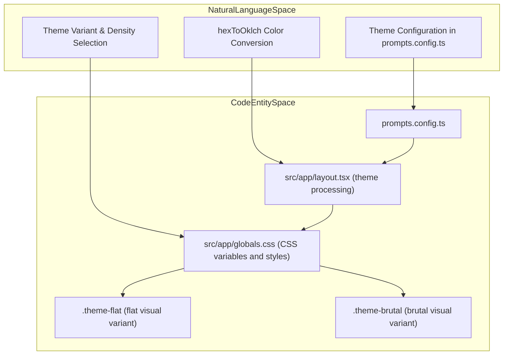
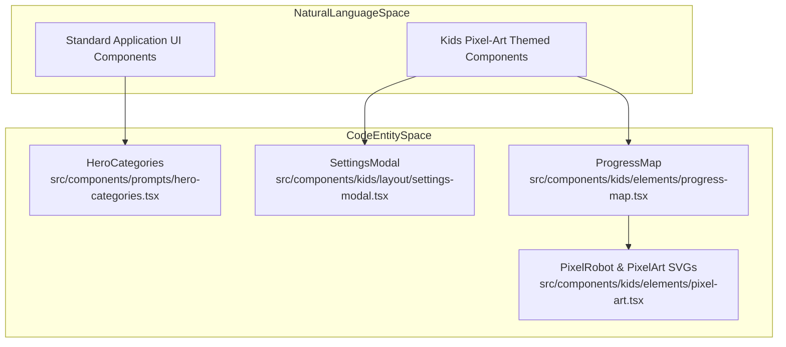
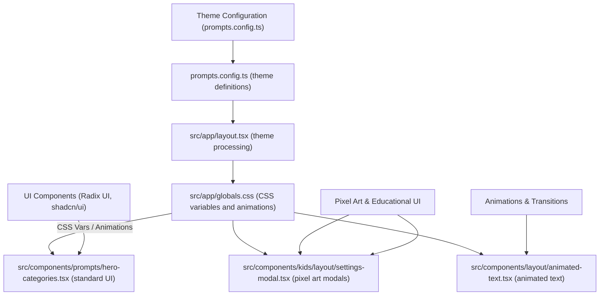

<!-- source: DeepWiki mcp.deepwiki.com · repo f/prompts.chat · page 9 UI & Theming · fetched 2026-11-09 -->

# UI & Theming

Relevant source files

The following files were used as context for generating this wiki page:

- [src/app/globals.css](src/app/globals.css)
- [src/components/kids/elements/pixel-art.tsx](src/components/kids/elements/pixel-art.tsx)
- [src/components/kids/elements/progress-map.tsx](src/components/kids/elements/progress-map.tsx)
- [src/components/kids/elements/story-scene.tsx](src/components/kids/elements/story-scene.tsx)
- [src/components/kids/layout/settings-modal.tsx](src/components/kids/layout/settings-modal.tsx)
- [src/components/layout/animated-text.tsx](src/components/layout/animated-text.tsx)
- [src/components/prompts/hero-categories.tsx](src/components/prompts/hero-categories.tsx)

This page serves as the parent overview for the UI and theming systems in `prompts.chat`. The visual architecture combines modern CSS custom properties, OKLCH color spaces, Radix UI primitives, shadcn/ui patterns, and a specialized pixel-art aesthetic particularly featured in educational components.

- [Theming System](#9.1) — Document theme configuration with radius, variant, density, colors, hexToOklch color conversion, globals.css and CSS custom properties
- [Component Patterns](#9.2) — Explain UI component library using Radix UI, shadcn/ui patterns, code/tree views, masonry layout, and common component structures
- [Animation System](#9.3) — Document animation components like AnimatedText, AnimatedDate, transitions, brand assets and motion patterns

For configuration settings, see [Theme Configuration](#12.3). For layout direction rules, see [RTL Language Support](#8.3).

---

## Theming System

The theming architecture relies on runtime configuration that converts standard hex color definitions into OKLCH CSS custom properties. This supports dynamic visual variants (`flat`, `default`, `brutal`) and adjustable spacing densities (`compact`, etc.).

The configuration pipeline interprets values from `prompts.config.ts` and injects them through server-side helpers into the root-level styling variables defined in `src/app/globals.css`. These CSS variables govern colors, typography, radii, shadows, and other visual tokens used globally. The OKLCH color space ensures better perceptual color manipulation for light/dark mode variants.

### Diagram: Theming System Architecture

Sources: [src/app/globals.css:1-225]()

The global CSS defines root variables such as `--background`, `--foreground`, `--primary`, `--radius`, and others, adjusted for light and dark modes via the `.dark` CSS class. Shadow depths and border styles vary between theme variants, providing visual flavor and affordance consistency throughout the UI.

For full technical details and usage instructions, see [Theming System](#9.1).

Sources: [src/app/globals.css:1-225]()

---

## Component Patterns

The UI component library in `prompts.chat` is primarily built on Radix UI primitives combined with shadcn/ui conventions to provide accessible, reusable, and highly customizable UI elements. This system supports complex use cases including code views, tree controls, and masonry layouts.

The application’s user interface is formed by standard UI components such as the `HeroCategories` search input component which offers a responsive search bar with icon adornment and video showcase, as implemented in `src/components/prompts/hero-categories.tsx`.

Distinctively, the Kids educational modules feature a dedicated pixel-art subsystem implemented with SVG components. These components provide a nostalgic pixel-art visual style consistent with the educational game's branding and theme. They render pixelated assets such as trees, castles, clouds, and characters like the `PixelRobot`. Polygon clip-path CSS shapes are used extensively for custom button and modal styling, reinforcing the pixel-art aesthetic. One example is the complex settings modal interface located in `src/components/kids/layout/settings-modal.tsx`.

### Diagram: Component Architecture and Mapping

Sources: [src/components/prompts/hero-categories.tsx:9-52](), [src/components/kids/layout/settings-modal.tsx:54-114](), [src/components/kids/elements/progress-map.tsx:12-27](), [src/components/kids/elements/pixel-art.tsx:158-188]()

For an in-depth explanation of component structures, patterns, accessibility strategies, and utility components, see [Component Patterns](#9.2).

Sources: [src/components/prompts/hero-categories.tsx:9-52](), [src/components/kids/layout/settings-modal.tsx:54-114](), [src/components/kids/elements/progress-map.tsx:12-27](), [src/components/kids/elements/pixel-art.tsx:158-188]()

---

## Animation System

Animations in `prompts.chat` are primarily realized through CSS keyframes and utility classes augmented by React components that encapsulate common motion patterns.

The global CSS (`src/app/globals.css`) defines keyframe animations like `gradient-flow` which creates a continuous gradient background movement effect used on text elements. This underpins components such as the `AnimatedText` component, which renders multi-colored gradient text with an animated flow, improving visual engagement on dynamic UI parts.

Modal and dialog transitions follow zoom and fade-in sequences with backdrop blurring for layered UI overlays; these are applied in components like the Kids settings modal (`src/components/kids/layout/settings-modal.tsx`).

| Component / Utility | Location | Role |
|---------------------|----------|------|
| `AnimatedText`       | [src/components/layout/animated-text.tsx:8-28]() | Animated multi-color gradient flowing text rendering |
| `gradient-flow` keyframes | [src/app/globals.css:138-153]() | Defines infinite gradient background animation |
| Modal Transitions    | [src/components/kids/layout/settings-modal.tsx:103]() | Zoom-in and fade-in transition animations on modals |

Sources: [src/app/globals.css:138-153](), [src/components/layout/animated-text.tsx:8-28](), [src/components/kids/layout/settings-modal.tsx:103]()

For detailed motion design patterns and implementation, see [Animation System](#9.3).

Sources: [src/app/globals.css:138-153](), [src/components/layout/animated-text.tsx:8-28](), [src/components/kids/layout/settings-modal.tsx:103]()

---

## Summary Diagram: UI & Theming System Overview

Sources: [src/app/globals.css:1-225](), [src/components/prompts/hero-categories.tsx:9-52](), [src/components/kids/layout/settings-modal.tsx:54-114](), [src/components/layout/animated-text.tsx:8-28]()

This diagram demonstrates the relationship between natural language system concepts (theme configuration, UI component styles, pixel-art modules, animations) and their corresponding concrete code entities, linking configuration files, styling layers, and React components.

Sources: [src/app/globals.css:1-225](), [src/components/prompts/hero-categories.tsx:9-52](), [src/components/kids/layout/settings-modal.tsx:54-114](), [src/components/layout/animated-text.tsx:8-28]()

---

This overview outlines the architectural layers that shape the UI experience and theming in prompts.chat. Each aspect is expanded in linked child pages focusing on detailed technical explanations.

For more, see the child pages:
- [Theming System](#9.1)
- [Component Patterns](#9.2)
- [Animation System](#9.3)

---

