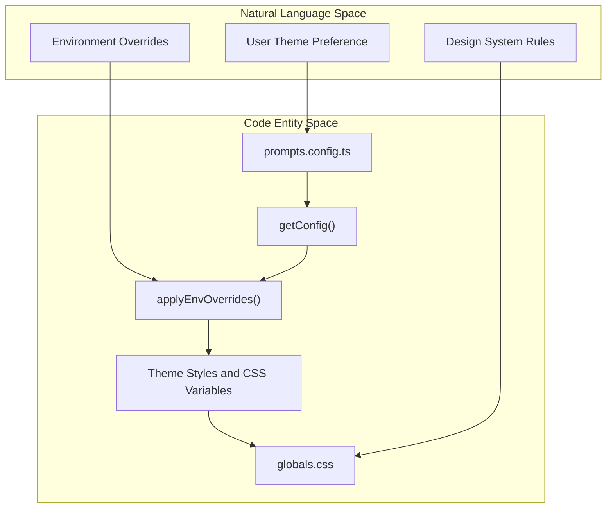
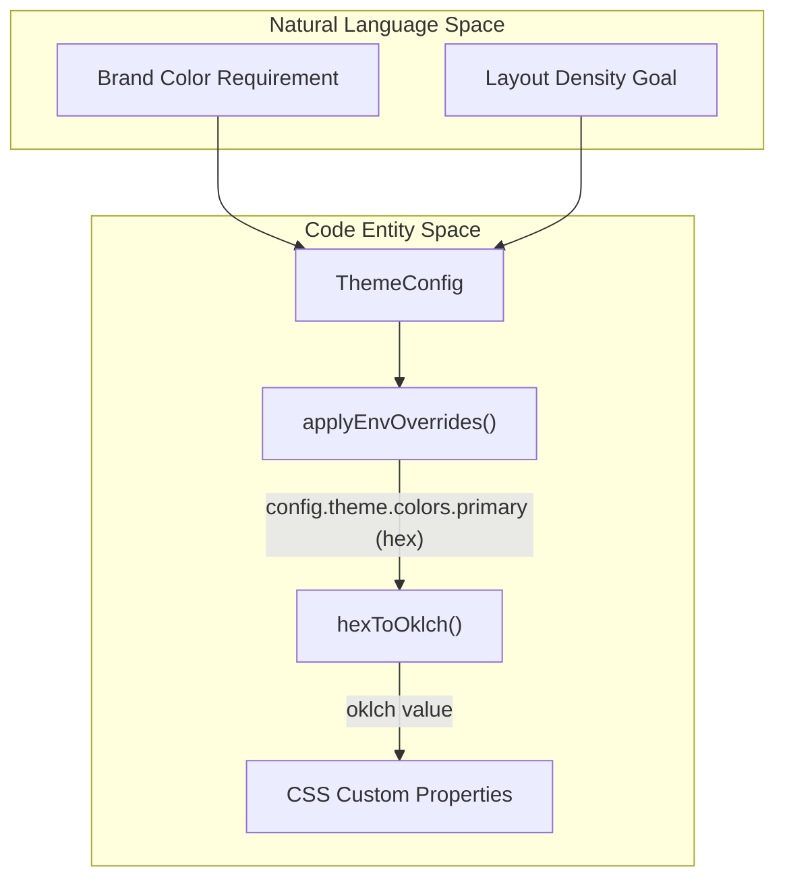

<!-- source: DeepWiki mcp.deepwiki.com · repo f/prompts.chat · page 9.1 Theming System · fetched 2026-11-09 -->

# Theming System

Relevant source files

The following files were used as context for generating this wiki page:

- [.env.example](.env.example)
- [prompts.config.ts](prompts.config.ts)
- [src/app/globals.css](src/app/globals.css)
- [src/app/layout.tsx](src/app/layout.tsx)
- [src/components/kids/elements/pixel-art.tsx](src/components/kids/elements/pixel-art.tsx)
- [src/components/kids/elements/progress-map.tsx](src/components/kids/elements/progress-map.tsx)
- [src/components/kids/elements/story-scene.tsx](src/components/kids/elements/story-scene.tsx)
- [src/components/kids/layout/settings-modal.tsx](src/components/kids/layout/settings-modal.tsx)
- [src/components/layout/animated-text.tsx](src/components/layout/animated-text.tsx)
- [src/components/layout/announcement-banner.tsx](src/components/layout/announcement-banner.tsx)
- [src/components/layout/header.tsx](src/components/layout/header.tsx)
- [src/components/prompts/hero-categories.tsx](src/components/prompts/hero-categories.tsx)
- [src/components/ui/masonry.tsx](src/components/ui/masonry.tsx)
- [src/lib/config/index.ts](src/lib/config/index.ts)
- [src/lib/db.ts](src/lib/db.ts)
- [src/lib/i18n/config.ts](src/lib/i18n/config.ts)

## Purpose and Scope

The theming system provides a unified visual design language across the application through:

- **Theme variants** (`flat`, `default`, `brutal`) that control shadow and border styles [src/app/globals.css:158-190]().
- **Density modes** (`compact`, `default`, `comfortable`) that adjust spacing, font scale, and container padding [src/app/globals.css:213-225]().
- **Border radius settings** (`none`, `sm`, `md`, `lg`) mapped to `--radius` CSS variables [src/lib/config/index.ts:11-15](), [src/app/globals.css:43-46]().
- **Hex to OKLCH conversion** via configuration and runtime environment variable overrides (`PCHAT_COLOR`, `PCHAT_THEME_RADIUS`, etc.) for dynamic, perceptually uniform color injection [src/lib/config/index.ts:117-185]().

Sources: [src/app/globals.css:158-190](), [src/app/globals.css:213-225](), [src/lib/config/index.ts:11-22](), [src/lib/config/index.ts:117-185]()

---

## Configuration Architecture & Server-Side Injection

The theming pipeline resolves configuration values via `prompts.config.ts` and runtime overrides processed by `applyEnvOverrides()` in `src/lib/config/index.ts` [src/lib/config/index.ts:117-185](). It reads the application configuration, computes dynamic properties for variants, density, and colors, and injects them into the DOM styles and CSS custom properties defined in `src/app/globals.css` [src/app/globals.css:7-47]().

### Diagram: Configuration to Theming Code Entities

Sources: [prompts.config.ts:20-32](), [src/lib/config/index.ts:117-185](), [src/app/globals.css:7-47]()

---

## Color Conversion & Dynamic Injection

To maintain perceptual uniformity across arbitrary brand color inputs, the configuration system accepts hex or OKLCH color values through `ThemeConfig.colors` [src/lib/config/index.ts:17-21]() and overrides them via runtime environment variables like `PCHAT_COLOR` [src/lib/config/index.ts:147-152](). The `hexToOklch` function [src/app/layout.tsx:120-142]() performs the conversion from hex to OKLCH format.

### Diagram: Runtime Theme Resolution and CSS Injection

The parsed color values map into CSS custom properties under `:root` and `.dark` blocks, allowing seamless runtime theme switching without rebuilding the application [src/app/layout.tsx:160-172](), [src/app/globals.css:49-116]().

Sources: [src/lib/config/index.ts:17-21](), [src/lib/config/index.ts:86-185](), [src/app/globals.css:49-116](), [src/app/layout.tsx:120-142](), [src/app/layout.tsx:160-172]()

---

## Theme Variants

Variant controls are implemented via CSS classes applied to container elements:

- **Flat (`.theme-flat`)**: Eliminates shadows entirely and sets simplified border colors [src/app/globals.css:158-173](). It also strips button and input shadows [src/app/globals.css:198-208]().
- **Default (`.theme-default`)**: Applies balanced, subtle elevation shadows (`--shadow-sm`, `--shadow`, `--shadow-md`, `--shadow-lg`) [src/app/globals.css:175-181]().
- **Brutal (`.theme-brutal`)**: Enforces zero border radius (`--radius: 0 !important`), 2-pixel borders using `currentColor`, and hard offset shadows [src/app/globals.css:184-196]().

Sources: [src/app/globals.css:158-208]()

---

## Density Modes

Density modes alter layout scaling and spacing parameters across the application:

| Density Mode | Spacing Unit Variable | Base Font Size | Description |
|--------------|-----------------------|----------------|-------------|
| `compact`    | `0.75rem`             | `0.875rem`     | Tighter padding and scaled-down heading typography [src/app/globals.css:213-225]() |
| `default`    | `1rem`                | `1rem`         | Standard balanced layout spacing |
| `comfortable`| `1.25rem`             | `1.125rem`     | Expanded whitespace for readability |

These modes are applied as CSS classes like `density-compact` on container elements [src/app/globals.css:213-225]().

Sources: [src/app/globals.css:213-225]()

---

## Globals.css and CSS Custom Properties

Core design tokens are declared as CSS custom properties under `:root` and `.dark` selectors within `src/app/globals.css` [src/app/globals.css:49-116](). 

- **Theme Mapping**: Tailwind v4 uses `@theme inline` to map utility tokens like `--color-primary`, `--color-background`, and radius variables (`--radius-sm`, `--radius-md`, `--radius-lg`) directly to underlying custom properties [src/app/globals.css:7-47]().
- **Base Layer Rules**: Global element defaults enforce border colors and text/background rendering [src/app/globals.css:118-129]().

Sources: [src/app/globals.css:7-129]()

---

# Summary

The theming architecture combines static configuration defined in `prompts.config.ts` [prompts.config.ts:20-32]() with runtime environment overrides handled by `applyEnvOverrides()` [src/lib/config/index.ts:117-185](). By leveraging CSS custom property mappings [src/app/globals.css:7-47]() and modular variant/density class sheets [src/app/globals.css:158-225](), the system delivers high-performance, accessible runtime styling.

Sources: [prompts.config.ts:20-32](), [src/lib/config/index.ts:117-185](), [src/app/globals.css:7-225]()

---

# References

- `prompts.config.ts`: User-facing theme configuration (`radius`, `variant`, `density`, `colors`).
- `src/lib/config/index.ts`: Configuration loader, `ThemeConfig` interface, and `applyEnvOverrides()` implementation.
- `src/app/globals.css`: Tailwind v4 theme bindings, `:root`/`.dark` tokens, variants (`.theme-*`), and density classes (`.density-*`).
- `src/app/layout.tsx`: Server-side `hexToOklch` conversion and CSS variable injection.

---

