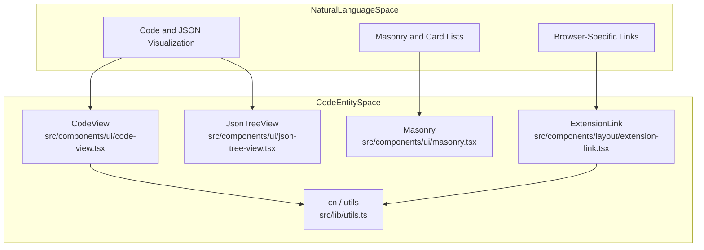
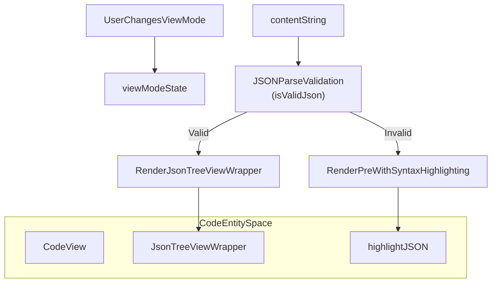

<!-- source: DeepWiki mcp.deepwiki.com · repo f/prompts.chat · page 9.2 Component Patterns · fetched 2026-11-09 -->

# Component Patterns

Relevant source files

The following files were used as context for generating this wiki page:

- [src/app/prompts/(list)/layout.tsx](src/app/prompts/(list)/layout.tsx)
- [src/components/layout/extension-link.tsx](src/components/layout/extension-link.tsx)
- [src/components/ui/code-view.tsx](src/components/ui/code-view.tsx)
- [src/components/ui/json-tree-view.tsx](src/components/ui/json-tree-view.tsx)
- [src/lib/utils.ts](src/lib/utils.ts)

This page explains the UI component library used throughout prompts.chat for displaying, managing, and interacting with prompts. These components follow consistent patterns for data presentation, user interaction, and content rendering, utilizing Radix UI primitives and shadcn/ui design patterns.

For UI theming configuration, see [9.1 Theming System](). For animation implementation details, see [9.3 Animation System]().

---

## 1. Component Architecture & Design System Integration

The prompt-related components follow a layered architecture with clear separation between presentation, interaction, and data management concerns. Theme variables such as `--radius` and `--primary` are injected at the root level via `RootLayout`, while utility functions in `src/lib/utils.ts` handle class merging and browser environment detection (`[src/lib/utils.ts:4-6]()`).

### Component Hierarchy and Data Flow

The diagram below illustrates how data flows through the UI layer, associating system abstractions with exact code entities (`CodeView`, `JsonTreeView`, `ExtensionLink`).

**Component System to Code Entity Mapping**

Sources: [src/components/ui/code-view.tsx:22-143](), [src/components/ui/json-tree-view.tsx:54-79](), [src/components/layout/extension-link.tsx:15-48](), [src/lib/utils.ts:4-6]()

---

## 2. Code Visualization & Tree Views

### CodeView Component

The `CodeView` component provides a rich interface for displaying code or structured data (`[src/components/ui/code-view.tsx:22-143]()`), primarily designed for JSON and YAML content. It allows toggling between a raw code view with syntax highlighting and a tree view for interactive exploration.

Key features:
- **View Modes:** Users can toggle between `"code"` and `"tree"` modes. Tree view is available only if the content is valid JSON (`[src/components/ui/code-view.tsx:56-75]()`).
- **Syntax Highlighting:** The component manually highlights syntax using helper functions like `highlightJSON` (`[src/components/ui/code-view.tsx:153-195]()`), differentiating keys, strings, numbers, booleans, and null values.
- **Line Numbers:** A fixed gutter showing line numbers is rendered beside the code lines (`[src/components/ui/code-view.tsx:119-122]()`).
- **Expandable Tree:** Tree view uses `JsonTreeViewWrapper`, which renders the parsed JSON data in an expandable/collapsible hierarchical format (`[src/components/ui/code-view.tsx:104-110]()`).

### CodeView Component Flow

Sources: [src/components/ui/code-view.tsx:22-195](), [src/components/ui/json-tree-view.tsx:54-79]()

---

### JsonTreeView Component

The `JsonTreeView` component recursively renders JSON data as a tree structure with expand/collapse functionality:

- **Data Model:** Uses a recursive `JsonNode` structure (`[src/components/ui/json-tree-view.tsx:8-13]()`) identifying each node by path and type (`object`, `array`, `string`, `number`, `boolean`, or `null`).
- **Expandable Paths:** Maintains a `Set` of expanded paths via `useState` (`[src/components/ui/json-tree-view.tsx:55-67]()`).
- **Recursive Rendering:** The `renderNode` function traverses JSON nodes recursively (`[src/components/ui/json-tree-view.tsx:110-191]()`), rendering keys with clickable expand/collapse toggles for objects and arrays.
- **Expand/Collapse All:** Provides `expandAll` and `collapseAll` functions, exposed via refs, to control the expansion state of all nodes (`[src/components/ui/json-tree-view.tsx:73-79]()`).

Sources: [src/components/ui/json-tree-view.tsx:8-191]()

---

## 3. Card & List Patterns

### Masonry Layout

A custom `Masonry` component arranges child elements into justified columns based on viewport size, providing a dynamic grid layout.

- **Responsive Columns:** The number of columns adjusts across breakpoints (`default`, `md`, `lg`, `xl`).
- **Position Calculation:** Uses height tracking per column to place items in the shortest column.
- **RTL Support:** Detects and accommodates right-to-left layout with correct item positioning.

### RelatedPrompts Component

The `RelatedPrompts` component renders a grid list of related prompt cards with important prompt metadata.

- **Data:** Displays prompt title, description (truncated), type with a badge, and voting count.
- **Author:** Shows author's avatar with fallback initials and username.
- **Links:** Each prompt card links to the prompt detail page via helper route builders.

Sources: [src/components/prompts/related-prompts.tsx:34-90]()

---

## 4. Browser-Specific Components

### ExtensionLink Component

The `ExtensionLink` component (`[src/components/layout/extension-link.tsx:15-48]()`) dynamically renders a link to the appropriate browser extension based on the user's browser.

- **Browser Detection:** Uses `isChromeBrowser()` and `isFirefoxBrowser()` from `src/lib/utils.ts` to detect the current browser (`[src/components/layout/extension-link.tsx:20-25]()`, `[src/lib/utils.ts:21-41]()`).
- **Dynamic URL:** Sets the `extensionUrl` to either a Chrome extension URL or `FIREFOX_ADDON_URL` (`[src/components/layout/extension-link.tsx:30-31]()`).
- **Iconography:** Displays the appropriate browser icon (Chromium or Firefox SVG) (`[src/components/layout/extension-link.tsx:39-45]()`).

Sources: [src/components/layout/extension-link.tsx:15-48](), [src/lib/utils.ts:21-41]()

---

# Summary

The component patterns in prompts.chat leverage modular React components, Radix UI primitives, and advanced UI constructs to handle complex rendering such as code tree views and masonry layouts. These patterns ensure consistency, accessibility, and maintainability in the rich prompt management interface.

Sources: [src/components/ui/code-view.tsx:1-143](), [src/components/ui/json-tree-view.tsx:1-191](), [src/components/prompts/related-prompts.tsx:34-90](), [src/components/layout/extension-link.tsx:15-48](), [src/lib/utils.ts:21-41]()

---

