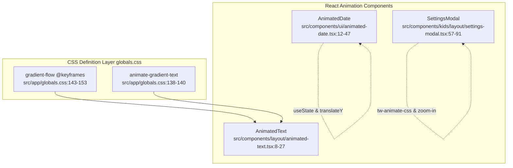
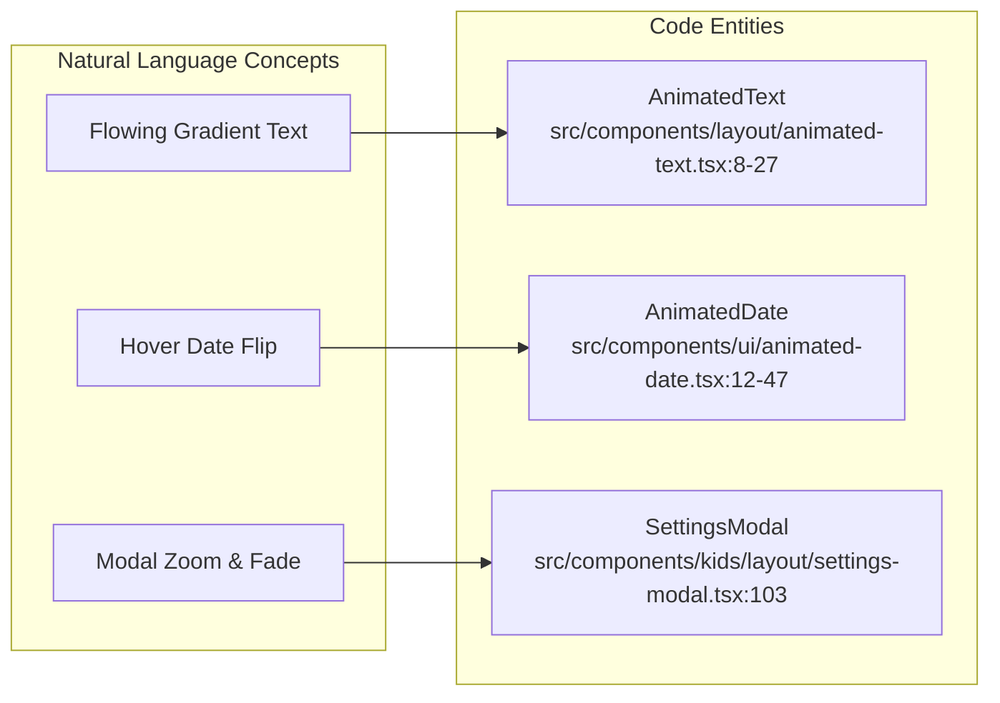
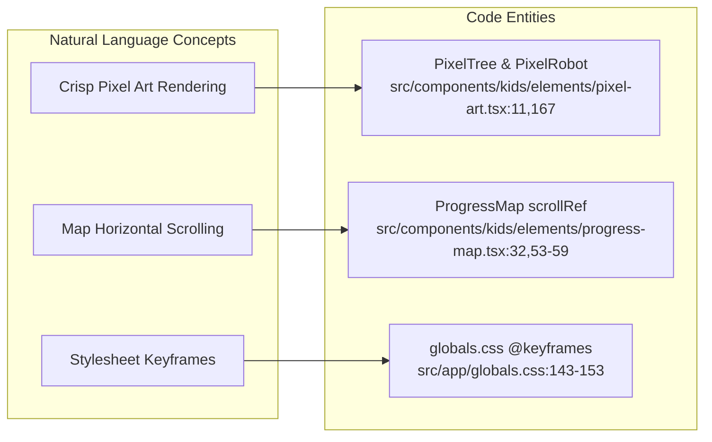

<!-- source: DeepWiki mcp.deepwiki.com · repo f/prompts.chat · page 9.3 Animation System · fetched 2026-11-09 -->

# Animation System

Relevant source files

The following files were used as context for generating this wiki page:

- [public/favicon/apple-touch-icon.png](public/favicon/apple-touch-icon.png)
- [public/favicon/favicon-96x96.png](public/favicon/favicon-96x96.png)
- [public/favicon/favicon.ico](public/favicon/favicon.ico)
- [public/favicon/favicon.svg](public/favicon/favicon.svg)
- [public/favicon/site.webmanifest](public/favicon/site.webmanifest)
- [public/favicon/web-app-manifest-192x192.png](public/favicon/web-app-manifest-192x192.png)
- [public/favicon/web-app-manifest-512x512.png](public/favicon/web-app-manifest-512x512.png)
- [src/components/prompts/share-dropdown.tsx](src/components/prompts/share-dropdown.tsx)
- [src/components/ui/animated-date.tsx](src/components/ui/animated-date.tsx)
- [tsconfig.json](tsconfig.json)

## Purpose and Scope
The Animation System provides interactive visual effects, transitions, and motion patterns integrated throughout prompts.chat. It covers component-level animations like animated text gradients `[src/components/layout/animated-text.tsx:1-28]()` (referencing path patterns) and date hover switches `[src/components/ui/animated-date.tsx:1-48]()`, Tailwind CSS animations, dialog/modal entrance transitions, and pixel art rendering used in the Kids Learning Game `[src/components/kids/elements/pixel-art.tsx:1-188]()`.

Sources: `[src/components/ui/animated-date.tsx:1-48]()`

---

## Animation Architecture
The animation architecture consists of stylesheet-level keyframes `[src/app/globals.css:143-153]()`, Tailwind CSS utility integration `[src/app/globals.css:1-3]()`, and React state-driven transformation handlers `[src/components/ui/animated-date.tsx:12-47]()`.

### Flow Diagram: Animation Architecture Layers

Sources: `[src/components/ui/animated-date.tsx:12-47]()`

---

## Core Animation Components

### AnimatedText
`AnimatedText` renders a continuous horizontal gradient flow across text elements using CSS backgrounds and keyframe animations.
- Uses `animate-gradient-text` utility class mapped to `@keyframes gradient-flow` `[src/app/globals.css:138-140]()`.
- Configures background size at `300% 100%` with `backgroundClip: "text"` and transparent text fill.

Sources: `[src/app/globals.css:138-153]()`

### AnimatedDate
`AnimatedDate` toggles between relative time and an exact formatted date on hover `[src/components/ui/animated-date.tsx:12-47]()`.
- Uses React `useState` (`showExact`) to track mouse hover states `[src/components/ui/animated-date.tsx:13]()`, `[src/components/ui/animated-date.tsx:25-26]()`.
- Animates vertical text shifts using CSS classes `transition-transform duration-300 ease-in-out` and `-translate-y-full` `[src/components/ui/animated-date.tsx:31-44]()`.

Sources: `[src/components/ui/animated-date.tsx:1-48]()`

### SettingsModal & Dialog Transitions
Modals like `SettingsModal` utilize entrance animation utilities from Tailwind plugins (`tw-animate-css`) for smooth pop-up effects `[src/components/kids/layout/settings-modal.tsx:1-184]()`.
- Utilizes classes like `animate-in zoom-in-95 fade-in duration-200` `[src/components/kids/layout/settings-modal.tsx:103]()`.
- Backdrops incorporate `backdrop-blur-sm` `[src/components/kids/layout/settings-modal.tsx:97]`.

Sources: `[src/components/kids/layout/settings-modal.tsx:57-113]()`

### Pixel Art & Game Animations
The Kids Learning Game uses pixel art SVG components (`PixelTree`, `PixelRobot`, etc.) and CSS properties optimized for pixelation `[src/components/kids/elements/pixel-art.tsx:1-188]()`.
- `imageRendering: "pixelated"` styling ensures crisp scaling on retro elements `[src/components/kids/elements/pixel-art.tsx:11]()`.
- Horizontal scrolling maps use smooth DOM navigation (`scrollBy`) `[src/components/kids/elements/progress-map.tsx:53-59]()`.

Sources: `[src/components/kids/elements/pixel-art.tsx:1-188]()`, `[src/components/kids/elements/progress-map.tsx:53-60]()`

---

## Global CSS Keyframes & Utility Classes

Key animation definitions and variables in `src/app/globals.css`:

| Symbol / Utility | Role | Reference |
|------------------|------|-----------|
| `@keyframes gradient-flow` | Defines horizontal color shift across 0% to 100% background positions | `[src/app/globals.css:143-153]()` |
| `.animate-gradient-text` | Applies 20s infinite gradient flow animation | `[src/app/globals.css:138-140]()` |
| `tw-animate-css` | Imported plugin providing entrance/exit utility classes | `[src/app/globals.css:2]()` |

Sources: `[src/app/globals.css:1-153]()`

---

## Concept to Code Entity Mapping

### Diagram 1: Natural Language Concepts to Code Entities (Part 1)

Sources: `[src/components/ui/animated-date.tsx:12-47]()`, `[src/components/kids/layout/settings-modal.tsx:103]()`

### Diagram 2: Natural Language Concepts to Code Entities (Part 2)

Sources: `[src/components/kids/elements/pixel-art.tsx:11]()`, `[src/components/kids/elements/progress-map.tsx:32,53-59]()`, `[src/app/globals.css:143-153]()`

---

## Summary Table of Animation Components

| Component / Utility | File Path | Primary Function |
|---------------------|-----------|------------------|
| `AnimatedText` | `[src/components/layout/animated-text.tsx:1-28]()` | Continuous flowing text color gradient animation |
| `AnimatedDate` | `[src/components/ui/animated-date.tsx:1-48]()` | Vertical translation flip between relative and exact date |
| `SettingsModal` | `[src/components/kids/layout/settings-modal.tsx:57-113]()` | Dialog zoom/fade entrance transitions |
| `PixelRobot` / Art | `[src/components/kids/elements/pixel-art.tsx:1-188]()` | Retro pixel art rendering with state-driven moods |
| `ProgressMap` | `[src/components/kids/elements/progress-map.tsx:1-541]()` | Horizontal smooth scrolling container for level navigation |

Sources: `[src/components/ui/animated-date.tsx:1-48]()`, `[src/components/kids/layout/settings-modal.tsx:57-113]()`, `[src/components/kids/elements/pixel-art.tsx:1-188]()`, `[src/components/kids/elements/progress-map.tsx:1-541]()`

# End of 9.3 Animation System

---

