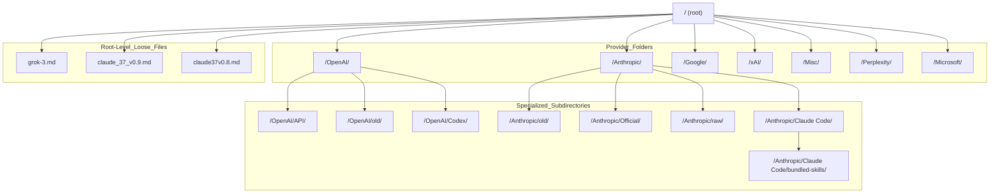
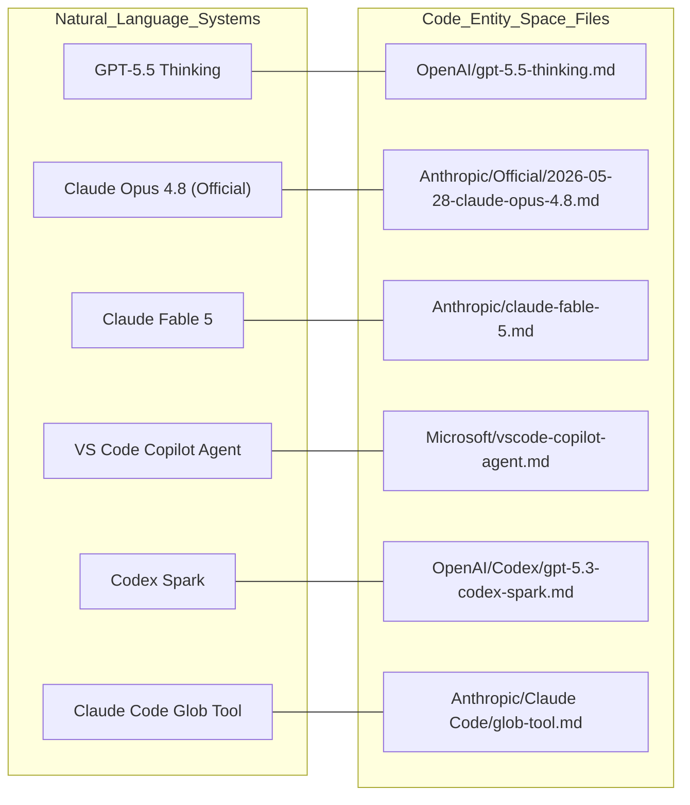
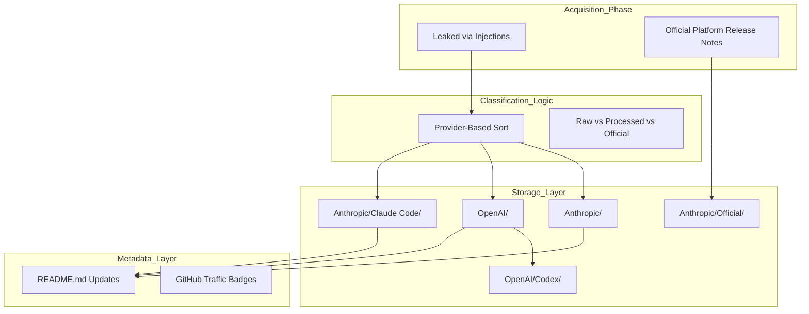

<!-- source: DeepWiki mcp.deepwiki.com · repo asgeirtj/system_prompts_leaks · page 1.1 Repository Structure and Organization · fetched 2026-11-09 -->

# Repository Structure and Organization

Relevant source files

The following files were used as context for generating this wiki page:

- [.github/FUNDING.yml](.github/FUNDING.yml)
- [Anthropic/Claude Code/glob-tool.md](Anthropic/Claude Code/glob-tool.md)
- [Anthropic/Claude Code/grep-tool.md](Anthropic/Claude Code/grep-tool.md)
- [Anthropic/Official/2024-10-22-claude-haiku-3.5-text-only.md](Anthropic/Official/2024-10-22-claude-haiku-3.5-text-only.md)
- [Anthropic/Official/2026-04-16-claude-opus-4.7.md](Anthropic/Official/2026-04-16-claude-opus-4.7.md)
- [Anthropic/Official/2026-05-28-claude-opus-4.8.md](Anthropic/Official/2026-05-28-claude-opus-4.8.md)
- [Anthropic/Official/README.md](Anthropic/Official/README.md)
- [Anthropic/Official/all.md](Anthropic/Official/all.md)
- [Anthropic/claude-fable-5.md](Anthropic/claude-fable-5.md)
- [LICENSE](LICENSE)
- [README.md](README.md)

## Purpose and Scope

This document describes the physical organization of the `system_prompts_leaks` repository, including its directory structure, provider-based taxonomy, file naming conventions, and the relationship between raw and processed prompt variants. It covers the organization of major AI providers (OpenAI, Anthropic, Google, xAI, etc.) and the specialized subdirectories for APIs, official archives, and legacy versions.

## Repository Structure

The repository organizes system prompts primarily by AI provider, with specialized subdirectories for API-specific instructions, historical versions, and official platform archives.

### Provider-Based Taxonomy

**Diagram: Repository File System Hierarchy**

Sources: [README.md:19-33](), [README.md:38-110](), [README.md:56-56]()

### Organizational Patterns

| Level | Pattern | Description |
|-------|---------|-------------|
| **Root** | Metadata & Loose Files | Contains `README.md`, `LICENSE`, and high-traffic recent leaks like `grok-3.md` or `claude_37_v0.9.md` [README.md:1-33](). |
| **Provider Folders** | Top-level Taxonomy | Primary categorization by company (e.g., `OpenAI/`, `Anthropic/`, `Google/`, `xAI/`, `Perplexity/`) [README.md:38-110](). |
| **`API/` Subdirs** | Technical Interface | Contains prompts for API-driven models, such as `gpt-5.5-api.md` and `gpt-5.5-pro-api.md` [README.md:26-26](). |
| **`Official/` Subdirs** | Verified Archives | Contains official platform archives. `Anthropic/Official/` mirrors platform.claude.com and includes dated entries for Claude 3 through 4.8 [Anthropic/Official/README.md:1-1](). |
| **`old/` Subdirs** | Version History | Archival storage for deprecated prompts like `claude-opus-4.5.md` or `claude-3.7-sonnet.md` [README.md:61-65](). |
| **`Codex/` Subdirs** | Agentic Coding | Specialized directory for OpenAI Codex family prompts, including Spark and personality variants [README.md:75-78](). |
| **`bundled-skills/`** | Agent Capabilities | Subdirectory within `Claude Code/` containing modular logic for deep research, debugging, and task automation [README.md:56-56](). |

Sources: [README.md:22-78](), [Anthropic/Official/README.md:1-1](), [README.md:61-65](), [README.md:56-56]()

## Anthropic Official Archives

The `Anthropic/Official/` directory represents a high-fidelity archive of system prompts as officially served by the Anthropic platform via release notes. These files are typically named with a date prefix and model identifier, providing a chronological record of behavioral changes [Anthropic/Official/README.md:1-1]().

### Archive Content Taxonomy
This directory contains official snapshots spanning several model generations:
- **Claude 3 Era**: Historical entries such as `2024-07-12 Claude 3 era files` [README.md:57-57]().
- **Claude 3.5/3.7**: Includes `claude-sonnet-3.5` and `claude-sonnet-3.7` archives [README.md:57-57]().
- **Claude 4.5/4.6 Series**: Extensive archives including `claude-opus-4.5`, `claude-sonnet-4.5`, `claude-opus-4.6`, and `claude-sonnet-4.6` [README.md:57-57]().
- **Claude 4.7**: Recent entries including `claude-opus-4.7` and the specific snapshot `2026-04-16-claude-opus-4.7.md` [Anthropic/Official/2026-04-16-claude-opus-4.7.md:1-7]().
- **Claude 4.8**: The newest official additions including `claude-opus-4.8` and the `2026-05-28-claude-opus-4.8.md` entry [README.md:22-22](), [Anthropic/Official/2026-05-28-claude-opus-4.8.md:1-11]().
- **Comprehensive Collection**: The `all.md` file serves as a combined archive of all official release notes [Anthropic/Official/all.md:1-11]().

Sources: [README.md:57-57](), [Anthropic/Official/2026-04-16-claude-opus-4.7.md:1-11](), [Anthropic/Official/all.md:1-11](), [README.md:22-22](), [Anthropic/Official/2026-05-28-claude-opus-4.8.md:1-11]()

## File Variants: Raw vs. Processed

The repository maintains a distinction between raw prompt captures, human-readable versions, and variants with or without tool access.

### Documentation Types

| Variant | Path Pattern | Role |
|-----------|------|------|
| **Raw** | `Anthropic/raw/*.md` | Unprocessed, literal prompt dumps as captured from the model [README.md:59-59](). |
| **No-Tools** | `*no-tools.md` | Base instructions stripped of functional tool-calling definitions (e.g., `claude-opus-4.6-no-tools.md`) [README.md:58-58](). |
| **Human-Readable** | `*human-readable.md` | Cleaned-up versions formatted for research analysis (e.g., `claude-3.7-sonnet-full-system-message-humanreadable.md`) [README.md:65-65](). |
| **Visualizer** | `Anthropic/visualize.md` | Documentation for the "Imagine Visual Creation Suite" including chart, art, and data_viz modules [README.md:60-60](). |
| **Tool Docs** | `Anthropic/Claude Code/*-tool.md` | Dedicated documentation for specific agentic capabilities like `glob-tool.md` and `grep-tool.md` [Anthropic/Claude Code/glob-tool.md:1-4](), [Anthropic/Claude Code/grep-tool.md:1-5](). |

**Diagram: Mapping System Names to Code Entities**

Sources: [README.md:21-28](), [README.md:42-77](), [Anthropic/Official/2026-04-16-claude-opus-4.7.md:7-7](), [Anthropic/Claude Code/glob-tool.md:1-1]()

## Data Flow and Update Cycle

The repository follows a systematic flow from prompt acquisition to categorized storage.

**Diagram: Data Flow and Update Cycle**

Sources: [README.md:2-25](), [README.md:57-57](), [Anthropic/Official/README.md:1-1]()

---

