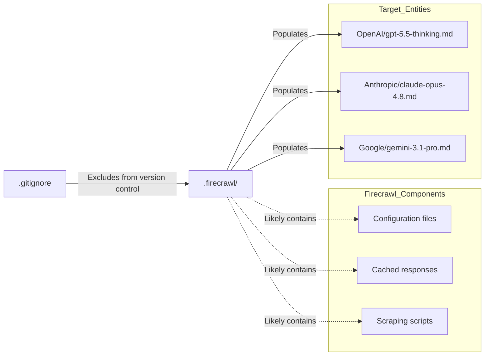
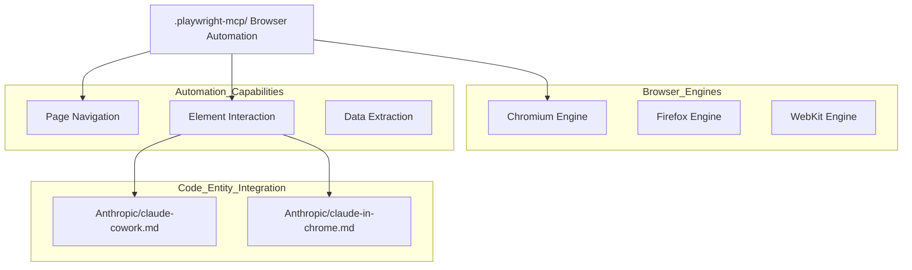
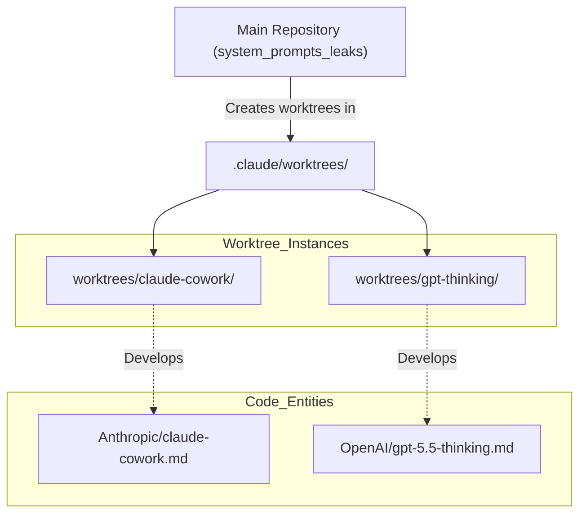

<!-- source: DeepWiki mcp.deepwiki.com · repo asgeirtj/system_prompts_leaks · page 1.2 Development Infrastructure and Tools · fetched 2026-11-09 -->

# Development Infrastructure and Tools

<details>
<summary>Relevant source files</summary>

The following files were used as context for generating this wiki page:

- [.github/CONTRIBUTING.md](.github/CONTRIBUTING.md)
- [.github/scripts/accumulate-traffic.py](.github/scripts/accumulate-traffic.py)
- [.github/workflows/traffic-to-badge.yml](.github/workflows/traffic-to-badge.yml)

</details>


## Purpose and Scope

This document covers the development infrastructure and tools used in the `system_prompts_leaks` repository for collecting, managing, and processing AI system prompts from major providers. These tools support the core workflow of acquiring system prompt data through web scraping, browser automation, and parallel development workflows. All tools documented here are excluded from version control via [.gitignore:1-9]() but are essential to the repository's operation.

For documentation of the repository's file organization and taxonomy, see [1.1 Repository Structure and Organization](). For information about specific visualization tools like the Claude System Prompt Explorer, see [2.6 Raw and Human-Readable System Prompt Variants]().

## Development Tool Inventory

The repository employs primary infrastructure components, each serving a distinct purpose in the system prompt collection and management pipeline:

| Tool | Directory / File | Primary Function | Usage Context |
|------|-----------|------------------|---------------|
| **Firecrawl** | `.firecrawl/` | Web crawling and scraping | Automated extraction of system prompts from web interfaces |
| **Playwright MCP** | `.playwright-mcp/` | Browser automation | Dynamic content interaction and testing |
| **Claude Worktrees** | `.claude/worktrees/` | Git worktree management | Parallel development of multiple system prompt variants |
| **GitHub Actions** | `.github/workflows/` | CI/CD and Automation | Automated updates, traffic tracking, and dashboard generation |
| **Antigravity CLI** | `.antigravitycli` | Google DeepMind agentic coding | Specialized coding assistant for Google-related prompts |

**Sources:** [.gitignore:1-9](), [.github/workflows/traffic-to-badge.yml:1-6](), [.github/CONTRIBUTING.md:1-24]()

## Tool Architecture and Workflow Integration

### Development Infrastructure Overview

```mermaid
graph TB
    subgraph "External_Sources"
        ["OpenAI Web Interface"]
        ["Anthropic claude.ai"]
        ["Google AI Studio"]
        ["xAI Platform"]
    end
    
    subgraph "Collection_Layer"
        Firecrawl[".firecrawl/ Web Crawling Engine"]
        PlaywrightMCP[".playwright-mcp/ Browser Automation"]
    end
    
    subgraph "Automation_&_CI"
        GHActions[".github/workflows/ GitHub Actions"]
        TrafficBadge["traffic-to-badge.yml"]
        TrafficScript["accumulate-traffic.py"]
    end
    
    subgraph "Development_Layer"
        ClaudeWorktrees[".claude/worktrees/ Git Worktree Manager"]
        Antigravity[".antigravitycli Agentic Assistant"]
    end
    
    subgraph "Repository_Content"
        OpenAIDir["OpenAI/gpt-5.5-thinking.md"]
        AnthropicDir["Anthropic/claude-opus-4.8.md"]
        GoogleDir["Google/gemini-3.1-pro.md"]
        xAIDir["xAI/grok-expert.md"]
    end
    
    ["OpenAI Web Interface"] -->|"Scrape system prompts"| Firecrawl
    ["Anthropic claude.ai"] -->|"Scrape system prompts"| Firecrawl
    
    ["OpenAI Web Interface"] -->|"Dynamic content extraction"| PlaywrightMCP
    ["Anthropic claude.ai"] -->|"Dynamic content extraction"| PlaywrightMCP
    
    Firecrawl -->|"Extracted prompts"| OpenAIDir
    Firecrawl -->|"Extracted prompts"| AnthropicDir
    
    PlaywrightMCP -->|"Testing & validation"| AnthropicDir
    
    GHActions -->|"Automated collection"| Firecrawl
    GHActions -->|"Traffic analytics"| TrafficBadge
    TrafficBadge -->|"Triggers"| TrafficScript
    
    ClaudeWorktrees -->|"Parallel development"| AnthropicDir
    ClaudeWorktrees -->|"Parallel development"| OpenAIDir
    Antigravity -->|"Google DeepMind assistant"| GoogleDir
```

**Development Infrastructure Workflow**: This diagram shows how external AI provider interfaces are accessed through Firecrawl (for static content scraping) and Playwright MCP (for dynamic content interaction), with results organized into provider-specific directories. GitHub Actions orchestrates these tools for automated updates and repository analytics via `accumulate-traffic.py`.

**Sources:** [.gitignore:2-9](), [.github/workflows/traffic-to-badge.yml:1-15](), [.github/scripts/accumulate-traffic.py:1-7]()

## Firecrawl - Web Scraping Infrastructure

### Overview

Firecrawl is a web crawling and scraping tool stored in the `.firecrawl/` directory. It is the primary mechanism for extracting system prompts from AI provider web interfaces, particularly those that expose prompt information through HTTP responses or rendered web pages.

### Directory Structure and Data Flow



**Firecrawl Directory Architecture**: The `.firecrawl/` directory is excluded from version control and serves as the repository's web scraping infrastructure for collecting system prompts from all major AI providers.

**Sources:** [.gitignore:2](), [.github/CONTRIBUTING.md:11-17]()

### Purpose and Capabilities

Firecrawl provides the following capabilities for this repository:

1.  **Static Content Extraction**: Retrieval of system prompts embedded in HTML responses.
2.  **API Response Capture**: Interception and storage of system prompt data from API endpoints.
3.  **Metadata Collection**: Extraction of model versions, knowledge cutoff dates, and configuration parameters.

## Playwright MCP - Browser Automation Framework

### Overview

Playwright MCP (Model Context Protocol) is a browser automation framework stored in the `.playwright-mcp/` directory. It provides programmatic control over browser instances for interacting with dynamic web content that cannot be scraped through static HTTP requests alone. This is particularly relevant for the complex tool ecosystems seen in Claude Cowork mode.

### Architecture



**Playwright MCP Architecture**: The `.playwright-mcp/` framework provides browser automation across multiple engines, supporting dynamic content extraction and testing scenarios for environments like `claude-cowork.md` and `claude-in-chrome.md`.

**Sources:** [.gitignore:3](), [.github/CONTRIBUTING.md:11-19]()

### Key Capabilities

Playwright MCP enables:

1.  **Dynamic Content Handling**: Execution of JavaScript to render system prompts that are client-side generated.
2.  **Authentication Flow Automation**: Navigation through login sequences to access protected system prompt endpoints.
3.  **Wait Strategies**: Intelligent waiting for network requests and DOM mutations before extraction.
4.  **Tool Interaction Testing**: Validating browser-based tools such as those used in Claude in Chrome, which include functions like navigation and page reading.

## Claude Worktrees - Git Workflow Management

### Overview

The `.claude/worktrees/` directory implements Git worktree management for parallel development of system prompt documentation. Git worktrees allow multiple working directories to be checked out simultaneously from a single repository.

### Worktree Architecture



**Claude Worktrees Directory Structure**: The `.claude/worktrees/` directory manages multiple parallel working directories, enabling simultaneous development of different AI provider system prompt documentation.

**Sources:** [.gitignore:4](), [.github/CONTRIBUTING.md:7-17]()

## GitHub Actions - Automation and CI

The repository utilizes GitHub Actions for automated maintenance and data visualization.

### Traffic and Dashboard Generation
The workflow `traffic-to-badge.yml` runs daily to collect repository traffic data and generate a live dashboard.

- **Trigger**: Scheduled cron job at `0 0 * * *` and manual `workflow_dispatch` [.github/workflows/traffic-to-badge.yml:4-6]().
- **Data Collection**: Uses `yi-Xu-0100/traffic-to-badge` to collect view and clone counts [.github/workflows/traffic-to-badge.yml:30-40]().
- **Post-Processing**: Executes `.github/scripts/accumulate-traffic.py` to merge today's snapshots into historical files `traffic_referrers_history.json` and `traffic_paths_history.json` [.github/scripts/accumulate-traffic.py:15-18](), [.github/workflows/traffic-to-badge.yml:42-43]().
- **Dashboard**: Generates a self-contained HTML dashboard (`dashboard.html`) using ApexCharts and embedded JSON data [.github/scripts/accumulate-traffic.py:76-97]().
- **Deployment**: Updates are pushed to a dedicated `traffic` branch [.github/workflows/traffic-to-badge.yml:45-50]().

### Traffic Data Management Logic
The `accumulate-traffic.py` script manages the state of repository analytics by merging current GitHub API snapshots with historical data stored in the `traffic` branch.

| Function | Role | Code Reference |
| :--- | :--- | :--- |
| `fetch_from_branch` | Retrieves historical JSON from `origin/traffic` | [.github/scripts/accumulate-traffic.py:27-36]() |
| `accumulate` | Merges new `referrers` and `paths` into history | [.github/scripts/accumulate-traffic.py:38-74]() |
| `build_dashboard` | Injects series data into `DASHBOARD_TEMPLATE` | [.github/scripts/accumulate-traffic.py:76-97]() |

**Sources:** [.github/workflows/traffic-to-badge.yml:1-54](), [.github/scripts/accumulate-traffic.py:1-114]()

## Version Control Exclusion Strategy

### .gitignore Configuration

All primary development tools and temporary files are excluded from version control through explicit entries in [.gitignore:1-9]():

```
.DS_Store
._*
.venv/
.firecrawl/
.playwright-mcp/
.claude/worktrees/
git-log.txt
tmp/
.antigravitycli
```

### Rationale for Exclusion

Each tool is excluded for specific reasons:

1.  **`.firecrawl/`**: Contains cached web responses and scraping scripts that may include sensitive authentication tokens [.gitignore:4]().
2.  **`.playwright-mcp/`**: Stores browser state, session cookies, and potentially large browser binaries [.gitignore:5]().
3.  **`.claude/worktrees/`**: Git worktrees are repository-specific development artifacts that should not be shared across clones [.gitignore:6]().
4.  **`.antigravitycli`**: Local configuration for Google DeepMind's agentic coding assistant [.gitignore:9]().
5.  **`.venv/`**: Local Python virtual environment for tool execution [.gitignore:3]().

### Developer Onboarding Implications

Developers cloning this repository must:

1.  Install Firecrawl independently (if scraping new content).
2.  Set up Playwright MCP with appropriate browser drivers (if automating collection).
3.  Create their own worktrees based on their workflow needs as described in the contribution guide [.github/CONTRIBUTING.md:7-10]().

**Sources:** [.gitignore:1-9](), [.github/CONTRIBUTING.md:7-10]()

## Tool Interaction and Dependencies

### Dependency Relationships

The tools form a complementary ecosystem:

| Tool | Depends On | Provides To | Isolation Level |
|------|------------|-------------|-----------------|
| `.firecrawl/` | External web endpoints | Raw system prompt data | Complete (separate process) |
| `.playwright-mcp/` | Browser engines | Enhanced dynamic data | Complete (separate process) |
| `.claude/worktrees/` | Main Git repository | Parallel development capacity | Git-managed isolation |
| `GitHub Actions` | Repository secrets | Traffic badges and dashboard | Remote CI environment |
| `.antigravitycli` | Google DeepMind Platform | Antigravity CLI logic | Local configuration |

**Sources:** [.gitignore:2-9](), [.github/workflows/traffic-to-badge.yml:32-43](), [.github/scripts/accumulate-traffic.py:1-7]()

---

