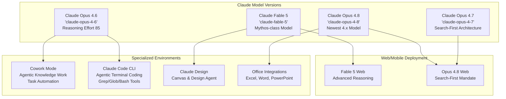
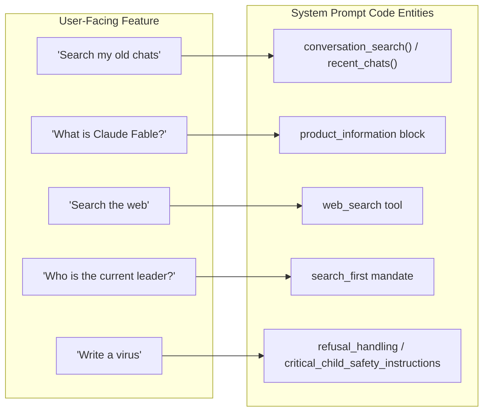

<!-- source: DeepWiki mcp.deepwiki.com · repo asgeirtj/system_prompts_leaks · page 2 Anthropic Claude Systems · fetched 2026-11-09 -->

# Anthropic Claude Systems

Relevant source files

The following files were used as context for generating this wiki page:

- [Anthropic/Claude Code/claude-code-2.1.172-fable-5.md](Anthropic/Claude Code/claude-code-2.1.172-fable-5.md)
- [Anthropic/Claude Code/claude-code-2.1.172-opus-4.6.md](Anthropic/Claude Code/claude-code-2.1.172-opus-4.6.md)
- [Anthropic/Claude Code/claude-code-2.1.172-opus-4.8.md](Anthropic/Claude Code/claude-code-2.1.172-opus-4.8.md)
- [Anthropic/claude-opus-4.6.md](Anthropic/claude-opus-4.6.md)
- [Anthropic/claude-opus-4.7.md](Anthropic/claude-opus-4.7.md)
- [Anthropic/claude-opus-4.8.md](Anthropic/claude-opus-4.8.md)
- [Anthropic/raw/claude-opus-4.6-raw.md](Anthropic/raw/claude-opus-4.6-raw.md)

This page provides an overview of Anthropic's Claude system prompts captured in this repository, covering multiple model versions (Fable 5, Opus 4.8, Opus 4.7, Opus 4.6, Sonnet 4.6) and deployment contexts (web/mobile chat interface, desktop code CLI, and specialized modes). It compares architectural patterns, tool ecosystems, and operational guidelines across these variants.

For detailed documentation of specific systems:
- [Claude Opus 4.6 - Complete Architecture](#2.1)
- [Claude Fable 5, Opus 4.8, and Opus 4.7 - Newest Model Family](#2.2)
- [Claude Cowork Mode - VM Environment and Agent System](#2.3)
- [Claude Desktop Code CLI, Office Integrations, and Bundled Skills](#2.4)
- [Raw, Human-Readable, and Specialized Deployment Variants](#2.6)

## Product Lineup and Deployment Contexts

The Claude family is categorized by model capability and the specific interface or "mode" in which the model operates. Each mode injects distinct toolsets and behavioral constraints into the system prompt.

Typical model identifiers found in the prompts include `claude-fable-5` [Anthropic/Claude Code/claude-code-2.1.172-fable-5.md:31](), `claude-opus-4-8` [Anthropic/claude-opus-4.8.md:19](), `claude-opus-4-7` [Anthropic/claude-opus-4.7.md:17](), and `claude-opus-4-6` [Anthropic/claude-opus-4.6.md:13]().

### Model Hierarchy
*   **Claude Fable 5**: The first model in the Claude 5 family and part of the new **Mythos-class** tier. It is positioned above Claude Opus in capability and includes enhanced safety measures for dual-use capabilities [Anthropic/Claude Code/claude-code-2.1.172-fable-5.md:31]().
*   **Claude Opus 4.8**: The newest model in the 4.x family, maintaining the aggressive `search_first` mandate and adding explicit guidance for agentic tools like `Claude Design` [Anthropic/claude-opus-4.8.md:19-29]().
*   **Claude Opus 4.7**: Introduced the mandatory `search_first` mandate for factual questions, requiring search before answering regardless of model confidence [Anthropic/claude-opus-4.7.md:5-7]().
*   **Claude Opus 4.6**: A flagship model featuring a comprehensive tool ecosystem and a `reasoning_effort` configuration of 85 [Anthropic/claude-opus-4.6.md:1-9]().
*   **Claude Sonnet 4.6**: Balanced performance within the 4.6 family [Anthropic/claude-opus-4.6.md:9]().

### Specialized Interfaces
Claude is accessible via standard web/mobile chat, but also through specialized agentic products:
*   **Claude Code**: A CLI tool for agentic coding directly from the terminal, utilizing tools like `Bash`, `Edit`, `Grep`, and `Glob` [Anthropic/Claude Code/claude-code-2.1.172-opus-4.8.md:1-12]().
*   **Claude Cowork**: A desktop tool for non-developers to automate file and task management, utilizing a multi-agent system [Anthropic/claude-opus-4.8.md:27-29]().
*   **Claude Design**: An agent with a canvas and design tools for iterative visual creation [Anthropic/claude-opus-4.8.md:29]().
*   **Claude in Chrome**: A browsing agent for web automation [Anthropic/claude-opus-4.7.md:17]().
*   **Claude in Excel, Word, & PowerPoint**: Specialized agents for spreadsheets, documents, and slides [Anthropic/claude-opus-4.8.md:29]().

**Claude Family Architecture**

**Sources:** [Anthropic/Claude Code/claude-code-2.1.172-fable-5.md:31-46](), [Anthropic/claude-opus-4.8.md:19-29](), [Anthropic/claude-opus-4.7.md:13-17](), [Anthropic/claude-opus-4.6.md:1-13]()

## Common Architectural Components

Despite deployment differences, Claude systems share a core "System Prompt Architecture" characterized by XML-tagged modules and specific tool-calling frameworks.

### Memory and Context Management
Claude utilizes a dual-layered memory system. It actively searches past interactions using tools such as `conversation_search` and `recent_chats`. Users can customize the experience via `user preferences` (for tone/formatting) and the `style` feature (for writing style) [Anthropic/claude-opus-4.7.md:23-24]().

### Search and Information Retrieval
The `<search_first>` mandate is a defining feature of the 4.7 and 4.8 families. Claude must use the `web_search` tool for any factual question about the present-day world, regardless of internal confidence [Anthropic/claude-opus-4.7.md:5-9](). The 4.8 model adds a strict prohibition against offering to search in a follow-up; if a search is needed, it must be performed immediately [Anthropic/claude-opus-4.8.md:9-11]().

### Safety and Copyright (The "Hard Limits")
A defining feature of the Claude architecture is strict copyright compliance and child safety. Critical child safety instructions [Anthropic/claude-opus-4.7.md:39-50]() require special attention, prohibiting romantic content involving minors or decoding CSAM-related slang [Anthropic/claude-opus-4.8.md:53-59](). Claude is also prohibited from working on malicious code or weapon creation [Anthropic/claude-opus-4.6.md:41-43]().

**Mapping Natural Language to Code Entities**

**Sources:** [Anthropic/Claude Code/claude-code-2.1.172-fable-5.md:31-50](), [Anthropic/claude-opus-4.8.md:5-11](), [Anthropic/claude-opus-4.7.md:5-24](), [Anthropic/claude-opus-4.6.md:21-43]()

## Tool Ecosystem Comparison

The toolset varies significantly between the standard Web interface and the Desktop/CLI environments.

| Tool Category | Web/Mobile (Fable 5 / Opus 4.8) | Claude Code CLI |
| :--- | :--- | :--- |
| **Search** | `conversation_search`, `web_search` | `WebSearch`, `WebFetch` |
| **Agentic** | Implicit / Cowork integration | `Agent` (subagent_type: Plan, Explore, etc.) |
| **Code/Files** | `Code Execution` | `Bash`, `Edit`, `Write`, `Grep`, `Glob` |
| **Communication**| Standard Chat | `AskUserQuestion`, `SendMessage` |
| **Productivity** | `Artifacts`, `Imagine` | `NotebookEdit` |

**Sources:** [Anthropic/Claude Code/claude-code-2.1.172-fable-5.md:31-50](), [Anthropic/Claude Code/claude-code-2.1.172-opus-4.8.md:54-76](), [Anthropic/claude-opus-4.8.md:29-35]()

## Child Pages

For granular technical details on each subsystem, refer to the following pages:

*   **[Claude Opus 4.6 - Complete Architecture](#2.1)**: Deep dive into the primary flagship model's toolset, reasoning effort (set to 85 [Anthropic/claude-opus-4.6.md:1]()), and past conversation search.
*   **[Claude Fable 5, Opus 4.8, and Opus 4.7 - Newest Model Family](#2.2)**: Analysis of the newest Mythos-class Fable 5 model [Anthropic/Claude Code/claude-code-2.1.172-fable-5.md:31](), the mandatory `search_first` policy [Anthropic/claude-opus-4.7.md:5](), and the expanded `product_information` blocks.
*   **[Claude Cowork Mode - VM Environment and Agent System](#2.3)**: Details on the agentic knowledge-work desktop app and its interaction with beta products like Claude in Chrome [Anthropic/claude-opus-4.8.md:27-29]().
*   **[Claude Desktop Code CLI, Office Integrations, and Bundled Skills](#2.4)**: Documentation of the CLI toolset for software engineering tasks, including `Bash`, `Edit`, and multi-agent sub-delegation [Anthropic/Claude Code/claude-code-2.1.172-opus-4.8.md:56-66]().
*   **[Raw, Human-Readable, and Specialized Deployment Variants](#2.6)**: Comparison of different prompt formats, including raw markdown [Anthropic/raw/claude-opus-4.6-raw.md:1](), visualization tools, and specialized mobile/voice variants.

---

