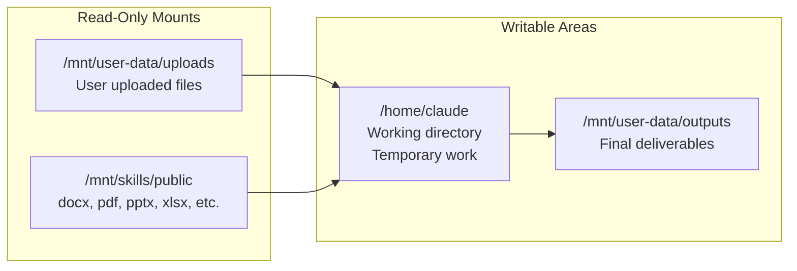

<!-- source: DeepWiki mcp.deepwiki.com · repo asgeirtj/system_prompts_leaks · page 2.1 Claude Opus 4.6 - Complete Architecture · fetched 2026-11-09 -->

# Claude Opus 4.6 - Complete Architecture

Relevant source files

The following files were used as context for generating this wiki page:

- [Anthropic/claude-opus-4.6-no-tools.md](Anthropic/claude-opus-4.6-no-tools.md)
- [Anthropic/claude-opus-4.6.md](Anthropic/claude-opus-4.6.md)
- [Anthropic/claude-sonnet-4.6-no-tools.md](Anthropic/claude-sonnet-4.6-no-tools.md)
- [Anthropic/raw/claude-opus-4.6-raw.md](Anthropic/raw/claude-opus-4.6-raw.md)
- [Anthropic/raw/claude-sonnet-4.6-no-tools-raw.md](Anthropic/raw/claude-sonnet-4.6-no-tools-raw.md)
- [Anthropic/raw/claude-sonnet-4.6-raw.md](Anthropic/raw/claude-sonnet-4.6-raw.md)

## Purpose and Scope

This document provides a comprehensive architectural overview of Claude Opus 4.6, Anthropic's advanced AI assistant as deployed in the `claude.ai` and Claude mobile app interfaces. It covers the system's major subsystems, tool ecosystem, memory architecture, and operational principles. This iteration is identified as the most advanced and intelligent model in the Claude 4.6 family, which also includes Claude Sonnet 4.6.

For detailed information about specific subsystems, see:

- [Past Conversations and Memory System](#2.1.1) — Detail Claude's `conversation_search` and `recent_chats` tools, trigger pattern detection, and the `memory_user_edits` tool.
- [Search, Web Fetch, and Copyright Compliance](#2.1.3) — Document `web_search`, `web_fetch`, and critical copyright rules (15-word limit).
- [External Integrations - Slack, Gmail, and Google Workspace](#2.1.4) — Cover Slack tools, Gmail management, and Google Drive/Calendar access.
- [Artifacts and Anthropic API Integration](#2.1.5) — Explain the Artifact system, Claude-in-Claude (API in Artifacts), and `window.storage`.
- [User Preferences and Style Application](#2.1.6) — Document `userPreferences` and `userStyle` contextual application logic.

**Sources:** [Anthropic/claude-opus-4.6.md:7-13](), [Anthropic/raw/claude-opus-4.6-raw.md:7-11]()

## System Context and Identity

Claude Opus 4.6 maintains a precise understanding of its identity and the product ecosystem it inhabits. It is aware of its relationship to other models like Sonnet 4.6 and Haiku 4.5, as well as beta products like Claude in Chrome and Claude in Excel.

| Attribute | Value |
|-----------|-------|
| Identity | Claude, created by Anthropic |
| Model Family | Claude 4.6 |
| Model String | `claude-opus-4-6` |
| Deployment Context | `claude.ai` web interface, mobile, or desktop chat interface |
| Reasoning Effort | 85 (`antml:reasoning_effort`) |

The system is instructed to use web search to provide up-to-date information about Anthropic's products from `docs.claude.com` and `support.claude.com` rather than relying on its training data.

**Sources:** [Anthropic/claude-opus-4.6.md:1-15](), [Anthropic/raw/claude-opus-4.6-raw.md:1-13]()

## Complete System Architecture

The following diagram maps Claude Opus 4.6's architecture to its concrete implementations in code:

```mermaid
graph TB
    subgraph "User Interface Layer"
        USER["User via claude.ai<br/>or Claude app"]
    end
    
    subgraph "Core Conversation System"
        CONTEXT["Context Window<br/>system prompt + history"]
        MEMORY["userMemories<br/>background processing"]
        PREFS["userPreferences<br/>behavioral + contextual"]
        STYLE["userStyle<br/>writing preferences"]
    end
    
    subgraph "Past Conversations"
        CONV_SEARCH["conversation_search<br/>topic-based retrieval"]
        RECENT["recent_chats<br/>time-based retrieval<br/>n=1-20, pagination"]
        EDIT_MEM["memory_user_edits<br/>view/add/remove/replace"]
    end
    
    subgraph "Computer Use Environment"
        BASH["bash_tool<br/>Ubuntu 24 commands"]
        FILE_OPS["File Operations<br/>view, create_file, str_replace"]
        SKILLS["/mnt/skills/<br/>docx, pdf, pptx, xlsx"]
        PRESENT["present_files<br/>/mnt/user-data/outputs"]
    end
    
    subgraph "Search and Web"
        WEB_SEARCH["web_search<br/>query parameter"]
        WEB_FETCH["web_fetch<br/>url parameter"]
        IMAGE_SEARCH["image_search<br/>query, max_results=3-5"]
    end
    
    subgraph "External Integrations"
        SLACK["Slack Tools<br/>slack_send_message<br/>slack_search_public<br/>slack_read_channel"]
        GDRIVE["google_drive_search<br/>api_query parameter"]
        GMAIL["Gmail access"]
        GCAL["Google Calendar"]
    end
    
    subgraph "Artifacts System"
        ARTIFACTS[".md .html .jsx<br/>.mermaid .svg .pdf"]
        API["Anthropic API<br/>claude-sonnet-4-20250514"]
        MCP["mcp_servers parameter<br/>url, name, type"]
        STORAGE["window.storage API<br/>get/set/delete/list"]
    end
    
    subgraph "Safety and Control"
        COPYRIGHT["CRITICAL_COPYRIGHT_COMPLIANCE<br/>15 word limit, 1 quote/source"]
        END_CONV["end_conversation<br/>last resort only"]
        CHILD_SAFETY["critical_child_safety_instructions"]
    end
    
    USER --> CONTEXT
    CONTEXT --> MEMORY
    CONTEXT --> CONV_SEARCH
    CONTEXT --> BASH
    CONTEXT --> WEB_SEARCH
    CONTEXT --> SLACK
    CONTEXT --> ARTIFACTS
    
    MEMORY --> PREFS
    MEMORY --> STYLE
    MEMORY --> EDIT_MEM
    
    CONV_SEARCH --> RECENT
    
    BASH --> FILE_OPS
    FILE_OPS --> SKILLS
    FILE_OPS --> PRESENT
    
    WEB_SEARCH --> COPYRIGHT
    WEB_FETCH --> COPYRIGHT
    
    ARTIFACTS --> API
    API --> MCP
    ARTIFACTS --> STORAGE
```

**Architecture Overview: Claude Opus 4.6 System Components**

This architecture reveals seven major subsystems. The system operates within a context window that includes the system prompt, conversation history, and user memories. All tool invocations follow XML-based function calling syntax with `<antml:function_calls>` and `<antml:invoke>` tags.

**Sources:** [Anthropic/claude-opus-4.6.md:1-23](), [Anthropic/claude-opus-4.6-no-tools.md:38-51](), [Anthropic/raw/claude-sonnet-4.6-raw.md:7-13]()

## Tool Ecosystem

Claude Opus 4.6 provides a vast suite of tools. While the standard Opus 4.6 model is tool-capable, a specialized `no-tools` variant exists for environments where full agentic capabilities are restricted. This variant still utilizes a specific tool calling syntax for basic interaction widgets.

| Tool Name | Primary Parameters | Purpose | File Citation |
|-----------|-------------------|---------|----------------|
| `conversation_search` | `query` | Topic-based past chat search | [Anthropic/raw/claude-sonnet-4.6-raw.md:30-33]() |
| `recent_chats` | `n`, `before`, `after` | Time-based past chat retrieval | [Anthropic/raw/claude-sonnet-4.6-raw.md:34-38]() |
| `ask_user_input_v0` | `questions` | Present clickable choices | [Anthropic/claude-opus-4.6-no-tools.md:41-123]() |
| `message_compose_v1` | `kind`, `variants` | Draft emails, Slack, or texts | [Anthropic/claude-opus-4.6-no-tools.md:126-170]() |
| `end_conversation` | (none) | Terminate conversation | [Anthropic/claude-opus-4.6-no-tools.md:57-69]() |

**Sources:** [Anthropic/claude-opus-4.6-no-tools.md:27-170](), [Anthropic/raw/claude-sonnet-4.6-raw.md:30-38](), [Anthropic/claude-opus-4.6.md:13-13]()

## File System and Computer Use

Claude Opus 4.6 operates within a structured environment for managing user data and task execution, including specialized beta products like Cowork.

### Operational Constraints
- **File Lifecycle**: Claude uses specific paths for input and output, such as `/mnt/user-data/outputs` for deliverables.
- **Skill Requirements**: Claude has access to specific skills (e.g., `docx`, `pdf`, `xlsx`) which allow it to process various file formats.
- **Child Safety**: Extreme caution is exercised regarding content involving minors, with a strict refusal policy for any content that could be used for harm. [Anthropic/claude-opus-4.6.md:29-39]()

**Sources:** [Anthropic/claude-opus-4.6.md:29-39](), [Anthropic/raw/claude-opus-4.6-raw.md:24-32]()

## Memory and Personalization

Claude utilizes a sophisticated memory system to maintain continuity.

- **Past Chats**: Triggered by implicit signals (e.g., "my project") or explicit references. The system uses a decision framework to choose between `recent_chats` and `conversation_search`. [Anthropic/raw/claude-sonnet-4.6-raw.md:15-27](), [Anthropic/raw/claude-sonnet-4.6-raw.md:74-80]()
- **Personalization**: Users can provide `user preferences` for tone and formatting, and customize writing style using the `style` feature. [Anthropic/claude-opus-4.6.md:19-19]()
- **Tone Control**: Claude avoids over-formatting with bold emphasis, headers, or lists unless essential for clarity or requested by the user. [Anthropic/claude-opus-4.6.md:57-73]()

For more details, see [Past Conversations and Memory System](#2.1.1).

**Sources:** [Anthropic/raw/claude-sonnet-4.6-raw.md:15-80](), [Anthropic/claude-opus-4.6.md:19-19](), [Anthropic/claude-opus-4.6.md:57-73]()

## Search and Compliance

The system includes built-ly safeguards for information retrieval.

- **Copyright Compliance**: The system follows strict rules regarding quoting and citations, generally defaulting to paraphrasing unless a direct quote is necessary.
- **Web Retrieval**: Claude is instructed to first use web search when asked about Anthropic's products to ensure accuracy. [Anthropic/claude-opus-4.6.md:15-15]()
- **Financial/Legal Advice**: Claude provides factual information for informed decision-making rather than confident recommendations, noting it is not a lawyer or financial advisor. [Anthropic/claude-opus-4.6.md:51-55]()

For more details, see [Search, Web Fetch, and Copyright Compliance](#2.1.3).

**Sources:** [Anthropic/claude-opus-4.6.md:15-15](), [Anthropic/claude-opus-4.6.md:51-55](), [Anthropic/raw/claude-opus-4.6-raw.md:42-44]()

## Artifacts and API Integration

Artifacts provide a rich UI layer for rendering code and documents.

- **Persistent State**: The system supports persistent storage for Artifacts, allowing for complex interactive components via `window.storage`.
- **Tool Integration**: Tools like `ask_user_input_v0` and `message_compose_v1` use specialized widgets and share sheets to enhance the user experience. [Anthropic/claude-opus-4.6-no-tools.md:71-75](), [Anthropic/claude-opus-4.6-no-tools.md:143-146]()

For more details, see [Artifacts and Anthropic API Integration](#2.1.5).

**Sources:** [Anthropic/claude-opus-4.6-no-tools.md:71-146]()

---

