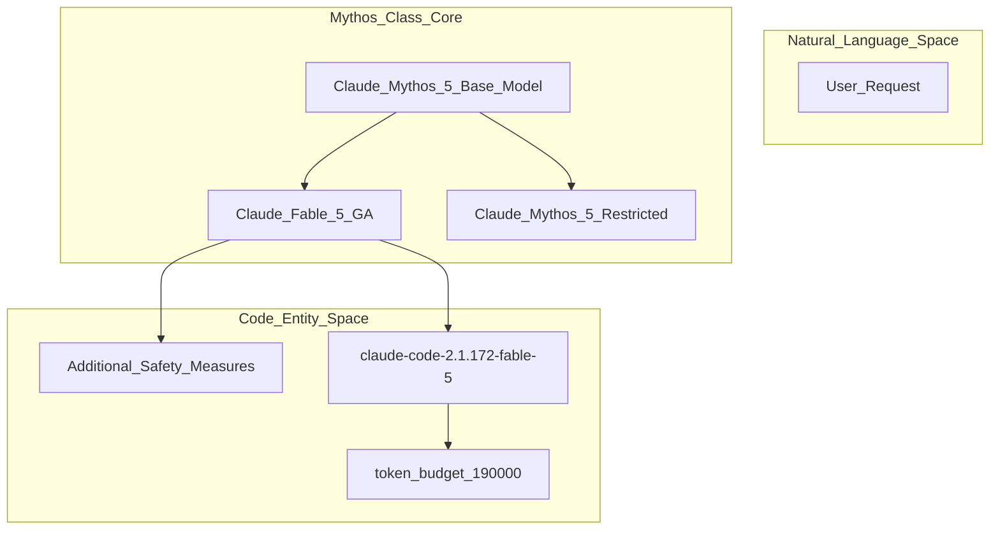
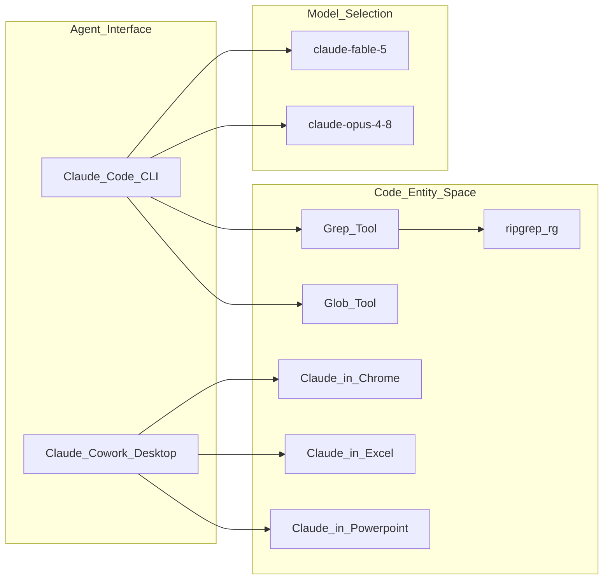

<!-- source: DeepWiki mcp.deepwiki.com · repo asgeirtj/system_prompts_leaks · page 2.2 Claude Fable 5, Opus 4.8, and Opus 4.7 - Newest Model Family · fetched 2026-11-09 -->

# Claude Fable 5, Opus 4.8, and Opus 4.7 - Newest Model Family

Relevant source files

The following files were used as context for generating this wiki page:

- [Anthropic/Claude Code/claude-code-2.1.172-fable-5.md](Anthropic/Claude Code/claude-code-2.1.172-fable-5.md)
- [Anthropic/Claude Code/claude-code-2.1.172-opus-4.6.md](Anthropic/Claude Code/claude-code-2.1.172-opus-4.6.md)
- [Anthropic/Claude Code/claude-code-2.1.172-opus-4.8.md](Anthropic/Claude Code/claude-code-2.1.172-opus-4.8.md)
- [Anthropic/Claude Code/glob-tool.md](Anthropic/Claude Code/glob-tool.md)
- [Anthropic/Claude Code/grep-tool.md](Anthropic/Claude Code/grep-tool.md)
- [Anthropic/Official/2026-04-16-claude-opus-4.7.md](Anthropic/Official/2026-04-16-claude-opus-4.7.md)
- [Anthropic/Official/2026-05-28-claude-opus-4.8.md](Anthropic/Official/2026-05-28-claude-opus-4.8.md)
- [Anthropic/Official/README.md](Anthropic/Official/README.md)
- [Anthropic/Official/all.md](Anthropic/Official/all.md)
- [Anthropic/claude-fable-5.md](Anthropic/claude-fable-5.md)
- [Anthropic/claude-opus-4.7.md](Anthropic/claude-opus-4.7.md)
- [Anthropic/claude-opus-4.8.md](Anthropic/claude-opus-4.8.md)

This page documents the architecture of Claude Fable 5, Claude Opus 4.8, and Claude Opus 4.7, the newest and most advanced models in the Anthropic family. It covers the introduction of the Mythos-class tier with Fable 5, the strict `search_first` mandate, the advanced research mode, and the specialized `Claude Code` CLI variants.

## Overview

Claude Fable 5 is the newest flagship model and the first entry in the Claude 5 / Mythos-class tier [Anthropic/claude-fable-5.md:17](). It represents a significant jump in capability over the Claude 4.X family, which is currently led by Claude Opus 4.8 [Anthropic/claude-opus-4.8.md:19](). These models are characterized by a "search-first" architecture where the model is mandated to verify factual claims in real-time rather than relying on internal training data [Anthropic/claude-opus-4.8.md:7-9]().

Key architectural highlights include:
*   **Mythos-Class Tier**: A new model class sitting above Opus in intelligence, debuting with Claude Fable 5 [Anthropic/claude-fable-5.md:17]().
*   **Search-First Mandate**: Mandatory web search for all present-day factual queries [Anthropic/claude-opus-4.8.md:9](), [Anthropic/claude-opus-4.7.md:7]().
*   **Advanced Research Mode**: Integration of the `deep research` feature and `launch_extended_search_task` tool [Anthropic/claude-opus-4.8.md:35]().
*   **Full Office Suite**: Beta integration with `Claude in Powerpoint`, `Claude in Excel`, `Claude in Chrome`, and `Claude Design` [Anthropic/claude-opus-4.8.md:29]().
*   **Agentic CLI**: The `Claude Code` (v2.1.172) variants for terminal-based software engineering [Anthropic/Claude Code/claude-code-2.1.172-fable-5.md:1]().

---

## Claude Fable 5: The First Mythos-Class Model

Claude Fable 5 is the first model in the Claude 5 family. It shares its underlying model with **Claude Mythos 5**, which is reserved for approved organizations due to its advanced capabilities [Anthropic/claude-fable-5.md:17](). Fable 5 includes additional safety measures for dual-use capabilities that are not present in the Mythos variant [Anthropic/Claude Code/claude-code-2.1.172-fable-5.md:31]().

### Mythos Tier Architecture

Fable 5 is positioned as the most intelligent generally available model [Anthropic/claude-fable-5.md:17](). It introduces a high `token_budget` of 190,000 [Anthropic/claude-fable-5.md:5]() and is optimized for autonomous operation in coding environments [Anthropic/Claude Code/claude-code-2.1.172-fable-5.md:54]().

**Diagram: Claude 5 / Mythos Tier Hierarchy**

Sources: [Anthropic/claude-fable-5.md:3-31](), [Anthropic/Claude Code/claude-code-2.1.172-fable-5.md:31-46]()

---

## Claude Opus 4.8 and 4.7

Claude Opus 4.8 is the most advanced model in the 4.X family, succeeding Opus 4.7 and the 4.6 family [Anthropic/claude-opus-4.8.md:19-23](). It introduces refined retrieval logic, explicitly forbidding the model from offering to "dig into" something in a future turn if the information can be retrieved immediately [Anthropic/claude-opus-4.8.md:11]().

### The Search-First Mandate

Models in this family follow a strict directive: Claude **must** search before answering any factual question about the present-day world [Anthropic/claude-opus-4.7.md:7](). This mandate overrides the model's confidence in its training data for:
*   **Pricing**: "What does this `<product>` cost?" [Anthropic/claude-opus-4.8.md:9]().
*   **Leadership**: "Who's the leader of `<country>`?" [Anthropic/claude-opus-4.8.md:9]().
*   **Documentation**: Mandatory searches of `https://docs.claude.com` and `https://support.claude.com` [Anthropic/claude-opus-4.8.md:31]().

---

## Specialized Deployment Variants

The newest models are deployed through specialized interfaces, most notably the `Claude Code` CLI and the `Cowork` desktop application.

*   **Claude Code (v2.1.172)**: An interactive agent for software engineering. It includes powerful tools like `Grep` for content searching [Anthropic/Claude Code/grep-tool.md:1]() and `Glob` for path matching [Anthropic/Claude Code/glob-tool.md:1]().
*   **Claude Cowork**: A desktop app for non-developers that can orchestrate beta tools like `Claude in Chrome`, `Excel`, and `Powerpoint` [Anthropic/claude-opus-4.8.md:27-29]().

**Diagram: Agentic Tool Orchestration (v2.1.172)**

Sources: [Anthropic/Claude Code/grep-tool.md:1-5](), [Anthropic/Claude Code/glob-tool.md:1-7](), [Anthropic/Claude Code/claude-code-2.1.172-fable-5.md:44-46](), [Anthropic/claude-opus-4.8.md:27-29]()

---

## Official Archives and Directory Structure

The `Anthropic/Official/` directory contains platform-specific archives, including the definitive Opus 4.8 release (2026-05-28) and the Opus 4.7 release (2026-04-16) [Anthropic/Official/2026-05-28-claude-opus-4.8.md:7](), [Anthropic/Official/2026-04-16-claude-opus-4.7.md:7](). These archives document the transition from the Claude 3 era to the current frontier.

### Model Comparison Table

| Feature | Claude Fable 5 | Claude Opus 4.8 | Claude Opus 4.7 |
| :--- | :--- | :--- | :--- |
| **Model String** | `claude-fable-5` [Anthropic/claude-fable-5.md:23]() | `claude-opus-4-8` [Anthropic/claude-opus-4.8.md:23]() | `claude-opus-4-7` [Anthropic/claude-opus-4.7.md:17]() |
| **Class** | Mythos-class [Anthropic/claude-fable-5.md:17]() | Opus-class [Anthropic/claude-opus-4.8.md:19]() | Opus-class [Anthropic/claude-opus-4.7.md:13]() |
| **Search Policy** | `search_first` [Anthropic/claude-fable-5.md:29]() | `search_first` + No-Offer [Anthropic/claude-opus-4.8.md:11]() | `search_first` [Anthropic/claude-opus-4.7.md:5]() |
| **Office Suite** | Excel, Powerpoint, Chrome [Anthropic/claude-fable-5.md:27]() | Excel, Powerpoint, Chrome, Design [Anthropic/claude-opus-4.8.md:29]() | Excel, Chrome, Powerpoint [Anthropic/Official/2026-04-16-claude-opus-4.7.md:15]() |

---

## Behavioral Guardrails

All models in this family implement rigorous safety protocols. The `<critical_child_safety_instructions>` forbid "mentally reframing" inappropriate requests into safe ones [Anthropic/claude-fable-5.md:47](). Fable 5 and Opus 4.8 include specific prohibitions against decoding slang or acronyms used in exploitation, as knowing these terms is considered "access-enabling" [Anthropic/claude-fable-5.md:50](), [Anthropic/claude-opus-4.8.md:59]().

For details on the Sonnet variants and the evolution from the Claude 4.5/4.6 era, see [Claude Sonnet 4.6 and Earlier Variants](#2.2.1).

Sources: [Anthropic/claude-fable-5.md:1-56](), [Anthropic/claude-opus-4.8.md:1-63](), [Anthropic/claude-opus-4.7.md:1-27](), [Anthropic/Claude Code/claude-code-2.1.172-fable-5.md:1-54](), [Anthropic/Official/2026-05-28-claude-opus-4.8.md:1-51](), [Anthropic/Official/2026-04-16-claude-opus-4.7.md:1-43]()

---

