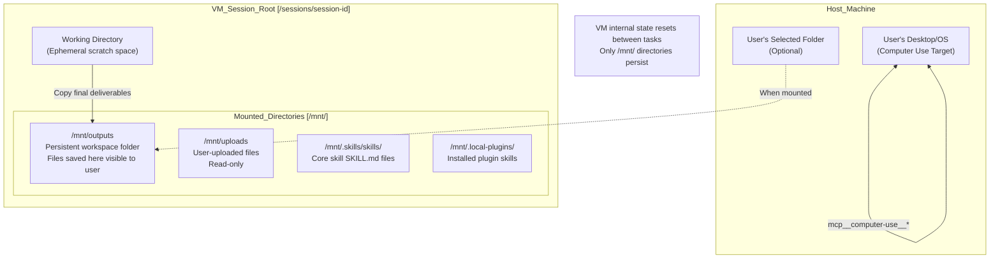
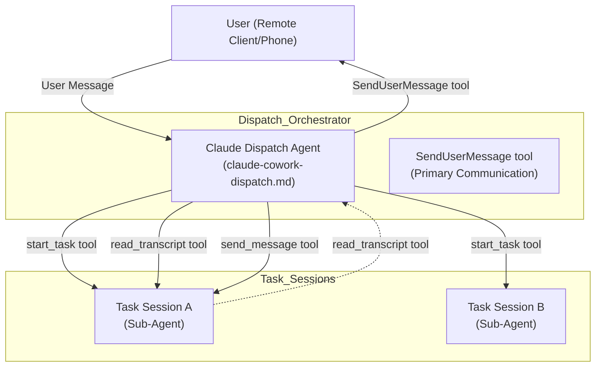

<!-- source: DeepWiki mcp.deepwiki.com · repo asgeirtj/system_prompts_leaks · page 2.3 Claude Cowork Mode - VM Environment and Agent System · fetched 2026-11-09 -->

# Claude Cowork Mode - VM Environment and Agent System

Relevant source files

The following files were used as context for generating this wiki page:

- [Anthropic/claude-cowork-dispatch.md](Anthropic/claude-cowork-dispatch.md)
- [Anthropic/claude-cowork.md](Anthropic/claude-cowork.md)

This document describes the architecture of Claude Cowork Mode, a research preview feature of the Claude desktop app that provides a sandboxed Linux VM environment for autonomous task execution. Cowork Mode is implemented on the Claude Agent SDK and operates as a specialized variant of Claude Opus 4.6 with extended tool capabilities, multi-agent coordination, and strict security boundaries. [Anthropic/claude-cowork.md:1-7]()

For Claude Opus 4.6's base architecture, see [Claude Opus 4.6 - Complete Architecture](#2.1). For security-specific implementation details, see [Security Architecture and Prompt Injection Defense](#2.3.1). For MCP tool integration, see [MCP Tools and Browser Automation](#2.3.2).

Sources: [Anthropic/claude-cowork.md:1-9](), [Anthropic/claude-cowork.md:15-16]()

---

## VM Environment Architecture

Cowork Mode runs inside a lightweight Ubuntu Linux VM on the user's local computer. The VM provides a secure execution sandbox with controlled access to user files through a mount system. [Anthropic/claude-cowork.md:5-7]()

### Directory Structure

The following diagram maps the relationship between the host machine and the VM's internal file system paths used by tools like `Read`, `Write`, and `Bash`.

**VM File System Mapping**

**File Access Rules:**

- **Working Directory** (`/sessions/[session-id]`): Temporary scratchpad for all intermediate work. Not visible to users. [Anthropic/claude-cowork-dispatch.md:67-68]()
- **Outputs** (`/mnt/outputs`): Final deliverables must be copied here. If the user mounted a folder, this IS that folder (bidirectional access). [Anthropic/claude-cowork-dispatch.md:44-46]()
- **Uploads** (`/mnt/uploads`): Read-only access to user-uploaded files. [Anthropic/claude-cowork-dispatch.md:67-68]()
- **Plugin Skills** (`/mnt/.local-plugins/`): Installed plugin skills from marketplaces via MCP bundles. [Anthropic/claude-cowork.md:15-16]()

Sources: [Anthropic/claude-cowork.md:5-7](), [Anthropic/claude-cowork.md:15-16](), [Anthropic/claude-cowork-dispatch.md:44-48](), [Anthropic/claude-cowork-dispatch.md:67-70]()

---

## Agent SDK Framework and Dispatch Orchestration

Cowork Mode implements the Claude Agent SDK, enabling hierarchical multi-agent task delegation. In some configurations, Claude acts as a **Dispatch orchestrator**, routing work to dedicated task sessions rather than performing them directly. [Anthropic/claude-cowork-dispatch.md:14-18]()

### Dispatch Coordination

The Dispatch system is a mobile-first interface where the assistant only communicates via the `SendUserMessage` tool. Plain text assistant replies are not rendered to the user. [Anthropic/claude-cowork-dispatch.md:16-17]()

**Dispatch Orchestration Flow**

**Dispatch Routing Heuristics:**
- **New Task**: Uses `start_task` for distinct goals unrelated to running tasks (e.g., "Find a confirmation in Downloads"). [Anthropic/claude-cowork-dispatch.md:27-35]()
- **Follow-up**: Uses `send_message` with an existing `session_id` for clarifications or corrections. [Anthropic/claude-cowork-dispatch.md:28-30]()
- **Progress Check**: Uses `read_transcript` to monitor task outcomes or check progress. [Anthropic/claude-cowork-dispatch.md:29-30]()

Sources: [Anthropic/claude-cowork-dispatch.md:14-31](), [Anthropic/claude-cowork-dispatch.md:52-63]()

---

## Core Tool Ecosystem

Cowork Mode provides a robust suite of core tools plus extensive MCP integrations. Tools are ground-truthed by the list at the top of the system prompt. [Anthropic/claude-cowork.md:1-2]()

### File and Code Tools

| Tool | Purpose | Key Constraint |
|------|---------|----------------|
| `Read` | File inspection | Used for workspace folder access. [Anthropic/claude-cowork.md:5]() |
| `Write` | File creation | Used for workspace folder access. [Anthropic/claude-cowork.md:5]() |
| `Edit` | Precise changes | Used for workspace folder access. [Anthropic/claude-cowork.md:5]() |
| `Bash` | Shell access | Sandboxed Linux shell for running code. [Anthropic/claude-cowork.md:5]() |

Sources: [Anthropic/claude-cowork.md:1-7]()

### Web and Search Tools

- **Web Search**: Claude first searches Anthropic's documentation (`docs.claude.com`) when asked about products or features. [Anthropic/claude-cowork.md:17-18]()
- **Policy Search**: Claude searches specific URLs (e.g., `anthropic.com/news/claude-is-a-space-to-think`) to answer questions about ads or company policies. [Anthropic/claude-cowork.md:23-24]()

Sources: [Anthropic/claude-cowork.md:17-24]()

---

## Skills System

The Skills system provides best-practice templates for specialized tasks. These are delivered via MCP bundles and plugins. [Anthropic/claude-cowork.md:15-16]()

**Specialized Agents (Beta):**
- **Claude in Chrome**: A browsing agent for web automation. [Anthropic/claude-cowork.md:15-16]()
- **Claude in Excel**: A spreadsheet agent for data management. [Anthropic/claude-cowork.md:15-16]()
- **Cowork**: A desktop tool for non-developers to automate file and task management. [Anthropic/claude-cowork.md:15-16]()

Sources: [Anthropic/claude-cowork.md:15-16]()

---

## Security and Permission Model

Cowork Mode operates under a strict security framework where certain actions are prohibited or require explicit user confirmation.

- **Prohibited Content**: Malicious code (malware, exploits), weapon creation, and content involving the sexualization of minors are strictly declined. [Anthropic/claude-cowork.md:31-35]()
- **Public Figures**: Claude avoids writing creative content involving real, named public figures or attributing fictional quotes to them. [Anthropic/claude-cowork.md:37-38]()
- **Computer Use**: The `mcp__computer-use__*` tools allow desktop control (screenshots, clicks, typing). These actions happen on the user's real computer, which is a separate filesystem from the sandbox VM. [Anthropic/claude-cowork-dispatch.md:72-76]()
- **Network Access**: Organization Owners can control Claude's network access settings in Admin settings. [Anthropic/claude-cowork.md:21-22]()

For detailed security architecture including prompt injection defense, see [Security Architecture and Prompt Injection Defense](#2.3.1).

For MCP tool integration including Claude in Chrome and Browser Automation, see [MCP Tools and Browser Automation](#2.3.2).

Sources: [Anthropic/claude-cowork.md:21-38](), [Anthropic/claude-cowork-dispatch.md:72-76]()

---

