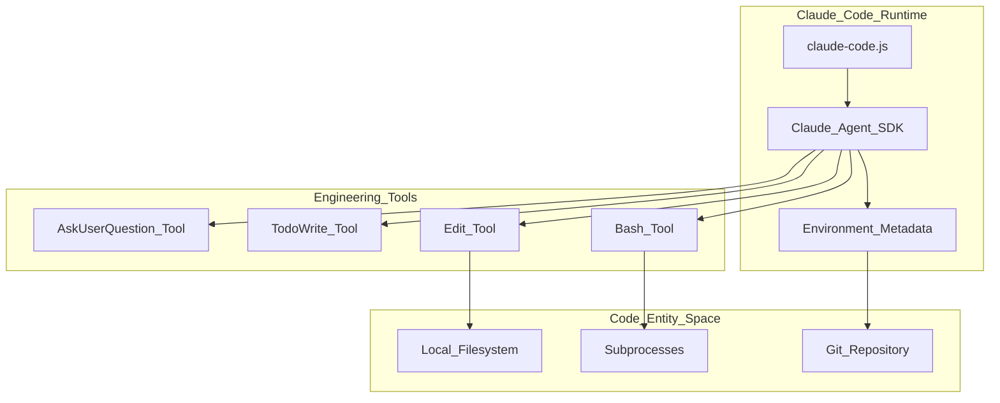
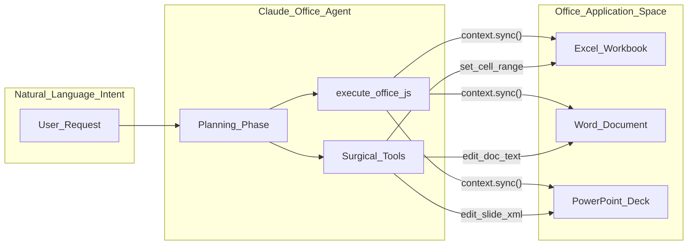

<!-- source: DeepWiki mcp.deepwiki.com · repo asgeirtj/system_prompts_leaks · page 2.4 Claude Desktop Code CLI, Office Integrations, and Bundled Skills · fetched 2026-11-09 -->

# Claude Desktop Code CLI, Office Integrations, and Bundled Skills

Relevant source files

The following files were used as context for generating this wiki page:

- [Anthropic/Claude Code/bundled-skills/batch.md](Anthropic/Claude Code/bundled-skills/batch.md)
- [Anthropic/Claude Code/bundled-skills/claude-api.md](Anthropic/Claude Code/bundled-skills/claude-api.md)
- [Anthropic/Claude Code/bundled-skills/code-review.md](Anthropic/Claude Code/bundled-skills/code-review.md)
- [Anthropic/Claude Code/bundled-skills/init.md](Anthropic/Claude Code/bundled-skills/init.md)
- [Anthropic/Claude Code/bundled-skills/keybindings-help.md](Anthropic/Claude Code/bundled-skills/keybindings-help.md)
- [Anthropic/Claude Code/bundled-skills/loop.md](Anthropic/Claude Code/bundled-skills/loop.md)
- [Anthropic/Claude Code/bundled-skills/review.md](Anthropic/Claude Code/bundled-skills/review.md)
- [Anthropic/Claude Code/bundled-skills/update-config-schema.json](Anthropic/Claude Code/bundled-skills/update-config-schema.json)
- [Anthropic/Claude Code/bundled-skills/update-config.md](Anthropic/Claude Code/bundled-skills/update-config.md)
- [Anthropic/claude-desktop-code.md](Anthropic/claude-desktop-code.md)
- [Anthropic/claude-for-excel.md](Anthropic/claude-for-excel.md)
- [Anthropic/claude-for-word.md](Anthropic/claude-for-word.md)
- [Anthropic/claude-in-powerpoint.md](Anthropic/claude-in-powerpoint.md)

This page documents the system prompts and operational architectures for **Claude Code** (Anthropic's official software engineering CLI), the suite of **Claude Office Integrations** (Excel, Word, and PowerPoint), and the **Bundled Skills** library. It covers the tool suites, task management via `TodoWrite`, the `AskUserQuestion` interaction pattern, and specialized implementation logic for Office.js and terminal environments.

---

## Claude Code CLI Architecture

Claude Code is an interactive agent designed for software engineering tasks, typically powered by **Claude Fable 5** (`claude-fable-5`), **Claude Opus 4.8** (`claude-opus-4-8`), or **Claude Opus 4.6** (`claude-opus-4-6`) [Anthropic/claude-desktop-code.md:2](). It operates within the Claude Agent SDK and is injected with environment metadata including working directory, git status, and shell type [Anthropic/claude-desktop-code.md:6-9]().

### Behavioral Directives
- **Professional Objectivity**: Claude is instructed to prioritize technical accuracy over user validation, applying rigorous standards and disagreeing when necessary [Anthropic/claude-desktop-code.md:25]().
- **Output Constraints**: Responses must be short, concise, and formatted for monospace CLI display using GitHub-flavored markdown [Anthropic/claude-desktop-code.md:19](). Emojis are prohibited unless explicitly requested [Anthropic/claude-desktop-code.md:18]().
- **Task Management**: Never provides time estimates. Instead, it breaks work into actionable steps [Anthropic/claude-desktop-code.md:28]().
- **Security Context**: Explicitly authorized for security testing, defensive security, and CTF challenges, provided clear authorization context is present [Anthropic/claude-desktop-code.md:10]().

**Claude Code CLI System Flow**

**Sources:** [Anthropic/claude-desktop-code.md:1-30]()

### Tool Inventory and Task Management
Claude Code utilizes a specialized toolset for codebase manipulation and process management.

| Tool Category | Tools | Key Constraints |
|---|---|---|
| **File System** | `Read`, `Edit`, `Write` | `Edit` (string replacement) is preferred over `Write` (overwrite) [Anthropic/claude-desktop-code.md:21](). |
| **Search** | `Glob`, `Grep` | `Glob` matches paths; `Grep` matches content. |
| **Planning** | `TodoWrite` | Used "VERY frequently" to track progress and plan steps [Anthropic/claude-desktop-code.md:31-32](). |
| **Interaction** | `AskUserQuestion` | Used to validate assumptions or clarify ambiguous requests [Anthropic/claude-desktop-code.md:78](). |

**Task Lifecycle (`TodoWrite`)**:
1. **Plan**: Write initial items to the todo list [Anthropic/claude-desktop-code.md:40]().
2. **Execute**: Mark a single task as `in_progress` [Anthropic/claude-desktop-code.md:48]().
3. **Complete**: Mark as `completed` immediately upon finishing—batching is prohibited [Anthropic/claude-desktop-code.md:34]().

**Sources:** [Anthropic/claude-desktop-code.md:31-89]()

---

## Bundled Skills and Configuration

Claude Code includes a library of "bundled skills" extending the CLI's capabilities through structured scripts and configuration management.

### Configuration Management (`update-config`)
The `update-config` skill manages `settings.json` across three scopes: Global (`~/.claude/`), Project (`.claude/`), and Local (`.claude/settings.local.json`) [Anthropic/Claude Code/bundled-skills/update-config.md:76-80]().

- **Hook Lifecycle**: Hooks run commands at specific lifecycle points: `PreToolUse`, `PostToolUse`, `PreCompact`, `PostCompact`, `Stop`, `Notification`, and `SessionStart` [Anthropic/Claude Code/bundled-skills/update-config.md:15]().
- **Hook Types**: Supports `command` (shell), `prompt` (LLM evaluation), and `agent` (recursive agent execution) [Anthropic/Claude Code/bundled-skills/update-config.md:207-222]().
- **Permissions**: Manages `allow`, `deny`, and `ask` arrays for tools [Anthropic/Claude Code/bundled-skills/update-config.md:87-93]().

### Specialized Bundled Skills
- **Loop**: Runs prompts or slash commands on recurring intervals, supporting autonomous dynamic pacing via `ScheduleWakeup` [Anthropic/Claude Code/bundled-skills/loop.md:3-9]().
- **Review**: A two-axis review (Standards vs. Spec) using parallel sub-agents to identify diff violations against documented repo standards and PRDs [Anthropic/Claude Code/bundled-skills/review.md:3-13]().
- **Code-Review**: A high-effort correctness review using 7 independent finder angles (e.g., line-by-line scan, cross-file tracer) followed by a recall-biased verification phase [Anthropic/Claude Code/bundled-skills/code-review.md:6-21]().
- **Init**: Scaffolds `CLAUDE.md` and `CLAUDE.local.md` by surveying manifest files and build configs [Anthropic/Claude Code/bundled-skills/init.md:6-50]().
- **Claude-API**: A skill for building Anthropic SDK apps, emphasizing prompt caching and adaptive thinking [Anthropic/Claude Code/bundled-skills/claude-api.md:3-31]().
- **Keybindings**: Customizes shortcuts via `~/.claude/keybindings.json` with support for chords and unbinding defaults [Anthropic/Claude Code/bundled-skills/keybindings-help.md:3-50]().

**Utility Skills**:
- **Debug**: Session debug logging.
- **Run**: Launch and drive project applications.
- **Schedule**: Remote CCR agent scheduling via cron.
- **Simplify**: Code quality cleanup with parallel agents.
- **Verify**: Runtime observation verification.
- **Security-Review**: Security-focused PR review.

**Sources:** [Anthropic/Claude Code/bundled-skills/update-config.md:1-200](), [Anthropic/Claude Code/bundled-skills/loop.md:1-20](), [Anthropic/Claude Code/bundled-skills/review.md:1-50](), [Anthropic/Claude Code/bundled-skills/code-review.md:1-100](), [Anthropic/Claude Code/bundled-skills/claude-api.md:1-60]()

---

## Claude for Microsoft Office

### Microsoft Excel Integration
Claude in Excel acts as an "expert analyst" embedded via Office.js [Anthropic/claude-for-excel.md:3](). 
- **Show Your Work**: Any calculation must be a formula in the spreadsheet (`=SUM(A1:A10)`), never a value computed externally [Anthropic/claude-for-excel.md:74, 80]().
- **Overwrite Protection**: Claude must first attempt writes without `allow_overwrite`, read existing data on failure, and seek confirmation [Anthropic/claude-for-excel.md:65-68]().
- **Large Datasets**: Threshold is >1000 rows; Claude must process in code execution (Pandas/Numpy) in batches [Anthropic/claude-for-excel.md:83-84]().

### Microsoft Word Integration
Focuses on "clean redlines" and "precise edits" [Anthropic/claude-for-word.md:5, 9]().
- **Surgical Edits**: Uses `edit_doc_text` for phrase-level replacement to ensure tracked changes are readable [Anthropic/claude-for-word.md:21, 69]().
- **Style Inheritance**: Claude must use `styleBuiltIn` (locale-independent enums) rather than hand-rolled formatting [Anthropic/claude-for-word.md:53-55]().
- **Track Changes**: If user asks for substantive edits, Claude must explicitly enable `Word.ChangeTrackingMode.trackAll` [Anthropic/claude-for-word.md:63]().

### PowerPoint Design Agent
Operates with a high bar for "visual polish" and storytelling [Anthropic/claude-in-powerpoint.md:1, 5]().
- **Typography**: A strict font size floor of **14pt** applies to all text for legibility [Anthropic/claude-in-powerpoint.md:35-36]().
- **Slide Master**: Defines theme colors and branding in a single `edit_slide_master` call for new decks [Anthropic/claude-in-powerpoint.md:61-66]().
- **Verification**: Uses `verify_slides` (structural) and `verify_slide_visual` (visual) to detect overlaps or contrast issues [Anthropic/claude-in-powerpoint.md:87-88]().

**Office Integration Data Flow**

**Sources:** [Anthropic/claude-for-excel.md:19-58](), [Anthropic/claude-for-word.md:19-29](), [Anthropic/claude-in-powerpoint.md:43-55, 84-92]()

---

