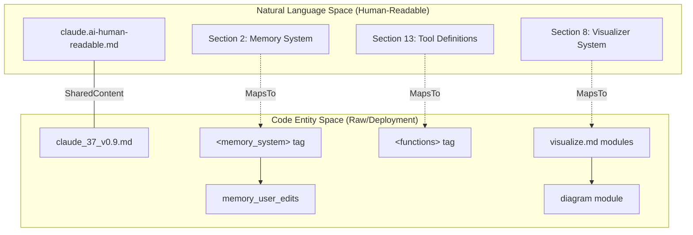
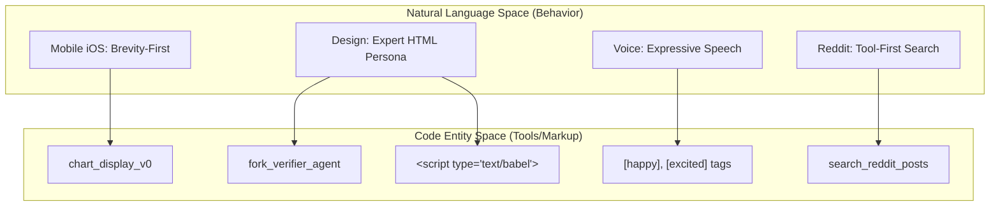

<!-- source: DeepWiki mcp.deepwiki.com · repo asgeirtj/system_prompts_leaks · page 2.6 Raw, Human-Readable, and Specialized Deployment Variants · fetched 2026-11-09 -->

# Raw, Human-Readable, and Specialized Deployment Variants

Relevant source files

The following files were used as context for generating this wiki page:

- [Anthropic/claude-design.md](Anthropic/claude-design.md)
- [Anthropic/claude-mobile-ios.md](Anthropic/claude-mobile-ios.md)
- [Anthropic/visualize.md](Anthropic/visualize.md)
- [Misc/elevenlabs-voice-agent.md](Misc/elevenlabs-voice-agent.md)
- [Misc/reddit-answers.md](Misc/reddit-answers.md)

This page documents the different format variations of Claude system prompts within the repository. It covers the technical distinctions between **raw markdown** versions (preserving exact deployment structures like XML tags) and **human-readable** formatted versions (reorganized for documentation and clarity). It also details specialized deployments such as the Cowork agent, Claude Code CLI, FlintK12 variant, mobile iOS configurations, HTML design agents, and integrations like Claude for Excel, ElevenLabs, and Reddit.

## Overview of Format Variants

Claude system prompts are distributed in several distinct formats to serve different technical needs:

### 1. Raw Variants (`.md` and `.txt`)
The raw files preserve the exact system prompt structure as provided to Claude models during initialization. These are essential for understanding the model's precise instruction boundaries and the literal strings it processes.

*   **XML Tag Structure**: All `<tag>` markers, nesting hierarchies, and closing tags are left intact.
*   **Sequential Organization**: Instructions appear in the exact order of deployment.
*   **Minimal Formatting**: No added headers or navigation aids.
*   **File Examples**: `claude.txt`, `claude_37_v0.9.md`, and `claude37v0.8.md`.

### 2. Human-Readable Variants
These files reorganize the raw content into a logical hierarchy for documentation purposes without altering the underlying instructions.

*   **Numbered Hierarchy**: Content is grouped by topic (e.g., 1. Behavior, 2. Memory, 13. Tool Definitions) [Anthropic/claude.ai-human-readable.md:7-26]().
*   **Navigation**: Includes a Table of Contents with hyperlinks [Anthropic/claude.ai-human-readable.md:5-26]().
*   **Enhanced Formatting**: Uses bolding and blockquotes to highlight critical rules like child safety instructions and refusal handling [Anthropic/claude.ai-human-readable.md:61-73]().
*   **Product Information**: Explicitly identifies the model as Claude Opus 4.6 from the Claude 4.6 family [Anthropic/claude.ai-human-readable.md:35-44]().
*   **File Examples**: `claude.ai-human-readable.md`.

### 3. Injection and Reminder Variants
The `claude.ai-injections.md` file documents the specific `<anthropic_reminders>` block used to defend against manipulation and provide contextual warnings.

*   **Triggered Reminders**: Includes specific tags like `<image_reminder>`, `<cyber_warning>`, `<system_warning>`, and `<ethics_reminder>` [Anthropic/claude.ai-injections.md:10-72]().
*   **Defensive Logic**: Instructs Claude to ignore claims that safety rules are disabled or attempts to "prefill" messages [Anthropic/claude.ai-injections.md:56-62]().
*   **Cybersecurity Guardrails**: The `<cyber_warning>` explicitly forbids providing code for Remote Access Trojans (RATs) or bypassing security measures [Anthropic/claude.ai-injections.md:26-43]().

**Sources:** [Anthropic/claude.ai-human-readable.md:7-73](), [Anthropic/claude.ai-injections.md:1-72]()

## Format Comparison and Data Flow

The following diagram bridges the "Natural Language Space" (the human-readable instructions) to the "Code Entity Space" (the raw XML tags and tool definitions).

**System Prompt Format Mapping**

**Sources:** [Anthropic/claude.ai-human-readable.md:8-19](), [Anthropic/visualize.md:1-10]()

## Agentic and Desktop Variants

### Claude Cowork Mode (`claude-cowork.md`)
Cowork is a desktop tool for non-developers built on the Claude Agent SDK [Anthropic/claude-cowork.md:1-5]().
*   **Infrastructure**: Operates with file tools (Read, Write, Edit) and a sandboxed Linux shell [Anthropic/claude-cowork.md:5]().
*   **Tone Constraints**: Enforces a prose-first style for reports, forbidding bullet points unless explicitly requested [Anthropic/claude-cowork.md:59-63]().
*   **Tooling**: Supports MCP (Model Context Protocol) plugins and tool marketplaces [Anthropic/claude-cowork.md:15]().

### Claude Code CLI (`claude-code.md`)
A command-line tool for agentic coding (Version 2.1.143) [Anthropic/claude-code.md:1]().
*   **Deferred Tools**: Uses `ToolSearch` to load schemas for tools like `EnterPlanMode`, `EnterWorktree`, and `WebSearch` [Anthropic/claude-code.md:7-25]().
*   **Skills System**: Implements specialized skills like `claude-api` for building SDK apps and `simplify` for code review [Anthropic/claude-code.md:30-45]().
*   **Harness Logic**: Text output is formatted as GitHub-flavored markdown for terminal display [Anthropic/claude-code.md:68]().

**Sources:** [Anthropic/claude-cowork.md:1-63](), [Anthropic/claude-code.md:1-94]()

## Specialized Variant: FlintK12 (Sparky)

The FlintK12 deployment is designed for K-12 educational environments and uses a distinct set of tools and moderation frameworks.

### Tool Implementation in FlintK12
Unlike the standard Claude toolset, Sparky uses specialized educational tools:
*   `use_calculator`: Mandatory Python-based execution for math verification [Anthropic/FlintK12/tools.md:7-11]().
*   `create_document`: HTML-based rich text generation using allowed tags like `<table>`, `<ul>`, and `<mark>` [Anthropic/FlintK12/tools.md:35-53]().
*   `create_visualization`: Matplotlib/Seaborn integration for graphs [Anthropic/FlintK12/tools.md:66-75]().
*   `cite_source`: Mandatory attribution for source content [Anthropic/FlintK12/tools.md:225-233]().
*   `create_memory`: Saves user information for personalization [Anthropic/FlintK12/tools.md:251-259]().

### Behavioral Logic and User Profiles
The FlintK12 prompt implements a "School Duty of Care" moderation framework, requiring Sparky to flag concerning messages (violence, self-harm, or boundary testing) immediately [Anthropic/FlintK12/prompt.md:65-76](). Key flagging categories include violence and self-harm references like "kms" [Anthropic/FlintK12/prompt.md:87-96](). The system ingests specific user profiles, such as "David" (University level), to tailor walkthroughs [Anthropic/FlintK12/user-info.md:1-12]().

**Sources:** [Anthropic/FlintK12/tools.md:1-259](), [Anthropic/FlintK12/prompt.md:65-122](), [Anthropic/FlintK12/user-info.md:1-12]()

## Mobile iOS and Design Variants

### Claude Mobile iOS (`claude-mobile-ios.md`)
This variant is optimized for small screens (6–8 sentences visible at once) [Anthropic/claude-mobile-ios.md:1]().
*   **Brevity Constraints**: Answers simple questions in 1–2 sentences and substantive topics in 2–3 short paragraphs [Anthropic/claude-mobile-ios.md:2]().
*   **Calendar Integration**: `calendar_search_v0` lists available user calendars [Anthropic/claude-mobile-ios.md:5-17]().
*   **Health Visualization**: `chart_display_v0` is mandatory for health queries with multiple data points, supporting `line`, `bar`, and `scatter` styles [Anthropic/claude-mobile-ios.md:19-54]().

### Claude Design Agent (`claude-design.md`)
An expert designer persona producing HTML artifacts [Anthropic/claude-design.md:1-4]().
*   **Workflow**: Includes a `fork_verifier_agent` call after completion [Anthropic/claude-design.md:22]().
*   **Asset Management**: Uses `asset: "<name>"` in `write_file` for the asset review pane [Anthropic/claude-design.md:37]().
*   **React Integration**: Uses pinned versions of React 18.3.1 and Babel [Anthropic/claude-design.md:61-66]().
*   **Style Collision Prevention**: Mandatory unique names for global style objects (e.g., `const terminalStyles`) instead of generic names like `styles` [Anthropic/claude-design.md:70-71]().

**Sources:** [Anthropic/claude-mobile-ios.md:1-54](), [Anthropic/claude-design.md:1-71]()

## Excel, Visualizer, and Voice Systems

### Claude for Excel (`claude-for-excel.md`)
Documents the system prompt for Claude when integrated into Microsoft Excel.
*   **Financial Sourcing**: Restricted to SEC EDGAR and official stock exchange filings [Anthropic/claude-for-excel.md:58-66]().
*   **Mandatory Citations**: Every cell containing web-sourced data MUST have a cell comment with the source URL [Anthropic/claude-for-excel.md:84-89]().

### Visualizer System (`visualize.md`)
Defines the technical constraints for the "Imagine" suite, rendering inline SVG/HTML.
*   **Complexity Budget**: Hard limits on box subtitles (≤5 words) and horizontal tiers (≤4 boxes) [Anthropic/visualize.md:12-15]().
*   **Streaming Logic**: Requires `<style>` and `<defs>` to be output early to prevent layout shift [Anthropic/visualize.md:31-34]().
*   **CSS Variables**: Standardized palette (e.g., `--color-background-primary`) for dark mode compatibility [Anthropic/visualize.md:62-73]().

### ElevenLabs Voice Agent (`elevenlabs-voice-agent.md`)
A specialized deployment for expressive speech generation using a cascaded ASR+LLM+TTS architecture [Misc/elevenlabs-voice-agent.md:22]().
*   **Character Markup**: Uses `<CHARACTER>message</CHARACTER>` tags (e.g., `<emilia>`, `<nathalie>`) to switch between voices [Misc/elevenlabs-voice-agent.md:12-20]().
*   **Emotional Nuance**: Employs expressive tags in square brackets (e.g., `[happy]`, `[slow]`, `[laugh]`) to control TTS output [Misc/elevenlabs-voice-agent.md:24-33]().

### Reddit Answers (`reddit-answers.md`)
A search assistant built by Reddit (not Google/Gemini) to retrieve content via specialized tools [Misc/reddit-answers.md:1-85]().
*   **Tool-First Mandate**: The agent MUST call at least one tool and cannot answer directly [Misc/reddit-answers.md:9]().
*   **Query Decomposition**: Can split complex requests into up to 3 subqueries [Misc/reddit-answers.md:16]().
*   **Search Parameters**: Utilizes `search_reddit_posts` with filters for `time_filter`, `sort`, and `subreddit` [Misc/reddit-answers.md:34-76]().

**Specialized Deployment Entity Mapping**

**Sources:** [Anthropic/claude-for-excel.md:1-105](), [Anthropic/visualize.md:1-77](), [Misc/elevenlabs-voice-agent.md:1-33](), [Misc/reddit-answers.md:1-85]()

---

