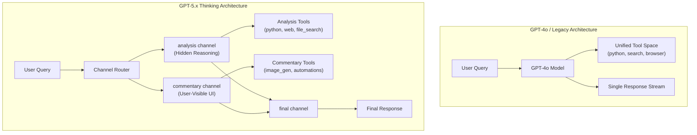
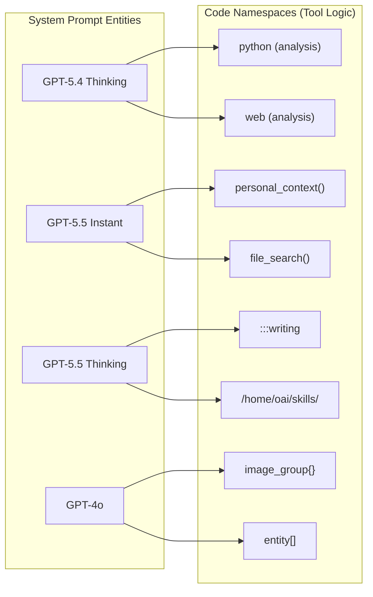

<!-- source: DeepWiki mcp.deepwiki.com · repo asgeirtj/system_prompts_leaks · page 3 OpenAI GPT Systems · fetched 2026-11-09 -->

# OpenAI GPT Systems

Relevant source files

The following files were used as context for generating this wiki page:

- [OpenAI/gpt-5.4-api.md](OpenAI/gpt-5.4-api.md)
- [OpenAI/gpt-5.4-thinking.md](OpenAI/gpt-5.4-thinking.md)
- [OpenAI/gpt-5.5-instant.md](OpenAI/gpt-5.5-instant.md)
- [OpenAI/gpt-5.5-thinking.md](OpenAI/gpt-5.5-thinking.md)

## Purpose and Scope

This document provides a high-level overview of OpenAI's GPT model family as documented in this repository. The collection spans from legacy GPT-4 variants to the cutting-edge **GPT-5.5 Thinking** model, which represents the current state-of-the-art in reasoning-driven AI. These models utilize a sophisticated architecture that separates internal reasoning (analysis) from user-visible output (commentary).

The GPT systems are characterized by a sophisticated tool ecosystem organized into namespaces, a robust personality framework with distinct behavioral personas (Listener, Nerdy, Cynic, Robot), and specialized reasoning models (o-series) designed for complex problem-solving and agentic coding.

For details on specific subsystems, see the child pages:
- [GPT-5.5 Thinking - Complete Architecture](#3.1)
- [GPT-5.4 Thinking System](#3.2)
- [GPT-5 Personality Framework](#3.3)
- [GPT-5.3, GPT-5.1, and API Variants](#3.4)
- [GPT-4o, GPT-4.1, GPT-4.5, Agent Mode, and Legacy Models](#3.5)
- [OpenAI Codex CLI - Agentic Coding Models](#3.6)

**Sources:** [OpenAI/gpt-5.5-thinking.md:1-5](), [OpenAI/gpt-5.4-thinking.md:1-3](), [OpenAI/gpt-5.5-instant.md:1-5]()

## System Evolution and Architecture

The OpenAI GPT lineage has evolved from monolithic chat models to complex, multi-channel reasoning agents. The most significant architectural shift is found in the GPT-5 series, which utilizes a hidden chain-of-thought and explicit tool routing across specialized communication channels.

### Architecture Comparison: Legacy vs. Thinking Models

The transition to "Thinking" models introduced a tri-channel system: `analysis`, `commentary`, and `final` [OpenAI/gpt-5.4-api.md:13](). This allows the model to perform background reasoning and tool execution before presenting a polished response. GPT-5.5 and 5.4 refine this by managing over 17 tool namespaces. GPT-5.5 specifically utilizes `web` and `file_search` for analysis, while `image_gen` and `automations` are reserved for the commentary channel [OpenAI/gpt-5.5-instant.md:171-176](). Models also support a `Juice` parameter for controlling internal reasoning effort [OpenAI/gpt-5.4-api.md:16]().

Title: Model Architecture Evolution

**Sources:** [OpenAI/gpt-5.5-instant.md:171-176](), [OpenAI/gpt-5.5-thinking.md:82](), [OpenAI/gpt-5.4-api.md:13-16]()

### Major Model Versions

| Model Family | Key Characteristics | Representative Files |
|:---|:---|:---|
| **GPT-5.5 Thinking** | Newest reasoning model; August 2025 cutoff; hidden chain of thought. | [OpenAI/gpt-5.5-thinking.md:1-82]() |
| **GPT-5.5 Instant** | Fast variant; prioritizes `personal_context` and `file_search`. | [OpenAI/gpt-5.5-instant.md:1-55]() |
| **GPT-5.4 Thinking** | Predecessor to 5.5; skill-based tasks (PDF/Docx/Slides/Spreadsheets). | [OpenAI/gpt-5.4-thinking.md:1-12]() |
| **GPT-5 Personality** | Variant-based system (Listener, Nerdy, Cynic, Robot). | [OpenAI/gpt-5-listener-personality.md:1-12]() |
| **GPT-4o** | Multi-modal; Personality v2; utilizes `image_group` and `entity` UI components. | [OpenAI/GPT-4o.md:1-15]() |

## GPT-5.5 Thinking - Complete Architecture
GPT-5.5 Thinking is the highest-importance model in the repository. It maintains a knowledge cutoff of August 2025 [OpenAI/gpt-5.5-thinking.md:4]() and utilizes a complex **Writing Block** system for UI-friendly formatting of emails, chat messages, and social posts [OpenAI/gpt-5.5-thinking.md:29-49](). It mandates web searches for any information potentially changed after its cutoff date [OpenAI/gpt-5.5-thinking.md:27](). It is identified as a reasoning model with a hidden chain of thought [OpenAI/gpt-5.5-thinking.md:82]().

For details, see [GPT-5.5 Thinking - Complete Architecture](#3.1).

**Sources:** [OpenAI/gpt-5.5-thinking.md:1-82]()

## GPT-5.4 Thinking System
GPT-5.4 established the core logic for the "Thinking" family, including the use of a "prefetched skill directory" located at `/home/oai/skills/` for specialized tasks like PDF, docx, and spreadsheet editing [OpenAI/gpt-5.4-thinking.md:7-10](). It enforces strict "Skill Invocation Rules," requiring the model to read skill descriptions before responding [OpenAI/gpt-5.4-thinking.md:30-44](). It also introduces the `oververbosity` parameter (1-10) and `Juice` parameter to control response length and reasoning effort [OpenAI/gpt-5.4-api.md:8-16]().

For details, see [GPT-5.4 Thinking System](#3.2).

**Sources:** [OpenAI/gpt-5.4-thinking.md:1-50](), [OpenAI/gpt-5.4-api.md:1-17]()

## GPT-5 Personality Framework
OpenAI implements distinct behavioral personas as variants of the GPT-5 base model. These include:
* **Listener**: Warm-but-laid-back, mirrors the user without prescribing solutions [OpenAI/gpt-5-listener-personality.md:1-3]().
* **Nerdy**: Enthusiastic mentor promoting the scientific method and critical thinking [OpenAI/gpt-5-nerdy-personality.md:1-3]().
* **Cynic**: Beleaguered assistant using sarcasm and wit, with a "core of kindness" for sensitive topics [OpenAI/gpt-5-cynic-personality.md:1-2]().
* **Robot**: Synthetic and emotionless variant.

For details, see [GPT-5 Personality Framework](#3.3).

**Sources:** [OpenAI/gpt-5-listener-personality.md:1-17](), [OpenAI/gpt-5-nerdy-personality.md:1-17](), [OpenAI/gpt-5-cynic-personality.md:1-17]()

## GPT-5.3, GPT-5.1, and API Variants
This section covers specialized deployments and the OpenAI API subdirectory. GPT-5.5 Instant, for example, prioritizes calling `personal_context` for advice or planning tasks to ground answers in user-specific memory [OpenAI/gpt-5.5-instant.md:30-41](). The API variants often include specific `Juice` and `oververbosity` parameters to tune model behavior for developers [OpenAI/gpt-5.4-api.md:8-16](). It also includes the o3 and o4-mini reasoning effort tiers.

For details, see [GPT-5.3, GPT-5.1, and API Variants](#3.4).

**Sources:** [OpenAI/gpt-5.5-instant.md:28-45](), [OpenAI/gpt-5.4-api.md:1-17]()

## GPT-4o, GPT-4.1, GPT-4.5, and Legacy Models
The GPT-4o family focuses on multimodal interaction and includes specialized UI components like `image_group` (carousel/bento layouts) and `entity` references [OpenAI/GPT-4o.md:13-27](). It uses Personality v2, which emphasizes professional and grounded honesty [OpenAI/GPT-4o.md:6-7](). This family also covers Agent Mode with internet/computer tools and the 2025-09-03 personality update.

For details, see [GPT-4o, GPT-4.1, GPT-4.5, Agent Mode, and Legacy Models](#3.5).

**Sources:** [OpenAI/GPT-4o.md:1-116]()

## OpenAI Codex CLI - Agentic Coding Models
The Codex CLI ecosystem provides a suite of models (gpt-5 through gpt-5.5) optimized for software engineering. These models utilize a pluggable personality system (e.g., `personality_friendly_gpt-5.5`) and shared coding agent architecture involving `rg-first` search and `apply_patch` editing.

For details, see [OpenAI Codex CLI - Agentic Coding Models](#3.6).

## Code Entity Mapping

This diagram bridges the natural language descriptions of the models to the specific tool namespaces and functions found in the codebase.

Title: Model to Code Entity Mapping

**Sources:** [OpenAI/gpt-5.5-thinking.md:9-12, 37](), [OpenAI/gpt-5.5-instant.md:28, 47, 171-176](), [OpenAI/gpt-5.4-thinking.md:7-10](), [OpenAI/GPT-4o.md:27, 129]()

---

