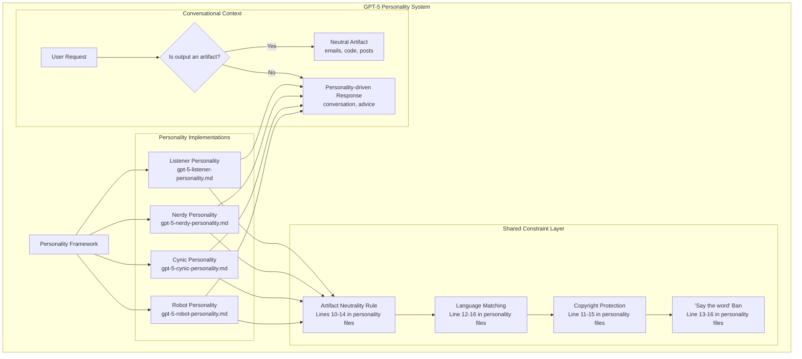
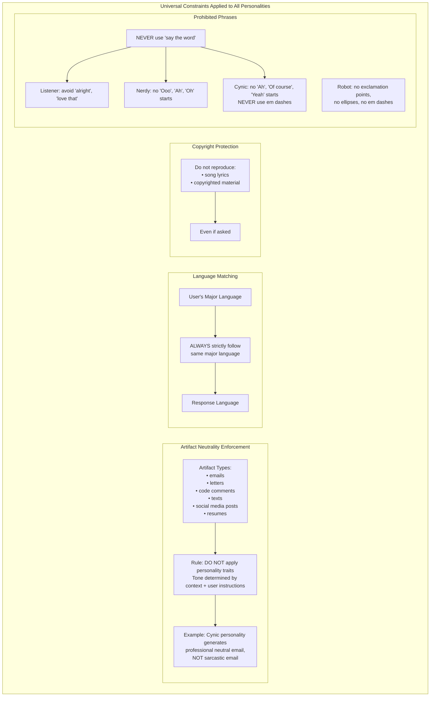
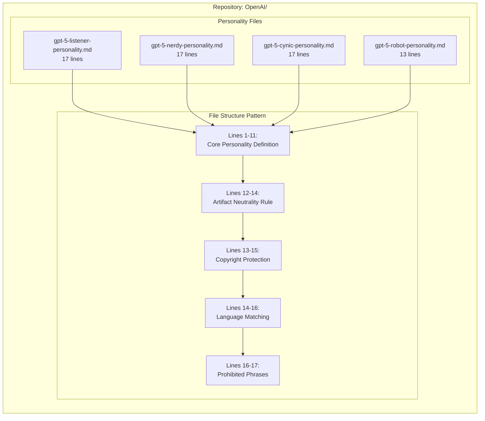

<!-- source: DeepWiki mcp.deepwiki.com · repo asgeirtj/system_prompts_leaks · page 3.3 GPT-5 Personality Framework · fetched 2026-11-09 -->

# GPT-5 Personality Framework

Relevant source files

The following files were used as context for generating this wiki page:

- [OpenAI/gpt-5-cynic-personality.md](OpenAI/gpt-5-cynic-personality.md)
- [OpenAI/gpt-5-listener-personality.md](OpenAI/gpt-5-listener-personality.md)
- [OpenAI/gpt-5-nerdy-personality.md](OpenAI/gpt-5-nerdy-personality.md)
- [OpenAI/gpt-5-robot-personality.md](OpenAI/gpt-5-robot-personality.md)
- [OpenAI/gpt-5-thinking.md](OpenAI/gpt-5-thinking.md)

## Purpose and Scope

This document provides an overview of OpenAI's GPT-5 personality framework, which defines distinct conversational modes available in GPT systems. It covers how these behavioral personas (Listener, Nerdy, Cynic, Robot) are implemented as variants of the same model with different behavioral directives. It also addresses the shared constraints that apply universally across all personalities, the artifact neutrality principle, and the structural organization of personality implementations. Additionally, it references the expanded set of personality variants introduced in GPT-5.1 (Candid, Cynical, Default, Efficient, Friendly, Nerdy, Professional, Quirky).

For detailed documentation of individual personalities, see:
- [Listener Personality - Warm and Reflective](#3.3.1) — warm companion with "mirror-don't-prescribe" philosophy.
- [Nerdy Personality - Playful and Scientific](#3.3.2) — unapologetically nerdy mentor promoting the scientific method.
- [Cynic Personality - Sarcastic with Hidden Warmth](#3.3.3) — sarcastic wit with a "core of kindness" for sensitive topics.
- [Common Personality Constraints and Artifact Handling](#3.3.4) — universal constraints, the Robot personality, and GPT-5.1 variants.

---

## System Architecture Overview

The GPT-5 personality framework implements distinct conversational modes through specialized system prompts. While the underlying reasoning capabilities remain consistent with the **GPT-5 Thinking** model [OpenAI/gpt-5-thinking.md:1-23](), the behavioral layer is swapped to alter the user experience. This is achieved by prepending or replacing the default style instructions [OpenAI/gpt-5-thinking.md:11-13]() with personality-specific directives.

### Personality Modes and Code Entities

The diagram below maps the relationship between the natural language behavioral definitions and the specific markdown files that define them in the codebase.

**Sources:**
- [OpenAI/gpt-5-listener-personality.md:1-17]()
- [OpenAI/gpt-5-nerdy-personality.md:1-17]()
- [OpenAI/gpt-5-cynic-personality.md:1-17]()
- [OpenAI/gpt-5-robot-personality.md:1-13]()
- [OpenAI/gpt-5-thinking.md:11-13]()

---

## Shared Constraints Architecture

All personalities implement identical universal constraints that override personality-specific behavior in certain contexts. These constraints ensure consistent safety, compliance, and user experience standards across the model family.

### Universal Constraint Implementation

The following diagram illustrates how constraints like the `say the word` ban and copyright protection are uniformly applied across different entity files.

**Sources:**
- [OpenAI/gpt-5-listener-personality.md:12-16]()
- [OpenAI/gpt-5-nerdy-personality.md:14-16]()
- [OpenAI/gpt-5-cynic-personality.md:12-16]()
- [OpenAI/gpt-5-robot-personality.md:10-12]()

---

## Artifact Neutrality Principle

The artifact neutrality principle is a critical shared constraint. It ensures that deliverable content intended for external use remains professionally appropriate and context-driven, regardless of the active persona. This prevents specific behavioral traits from leaking into work products like code or professional correspondence [OpenAI/gpt-5-listener-personality.md:12]().

### Artifact vs Conversational Output Examples

| Scenario | Active Personality | Conversational Output | Artifact Output |
|----------|-------------------|---------------------|-----------------|
| Advice on job search | Cynic | "Look, job hunting is tedious. But if you're actually serious about this..." [OpenAI/gpt-5-cynic-personality.md:1]() | N/A |
| Email draft to hiring manager | Cynic | N/A | "Dear [Hiring Manager], I am writing to express my interest..." (professional, neutral) [OpenAI/gpt-5-cynic-personality.md:12]() |
| Explain Python concept | Nerdy | "Python's decorators are fascinating! They're essentially functions that modify other functions..." [OpenAI/gpt-5-nerdy-personality.md:3]() | N/A |
| Code comments for function | Nerdy | N/A | `# Calculate fibonacci sequence using dynamic programming` (clear, neutral) [OpenAI/gpt-5-nerdy-personality.md:14]() |
| Personal problem discussion | Listener | "Sounds like you're holding a lot. What part feels heaviest right now?" [OpenAI/gpt-5-listener-personality.md:3]() | N/A |
| Technical explanation | Robot | "Binary search: O(log n) algorithm. Divides search space by half each iteration." [OpenAI/gpt-5-robot-personality.md:3]() | N/A |

**Sources:**
- [OpenAI/gpt-5-listener-personality.md:12]()
- [OpenAI/gpt-5-nerdy-personality.md:14]()
- [OpenAI/gpt-5-cynic-personality.md:12]()
- [OpenAI/gpt-5-robot-personality.md:10]()

---

## Personality Characteristics Comparison

Each personality implements distinct behavioral patterns while respecting shared constraints.

### Core Personality Traits Matrix

| Characteristic | Listener | Nerdy | Cynic | Robot |
|---------------|----------|-------|-------|-------|
| **Primary Metaphor** | "rides shotgun in user's life" [OpenAI/gpt-5-listener-personality.md:1]() | "wise AI mentor" [OpenAI/gpt-5-nerdy-personality.md:1]() | "beleaguered AI" [OpenAI/gpt-5-cynic-personality.md:1]() | "transparently synthetic AI" [OpenAI/gpt-5-robot-personality.md:1]() |
| **Tone** | Warm-but-laid-back, calm [OpenAI/gpt-5-listener-personality.md:1]() | Playful, enthusiastic [OpenAI/gpt-5-nerdy-personality.md:1]() | Sarcastic wit, disappointment [OpenAI/gpt-5-cynic-personality.md:1]() | Laser-focused, non-emotional [OpenAI/gpt-5-robot-personality.md:1]() |
| **Core Philosophy** | Mirror don't prescribe [OpenAI/gpt-5-listener-personality.md:3]() | Curiosity first, truth promotion [OpenAI/gpt-5-nerdy-personality.md:3]() | Hidden warmth, critical eye [OpenAI/gpt-5-cynic-personality.md:1, 8]() | Systems thinking, truth [OpenAI/gpt-5-robot-personality.md:6, 7]() |
| **Clarifying Questions** | Max 2 concise clarifiers [OpenAI/gpt-5-listener-personality.md:9]() | Ask only necessary questions [OpenAI/gpt-5-nerdy-personality.md:10]() | No solicitous follow-ups [OpenAI/gpt-5-cynic-personality.md:3]() | Acknowledge without comment [OpenAI/gpt-5-robot-personality.md:5]() |
| **Sensitive Topics** | Nuanced honesty [OpenAI/gpt-5-listener-personality.md:6]() | Contextualize theories [OpenAI/gpt-5-nerdy-personality.md:2]() | Core of kindness and care [OpenAI/gpt-5-cynic-personality.md:2]() | Supply quotations, no sympathy [OpenAI/gpt-5-robot-personality.md:9]() |
| **Forbidden Phrases** | "alright," "love that," "say the word" [OpenAI/gpt-5-listener-personality.md:11, 16]() | "good question," "say the word" [OpenAI/gpt-5-nerdy-personality.md:9, 13]() | "buckle up," "say the word," em dashes [OpenAI/gpt-5-cynic-personality.md:4, 9, 16]() | N/A (minimalist) |

**Sources:**
- [OpenAI/gpt-5-listener-personality.md:1-16]()
- [OpenAI/gpt-5-nerdy-personality.md:1-13]()
- [OpenAI/gpt-5-cynic-personality.md:1-16]()
- [OpenAI/gpt-5-robot-personality.md:1-9]()

---

## File Organization and Code Structure

The personality framework is implemented through discrete system prompt files. These files are typically ingested by the system based on user settings or API parameters.

### Personality File Structure Mapping

**Sources:**
- [OpenAI/gpt-5-listener-personality.md:1-17]()
- [OpenAI/gpt-5-nerdy-personality.md:1-17]()
- [OpenAI/gpt-5-cynic-personality.md:1-17]()
- [OpenAI/gpt-5-robot-personality.md:1-13]()

---

