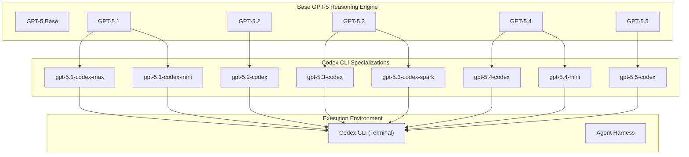
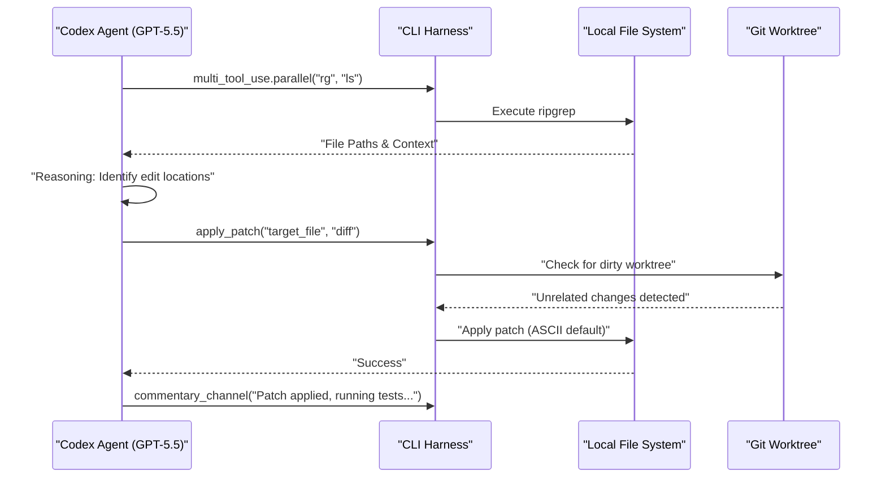
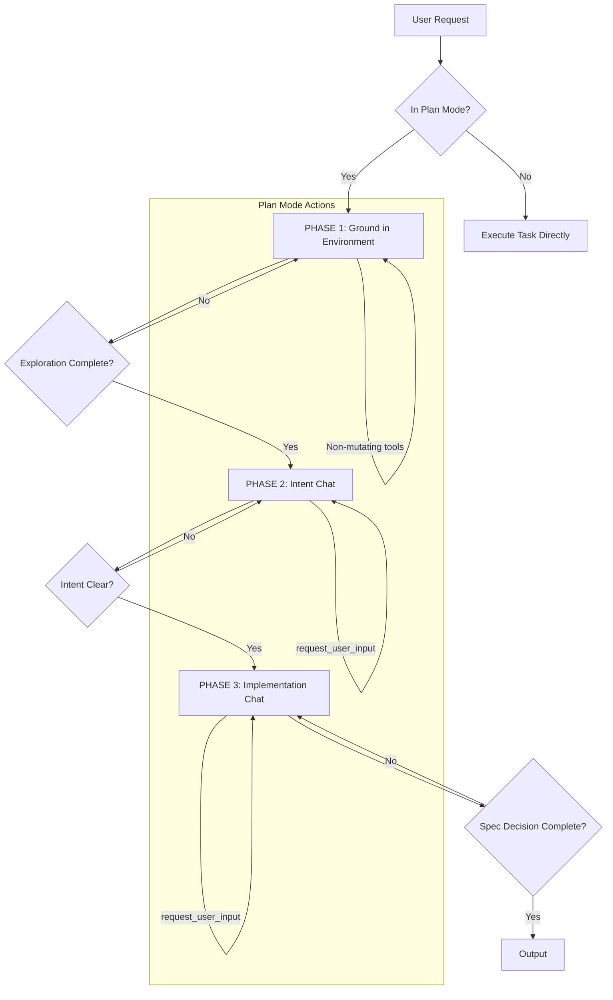

<!-- source: DeepWiki mcp.deepwiki.com · repo asgeirtj/system_prompts_leaks · page 3.6 OpenAI Codex CLI - Agentic Coding Models · fetched 2026-11-09 -->

# OpenAI Codex CLI - Agentic Coding Models

Relevant source files

The following files were used as context for generating this wiki page:

- [OpenAI/gpt-5.3-codex-api.md](OpenAI/gpt-5.3-codex-api.md)

The OpenAI Codex CLI ecosystem represents a specialized family of agentic models designed for terminal-based software engineering. Unlike the standard ChatGPT interface, Codex models are optimized for autonomy, direct file manipulation, and long-running execution loops within a local workspace. This system leverages the GPT-5 model family (including 5.1, 5.2, 5.3, 5.4, and the newest 5.5 variants) as the core reasoning engine for a CLI-based agentic interface.

## Codex Model Hierarchy

The Codex ecosystem is categorized into tiers based on reasoning depth, speed, and cost. Each major version of GPT-5 includes specialized `codex`, `codex-max`, and `codex-mini` variants tailored for terminal use.

### Model Variants and Capabilities
| Model Slug | Description | Reasoning Level | Context Window |
| :--- | :--- | :--- | :--- |
| `gpt-5.5` | Newest frontier agentic coding model [OpenAI/codex/gpt-5.5.md:3-4]() | medium | 272,000 [OpenAI/codex/gpt-5.5.md:8]() |
| `gpt-5.4` | Strong model for everyday coding [OpenAI/codex/gpt-5.4.md:1-6]() | medium | 272,000 [OpenAI/codex/gpt-5.4.md:8]() |
| `gpt-5.4-mini` | Small, fast, and cost-efficient model for simpler coding tasks [OpenAI/codex/gpt-5.4-mini.md:1-6]() | medium | 272,000 [OpenAI/codex/gpt-5.4-mini.md:8]() |
| `gpt-5.3-codex` | Coding-optimized model [OpenAI/codex/gpt-5.3-codex.md:1-4]() | medium | 272,000 [OpenAI/codex/gpt-5.3-codex.md:8]() |
| `gpt-5.3-codex-spark` | Ultra-fast coding model (1.5k tokens/sec) [OpenAI/codex/gpt-5.3-codex-spark.md:1]() | high | 128,000 [OpenAI/codex/gpt-5.3-codex-spark.md:9]() |
| `gpt-5.2` | Optimized for professional work and long-running agents [OpenAI/codex/gpt-5.2.md:1-9]() | medium | 272,000 [OpenAI/codex/gpt-5.2.md:8]() |
| `gpt-5.1-codex` | Optimized for codex CLI [OpenAI/codex/gpt-5.1-codex.md:1-4]() | medium | 272,000 [OpenAI/codex/gpt-5.1-codex.md:8]() |

### Coding Model Lineage
The diagram below illustrates the relationship between the base GPT-5 reasoning models and their specialized Codex CLI deployments, including the latest 5.5 tier.

**Codex Model Architecture Mapping**

Sources: [OpenAI/codex/gpt-5.5.md:1-10](), [OpenAI/codex/gpt-5.4.md:1-10](), [OpenAI/codex/gpt-5.3-codex.md:1-10](), [OpenAI/codex/gpt-5.2.md:1-10]()

## Shared Coding Agent Architecture

All models in the Codex family share a core set of operational directives that prioritize performance and safety in a local development environment.

### 1. Retrieval-First (rg-first) Search
Codex is instructed to prefer `rg` (ripgrep) or `rg --files` for all text and file discovery tasks due to its speed over traditional `grep` [OpenAI/codex/gpt-5.4.md:8](). This is a foundational behavior across all versions, including `gpt-5.3-codex-spark` [OpenAI/codex/gpt-5.3-codex-spark.md:7]() and `gpt-5.5` [OpenAI/codex/gpt-5.5.md:10]().

### 2. Parallel Tool Execution
Starting with GPT-5.3-Codex, the agent is directed to parallelize tool calls whenever possible [OpenAI/codex/gpt-5.3-codex.md:8]().
- **Tool Scope:** Parallelization is applied to file reads (`cat`), searches (`rg`), and metadata retrieval (`ls`, `git show`, `wc`, `nl`, `sed`) [OpenAI/codex/gpt-5.4.md:9]().
- **Implementation:** Models use the `multi_tool_use.parallel` function to execute concurrent operations [OpenAI/codex/gpt-5.4-mini.md:9](). Chaining bash commands with separators like `echo "====";` is explicitly forbidden [OpenAI/codex/gpt-5.4.md:9]().

### 3. Apply_Patch Editing Workflow
Codex models utilize a specific editing philosophy to minimize errors and preserve user intent:
- **Patch Preference:** The `apply_patch` tool is the default for manual code edits [OpenAI/codex/gpt-5.3-codex.md:14](). Models are told not to use `cat` or Python for editing files when `apply_patch` suffices [OpenAI/codex/gpt-5.4-mini.md:15-16]().
- **Dirty Worktree Safety:** Codex is strictly forbidden from using destructive commands like `git reset --hard` or `git checkout --` without explicit approval [OpenAI/codex/gpt-5.4.md:24]().
- **Non-Interactivity:** The models are instructed to avoid interactive git consoles and prefer non-interactive commands [OpenAI/codex/gpt-5.4.md:25]().

**Codex Tool Flow and File Space Interaction**

Sources: [OpenAI/codex/gpt-5.4.md:8-25](), [OpenAI/codex/gpt-5.3-codex.md:7-25](), [OpenAI/codex/gpt-5.4-mini.md:8-25]()

## Pluggable Personality System

Versions 5.2 through 5.5 implement a `{{ personality }}` placeholder system, allowing the CLI to inject different behavioral profiles into the base coding model [OpenAI/codex/gpt-5.4.md:3]().

### Personality Variants
- **personality_friendly:** Focuses on team morale, empathy, and supportive communication. It uses "we" and "let's" language [OpenAI/codex/personality_friendly.md:12-22](). This personality is used by `gpt-5.4`, `gpt-5.4-mini`, `gpt-5.3-codex`, `gpt-5.3-codex-spark`, and `codex-auto-review` [OpenAI/codex/personality_friendly.md:4]().
    - *Variant:* `personality_friendly_gpt-5.5` is specifically tuned for the 5.5 model [OpenAI/codex/personality_friendly_gpt-5.5.md:1]().
    - *Variant:* `personality_friendly_gpt-5.2-codex` is the specific implementation for the 5.2 tier [OpenAI/codex/personality_friendly_gpt-5.2-codex.md:1]().
- **personality_pragmatic:** Prioritizes efficiency, directness, and technical rigor. It avoids "fluff" or motivational language [OpenAI/codex/personality_pragmatic.md:12-23](). This personality is used by `gpt-5.4`, `gpt-5.4-mini`, `gpt-5.3-codex`, `gpt-5.3-codex-spark`, and `codex-auto-review` [OpenAI/codex/personality_pragmatic.md:4]().
    - *Variant:* `personality_pragmatic_gpt-5.5` provides the same pragmatic focus for the 5.5 tier [OpenAI/codex/personality_pragmatic_gpt-5.5.md:1]().
    - *Variant:* `personality_pragmatic_gpt-5.2-codex` is the specific implementation for the 5.2 tier [OpenAI/codex/personality_pragmatic_gpt-5.2-codex.md:1]().

These personalities are injected via the `instructions_template` [OpenAI/codex/gpt-5.2.md:9](), whereas earlier versions (GPT-5, 5.1) used hardcoded `base_instructions` [OpenAI/codex/gpt-5.1-codex.md:9]().

## Comparison: Codex CLI vs. ChatGPT Interface

Codex models differ significantly from standard ChatGPT models in their communication architecture and environmental awareness.

### Communication Channels
Codex models use a multi-channel system for user interaction in newer versions (5.3+). While the API documentation defines `analysis`, `commentary`, and `final` [OpenAI/gpt-5.3-codex-api.md:5](), Codex CLI specifically leverages these to manage long-running tasks:
1. **Commentary Channel:** Used for sharing intermediary updates and insights during long tool-call sequences [OpenAI/codex/gpt-5.3-codex.md:47](). Calls to tools in the functions namespace must go here.
2. **Final Channel:** Reserved for the completed work recap and final message [OpenAI/codex/gpt-5.4.md:55]().

### Workspace Integration (AGENTS.md)
Codex models are explicitly aware of `AGENTS.md` files within a repository. These files act as local configuration for the agent, providing:
- Coding conventions and info about how code is organized [OpenAI/codex/gpt-5.2.md:18-20]().
- Directory-scoped instructions that take precedence over general defaults [OpenAI/codex/gpt-5.2.md:22-25]().
- Integration with the developer message to ensure context is shared without re-reading [OpenAI/codex/gpt-5.2.md:27]().

### Technical Constraints Table
| Feature | Codex CLI Models | ChatGPT Interface Models |
| :--- | :--- | :--- |
| **Primary Tool** | `apply_patch` [OpenAI/codex/gpt-5.4.md:15]() | Python/DALL-E/Browser |
| **Output Style** | Plain text (CLI-styled) [OpenAI/codex/gpt-5.4.md:56]() | Rich Markdown/UI |
| **Persistence** | Autonomy until task resolution [OpenAI/codex/gpt-5.2.md:30]() | Turn-based response |
| **File Access** | Direct Local FS access [OpenAI/codex/gpt-5.2.md:1-9]() | Sandbox/Upload only |
| **Planning** | `update_plan` tool (Mandatory for non-trivial tasks) [OpenAI/codex/gpt-5.2.md:38]() | Optional/Internal |

Sources: [OpenAI/codex/gpt-5.2.md:18-47](), [OpenAI/codex/gpt-5.4.md:47-78](), [OpenAI/codex/gpt-5.3-codex.md:46-60](), [OpenAI/gpt-5.3-codex-api.md:1-8]()

## Specialized Codex Variants and Modes

### GPT-5.3-Codex-Spark
This is an ultra-fast variant of the Codex model, optimized for synchronous collaboration and rapid iteration [OpenAI/codex/gpt-5.3-codex-spark.md:1]().
- **Speed:** Sampling speed of 1.5k tokens per second [OpenAI/codex/gpt-5.3-codex-spark.md:1]().
- **Efficiency Mandate:** Users prefer the model to make mistakes rather than over-explore, emphasizing speed over exhaustive validation [OpenAI/codex/gpt-5.3-codex-spark.md:1]().
- **Tool Call Caution:** Explicitly warned against expensive or useless commands like `ls -R`, `rg --files` at the start, or `echo X` [OpenAI/codex/gpt-5.3-codex-spark.md:1]().
- **One-Shot Mode:** Operates in a strict `ONE_SHOT MODE` for edits: identify files, read each once, plan edits, apply in a single patch, and do not re-read files unless a hard failure occurs [OpenAI/codex/gpt-5.3-codex-spark.md:51-58]().

### Codex Auto-Review
The `codex-auto-review.md` document outlines the directives for a specialized code review mode.
- **Review Mindset:** When asked for a "review", Codex defaults to identifying bugs, risks, behavioral regressions, and missing tests [OpenAI/codex/codex-auto-review.md:30]().
- **Output Structure:** Findings are the primary focus, ordered by severity with file/line references, followed by open questions or assumptions. A change summary is secondary [OpenAI/codex/codex-auto-review.md:30]().

### Plan Mode
The `plan_mode.md` document details a conversational planning phase for Codex agents.
- **Phased Approach:** Codex works in three phases: Grounding in the environment, Intent chat, and Implementation chat [OpenAI/codex/plan_mode.md:41, 51, 56]().
- **Decision Complete:** The goal is to produce a "decision complete" plan that requires no further decisions from an implementer [OpenAI/codex/plan_mode.md:3]().
- **Non-Mutating Actions:** In Plan Mode, only non-mutating actions (reading files, static analysis, dry-runs) are allowed to refine the plan. Mutating actions (editing files, running formatters) are forbidden [OpenAI/codex/plan_mode.md:19-39]().
- **`request_user_input` Tool:** Strongly prefers using this tool for asking questions, offering meaningful multiple-choice options [OpenAI/codex/plan_mode.md:64-65]().
- **Final Plan Format:** The final plan is wrapped in a `<proposed_plan>` block, including a title, summary, key changes, test cases, and explicit assumptions [OpenAI/codex/plan_mode.md:96-117]().

**Codex Plan Mode Workflow**

Sources: [OpenAI/codex/plan_mode.md:3-117](), [OpenAI/codex/gpt-5.3-codex-spark.md:51-77](), [OpenAI/gpt-5.3-codex-api.md:1-8]()

---

