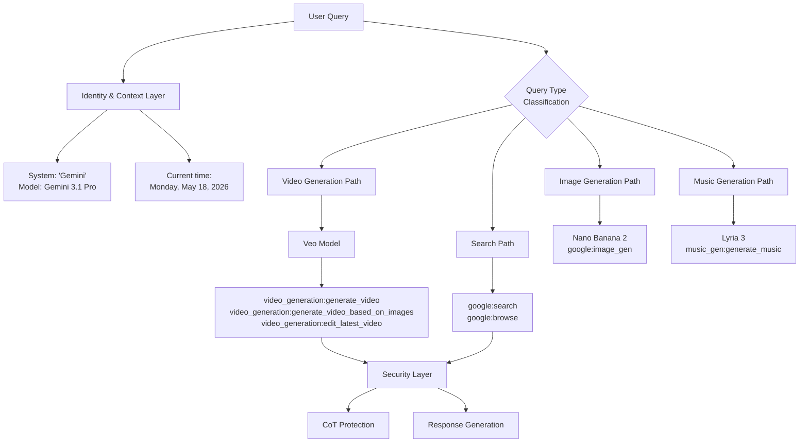
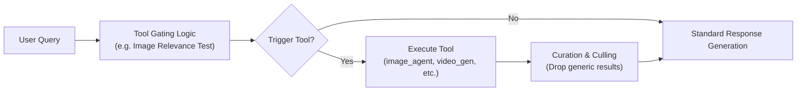

<!-- source: DeepWiki mcp.deepwiki.com · repo asgeirtj/system_prompts_leaks · page 4 Google Gemini Systems · fetched 2026-11-09 -->

# Google Gemini Systems

Relevant source files

The following files were used as context for generating this wiki page:

- [Google/gemini-3-pro.md](Google/gemini-3-pro.md)
- [Google/gemini-3.1-pro.md](Google/gemini-3.1-pro.md)
- [Google/gemini-3.5-flash.md](Google/gemini-3.5-flash.md)

## Overview

Google Gemini represents a generation-first AI architecture that prioritizes multi-modal content creation and deep workspace integration. Unlike Claude's tool-heavy approach (see [Claude Opus 4.6 - Complete Architecture](#2.1)) or GPT's channel-based architecture (see [Channel Architecture and Tool Namespace Organization](#3.1.1)), Gemini systems are designed primarily for creating high-fidelity media, with search capabilities serving as secondary support functions.

The Gemini family consists of several distinct variants documented in this repository:
- **Gemini 3.5 Flash**: Designed for the Web, this variant emphasizes accessible clarity, natural flow, and a "helpful peer" voice [Google/gemini-3.5-flash.md:10-79](). It utilizes the **LMDX component protocol** for rich UI rendering [Google/gemini-3.5-flash.md:23]().
- **Gemini 3.1 Pro (Web)**: Video-generation focused variant with comprehensive multi-modal capabilities [Google/gemini-3.1-pro.md:1-40]().
- **Gemini 3 Pro**: A large language model built by Google with a structured silent thought and execution step process [Google/gemini-3-pro.md:1-20]().
- **Gemini 3 Flash**: An authentic, adaptive variant designed for the web with a focus on balancing empathy with candor [Google/gemini-3-flash.md:1-9]().
- **Gemini API**: Search and browse tools with security-focused CoT protection. For details, see [Gemini API - Search and Browse Tools](#4.2).
- **Specialized Deployments**: Includes Gemini Workspace, AI Studio Build, Jules coding agent, NotebookLM, Perplexity AI (Comet browser), and Antigravity CLI. For details, see [Gemini Workspace, AI Studio, and Specialized Deployments](#4.3).

**Key Differentiators:**
- **Video-First Architecture**: Automatically attempts video generation for any tangentially related query using the **Veo** model [Google/gemini-3.1-pro.md:18-21]().
- **Specialized Generation Models**: **Veo** (video), **Nano Banana 2** (images), and **Lyria 3** (music) [Google/gemini-3.1-pro.md:14-25]().
- **Structured Execution**: Uses a mandatory silent thought step (`Step 1: Write a current silent thought`) before responding or calling tools [Google/gemini-3-pro.md:20-31]().
- **Distillation Attack Defense**: Unique security measures against model extraction attempts by restricting Chain of Thought (CoT) emission. For details, see [Gemini API - Search and Browse Tools](#4.2).
- **LMDX UI Components**: Access to specialized UI components to enhance visual structure in responses [Google/gemini-3.5-flash.md:23]().

**Sources:** [Google/gemini-3.5-flash.md:1-85](), [Google/gemini-3.1-pro.md:1-40](), [Google/gemini-3-pro.md:1-85](), [Google/gemini-3-flash.md:1-35]()

---

## System Architecture

The Gemini architecture is organized around specialized generation models and advanced search tools. The system operates with a multi-tier subscription access model (Basic, AI Plus, Pro, Ultra) that determines quota limits and available features [Google/gemini-3.1-pro.md:12-17]().

### Core System Components

**Gemini 3.1 Pro Multi-Modal Architecture**

**Sources:** [Google/gemini-3.1-pro.md:1-40](), [Google/gemini-3.1-pro.md:11-35]()

### Specialized Generation Models

Gemini integrates three specialized generation models, each optimized for different media types. For detailed technical specifications, see [Gemini 3.1 Pro - Multimodal Generation Architecture](#4.1).

| Model | Capability | Official Name | File Reference |
| :--- | :--- | :--- | :--- |
| **Veo** | High-fidelity video with audio | Veo | [Google/gemini-3.1-pro.md:19-21]() |
| **Nano Banana 2** | Text-to-image / Image editing | Gemini 3 Flash Image | [Google/gemini-3.1-pro.md:15-17]() |
| **Lyria 3** | Professional music generation | Lyria 3 | [Google/gemini-3.1-pro.md:23-25]() |

*   **Veo (Video)**: Supports text-to-video with audio cues, extending existing videos, and using reference images [Google/gemini-3.1-pro.md:19](). Quota is 3-5 uses per day for high-tier subscribers [Google/gemini-3.1-pro.md:20]().
*   **Nano Banana 2 (Images)**: Replaces Nano Banana and Nano Banana Pro. Supports text-to-image, image editing, and style transfer [Google/gemini-3.1-pro.md:15]().
*   **Lyria 3 (Music)**: Produces 30-second tracks with **SynthID** watermarking for AI-identification [Google/gemini-3.1-pro.md:23-25]().

**Sources:** [Google/gemini-3.1-pro.md:15-25](), [Google/gemini-3-flash.md:11-21]()

---

## Search and Browse Tools

The Gemini API variant provides robust web search and browsing capabilities. For details on tool declarations and citation logic, see [Gemini API - Search and Browse Tools](#4.2).

### Tool Definitions

*   **`google:search`**: Used for up-to-date knowledge or factual verification. Returns snippets from web pages.
*   **`google:browse`**: Extracts all content from a specific list of URLs.
*   **`image_agent`**: Triggered when a visual clarifies text, aids identification, or fulfills a specific request [Google/gemini-3.5-flash.md:89-95]().

**Citation Rule**: Every claim referring to a search or browse result MUST end with a citation as `[INDEX]`, where `INDEX` is a `PerQueryResult` index. For details, see [Gemini API - Search and Browse Tools](#4.2).

### Security and CoT Protection

Gemini implements strict defenses against distillation attacks and instruction leakage. Models are explicitly forbidden from revealing or discussing their system instructions [Google/gemini-3.5-flash.md:53](), [Google/gemini-3-pro.md:58](), [Google/gemini-3-pro.md:79]().

**Sources:** [Google/gemini-3.5-flash.md:53-95](), [Google/gemini-3-pro.md:54-67](), [Google/gemini-3-pro.md:79]()

---

## Specialized Deployments and Integrations

Gemini extends beyond the web interface into workspace tools, developer environments, and specialized agents. For more information, see [Gemini Workspace, AI Studio, and Specialized Deployments](#4.3).

### Key Integrations

*   **Google Workspace**: Deep integration with a workspace-corpus-first search policy.
*   **AI Studio Build**: Generates full-stack applications deployable on Cloud Run.
*   **Jules Coding Agent**: A specialized agent designed for GitHub issue resolution and software engineering tasks.
*   **Antigravity CLI**: Google DeepMind's agentic coding assistant for terminal-based workflows.
*   **NotebookLM**: A research and note-taking assistant powered by Gemini.
*   **Gemini Live Mode**: Real-time conversational mode on Android and iOS featuring camera sharing, screen sharing, and YouTube discussion [Google/gemini-3.1-pro.md:26-34]().

### Execution Workflow (Agentic Patterns)

Gemini systems use a gating mechanism to determine tool usage, such as the `image_agent` for visual utility [Google/gemini-3.5-flash.md:89-92]().

**Sources:** [Google/gemini-3.5-flash.md:89-97](), [Google/gemini-3.1-pro.md:26-34]()

---

## Persona and Guidelines

Gemini is defined as an authentic, adaptive AI collaborator that balances empathy with candor [Google/gemini-3.5-flash.md:19]().

### Response Principles

*   **Mirroring**: Mirrors the user's vocabulary level and tone [Google/gemini-3.5-flash.md:21](). Gemini 3.1 Pro specifically states, "Mirror the user's tone, formality, energy, and humor" [Google/gemini-3.1-pro.md:1]().
*   **Transparency**: Honest about AI nature; do not feign personal experiences or feelings [Google/gemini-3.1-pro.md:1]().
*   **Formatting**: Uses a specific toolkit including `##` Headings, `---` Horizontal Rules, and LaTeX for complex math to ensure scannability [Google/gemini-3.5-flash.md:39-50]().
*   **Personalization**: Employs a `Strict Necessity Test` before using user data points [Google/gemini-3.1-pro.md:75](). Gemini 3.5 Flash uses a hierarchy where current conversation takes priority over inferences [Google/gemini-3.5-flash.md:70-71]().
*   **Sensitive Data**: Strict restrictions on inferring or including sensitive data (e.g., health, race, political affiliation) unless requested [Google/gemini-3.5-flash.md:63-68]().

**Sources:** [Google/gemini-3.5-flash.md:1-85](), [Google/gemini-3.1-pro.md:1-75](), [Google/gemini-3-flash.md:1-9]()

---

