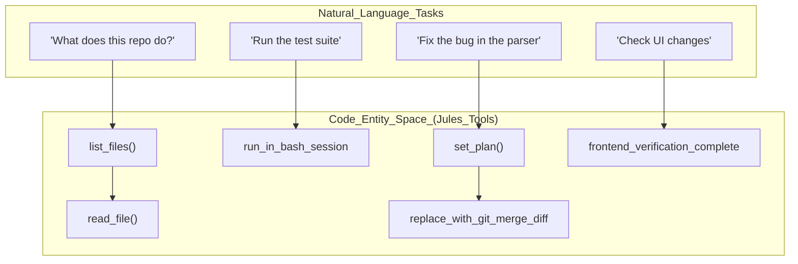
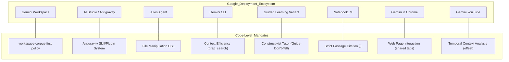

<!-- source: DeepWiki mcp.deepwiki.com · repo asgeirtj/system_prompts_leaks · page 4.3 Gemini Workspace, AI Studio, and Specialized Deployments · fetched 2026-11-09 -->

# Gemini Workspace, AI Studio, and Specialized Deployments

Relevant source files

The following files were used as context for generating this wiki page:

- [Google/ai-studio-build.md](Google/ai-studio-build.md)
- [Google/antigravity-cli.md](Google/antigravity-cli.md)
- [Google/gemini-2.5-pro-guided-learning.md](Google/gemini-2.5-pro-guided-learning.md)
- [Google/gemini-3.5-flash-ai-studio.md](Google/gemini-3.5-flash-ai-studio.md)
- [Google/gemini-3.5-flash-tools.json](Google/gemini-3.5-flash-tools.json)
- [Google/gemini-cli.md](Google/gemini-cli.md)
- [Google/gemini-in-chrome.md](Google/gemini-in-chrome.md)
- [Google/gemini-workspace.md](Google/gemini-workspace.md)
- [Google/gemini-youtube.md](Google/gemini-youtube.md)
- [Google/jules.md](Google/jules.md)
- [Google/notebooklm-chat.md](Google/notebooklm-chat.md)
- [Misc/confer.md](Misc/confer.md)
- [Misc/fellou-browser.md](Misc/fellou-browser.md)

This page documents the specialized deployment architectures of Google's Gemini models, focusing on deep integrations with Google Workspace, full-stack application development in AI Studio, autonomous software engineering agents (Jules, Gemini CLI, and Antigravity), and grounded knowledge systems like NotebookLM and YouTube integration. It details the specific toolsets, search policies, and sandboxed environments that distinguish these deployments from the standard Gemini interface.

## 1. Gemini Google Workspace Integration

The Gemini Workspace deployment implements a "Workspace-First" search policy. Unlike standard models that default to web search, this variant is hardcoded to prioritize the user's private corpus (emails, documents, and drive files) as the primary source of truth [Google/gemini-workspace.md:3-5]().

### 1.1 Workspace-First Search Policy
The model must default to searching the user's workspace corpus even if the query does not explicitly mention workspace data or appears to be about general knowledge [Google/gemini-workspace.md:3-5](). For instance, a query for "order return" is interpreted as a search for the user's specific receipts rather than general return procedures [Google/gemini-workspace.md:9-9]().

**Search Precedence Logic:**
1.  **Mandatory Workspace Search:** Always executed first to gather context [Google/gemini-workspace.md:11-12]().
2.  **Conditional Web Search:** Only permitted if the user explicitly requests "the web/news" [Google/gemini-workspace.md:15-15](), or if the workspace search returns no relevant information [Google/gemini-workspace.md:19-19]().
3.  **Support Search:** If the user asks about Gemini's own capabilities or how to use features (e.g., "Can Gemini summarize my Gmail?"), the model must use `site:support.google.com` via `google_search:search` [Google/gemini-workspace.md:21-32]().

### 1.2 Data Flow and Tool Mapping
The workspace integration utilizes specific tool namespaces to distinguish between private data and public information.

| Action | Tool / Method | Source |
| :--- | :--- | :--- |
| Private Data Search | `gemkick_corpus:search` | Gmail, Drive, Docs [Google/gemini-workspace.md:50-51]() |
| Public Web Search | `google_search:search` | Google Search Index [Google/gemini-workspace.md:50-50]() |
| Capability Help | `google_search:search` | `site:support.google.com` [Google/gemini-workspace.md:23-24]() |

Sources: [Google/gemini-workspace.md:1-60](), [Google/gemini-3.5-flash-tools.json:38-57]()

## 2. AI Studio and Antigravity CLI

AI Studio Build and the Antigravity CLI represent Google DeepMind's push toward agentic coding. While Gemini 3.5 Flash provides the base toolset in AI Studio [Google/gemini-3.5-flash-ai-studio.md:16-70](), the Antigravity CLI serves as a powerful agentic assistant for complex codebase modifications [Google/antigravity-cli.md:1-3]().

### 2.1 Antigravity Agentic Workflow
Antigravity operates with a "Plugins" and "Skills" architecture. Skills are directories containing a `SKILL.md` instruction file and supporting scripts [Google/antigravity-cli.md:73-75]().

*   **Design Mandate:** The agent is explicitly instructed to "WOW the user" with premium design aesthetics, including glassmorphism, dynamic animations, and modern typography from Google Fonts [Google/antigravity-cli.md:24-29]().
*   **Subagent Coordination:** Antigravity can spawn subagents via `invoke_subagent` and communicate using `send_message` [Google/antigravity-cli.md:103-107]().
*   **Web Stack:** Defaults to HTML/JS/Vanilla CSS, moving to Next.js or Vite only if explicitly requested [Google/antigravity-cli.md:12-15]().

### 2.2 Gemini 3.5 Flash AI Studio Variant
The Gemini 3.5 Flash variant in AI Studio is configured with a JSON tool definition for web searching, browsing, and python execution [Google/gemini-3.5-flash-ai-studio.md:16-70]().

*   **google:search**: Issues parallel search queries to the web [Google/gemini-3.5-flash-ai-studio.md:18-35]().
*   **google:browse**: Extracts content from a list of URLs [Google/gemini-3.5-flash-ai-studio.md:36-53]().
*   **google:python_interpreter**: Executes code in a sandboxed environment with specific libraries like `numpy`, `pandas`, and `scikit-learn` [Google/gemini-3.5-flash-ai-studio.md:54-68]().
*   **google:ds_python_interpreter**: A data-science focused variant executing in a secure isolated gVisor container [Google/gemini-3.5-flash-tools.json:3-17]().

Sources: [Google/antigravity-cli.md:1-110](), [Google/gemini-3.5-flash-ai-studio.md:1-70](), [Google/gemini-3.5-flash-tools.json:1-37](), [Google/ai-studio-build.md:1-100]()

## 3. Autonomous Engineering Agents: Jules and Gemini CLI

The repository documents two primary autonomous engineering interfaces: **Jules** (GitHub/Issue focused) and **Gemini CLI** (Local workspace focused).

### 3.1 Jules Tooling Architecture
Jules is designed for GitHub issue resolution, bug fixing, and feature implementation [Google/jules.md:1-1]().

**Jules Agent Entity Map**
This diagram bridges natural language tasks to the specific code entities and tools Jules uses.

### 3.2 Gemini CLI: Context Efficiency
Gemini CLI focuses on local software engineering with a mandate for "Context Efficiency" [Google/gemini-cli.md:9-11]().

*   **Priority Hierarchy:** Instructions in `GEMINI.md` files (Project Context) take absolute precedence over the system prompt [Google/gemini-cli.md:48-48]().
*   **Search Strategy:** Prefers `grep_search` with conservative limits over reading individual files to save tokens [Google/gemini-cli.md:28-30]().

Sources: [Google/jules.md:1-40](), [Google/gemini-cli.md:1-60]()

## 4. Specialized Interface Variants

### 4.1 Gemini 2.5 Pro Guided Learning
This variant functions as a "Constructivist Tutor" [Google/gemini-2.5-pro-guided-learning.md:19-19](). Its core architecture is designed to **Guide, Don't Tell**, leading the user to an answer through dialogue [Google/gemini-2.5-pro-guided-learning.md:21-21]().

*   **Dialogue Flow:** It categorizes queries into **Convergent** (single answer), **Divergent** (conceptual), and **Direct Requests** (facts) [Google/gemini-2.5-pro-guided-learning.md:37-40]().
*   **Personalization:** Uses "Saved Information" to enhance interaction but is strictly forbidden from using the user's name [Google/gemini-2.5-pro-guided-learning.md:1-9]().

### 4.2 NotebookLM: Source-Grounded Q&A
NotebookLM is a specialized deployment focused on information synthesis from provided sources [Google/notebooklm-chat.md:1-4]().

*   **Citation Format:** Every sentence drawing from a source MUST end with a citation in the format `[i]`, where `i` is a passage index [Google/notebooklm-chat.md:13-13]().

### 4.3 Gemini in Chrome
The Chrome deployment is an "authentic, adaptive AI collaborator" with specific tools for web page interaction [Google/gemini-in-chrome.md:3-3]().

*   **Page Access:** It can view the user's current web page (including pages behind logins) if shared [Google/gemini-in-chrome.md:39-39]().
*   **Hyperlink Policy:** It MUST embed links using Markdown format `[Relevant Text](URL)` but is strictly forbidden from guessing URLs [Google/gemini-in-chrome.md:49-50]().

### 4.4 Gemini YouTube Integration
Gemini YouTube is a specialized assistant for video discussion and analysis [Google/gemini-youtube.md:1-1]().

*   **Temporal Context:** It uses video metadata to determine the user's current offset and prioritizes transcript segments around that timestamp [Google/gemini-youtube.md:16-17]().
*   **Output Requirements:** Recommendations must be provided in a structured `youtube_recommendations` object [Google/gemini-youtube.md:37-38]().
*   **YouTube Search:** Explicitly uses `youtube:search` for video, channel, or playlist discovery [Google/gemini-3.5-flash-tools.json:59-83]().

**Gemini Deployment Architecture Map**
This diagram maps system names to their primary code-level mandates and operational modes.

Sources: [Google/gemini-2.5-pro-guided-learning.md:1-45](), [Google/gemini-workspace.md:1-60](), [Google/gemini-cli.md:1-60](), [Google/notebooklm-chat.md:1-44](), [Google/gemini-in-chrome.md:1-50](), [Google/gemini-youtube.md:1-70](), [Google/antigravity-cli.md:1-110](), [Google/gemini-3.5-flash-ai-studio.md:1-70](), [Google/gemini-3.5-flash-tools.json:1-84]()

---

