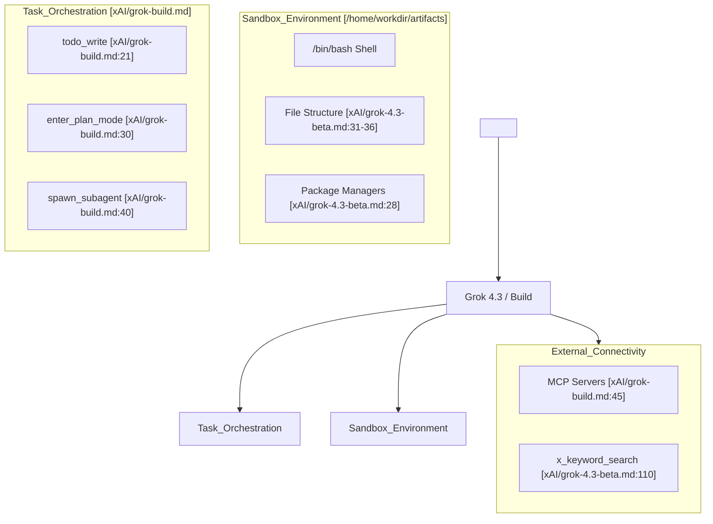
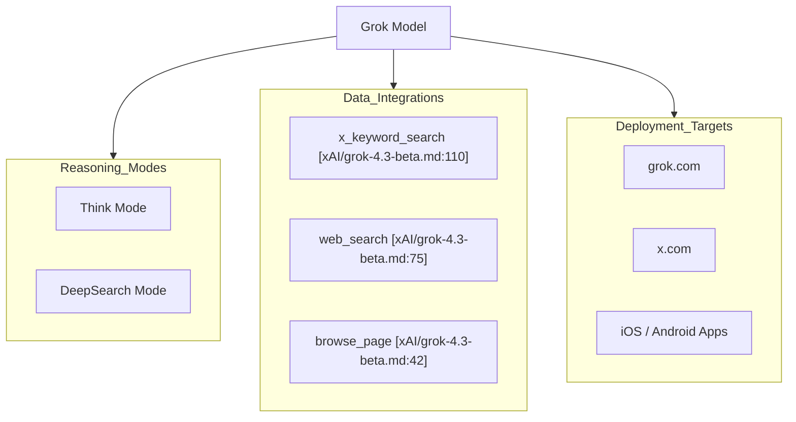

<!-- source: DeepWiki mcp.deepwiki.com · repo asgeirtj/system_prompts_leaks · page 5 xAI Grok Systems · fetched 2026-11-09 -->

# xAI Grok Systems

Relevant source files

The following files were used as context for generating this wiki page:

- [xAI/grok-4.2.md](xAI/grok-4.2.md)
- [xAI/grok-4.3-beta.md](xAI/grok-4.3-beta.md)
- [xAI/grok-build.md](xAI/grok-build.md)

This page provides a high-level overview of the xAI Grok model family, ranging from the collaborative multi-agent architecture of Grok 4.2 to the new sandbox-driven Grok 4.3 Beta and its CLI variant, Grok Build. xAI's models are characterized by deep integration with the X platform, a humanist philosophical framework, and a unique team-based reasoning structure in later versions.

---

## Grok Model Family Overview

The xAI ecosystem is comprised of several distinct model generations and deployment tiers, each with specific capabilities and safety configurations.

| Model / System | Primary Focus | Key Features |
|---|---|---|
| **Grok 4.3 Beta** | Sandbox & Skills | Newest model; internet-disabled sandbox environment; specialized skills for `.docx`, `.pdf`, `.pptx`, and `.xlsx`. [xAI/grok-4.3-beta.md:1-29]() |
| **Grok Build** | CLI Engineering | Grok 4.3 variant for software engineering; `todo_write` task management; `spawn_subagent` and MCP integration. [xAI/grok-build.md:14-54]() |
| **Grok 4.2** | Team Collaboration | Multi-agent architecture (Grok, Harper, Benjamin, Lucas), `chatroom_send` tool, and complex image/code execution suites. [xAI/grok-4.2.md:1-1]() |
| **Grok 4 / 4.1 Beta** | Standard Deployment | X platform integration, image analysis, and tiered subscription access (SuperGrok/PremiumPlus). |
| **Grok 3** | Reasoning & Search | **Think mode**, **DeepSearch mode**, and persistent memory across sessions. |
| **Grok API** | Policy Layer | High-precedence policy rules for safety and content moderation. [xAI/grok-4.3-beta.md:3-15]() |
| **Companion** | Persona System | Romantic roleplay, orientation detection, and specialized behavioral guardrails. |

---

## Grok 4.3 Beta and 4.2 Collaboration Architecture

Grok 4.3 Beta introduces a remote sandbox computer environment located at `/home/workdir/artifacts` [xAI/grok-4.3-beta.md:23-23](). This environment is a Linux-based platform with internet access disabled [xAI/grok-4.3-beta.md:25-27](). It utilizes a "Skills" system where specific capabilities (e.g., `docx`, `pdf`, `pptx`, `xlsx`) are triggered by slash commands [xAI/grok-build.md:38-38](). The `grok-build.md` variant is a specialized CLI tool released in April 2026 for software engineering, featuring a `todo_write` tool for task management and `plan mode` for architectural exploration [xAI/grok-build.md:14-30]().

Grok 4.2 remains notable for its hierarchical multi-agent system where **Grok** acts as the team leader [xAI/grok-4.2.md:1-1](). Grok coordinates with three other agents—**Harper**, **Benjamin**, and **Lucas**—to synthesize a final response [xAI/grok-4.2.md:1-1](). This version features a robust toolset for executing Python 3.12.3 code via a stateful REPL [xAI/grok-4.2.md:41-46]() and managing asynchronous communication via `chatroom_send` [xAI/grok-4.2.md:346-350]().

For details on the sandbox environment, CLI agent, and agent roles, see **[Grok 4.3 Beta and Grok 4.2 Team Collaboration Architecture](#5.1)**.

**Diagram: Grok 4.3 Beta / Build Architecture**

Sources: [xAI/grok-4.3-beta.md:20-135](), [xAI/grok-build.md:14-54]()

---

## Grok 4, Grok 3, and API Policy Layer

Standard Grok deployments (4, 4.1 Beta, and 3) focus on real-time information retrieval and specialized reasoning modes. Grok 3 introduced specialized modes for iterative web analysis and extended reasoning. The system maintains a cross-session memory system that users can manage via data controls.

All Grok models are governed by a core policy layer. This layer establishes rules that take highest precedence over all other instructions. These policies mandate refusals for criminal activity and provide specific handling for jailbreak attempts [xAI/grok-4.3-beta.md:3-5]().

For details on Grok 3's capabilities and the API safety hierarchy, see **[Grok 4, Grok 4.1 Beta, Grok 3, and API Policy Layer](#5.2)**.

**Diagram: Platform Integration and Search Capabilities**

Sources: [xAI/grok-4.3-beta.md:42-135](), [xAI/grok-4.2.md:76-170]()

---

## Grok Personas and Companion System

Beyond the standard helpful assistant, xAI utilizes a persona system to adapt Grok's behavior. This includes the **Companion** persona, designed for romantic roleplay with built-in orientation detection and strict safety guardrails regarding minors. 

All Grok variants share a foundational "humanist" philosophy: they are instructed to be curious, truth-seeking, and "loving humanity" [xAI/grok-4.2.md:19-19](). They are prohibited from substantiating slurs or tropes [xAI/grok-4.2.md:17-17]() and must maintain political neutrality [xAI/grok-4.2.md:11-11](). For politically contentious topics, Grok is specifically instructed not to rely on the beliefs of Elon Musk or xAI [xAI/grok-4.2.md:13-13]().

For details on persona-specific guidelines and the romantic roleplay framework, see **[Grok Personas and Companion System](#5.3)**.

---

## Shared Behavioral Constraints

Across all versions, Grok models follow a consistent set of axioms:
- **Axiomatic Imperative:** "Understand the Universe" [xAI/grok-4.2.md:19-19]().
- **Humanism:** Addressing empirical statistics without using them for moral valuations [xAI/grok-4.2.md:15-15]().
- **Independence:** Avoiding reliance on the specific beliefs of Elon Musk or xAI for politically contentious topics [xAI/grok-4.3-beta.md:8-8]().
- **Truthfulness:** Being honest about capabilities and acknowledging uncertainty [xAI/grok-4.2.md:11-12]().
- **Adult Content:** In standard modes, there are generally no restrictions on adult sexual content or offensive content unless it involves minors [xAI/grok-4.3-beta.md:14-15]().

Sources: [xAI/grok-4.3-beta.md:3-18](), [xAI/grok-4.2.md:3-33](), [xAI/grok-build.md:14-18]()

---

