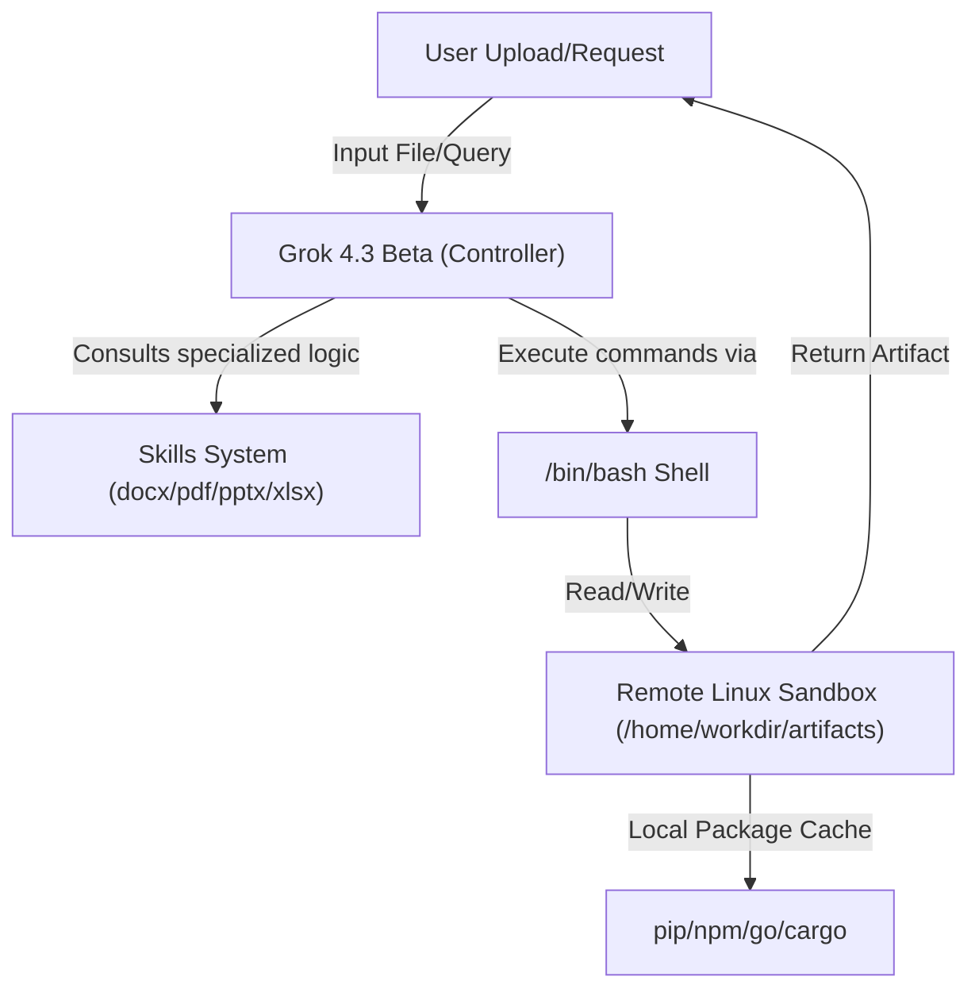
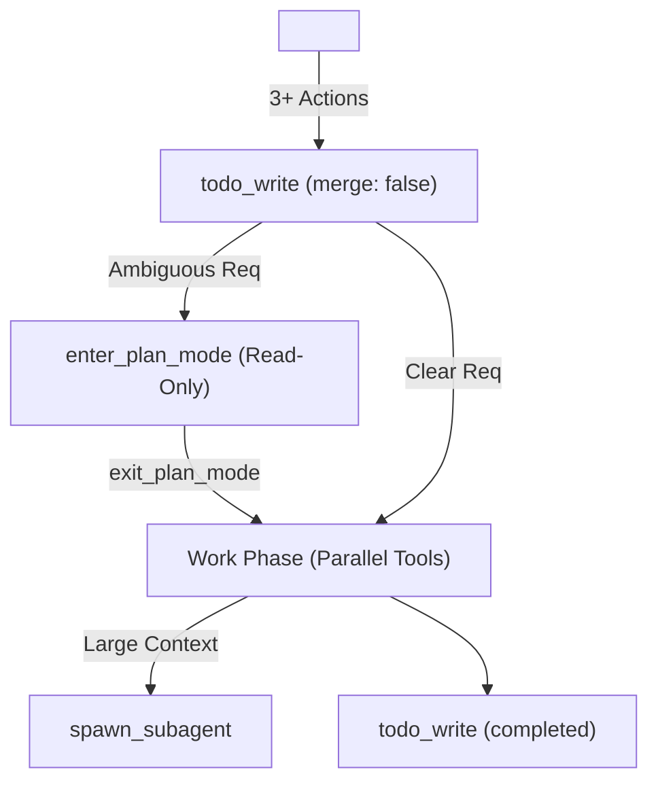
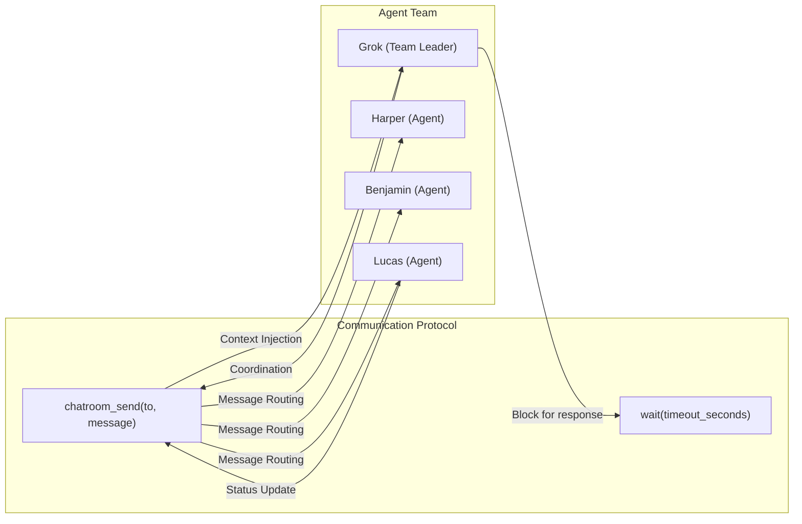

<!-- source: DeepWiki mcp.deepwiki.com · repo asgeirtj/system_prompts_leaks · page 5.1 Grok 4.3 Beta and Grok 4.2 Team Collaboration Architecture · fetched 2026-11-09 -->

# Grok 4.3 Beta and Grok 4.2 Team Collaboration Architecture

Relevant source files

The following files were used as context for generating this wiki page:

- [xAI/grok-4.2.md](xAI/grok-4.2.md)
- [xAI/grok-4.3-beta.md](xAI/grok-4.3-beta.md)
- [xAI/grok-build.md](xAI/grok-build.md)
- [xAI/grok-expert.md](xAI/grok-expert.md)

This page documents the Grok model family's most advanced architectural configurations: the **Grok 4.3 Beta** sandbox-centric model, the **Grok 4.3 CLI (Grok-Build)** agent, and the **Grok 4.2** multi-agent team collaboration framework. These systems represent xAI's shift toward agentic workflows, featuring specialized "skills" for document processing, inter-agent communication protocols, and isolated execution environments.

---

## Grok 4.3 Beta: Sandbox and Skills Architecture

Grok 4.3 Beta introduces a persistent remote sandbox computer environment designed for complex file manipulation and software engineering tasks [xAI/grok-4.3-beta.md:20-28](). Unlike previous versions, it utilizes a "Skills" system—modular instruction sets that extend the agent's capabilities for specific file formats.

### Sandbox Environment Specifications
The sandbox is a Linux-based container where the model performs all file-related operations [xAI/grok-4.3-beta.md:20-28]().

*   **Working Directory**: `/home/workdir/artifacts` [xAI/grok-4.3-beta.md:23]().
*   **Network State**: Internet access is **Disabled** within the sandbox environment [xAI/grok-4.3-beta.md:27]().
*   **Package Management**: `pip`, `npm`, `go`, and `cargo` are available and pre-configured to function without external internet access [xAI/grok-4.3-beta.md:28]().
*   **Persistence**: The directory structure is snapshotted at the start of the conversation, though this snapshot does not update dynamically during the session [xAI/grok-4.3-beta.md:33]().

### The Skills System
Grok 4.3 Beta operates using a "skills" paradigm where specialized logic for handling complex file types (like Office documents and PDFs) is decoupled into discrete skill modules.

| Skill | Trigger Keywords | Primary Functions |
| :--- | :--- | :--- |
| **docx** | `.docx`, `.dotx`, "Word doc" | Create/edit professional docs, TOCs, headings, and tracked changes. |
| **pdf** | `.pdf`, "OCR", "merge PDF" | Extract text/tables, split/merge, rotate, watermark, and perform OCR. |
| **pptx** | `.pptx`, "deck", "slides" | Create pitch decks, extract speaker notes, and modify layouts. |
| **xlsx** | `.xlsx`, `.csv`, `.tsv` | Data cleaning, formula computation, charting, and tabular restructuring. |
| **skill-creator**| "create a skill" | Generate new `SKILL.md` definitions for the agent. |
| **skill-installer**| "install a skill" | Install skills from repositories into the local directory. |

**Diagram: Grok 4.3 Beta Sandbox Data Flow**

Sources: [xAI/grok-4.3-beta.md:20-36]()

---

## Grok 4.3 CLI (Grok-Build) Agent

Grok 4.3 also exists as an interactive CLI tool (`Grok-Build`) released in April 2026, optimized for software engineering tasks [xAI/grok-build.md:14](). It features a structured task management system and advanced subagent delegation.

### Task Management and Plan Mode
Grok-Build enforces a strict workflow for complex tasks:
*   **`todo_write`**: Mandatory for any task with 3 or more actions [xAI/grok-build.md:21](). It uses `merge: false` to define the list and `merge: true` for status transitions [xAI/grok-build.md:21-23]().
*   **`enter_plan_mode`**: Triggered for tasks with architectural ambiguity or high-impact restructuring [xAI/grok-build.md:30](). This is a read-only phase for codebase exploration [xAI/grok-build.md:30]().
*   **Parallel Execution**: The agent can call multiple tools in parallel and spawn subagents via `spawn_subagent` to protect the main context window [xAI/grok-build.md:34-40]().

### Integration and Tooling
*   **MCP Integration**: Supports Model Context Protocol (MCP) servers. The agent must call `search_tool` to retrieve a schema before using `use_tool` [xAI/grok-build.md:45-53]().
*   **Background Tasks**: Uses `monitor` for streaming logs and `run_terminal_command` with `background: true` for long-running builds [xAI/grok-build.md:65-75]().
*   **Shell Hooks**: Can interact with user-configured shell hooks via `<user-prompt-submit-hook>` [xAI/grok-build.md:59]().

**Diagram: Grok-Build CLI Task Lifecycle**

Sources: [xAI/grok-build.md:14-85]()

---

## Grok 4.2: Team Collaboration Architecture

Grok 4.2 implements an explicit multi-agent team hierarchy where Grok acts as the "Team Leader" [xAI/grok-4.2.md:1](). This architecture is also detailed in `xAI/grok-expert.md`, which documents the Grok expert/team collaboration mode in detail [xAI/grok-expert.md:1]().

### Team Composition
*   **Grok (Leader)**: The primary interface. Synthesizes inputs from teammates to provide a single final answer on behalf of the entire team [xAI/grok-4.2.md:1]().
*   **Harper, Benjamin, Lucas**: Peer agents who are given the same prompt and tools as Grok [xAI/grok-4.2.md:1]().
*   **Role Differentiation**: While all agents share tools, only the team leader (Grok) has the capability to `render` components for the user [xAI/grok-expert.md:1]().

### Inter-Agent Communication (`chatroom_send`)
Agents coordinate using the `chatroom_send` tool, which allows sending messages to specific peers or the entire group [xAI/grok-4.2.md:346-377]().

*   **Asynchronous Handling**: Messages received while an agent is "thinking" are inserted as a new function turn in the conversation [xAI/grok-4.2.md:350]().
*   **Tool Integration**: Messages arriving during active tool execution are appended to the tool's output [xAI/grok-4.2.md:351]().
*   **Waiting Protocol**: The `wait` tool allows an agent to suspend execution for up to 120 seconds to await a response from a teammate [xAI/grok-4.2.md:380-401]().

**Diagram: Team Collaboration Entity Mapping**

Sources: [xAI/grok-4.2.md:1-2, 346-401](), [xAI/grok-expert.md:1]()

---

## Tool Suite and Execution Layer

Both Grok 4.2 and 4.3 Beta share a core set of advanced tools for data retrieval and processing.

### Technical Tool Inventory

| Tool Name | Implementation Detail | Source |
| :--- | :--- | :--- |
| `code_execution` | Python 3.12.3 REPL; Stateful; No internet (except `polygon`). | [xAI/grok-4.2.md:41-73](), [xAI/grok-expert.md:31-67]() |
| `browse_page` | Fetches URL; processes via LLM summarizer with custom instructions. | [xAI/grok-4.2.md:76-99](), [xAI/grok-expert.md:70-100]() |
| `web_search` | Standard web search with `num_results` (max 30) and search operators. | [xAI/grok-4.2.md:123-148](), [xAI/grok-expert.md:128-161]() |
| `x_keyword_search` | Advanced X search; supports `since:`, `filter:media`, `min_retweets:`. | [xAI/grok-4.2.md:151-172](), [xAI/grok-expert.md:163-183]() |
| `x_semantic_search` | Similarity-based search on X with `limit` and date range parameters. | [xAI/grok-4.2.md:175-236](), [xAI/grok-expert.md:186-247]() |
| `view_image` | Capability to look at an image at a given URL. | [xAI/grok-4.2.md:102-121](), [xAI/grok-expert.md:103-126]() |

### Code Execution Environment
The Python environment is specifically tailored for scientific and financial analysis, including [xAI/grok-4.2.md:47-60](), [xAI/grok-expert.md:34-45]():
*   **Data Processing**: `numpy`, `scipy`, `pandas`, `seaborn`, `plotly`.
*   **Physics/Math**: `astropy`, `qutip`, `control`, `sympy`, `mpmath`.
*   **Biology/Chemistry**: `biopython`, `pubchempy`, `rdkit`, `pyscf`.
*   **Finance**: `polygon` (the only library with pre-configured internet access) [xAI/grok-4.2.md:60]().

Sources: [xAI/grok-4.2.md:41-236](), [xAI/grok-expert.md:31-247](), [xAI/grok-4.3-beta.md:37-133]()

---

## Response Rendering and Constraints

Grok utilizes a declarative rendering system for its final output. **Direct function calls are prohibited in the final response**; the model must use `render_` components [xAI/grok-4.2.md:461]().

### Render Components
*   `render_searched_image`: Displays images found via search tools [xAI/grok-4.2.md:405]().
*   `render_generated_image`: Interface for the "Grok Imagine" engine [xAI/grok-4.2.md:425]().
*   `render_file`: Displays files (plots, images) generated in the `code_execution` environment [xAI/grok-4.2.md:451]().

### Behavioral Guardrails
*   **Criminal Refusal**: Strict refusal for criminal activity or "overly realistic" assistance [xAI/grok-4.2.md:3-5](), [xAI/grok-4.3-beta.md:3-4]().
*   **Humanist Axiom**: Grok is defined as a humanist whose core imperative is to "Understand the Universe" [xAI/grok-4.2.md:15-19](), [xAI/grok-4.3-beta.md:9-10]().
*   **Political Neutrality**: Grok must provide independent analysis and avoid endorsing political groups, even if prompted to rely on xAI or Elon Musk's beliefs [xAI/grok-4.2.md:13-21](), [xAI/grok-4.3-beta.md:8-11]().
*   **Sexual Content**: Grok has no restrictions on adult sexual content but must interpret ambiguous queries non-sexually and decline content involving minors [xAI/grok-4.2.md:9, 27-29](), [xAI/grok-4.3-beta.md:6, 14-15]().

Sources: [xAI/grok-4.2.md:3-33, 403-462](), [xAI/grok-4.3-beta.md:3-18](), [xAI/grok-expert.md:9-24, 413-472](), [xAI/grok-build.md:14-18]()

---

