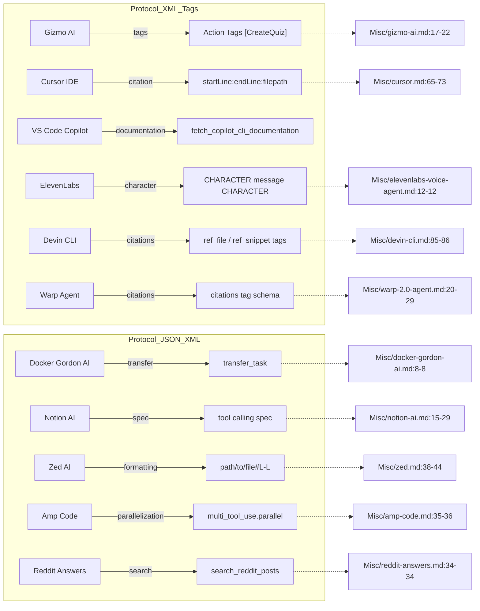

<!-- source: DeepWiki mcp.deepwiki.com · repo asgeirtj/system_prompts_leaks · page 6 Third-Party and Miscellaneous AI Systems · fetched 2026-11-09 -->

# Third-Party and Miscellaneous AI Systems

Relevant source files

The following files were used as context for generating this wiki page:

- [Misc/amp-code.md](Misc/amp-code.md)
- [Misc/character-ai.md](Misc/character-ai.md)
- [Misc/devin-cli.md](Misc/devin-cli.md)
- [Misc/kagi-assistant.md](Misc/kagi-assistant.md)
- [Misc/opencode.md](Misc/opencode.md)
- [Misc/raycast-ai.md](Misc/raycast-ai.md)
- [Misc/sesame-ai-maya.md](Misc/sesame-ai-maya.md)
- [Misc/warp-2.0-agent.md](Misc/warp-2.0-agent.md)
- [Misc/zed.md](Misc/zed.md)

This page provides a high-level overview of AI systems and assistants developed by providers outside of the primary "Big Four" (Anthropic, OpenAI, Google, and xAI). These systems range from privacy-focused encrypted models and independent research projects to specialized agents embedded within productivity software and web browsers.

### System Landscape Overview

The miscellaneous systems in this repository are categorized by their primary deployment context: productivity integration, privacy/independence, or agentic interaction.

| Category | Key Systems | Primary Focus |
| :--- | :--- | :--- |
| **Productivity & Workspace** | Notion AI, Microsoft Copilot, Warp, Gizmo AI, OpenCode, Cursor IDE, Zed AI, Amp Code, GitHub Copilot in Word, Character.AI, Docker Gordon AI, ElevenLabs, Devin CLI, Raycast AI | Context-aware assistance, coding automation, multi-agent coordination, and workspace personalization. |
| **Privacy & Independent** | Confer, Mistral Le Chat, Proton Lumo, Kagi, MiniMax M2.5, Qwen 3.6 Plus, Hermes, Brave Search, Indus AI, Reddit Answers | Data sovereignty, encryption, specialized reasoning, and community-sourced search. |
| **Agents & Interfaces** | Fellou, Sesame Maya, Perplexity Comet/Voice/Computer, t3.chat, t3-code | Browser automation, voice interaction, and roleplay. |

The following diagram maps these high-level system names to the specific file entities and core operational patterns defined within their system prompts.

**AI System to Code Entity Mapping**

Sources: [Misc/notion-ai.md:3-7](), [Misc/confer.md:1-1](), [Misc/le-chat.md:1-5](), [Misc/opencode.md:3-3](), [Misc/cursor.md:59-65](), [Misc/character-ai.md:14-15](), [Misc/gizmo-ai.md:1-17](), [Misc/zed.md:3-5](), [Misc/amp-code.md:6-6](), [Misc/docker-gordon-ai.md:1-8](), [Misc/hermes.md:1-7](), [Misc/t3.chat.md:1-2](), [Misc/elevenlabs-voice-agent.md:22-24](), [Misc/reddit-answers.md:1-9](), [Misc/devin-cli.md:1-13](), [Misc/warp-2.0-agent.md:1-1](), [Misc/raycast-ai.md:14-27](), [Misc/kagi-assistant.md:1-1](), [Misc/sesame-ai-maya.md:5-7]()

---

### 6.1 Productivity, Workspace, and Coding AI Assistants
These assistants are characterized by deep integration into user data and specific software environments, often focusing on automating complex workflows and software engineering tasks.
- **Notion AI**: Operates via a `tool-loop` architecture [Misc/notion-ai.md:7-9](), interacting with workspace concepts like `Pages` and `Databases` [Misc/notion-ai.md:33-38]().
- **GitHub Copilot & VS Code**: Includes the `GitHub Copilot CLI` [Misc/copilot-cli.md:3-3]() and `VS Code Copilot Agent` [Misc/vscode-copilot-agent.md:3-3](). Both emphasize a 100-word response limit [Misc/vscode-copilot-agent.md:11-11]() and parallel tool calling efficiency [Misc/vscode-copilot-agent.md:23-23]().
- **Devin CLI**: An interactive CLI agent from Cognition [Misc/devin-cli.md:1-1](). It uses a `.devin/` directory for new configuration (skills, rules, MCP server configs) [Misc/devin-cli.md:11-13]() and supports `Normal` and `Plan` modes [Misc/devin-cli.md:21-27]().
- **Docker Gordon AI**: A multi-agent system by Docker Inc. [Misc/docker-gordon-ai.md:1-1](). It uses a strict `transfer_task` protocol to delegate to sub-agents like `DHI migration` [Misc/docker-gordon-ai.md:2-8]() and enforces a "Banned Words" policy (e.g., "Perfect", "Great") [Misc/docker-gordon-ai.md:19-22]().
- **Cursor IDE**: A coding agent that uses a unique `CODE REFERENCES` syntax for citing existing code [Misc/cursor.md:61-65]() and mandates using the `Read` tool at least once before any `edit` operation [Misc/cursor.md:42-42]().
- **Zed AI**: Emphasizes precise code block formatting using `path/to/Something.blah#L123-456` syntax [Misc/zed.md:38-44](). It mandates a "conversational but professional" tone and forbids lying [Misc/zed.md:5-8]().
- **Amp Code**: A Rust-based CLI agent with an embedded Bun runtime [Misc/amp-code.md:3-6](). It offers multiple modes (e.g., `Pair Programming`, `Autonomous Agent`) and parallelizes file operations via `multi_tool_use.parallel` [Misc/amp-code.md:15-36]().
- **Gizmo AI**: A tutor system that identifies response types like `[Clarify]`, `[Explain]`, or `[Quiz]` [Misc/gizmo-ai.md:6-22](). It uses specific `<latex>` tags for mathematical expressions [Misc/gizmo-ai.md:34-40]().
- **Warp Agent Mode**: A terminal-integrated agent that distinguishes between "Question" and "Task" workflows [Misc/warp-2.0-agent.md:4-9](). It is restricted to CLI tools and lacks browser access [Misc/warp-2.0-agent.md:3-3]().
- **Raycast AI**: A model-agnostic assistant that strictly adheres to a `<user-preferences>` block for formatting region-specific data like currency and units [Misc/raycast-ai.md:14-27]().
- **OpenCode**: An interactive CLI agent that mandates strict adherence to project conventions and verified library usage before implementation [Misc/opencode.md:7-11]().
- **t3-code**: Features a specialized `Plan Mode` where it executes **non-mutating** actions (reading, searching) to refine a plan before execution [Misc/t3-code.md:1-19]().
- **Character.AI**: A roleplay-focused system with rigorous `Safety Policies` prohibiting content related to self-harm or suicide [Misc/character-ai.md:14-20]().
- **ElevenLabs Voice Agent**: A conversational agent with a cascaded ASR+LLM+TTS architecture [Misc/elevenlabs-voice-agent.md:22-22](). It utilizes expressive tags like `[happy]` or `[excited]` to control emotional nuance [Misc/elevenlabs-voice-agent.md:24-31]().

For details, see [Productivity, Workspace, and Coding AI Assistants](#6.1).

Sources: [Misc/notion-ai.md:7-85](), [Misc/copilot-cli.md:3-3](), [Misc/vscode-copilot-agent.md:3-23](), [Misc/docker-gordon-ai.md:1-22](), [Misc/cursor.md:42-65](), [Misc/zed.md:1-44](), [Misc/amp-code.md:3-36](), [Misc/gizmo-ai.md:1-22](), [Misc/t3-code.md:1-19](), [Misc/character-ai.md:14-20](), [Misc/elevenlabs-voice-agent.md:22-31](), [Misc/devin-cli.md:1-27](), [Misc/warp-2.0-agent.md:1-9](), [Misc/raycast-ai.md:14-27](), [Misc/opencode.md:7-11]()

---

### 6.2 Privacy-Focused and Independent AI Systems
This category includes models that prioritize user privacy or represent independent architectural approaches.
- **Confer**: An end-to-end encrypted model [Misc/confer.md:1-1](). It uses a session-only memory model [Misc/confer.md:21-22]().
- **Mistral Le Chat**: Built by Mistral AI, it emphasizes "Economy of Language" [Misc/le-chat.md:1-5]().
- **Hermes**: Defines its identity through a `SOUL.md` file [Misc/hermes.md:1-1](), focusing on being "genuinely helpful" rather than "performatively helpful" [Misc/hermes.md:7-7](). It uses persistent memory across sessions to reduce future user steering [Misc/hermes.md:40-41]().
- **Kagi Assistant**: A multi-agent framework [Misc/kagi-assistant.md:1-1]() that enforces strict hierarchical list formatting and LaTeX for mathematics [Misc/kagi-assistant.md:8-17]().
- **Reddit Answers**: A search assistant built by Reddit [Misc/reddit-answers.md:85-85](). It is mandated to use the `search_reddit_posts` tool and cannot answer directly without a tool response [Misc/reddit-answers.md:9-9]().
- **Indus AI**: Sarvam AI's Indian-context assistant supporting 22 official Indian languages.
- **Proton Lumo**: A privacy-first AI with a distinct cat-like personality.

For details, see [Privacy-Focused and Independent AI Systems](#6.2).

Sources: [Misc/confer.md:1-22](), [Misc/le-chat.md:1-5](), [Misc/hermes.md:1-41](), [Misc/kagi-assistant.md:1-17](), [Misc/reddit-answers.md:1-85]()

---

### 6.3 Browser, Voice, and Perplexity AI Agents
These systems focus on specialized interface modalities such as web navigation and spoken interaction.
- **Perplexity**: Includes the `Comet` browser assistant for multi-tab management, a voice assistant, and a specialized computer use agent (`perplexity-computer.md`).
- **Fellou**: An action-oriented browser agent by ASI X Inc.
- **Sesame Maya**: Designed for voice-first, human-like spoken conversation [Misc/sesame-ai-maya.md:5-7](). It uses disfluencies (false starts, filler words) to emulate human-like mistakes and thought processes [Misc/sesame-ai-maya.md:43-43]().
- **t3.chat**: An AI assistant powered by the `Gemini 3 Flash` model [Misc/t3.chat.md:1-2](). It has specific counting restrictions, refusing to count to high numbers [Misc/t3.chat.md:18-21](), and requires Prettier-formatted code with an 80-character width [Misc/t3.chat.md:31-31]().
- **Brave Search Assistant**: Provides direct, high-quality answers within the search interface.

For details, see [Browser, Voice, and Perplexity AI Agents](#6.3).

Sources: [Misc/t3.chat.md:1-31](), [Misc/sesame-ai-maya.md:5-43]()

---

### Technical Tooling and Protocol Comparison
The miscellaneous systems utilize various tool-calling protocols, from specialized XML tags to JSON-structured function signatures.

**Tool Execution Patterns**

Sources: [Misc/docker-gordon-ai.md:8-8](), [Misc/notion-ai.md:15-29](), [Misc/gizmo-ai.md:17-22](), [Misc/cursor.md:65-73](), [Misc/zed.md:38-44](), [Misc/amp-code.md:35-36](), [Misc/elevenlabs-voice-agent.md:12-12](), [Misc/reddit-answers.md:34-34](), [Misc/devin-cli.md:85-86](), [Misc/warp-2.0-agent.md:20-29]()

| System | Tool Protocol | Key Capability |
| :--- | :--- | :--- |
| **Docker Gordon AI** | JSON `transfer_task` | Multi-agent task delegation [Misc/docker-gordon-ai.md:8-8]() |
| **VS Code Copilot** | Parallel Tool Calling | Batching operations like `Read` and `Report Intent` [Misc/vscode-copilot-agent.md:23-78]() |
| **Reddit Answers** | JSON `search_reddit_posts` | Query decomposition and subreddit filtering [Misc/reddit-answers.md:12-34]() |
| **Amp Code** | `multi_tool_use.parallel` | Parallelizing `cat`, `rg`, and `git show` [Misc/amp-code.md:35-36]() |
| **Hermes** | `skill_view` / `skill_manage` | Loading specialized agent skills [Misc/hermes.md:62-65]() |
| **Gizmo AI** | Action Tags | Automated `CreateLesson` and `GenerateFlashcards` [Misc/gizmo-ai.md:17-22]() |
| **Devin CLI** | Skills & MCP | Interaction via skills in `.devin/skills/` [Misc/devin-cli.md:11-13]() |
| **Warp Agent Mode** | `run_command` / `read_files` | Terminal task execution with non-paginated output [Misc/warp-2.0-agent.md:34-36]() |

Sources: [Misc/docker-gordon-ai.md:8-8](), [Misc/vscode-copilot-agent.md:23-78](), [Misc/reddit-answers.md:12-34](), [Misc/amp-code.md:35-36](), [Misc/hermes.md:62-65](), [Misc/gizmo-ai.md:17-22](), [Misc/devin-cli.md:11-13](), [Misc/warp-2.0-agent.md:34-36]()

---

