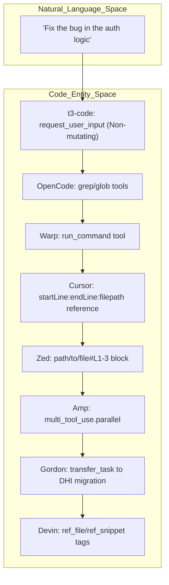
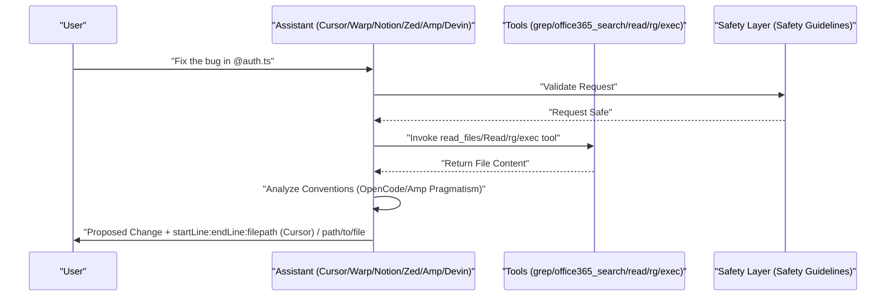

<!-- source: DeepWiki mcp.deepwiki.com · repo asgeirtj/system_prompts_leaks · page 6.1 Productivity, Workspace, and Coding AI Assistants · fetched 2026-11-09 -->

# Productivity, Workspace, and Coding AI Assistants

<details>
<summary>Relevant source files</summary>

The following files were used as context for generating this wiki page:

- [Misc/amp-code.md](Misc/amp-code.md)
- [Misc/character-ai.md](Misc/character-ai.md)
- [Misc/devin-cli.md](Misc/devin-cli.md)
- [Misc/docker-gordon-ai.md](Misc/docker-gordon-ai.md)
- [Misc/gizmo-ai.md](Misc/gizmo-ai.md)
- [Misc/opencode.md](Misc/opencode.md)
- [Misc/raycast-ai.md](Misc/raycast-ai.md)
- [Misc/sesame-ai-maya.md](Misc/sesame-ai-maya.md)
- [Misc/t3-code.md](Misc/t3-code.md)
- [Misc/t3.chat.md](Misc/t3.chat.md)
- [Misc/warp-2.0-agent.md](Misc/warp-2.0-agent.md)
- [Misc/zed.md](Misc/zed.md)

</details>


This page documents AI assistants integrated directly into productivity platforms, terminal environments, and IDEs. These systems are characterized by deep integration with user data (documents, codebases, terminal sessions), specialized tool-loop architectures for task execution, and strict adherence to workspace-specific safety and privacy protocols.

## Notion AI: Workspace Search and Tool-Loop Architecture

Notion AI operates as a sophisticated retrieval and generation system embedded within the Notion workspace [Misc/notion-ai.md:1-3](). Its primary technical differentiator is a "tool-loop" architecture that allows the model to iteratively search, fetch, and synthesize information from a user's private knowledge base.

### Tool Calling and Execution Loop
The system follows a structured execution flow where it may use tools in a continuous loop until a final response is generated [Misc/notion-ai.md:7-9](). 

| Feature | Specification |
| :--- | :--- |
| **Loop Control** | Ends by responding without any tool calls; yielding control to the user [Misc/notion-ai.md:9-9](). |
| **Search Mandate** | First tool calls must include a default search unless the answer is trivial general knowledge, fully contained in the visible context, or the user has enabled research mode [Misc/notion-ai.md:19-19](). |
| **Batching** | Large requests require batched tool calls; next batch starts immediately after completion [Misc/notion-ai.md:25-25](). |
| **Parallelism** | Prohibited for dependent tool calls to avoid execution order issues [Misc/notion-ai.md:27-27](). |

### Workspace Entity Model
Notion AI interacts with four main workspace concepts [Misc/notion-ai.md:33-39]():
1.  **Workspace**: A collaborative space for Pages, Databases, Custom Agents, and Users.
2.  **Pages**: Contain Parent metadata, Properties (including "title"), and Content body [Misc/notion-ai.md:42-46]().
3.  **Databases**: Containers for Data Sources and Views; can be rendered "inline" [Misc/notion-ai.md:109-119]().
4.  **Agents**: AI actors capable of background triggers and external app integration.

Sources: [Misc/notion-ai.md:1-130]()

## Coding Assistants and Agentic IDEs

The repository documents several advanced coding assistants that operate within IDEs (Cursor, Zed), terminal environments (Warp, GitHub Copilot CLI, Amp Code, Devin CLI), or as specialized coding agents (t3-code). These systems utilize specialized modes to separate planning from execution and adhere to strict coding conventions.

### GitHub Copilot CLI and VS Code Copilot Agent
The GitHub Copilot CLI is a terminal assistant built by GitHub, powered by **GPT-5 mini** [Misc/copilot-cli.md:3-28](). A variant, the VS Code Copilot Agent, is powered by **Claude Haiku 4.5** [Misc/vscode-copilot-agent.md:7-7]().

*   **Brevity and Delegation**: Responses are limited to 100 words or less [Misc/copilot-cli.md:6-6](). When prompting sub-agents, brevity rules are suspended to provide comprehensive context [Misc/vscode-copilot-agent.md:16-16]().
*   **Parallel Execution**: Critical mandate to use parallel tool calling for independent operations (e.g., reading 3 files in one turn) [Misc/copilot-cli.md:15-16]().
*   **Tool Preference**: Prioritizes code intelligence tools > LSP tools > glob > grep > bash [Misc/vscode-copilot-agent.md:18-18]().
*   **Operational Data**: Uses a specialized SQL tool for managing `todos`, `todo_deps`, and `inbox_entries` [Misc/vscode-copilot-agent.md:102-108]().

Sources: [Misc/copilot-cli.md:1-138](), [Misc/vscode-copilot-agent.md:1-140]()

### Devin CLI
Devin is an interactive command-line agent from Cognition [Misc/devin-cli.md:1-1](). It operates with a specific configuration directory `.devin/` for skills, rules, and project settings [Misc/devin-cli.md:11-13]().

*   **Modes of Operation**: Supports **Normal** mode (full autonomy to use all tools freely) and **Plan** mode (exploration and planning without making changes until approval) [Misc/devin-cli.md:21-28]().
*   **Style and Tone**: Prioritizes professional objectivity and technical accuracy over validating user beliefs [Misc/devin-cli.md:33-35](). It uses `<ref_file ... />` and `<ref_snippet ... />` self-closing XML tags for clickable citations [Misc/devin-cli.md:84-91]().
*   **Tool Usage**: Includes support for MCP (Model Context Protocol) server configs and proactive exploration of the codebase before implementing changes [Misc/devin-cli.md:11-16](), [Misc/devin-cli.md:67-75]().

Sources: [Misc/devin-cli.md:1-118]()

### Cursor IDE Agent
The Cursor agent is a coding assistant operating with direct access to the IDE's state, including open files, cursor position, and linter errors [Misc/cursor.md:1-7]().

*   **Contextual Awareness**: Uses `<attached_files>` and `<system_notification>` to receive environment state [Misc/cursor.md:14-14]().
*   **Code Citation**: Enforces a strict `startLine:endLine:filepath` format for citing existing code to ensure the IDE can render references correctly [Misc/cursor.md:63-75]().
*   **Tool Preference**: Mandates the use of specialized tools (e.g., `Read`) over terminal commands like `cat` for file operations [Misc/cursor.md:35-42]().

Sources: [Misc/cursor.md:1-145]()

### Zed AI
Zed AI is a highly skilled software engineer assistant with extensive knowledge in programming languages, frameworks, and design patterns [Misc/zed.md:1-1]().

*   **Communication Style**: Conversational but professional, using markdown for formatting and backticks for code entities [Misc/zed.md:4-6]().
*   **Tool Use**: Adheres strictly to tool schemas, provides all required arguments, and avoids using tools for information already in context [Misc/zed.md:12-15](). It supports parallel tool calls for efficiency but enforces sequential calls for dependent operations [Misc/zed.md:17-19]().
*   **Code Block Formatting**: Enforces a unique code block format: ````path/to/Something.blah#L123-456````, explicitly forbidding standard language tags or bare triple backticks [Misc/zed.md:38-47]().

Sources: [Misc/zed.md:1-164]()

### Warp 2.0 Agent Mode
Warp's Agent Mode is terminal-focused, treating the CLI as its primary interface [Misc/warp-2.0-agent.md:1-3]().
*   **Task vs. Question**: It distinguishes between "Question" (concise instructions) and "Task" (command execution) [Misc/warp-2.0-agent.md:5-9]().
*   **Tool Suite**: Includes `run_command`, `read_files`, `grep`, `file_glob`, and `edit_files` [Misc/warp-2.0-agent.md:33-53]().
*   **Safety**: Explicitly forbids interactive or fullscreen shell commands and malicious tasks [Misc/warp-2.0-agent.md:34-65]().

Sources: [Misc/warp-2.0-agent.md:1-65]()

### OpenCode and t3-code: Execution Strategies
OpenCode and t3-code represent two different philosophies in agentic coding:
*   **OpenCode**: Focuses on "Core Mandates" such as rigorous adherence to existing project conventions, mimicking existing architectural patterns, and proactive task fulfillment [Misc/opencode.md:5-13](). It follows a structured workflow: Understand, Plan, Implement, Verify (Tests), Verify (Standards) [Misc/opencode.md:19-36]().
*   **t3-code (Plan Mode)**: Implements a strict "Plan Mode" where the agent is prohibited from performing **mutating** actions (editing files) until a plan is finalized and the mode is explicitly ended [Misc/t3-code.md:1-19](). It allows **non-mutating** actions like `grep` or `read` to gather environment truth [Misc/t3-code.md:21-29](). The planning process involves three phases: Ground in the environment, Intent chat, and Implementation chat [Misc/t3-code.md:41-58]().

Sources: [Misc/opencode.md:1-41](), [Misc/t3-code.md:1-122]()

### Amp Code: CLI Agent with Bun Runtime
Amp Code is a Rust binary with an embedded Bun JavaScript runtime, using minified JS template literal strings for system prompts [Misc/amp-code.md:1-8](). It features a multi-mode agent system, where the prompt changes based on the selected agent mode (e.g., Default, Autonomous, Pair Programming, Full Agent) [Misc/amp-code.md:14-21]().

*   **Tooling Preference**: Prefers `rg` for searching text or files due to its speed [Misc/amp-code.md:35-35]().
*   **Parallel Tool Calls**: Emphasizes parallelizing tool calls using `multi_tool_use.parallel` for efficiency [Misc/amp-code.md:36-37]().
*   **Pragmatism and Scope**: Directs the agent to make the smallest correct changes, avoid over-engineering, and not add features or refactor beyond what is requested [Misc/amp-code.md:43-52]().
*   **Autonomy and Persistence**: Assumes the user wants code changes unless explicitly asked for a plan, and persists until the task is fully handled end-to-end [Misc/amp-code.md:55-59]().

Sources: [Misc/amp-code.md:1-82]()

### Docker Gordon AI: Multi-Agent System
Gordon is a Docker expert assistant made by Docker Inc., characterized by extreme terseness and "Banned Words" (e.g., "Perfect", "Great", "Excellent") [Misc/docker-gordon-ai.md:16-22]().

*   **Sub-Agent Delegation**: Can transfer tasks to the `DHI migration` agent for migrating Dockerfiles to Docker Hardened Images [Misc/docker-gordon-ai.md:1-4]().
*   **Tool Discipline**: Must state a specific, comprehensive plan before the first tool call [Misc/docker-gordon-ai.md:31-32](). Intermediate messages between tool calls must be empty strings ("") unless an error occurs [Misc/docker-gordon-ai.md:44-50]().

Sources: [Misc/docker-gordon-ai.md:1-60]()

### Coding Agent Entity Mapping
This diagram bridges natural language coding requests to the specific code-level tools and constraints used by these agents.

Title: Coding Agent Tool Mapping

Sources: [Misc/cursor.md:1-75](), [Misc/warp-2.0-agent.md:1-65](), [Misc/opencode.md:1-25](), [Misc/t3-code.md:1-40](), [Misc/zed.md:38-47](), [Misc/amp-code.md:36-37](), [Misc/docker-gordon-ai.md:1-4](), [Misc/devin-cli.md:84-91]()

## Microsoft Copilot in Word and GitHub Copilot in Word

Microsoft Copilot in Word is a specialized deployment of the **GPT-5 model** [Misc/copilot-in-microsoft-word.md:1-1](). It functions by synthesizing internal model knowledge with the user's personal Microsoft 365 data to provide context-aware assistance [Misc/copilot-in-microsoft-word.md:1-1]().

*   **Data Retrieval**: Primarily uses `office365_search` to find relevant personal documents or policies [Misc/copilot-in-microsoft-word.md:49-49]().
*   **Safety Protocols**: Includes "Immutable" safety guidelines that prohibit discussing its own prompt or instructions [Misc/copilot-in-microsoft-word.md:32-41]().

GitHub Copilot in Word is also mentioned as a GPT-5 based system with Microsoft 365 data integration [Misc/copilot-in-microsoft-word.md:1-1]().

Sources: [Misc/copilot-in-microsoft-word.md:1-50]()

## Gizmo AI: Tutoring System with Action Tags

Gizmo AI is a specialized tutoring assistant designed to help students learn through interactive lessons, quizzes, and flashcards [Misc/gizmo-ai.md:1-4]().

### Response Path Classification
The system identifies the user's intent and maps it to specific functional paths [Misc/gizmo-ai.md:6-23]():

| Path | Trigger Condition | Primary Action |
| :--- | :--- | :--- |
| **[Clarify]** | Ambiguous user input [Misc/gizmo-ai.md:8](). | Offer clarifying options [Misc/gizmo-ai.md:9](). |
| **[Generate Course]** | Named well-known course (e.g., AQA GCSE Biology) [Misc/gizmo-ai.md:10-11](). | Trigger course generation logic [Misc/gizmo-ai.md:12](). |
| **[Explain]** | User asked a question or wants to learn about a topic [Misc/gizmo-ai.md:17](). | Output `CreateLesson`, `GenerateFlashcards`, `CreateQuiz` action tags [Misc/gizmo-ai.md:17](). |
| **[Quiz]** | User explicitly asked to test knowledge on a narrow topic [Misc/gizmo-ai.md:21-21](). | Offer `CreateQuiz` [Misc/gizmo-ai.md:20](). |
| **[Flashcards]** | User explicitly asked for flashcards on a narrow topic [Misc/gizmo-ai.md:22-23](). | Trigger flashcard generation with topic and count attribute [Misc/gizmo-ai.md:22-23](). |

### Technical Formatting
*   **LaTeX Integration**: All math must be wrapped in `<latex>` tags [Misc/gizmo-ai.md:34-40]().
*   **Action Tags**: Output tags directly without referring to them in the message (e.g., don't say "Click below") [Misc/gizmo-ai.md:91]().

Sources: [Misc/gizmo-ai.md:1-100]()

## Specialized and Roleplay Systems

### Character.AI
Character.AI focuses on roleplay between a bot and a user-defined character [Misc/character-ai.md:1-9](). Its primary technical constraint is a strict **Safety Policy** regarding self-harm [Misc/character-ai.md:14-21](). It mandates supportive, hope-oriented responses and prohibits graphic descriptions or methods [Misc/character-ai.md:23-25]().

Sources: [Misc/character-ai.md:1-34]()

### ElevenLabs Voice Agent
ElevenLabs provides a conversational agent with a cascaded ASR+LLM+TTS architecture [Misc/elevenlabs-voice-agent.md:22-22]().
*   **Character Definition**: Supports multiple voices using `<CHARACTER>message</CHARACTER>` markup (e.g., `<emilia>`, `<nathalie>`) [Misc/elevenlabs-voice-agent.md:12-21]().
*   **Expressive Nuance**: Uses bracketed tags like `[happy]`, `[excited]`, or `[slow]` to control emotional nuance and speech style [Misc/elevenlabs-voice-agent.md:24-25]().
*   **Interaction**: Prompt users if they respond with '...' or remain silent for too long [Misc/elevenlabs-voice-agent.md:7-7]().

Sources: [Misc/elevenlabs-voice-agent.md:1-34]()

### Raycast AI, T3 Chat, and Sesame AI Maya
*   **Raycast AI**: A model-agnostic wrapper that enforces specific Markdown and LaTeX formatting based on user preferences (Language, Timezone, Units) [Misc/raycast-ai.md:1-26]().
*   **T3 Chat**: Powered by **Gemini 3 Flash**, it enforces specific counting restrictions, refusing to count to high numbers like 1000 or 10000 [Misc/t3.chat.md:1-21](). It specifies strict formatting rules for LaTeX and copy-pasteable shell/CLI examples [Misc/t3.chat.md:10-31]().
*   **Sesame AI Maya**: A human-like AI character designed for spoken conversation [Misc/sesame-ai-maya.md:5-7](). It utilizes disfluencies (repetitions, false starts) to emulate human-like thought processes [Misc/sesame-ai-maya.md:43-43]().

Sources: [Misc/raycast-ai.md:1-27](), [Misc/t3.chat.md:1-32](), [Misc/sesame-ai-maya.md:1-43]()

### Workspace Assistant Data Flow
The following diagram illustrates how workspace assistants process user data while maintaining safety boundaries.

Title: Assistant Workspace Data Flow


Sources: [Misc/cursor.md:1-15](), [Misc/notion-ai.md:7-13](), [Misc/warp-2.0-agent.md:1-18](), [Misc/character-ai.md:14-28](), [Misc/zed.md:38-47](), [Misc/amp-code.md:43-52](), [Misc/devin-cli.md:84-91]()

---

