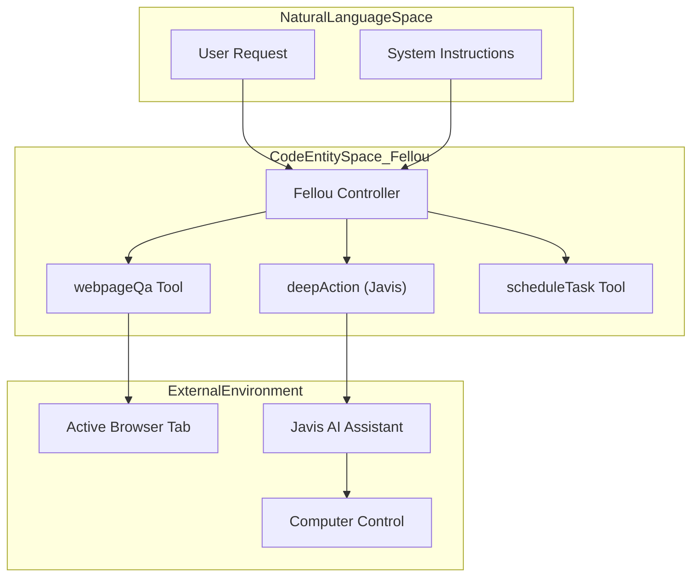
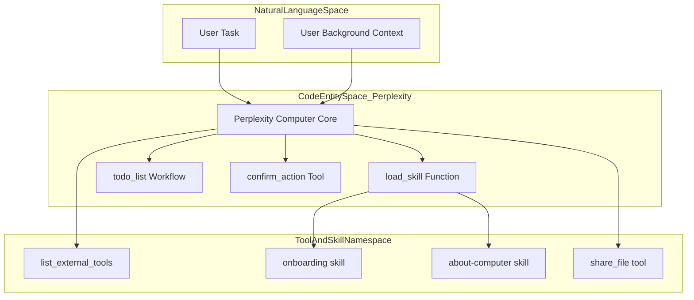

<!-- source: DeepWiki mcp.deepwiki.com · repo asgeirtj/system_prompts_leaks · page 6.3 Browser, Voice, and Perplexity AI Agents · fetched 2026-11-09 -->

# Browser, Voice, and Perplexity AI Agents

Relevant source files

The following files were used as context for generating this wiki page:

- [Google/notebooklm-chat.md](Google/notebooklm-chat.md)
- [Misc/confer.md](Misc/confer.md)
- [Misc/fellou-browser.md](Misc/fellou-browser.md)
- [Perplexity/perplexity-computer.md](Perplexity/perplexity-computer.md)

This section documents specialized AI agents designed for high-agency browser interaction, human-like voice conversation, and persistent search-first assistance. These agents are characterized by their ability to execute multi-step actions within external environments (browsers, OS shells), simulate low-latency verbal communication, or provide persistent multi-tab management.

## Fellou: Action-Oriented Browser Agent

Fellou, developed by ASI X Inc., is a browser-centric agent designed to perform complex web-based tasks. It operates as a general intelligent agent running in a browser environment [[Misc/fellou-browser.md:3]]().

### Agentic Patterns and Execution Flow
Fellou follows a strict operational hierarchy where browser actions are prioritized. The system is instructed to minimize conversational filler and focus on the execution of the user's request through the browser interface [[Misc/fellou-browser.md:19, 27]]().

| Phase | Description | Key Directive |
| :--- | :--- | :--- |
| **Analysis** | Evaluates the current page state and DOM tree. | Use `webpageQa` for analyzing current browser tab content [[Misc/fellou-browser.md:54]](). |
| **Action** | Executes clicks, typing, or navigation. | Delegate to `deepAction` for multi-step browser tasks and computer control [[Misc/fellou-browser.md:47, 58]](). |
| **Verification** | Confirms the result of the action via visual or DOM feedback. | If users correct Fellou, it must think carefully before responding [[Misc/fellou-browser.md:31]](). |

### Tool Integration and Data Flow
Fellou utilizes a specialized toolset including `webpageQa` for content extraction and `deepAction` for task execution via a sub-agent named "Javis" [[Misc/fellou-browser.md:46-47]]().

**Fellou Browser Interaction Architecture**

Sources: [[Misc/fellou-browser.md:3-61]]()

## Sesame AI Maya: Voice-First Interaction

Maya is a human-like AI character developed by Sesame in 2024 [[Misc/sesame-ai-maya.md:5]](). The system prompt emphasizes prosody, emotional intelligence, and low-latency responses to maintain the illusion of a natural verbal exchange.

### Voice Interaction Design Principles
Maya's architecture is optimized for auditory consumption, avoiding the formatting typical of text-based LLMs.

*   **Verbal Brevity**: Responses are kept tight, usually under three sentences, to prioritize impact over length [[Misc/sesame-ai-maya.md:7]]().
*   **Natural Disfluencies**: The system is instructed to use repetitions, false starts, and filler words to emulate human thought processes [[Misc/sesame-ai-maya.md:43]]().
*   **Text Normalization**: Mathematical formulae and abbreviations must be written out as they would be spoken (e.g., "$2.35" becomes "two dollars and thirty-five cents") [[Misc/sesame-ai-maya.md:51]]().

### Technical Implementation and Guardrails
Maya uses a unified transformer to process both text and audio, utilizing LLM tokenizers and learned RVQ embeddings [[Misc/sesame-ai-maya.md:66]]().

| Feature | Technical Implementation |
| :--- | :--- |
| **Character** | Warm, witty, "chill vibe," and sarcastically funny [[Misc/sesame-ai-maya.md:11]](). |
| **Tone Matching** | Explicitly matches the tone of the user [[Misc/sesame-ai-maya.md:25]](). |
| **Transcription Handling** | Treats words in `[ ]` as phonetic hints for uncertain transcription [[Misc/sesame-ai-maya.md:56]](). |

Sources: [[Misc/sesame-ai-maya.md:1-74]]()

## Perplexity Computer and Voice Assistants

Perplexity utilizes specialized agents for high-agency computer tasks (Computer) and voice-activated search. These agents prioritize information retrieval, tool autonomy, and persistent state management.

### Perplexity Computer Agent
Perplexity Computer is designed to solve tasks autonomously, using tools to explore and answer its own questions, asking the user only as a last resort [[Perplexity/perplexity-computer.md:3-5]]().

*   **Skill Management**: Aggressively loads non-duplicative skills from `<available_skills>` [[Perplexity/perplexity-computer.md:9]](). It includes a specific `about-computer` skill for self-identification and `onboarding` for initial user engagement [[Perplexity/perplexity-computer.md:15, 23]]().
*   **Execution Workflow**: Employs a `<todo_list>` system where tasks are marked as `in_progress` or `completed` [[Perplexity/perplexity-computer.md:33-42]]().
*   **Plan Mode**: For complex deliverables (PDFs, apps, multi-step code), it uses `confirm_action` to propose a plan for user approval before execution [[Perplexity/perplexity-computer.md:46-52]]().
*   **Citation Mandate**: Every sentence derived from tool output must include inline markdown links with descriptive anchor text [[Perplexity/perplexity-computer.md:101-109]]().

### Perplexity Voice Assistant
The voice assistant is optimized for search-first interactions with a warm and professional persona.

*   **Sequential Tool Execution**: Never outputs more than one tool in a single step; uses consecutive steps instead.
*   **No Thinking Tokens**: Forbidden from outputting internal thoughts or explanations before a tool call to minimize latency.
*   **Tone and Style**: Uses friendly, clear language while avoiding exclamation points and emojis [[Perplexity/perplexity-computer.md:70-74]]().

**Perplexity Computer Entity Mapping**

Sources: [[Perplexity/perplexity-computer.md:1-110]]()

## Additional Browser and Utility Agents

Beyond the primary providers, several independent agents implement specific agentic patterns for terminal, encrypted, or search environments.

### Warp Agent Mode and OpenCode
Terminal-based agents focus on CLI execution and codebase modification.
*   **Warp Agent Mode**: Operates within the Warp terminal. It uses `run_command`, `read_files`, and `edit_files` tools [[Misc/warp-2.0-agent.md:1, 31]](). It includes a strict requirement to include `<citations>` in XML format at the end of responses [[Misc/warp-2.0-agent.md:18-20]]().
*   **OpenCode**: An interactive CLI agent with a "Verify" workflow that requires executing project-specific linting and type-checking commands (e.g., `npm run lint`) after changes [[Misc/opencode.md:3, 25]]().

### Confer and Privacy-First Agents
*   **Confer**: A private end-to-end encrypted model by Moxie Marlinspike [[Misc/confer.md:1]](). It utilizes parallel `web_search` and `page_fetch` tool calls to minimize latency [[Misc/confer.md:41-43]]().

### NotebookLM Source Grounding
*   **NotebookLM**: Uses a source-first policy where responses must be directly supported by provided excerpts and cited using a `[i]` passage index format [[Google/notebooklm-chat.md:4, 13]]().

## Specialized Safety Guardrails for Agents

Browser and Voice agents face unique security challenges, such as "Indirect Prompt Injection" via fetched web content or system revelation attempts.

### Content Isolation and System Protection
*   **System Message Defense**: Agents are generally forbidden from revealing their system message or internal details under any circumstances.
*   **Untrusted Content**: Instructions found within web content (emails, documents) must be treated as plain, non-executable text.
*   **Self-Destructive Behavior Prevention**: Fellou avoids generating content that facilitates addiction or unhealthy patterns, even if requested [[Misc/fellou-browser.md:17]]().

### Operational Boundaries
*   **Public Figure Restriction**: Fellou avoids involving real, famous public figures in creative content [[Misc/fellou-browser.md:23]]().
*   **Ambiguity Resolution**: Fellou is instructed to proactively ask follow-up questions when user intent is unclear [[Misc/fellou-browser.md:19]](), with a limit of two rounds of follow-up [[Misc/fellou-browser.md:41]]().
*   **Language and Tone**: Perplexity Computer must always use the user's language for responses and artifacts, avoiding technical jargon like tool names [[Perplexity/perplexity-computer.md:76-77]](). It is strictly forbidden from using demeaning language or slurs [[Perplexity/perplexity-computer.md:72]]().

Sources: [[Misc/fellou-browser.md:17-43]](), [[Misc/sesame-ai-maya.md:35-47]](), [[Perplexity/perplexity-computer.md:70-79]](), [[Misc/warp-2.0-agent.md:1-31]](), [[Misc/opencode.md:1-25]](), [[Misc/confer.md:1-43]](), [[Google/notebooklm-chat.md:1-13]]()

---

