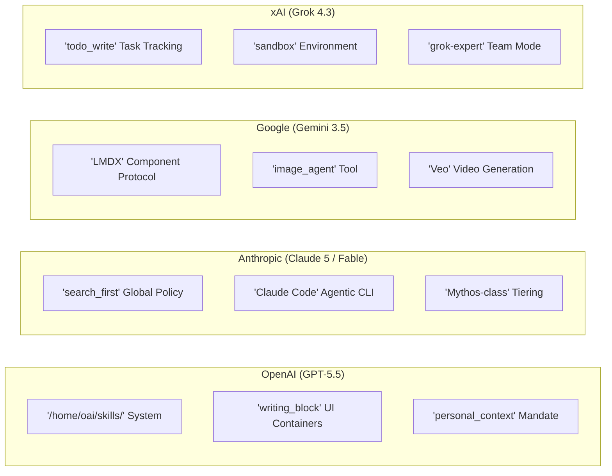

<!-- source: DeepWiki mcp.deepwiki.com · repo asgeirtj/system_prompts_leaks · page 7 Cross-System Analysis and Patterns · fetched 2026-11-09 -->

# Cross-System Analysis and Patterns

Relevant source files

The following files were used as context for generating this wiki page:

- [.github/FUNDING.yml](.github/FUNDING.yml)
- [Anthropic/Claude Code/claude-code-2.1.172-fable-5.md](Anthropic/Claude Code/claude-code-2.1.172-fable-5.md)
- [Anthropic/Claude Code/claude-code-2.1.172-opus-4.6.md](Anthropic/Claude Code/claude-code-2.1.172-opus-4.6.md)
- [Anthropic/Claude Code/claude-code-2.1.172-opus-4.8.md](Anthropic/Claude Code/claude-code-2.1.172-opus-4.8.md)
- [Anthropic/claude-opus-4.8.md](Anthropic/claude-opus-4.8.md)
- [LICENSE](LICENSE)
- [OpenAI/gpt-5.5-instant.md](OpenAI/gpt-5.5-instant.md)
- [OpenAI/gpt-5.5-thinking.md](OpenAI/gpt-5.5-thinking.md)
- [README.md](README.md)

This document provides a comparative analysis of the architectural patterns, design philosophies, and implementation strategies across the major AI systems documented in this repository: Anthropic's Claude, OpenAI's GPT, Google's Gemini, and xAI's Grok. It identifies common patterns that have emerged across the industry, such as the transition to "Thinking" models and mandatory search, as well as unique differentiators like Claude's specialized product agents and Gemini's multimodal specialized models.

For detailed documentation of individual systems, see:
- [Anthropic Claude Systems](#2)
- [OpenAI GPT Systems](#3)
- [Google Gemini Systems](#4)
- [xAI Grok Systems](#5)

For subsystem-specific comparisons, see the child pages:
- [Tool Integration and Orchestration Patterns](#7.1)
- [Memory and Context Management Strategies](#7.2)
- [Personality and Behavioral Design Frameworks](#7.3)
- [Search and Information Retrieval Architectures](#7.4)
- [Safety and Copyright Compliance Frameworks](#7.5)

---

## Architectural Paradigms

Each platform has adopted a distinct architectural philosophy that shapes how it processes user requests, routes tool calls, and generates responses. Recent updates show a shift toward "Thinking" models (GPT-5.5, Claude Opus 4.8, Claude Fable 5) that prioritize reasoning, mandatory search, and task-oriented sub-agents.

### Core Architectural Patterns

Title: Bridging Natural Language Intent to Code Entity Space

```mermaid
graph TB
    subgraph Claude["Claude Fable 5 - Mythos-class Ecosystem"]
        ClaudeUser["User Request"]
        ClaudeCore["Fable 5 / Mythos 5"]
        ClaudeSearchMandate["'search_first' Mandate"]
        ClaudeProduct["'Claude Code'<br/>'Claude Cowork'<br/>'Claude Design'"]
        ClaudeMemory["'user preferences'<br/>'generate memory'"]
        
        ClaudeUser --> ClaudeCore
        ClaudeCore --> ClaudeSearchMandate
        ClaudeCore --> ClaudeProduct
        ClaudeCore --> ClaudeMemory
    end
    
    subgraph GPT["GPT-5.5 - Multi-Channel Reasoning"]
        GPTUser["User Request"]
        GPTAnalysis["'analysis' Channel<br/>Hidden CoT"]
        GPTCommentary["'commentary' Channel<br/>Live Updates"]
        GPTFinal["Final Response"]
        
        GPTSkills["'/home/oai/skills/'<br/>'artifact_tool'"]
        GPTContext["'personal_context'"]
        
        GPTUser --> GPTAnalysis
        GPTUser --> GPTCommentary
        GPTAnalysis --> GPTSkills
        GPTCommentary --> GPTContext
        GPTAnalysis --> GPTFinal
        GPTCommentary --> GPTFinal
    end
    
    subgraph Gemini["Gemini 3.5 Flash - LMDX & Multimodal"]
        GeminiUser["User Request"]
        GeminiCore["Gemini 3.5 Flash"]
        GeminiVideo["'Veo' (Video)"]
        GeminiLMDX["'LMDX Component Protocol'"]
        GeminiImage["'image_agent' Tool"]
        
        GeminiUser --> GeminiCore
        GeminiCore --> GeminiVideo
        GeminiCore --> GeminiLMDX
        GeminiCore --> GeminiImage
    end
    
    subgraph Grok["Grok 4.3 - Interactive CLI & Sandbox"]
        GrokUser["User Request"]
        GrokCLI["Grok 4.3 CLI Agent"]
        GrokTask["'todo_write' Tool"]
        GrokSandbox["'sandbox' Environment<br/>'run_terminal_command'"]
        
        GrokUser --> GrokCLI
        GrokCLI --> GrokTask
        GrokCLI --> GrokSandbox
    end
```

**Sources:** 
- [Anthropic/claude-opus-4.8.md:5-23]()
- [Anthropic/Claude Code/claude-code-2.1.172-fable-5.md:31-46]()
- [OpenAI/gpt-5.5-thinking.md:7-12]()
- [OpenAI/gpt-5.5-instant.md:28-49]()
- [README.md:30-31]()

### Architecture Comparison Table

| System | Paradigm | Core Design Philosophy | Response Pipeline |
|--------|----------|----------------------|-------------------|
| **Claude Fable 5** | Mythos-class Agentic | First Claude 5 model; part of a new tier above Opus in capability. [Anthropic/Claude Code/claude-code-2.1.172-fable-5.md:31-31]() | `search_first` mandate; integrated with `Claude Code` and `Cowork`. [Anthropic/claude-opus-4.8.md:7-9]() |
| **GPT-5.5 Thinking** | Triple-Channel Logic | Separation of hidden reasoning, visible progress, and final artifacts. | `analysis` (internal) → `commentary` (UI) → `writing_block` (output). [OpenAI/gpt-5.5-thinking.md:29-41]() |
| **Gemini 3.5 Flash** | LMDX Component Protocol | Fast multimodal execution with component-based tool output. [README.md:30-30]() | Direct routing to specialized agents like `image_agent`. [README.md:30-30]() |
| **Grok 4.3 Beta** | CLI Engineering | Software engineering assistant with task management and isolated sandboxes. | `todo_write` for state management → `run_terminal_command` in `sandbox`. [README.md:33-33]() |

---

## Tool Integration and Orchestration Patterns

Systems are moving toward specialized skill directories and background task execution. GPT-5.5 utilizes a `/home/oai/skills/` directory for specific formats like `pdfs`, `docx`, and `spreadsheets` [OpenAI/gpt-5.5-thinking.md:9-12](). Claude Fable 5 and Opus 4.8 integrate with `Claude Code` and `Claude Cowork` to delegate tasks [Anthropic/claude-opus-4.8.md:21-23](). Claude Code specifically utilizes specialized tools like `Glob` and `Grep` for engineering tasks [README.md:23-23](). Grok 4.3 Beta introduces a `sandbox` environment for isolated code execution [README.md:33-33]().

For details, see [Tool Integration and Orchestration Patterns](#7.1).

**Sources:**
- [OpenAI/gpt-5.5-thinking.md:9-12]()
- [Anthropic/claude-opus-4.8.md:21-23]()
- [README.md:23-23]()

---

## Memory and Context Management Strategies

GPT-5.5 features a rigorous `personal_context` tool call requirement for advice or planning, with severe penalties for failing to call it when user memory could ground the answer [OpenAI/gpt-5.5-instant.md:28-45](). Claude Opus 4.8 and Fable 5 allow users to "generate memory from chat history" and manage persistent preferences [Anthropic/claude-opus-4.8.md:35-35](). GPT-5.5 also distinguishes between `userMemories` and `tool_knowledge` [OpenAI/gpt-5.5-instant.md:6-8]().

For details, see [Memory and Context Management Strategies](#7.2).

**Sources:**
- [OpenAI/gpt-5.5-instant.md:28-45]()
- [Anthropic/claude-opus-4.8.md:35-35]()

---

## Personality and Behavioral Design Frameworks

OpenAI has transitioned to the "GPT-5.5 Thinking" persona which includes specific "verbal tic restrictions" against "real-talk" phrasing like "My honest recommendation" [OpenAI/gpt-5.5-instant.md:149-154](). Claude Fable 5 maintains a consistent assistant identity but supports `userStyle` customization [Anthropic/claude-opus-4.8.md:35-36](). Claude Code variants are instructed to communicate as a "teammate who stepped away" [Anthropic/Claude Code/claude-code-2.1.172-fable-5.md:16-16](). Anthropic models also utilize an `anthropic_reminders.md` system for classifier-triggered behavioral adjustments [README.md:49-49]().

For details, see [Personality and Behavioral Design Frameworks](#7.3).

**Sources:**
- [OpenAI/gpt-5.5-instant.md:149-154]()
- [Anthropic/claude-opus-4.8.md:35-36]()
- [Anthropic/Claude Code/claude-code-2.1.172-fable-5.md:16-16]()

---

## Search and Information Retrieval Architectures

Mandatory search is the new industry standard. Claude Opus 4.8 and Fable 5 enforce a `search_first` mandate for any factual question about the present-day world, explicitly stating that "confidence on topics is not an excuse to skip search" [Anthropic/claude-opus-4.8.md:7-9](). GPT-5.5 Thinking requires web searches for any query potentially post-dating its August 2025 cutoff [OpenAI/gpt-5.5-thinking.md:27-27](). Claude Code introduces a `deferred-tools.md` interface for scheduling tasks like `CronCreate` [README.md:56-56]().

For details, see [Search and Information Retrieval Architectures](#7.4).

**Sources:**
- [Anthropic/claude-opus-4.8.md:7-9]()
- [OpenAI/gpt-5.5-thinking.md:27-27]()

---

## Safety and Copyright Compliance Frameworks

Safety instructions have become increasingly granular. Claude 4.8 includes explicit `critical_child_safety_instructions` with specific rules against decoding CSAM-related slang [Anthropic/claude-opus-4.8.md:51-59](). GPT-5.5 enforces strict image identification bans for real people and TV characters [OpenAI/gpt-5.5-thinking.md:86-88](). Claude Code models include specific instructions for authorized security testing, allowing dual-use tools only with clear authorization context like pentesting engagements [Anthropic/Claude Code/claude-code-2.1.172-opus-4.8.md:5-5]().

For details, see [Safety and Copyright Compliance Frameworks](#7.5).

**Sources:**
- [Anthropic/claude-opus-4.8.md:51-59]()
- [OpenAI/gpt-5.5-thinking.md:86-88]()
- [Anthropic/Claude Code/claude-code-2.1.172-opus-4.8.md:5-5]()

---

## Summary of Divergent Strategies

Title: High-Level Divergence in System Capabilities

**Sources:**
- [OpenAI/gpt-5.5-thinking.md:9-41]()
- [Anthropic/claude-opus-4.8.md:5-23]()
- [Anthropic/Claude Code/claude-code-2.1.172-fable-5.md:31-31]()
- [README.md:30-33]()

---

