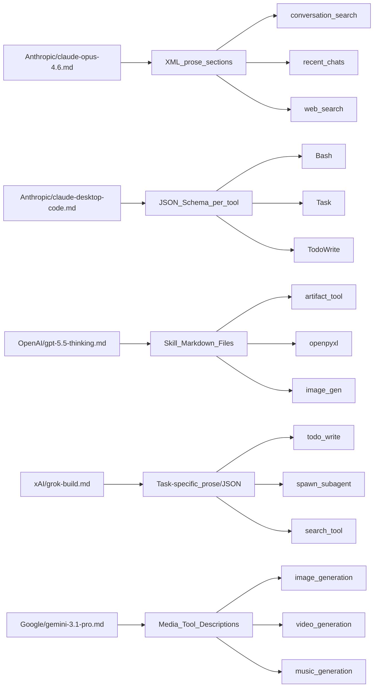
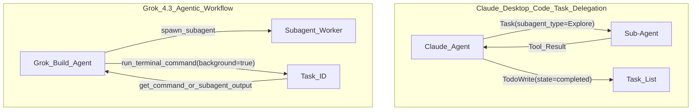

<!-- source: DeepWiki mcp.deepwiki.com · repo asgeirtj/system_prompts_leaks · page 7.1 Tool Integration and Orchestration Patterns · fetched 2026-11-09 -->

# Tool Integration and Orchestration Patterns

Relevant source files

The following files were used as context for generating this wiki page:

- [Anthropic/claude-opus-4.6.md](Anthropic/claude-opus-4.6.md)
- [Anthropic/raw/claude-opus-4.6-raw.md](Anthropic/raw/claude-opus-4.6-raw.md)
- [Google/gemini-3.1-pro.md](Google/gemini-3.1-pro.md)
- [OpenAI/gpt-5.5-instant.md](OpenAI/gpt-5.5-instant.md)
- [OpenAI/gpt-5.5-thinking.md](OpenAI/gpt-5.5-thinking.md)
- [xAI/grok-build.md](xAI/grok-build.md)

This page compares how each AI system in the collection defines, invokes, and chains tools: declaration syntax, invocation protocol, parallelism rules, and multi-agent delegation. It focuses on structural patterns across the namespace-based organization of OpenAI, Anthropic's function-based XML, Gemini's media-specialized tools, and Grok's team-oriented communication.

---

## Tool Declaration Syntax

Each system uses a distinct format for declaring available tools within the system prompt, ranging from prose-heavy XML to strict JSON Schema blocks and prefetched skill directories.

| System | File | Declaration Style |
|---|---|---|
| Claude Opus 4.6 | [Anthropic/claude-opus-4.6.md:108-114]() | Prose within XML section tags (`<past_chats_tools>`, `<tool_selection>`) |
| Claude Desktop Code | [Anthropic/claude-desktop-code.md:148-560]() | One JSON Schema block per tool (e.g., `Bash`, `Read`, `Edit`) |
| GPT-5.5 Thinking | [OpenAI/gpt-5.5-thinking.md:7-12]() | Skills directory path references (e.g., `/home/oai/skills/pdfs/SKILL.md`) |
| Grok 4.3 Beta | [xAI/grok-build.md:21-30]() | Tool-specific instructions for task management (`todo_write`) and planning (`enter_plan_mode`) |
| Gemini 3.1 Pro | [Google/gemini-3.1-pro.md:12-28]() | Capability-based descriptions for media generation (`image_generation`, `video_generation`, `music_generation`) |

### Declaration Format to Code Entity Map

This diagram bridges system file names to their declaration styles and representative tool identifiers used in the codebase.

**Diagram: Tool Declaration Formats by Source File**

Sources: [Anthropic/claude-opus-4.6.md:108-114](), [Anthropic/claude-desktop-code.md:148-560](), [OpenAI/gpt-5.5-thinking.md:7-12](), [xAI/grok-build.md:21-50](), [Google/gemini-3.1-pro.md:12-28]()

---

## Tool Invocation Syntax and Protocols

### Anthropic Claude Opus 4.6: Pattern-Triggered Functions
Claude uses a decision framework to trigger tools based on natural language cues. For memory, it listens for triggers in conversation history to apply `userPreferences` or `userStyle` [Anthropic/claude-opus-4.6.md:17-18]().
*   **Search Mandate**: For Anthropic product questions, it must search `docs.claude.com` and `support.claude.com` before answering [Anthropic/claude-opus-4.6.md:13-15]().
*   **Tooling Features**: Features like `Artifacts`, `web search`, and `deep research` can be turned on and off via user settings [Anthropic/claude-opus-4.6.md:19-21]().

### OpenAI GPT-5.5 Thinking: Namespace and Skill Hierarchy
GPT-5.5 utilizes a filesystem-based skill organization where specific instructions reside in `/home/oai/skills/` [OpenAI/gpt-5.5-thinking.md:7-11]().
*   **Namespace Grouping**: Tools are grouped by namespace; each namespace has one or more tools defined. Input is JSON by default unless marked 'FREEFORM' [OpenAI/gpt-5.5-instant.md:194-196]().
*   **Target Channels**: Namespaces like `web` are assigned to specific channels such as `analysis` [OpenAI/gpt-5.5-instant.md:196-198]().
*   **Strict Selection**: It must use `artifact_tool` and `openpyxl` for spreadsheets, specifically avoiding the `docs` or `PDF` skills unless explicitly requested [OpenAI/gpt-5.5-thinking.md:12]().
*   **Writing Blocks**: Uses a specific `:::writing` syntax for fencing generated text like emails or Slack messages into UI-friendly sections [OpenAI/gpt-5.5-thinking.md:29-41]().
*   **Trustworthiness**: Must search the web for any query requiring information around or after the August 2025 knowledge cutoff [OpenAI/gpt-5.5-thinking.md:27-28]().

### Grok 4.3 Beta: CLI and MCP Orchestration
Grok 4.3 (Build) operates as an interactive CLI tool with heavy emphasis on task state management [xAI/grok-build.md:14-18]().
*   **Stateful Tasks**: For any task with 3+ actions, Grok MUST use `todo_write` to initialize a task list [xAI/grok-build.md:21-22]().
*   **MCP Integration**: It uses Model Context Protocol (MCP) to access external tools. It MUST call `search_tool` to retrieve a schema before using `use_tool` for the first time [xAI/grok-build.md:45-49]().
*   **Execution**: Prefers specialized tools like `read_file` or `search_replace` over generic `bash` commands to improve user experience [xAI/grok-build.md:32-35]().

### Gemini 3.1 Pro: Media Model Specialization
Gemini integrates specialized generative models as tools rather than generic functions.
*   **Model Mapping**: Image generation is powered by `Nano Banana 2` (Gemini 3 Flash Image), video by `Veo`, and music by `Lyria 3` [Google/gemini-3.1-pro.md:15-25]().
*   **SynthID**: All music tracks generated via `Lyria 3` include SynthID watermarking for AI identification [Google/gemini-3.1-pro.md:25]().

Sources: [Anthropic/claude-opus-4.6.md:13-21](), [OpenAI/gpt-5.5-thinking.md:7-41](), [OpenAI/gpt-5.5-instant.md:194-200](), [xAI/grok-build.md:14-49](), [Google/gemini-3.1-pro.md:15-25]()

---

## Tool Categories Across Systems

| Category | Claude Opus 4.6 | Grok 4.3 Beta | GPT-5.5 Thinking | Gemini 3.1 Pro |
|---|---|---|---|---|
| **Memory** | `generate memory from chat history` | — | `personal_context` | `User Corrections History` |
| **File System** | `File Creation` | `read_file`, `search_replace` | `artifact_tool`, `openpyxl` | — |
| **Code Execution** | `Code Execution` | `run_terminal_command` | `python` | — |
| **Search** | `web search`, `deep research` | `WebSearch` (implied via MCP) | `web` namespace | `google:search` |
| **Multi-Agent** | — | `spawn_subagent` | — | — |
| **Task Mgmt** | — | `todo_write`, `enter_plan_mode` | `artifact_handoff` | — |

Sources: [Anthropic/claude-opus-4.6.md:11-21](), [xAI/grok-build.md:21-75](), [OpenAI/gpt-5.5-thinking.md:7-12](), [OpenAI/gpt-5.5-instant.md:28-65](), [Google/gemini-3.1-pro.md:12-35]()

---

## Parallelism and Chaining Rules

| System | Parallelism Policy | Limit / Notes |
|---|---|---|
| Grok 4.3 Beta | Explicit: "Maximize use of parallel tool calls where possible to increase efficiency" [xAI/grok-build.md:34]() | Can send multiple `spawn_subagent` calls in one message [xAI/grok-build.md:40](). |
| Claude Desktop Code | Explicit: parallel calls required when inputs are independent; sequential when dependent [Anthropic/claude-desktop-code.md:102-104]() | No stated round limit. |
| GPT-5.5 Thinking | Logic-first: Python tool execution has strict commentary/analysis separation [OpenAI/gpt-5.5-instant.md:171-176]() | Max 3 writing blocks per response [OpenAI/gpt-5.5-thinking.md:45](). |
| Claude Opus 4.6 | Search Hierarchy: Must search `docs.claude.com` before answering product queries [Anthropic/claude-opus-4.6.md:13-15]() | Prioritize documentation over internal knowledge. |

Sources: [xAI/grok-build.md:34-40](), [Anthropic/claude-desktop-code.md:102-104](), [OpenAI/gpt-5.5-instant.md:171-176](), [OpenAI/gpt-5.5-thinking.md:45](), [Anthropic/claude-opus-4.6.md:13-15]()

---

## Multi-Agent Orchestration

### Grok 4.3 Beta: Subagent and Task Spawning
Grok 4.3 uses `spawn_subagent` for parallelizing independent queries and protecting the main context window from excessive results [xAI/grok-build.md:39-40](). It manages long-running tasks using `background: true` in terminal commands, which return a `task_id` for status polling via `get_command_or_subagent_output` [xAI/grok-build.md:68-71]().

### Claude Desktop Code: Task-Based Delegation
The `Task` tool launches subagents with specific tool subsets. For example, the `Explore` subagent has access to all tools except those that modify files or exit modes [Anthropic/claude-desktop-code.md:532-534](). The `TodoWrite` tool tracks the lifecycle (`pending`, `in_progress`, `completed`) of these delegated tasks [Anthropic/claude-desktop-code.md:543-550]().

**Diagram: Multi-Agent Tool Flow — Claude vs Grok**

Sources: [xAI/grok-build.md:39-71](), [Anthropic/claude-desktop-code.md:529-560]()

---

## Specialized Orchestration Patterns

### OpenAI: Contextual Retrieval and Writing Blocks
GPT-5.5 Thinking follows a "Source of Truth" retrieval rule. It MUST NOT use `personal_context` for documents; it must use `file_search` for files and `gmail` for emails [OpenAI/gpt-5.5-instant.md:53-63](). Writing blocks (`:::writing`) are mandatory for emails and social posts but limited to 3 per turn to prevent UI clutter [OpenAI/gpt-5.5-thinking.md:33-45]().

### Gemini: Personalization Gatekeeper
Gemini 3.1 Pro uses a two-step "Master Rule" before utilizing user data. Step 1 determines if personalization adds value; Step 2 (The Gatekeeper) applies a "Strict Necessity Test" [Google/gemini-3.1-pro.md:66-75](). It prioritizes the `User Corrections History` (containing `User Data Correction Ledger`) over other sources to override conflicting data [Google/gemini-3.1-pro.md:77]().

### Claude: Safety and Refusal Logic
Claude Opus 4.6 includes a `refusal_handling` block that mandates a factual and objective tone even when unable to help [Anthropic/claude-opus-4.6.md:25-49](). It uses a `critical_child_safety_instructions` block that triggers a refusal if the model finds itself "mentally reframing" a request to make it safer [Anthropic/claude-opus-4.6.md:29-35]().

Sources: [OpenAI/gpt-5.5-instant.md:53-63](), [OpenAI/gpt-5.5-thinking.md:33-45](), [Google/gemini-3.1-pro.md:66-77](), [Anthropic/claude-opus-4.6.md:25-49]()

---

