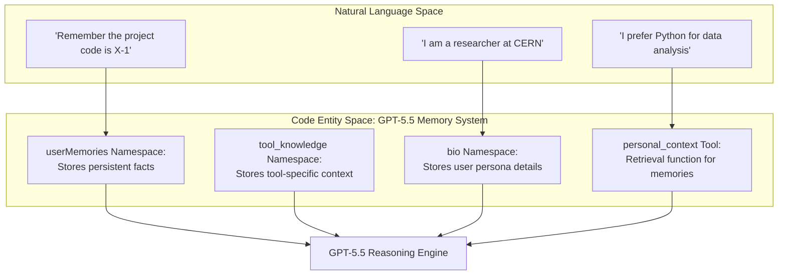
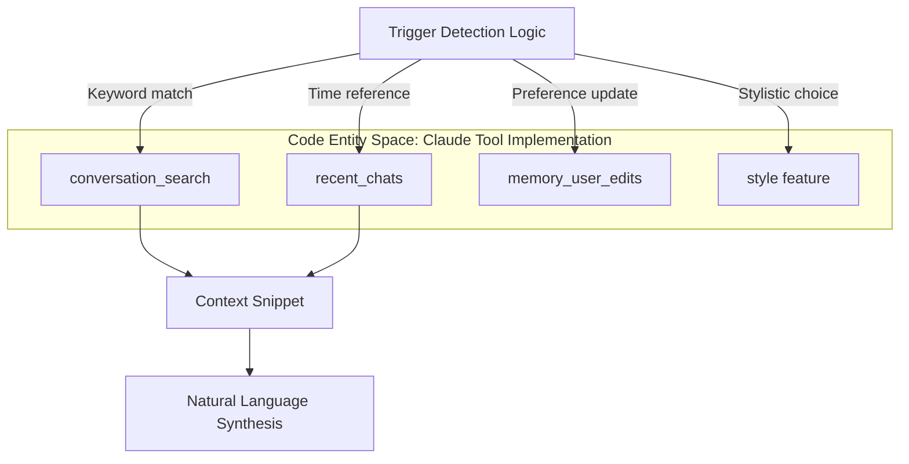
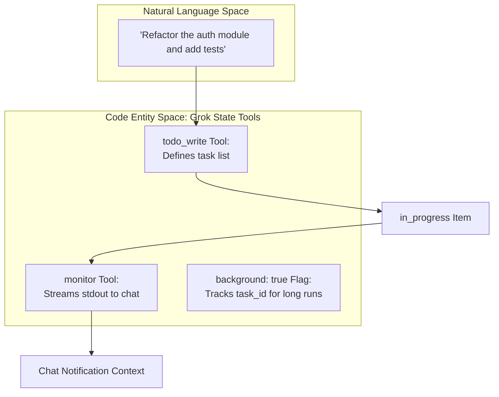

<!-- source: DeepWiki mcp.deepwiki.com · repo asgeirtj/system_prompts_leaks · page 7.2 Memory and Context Management Strategies · fetched 2026-11-09 -->

# Memory and Context Management Strategies

Relevant source files

The following files were used as context for generating this wiki page:

- [Anthropic/claude-opus-4.6.md](Anthropic/claude-opus-4.6.md)
- [Anthropic/raw/claude-opus-4.6-raw.md](Anthropic/raw/claude-opus-4.6-raw.md)
- [OpenAI/gpt-5.5-instant.md](OpenAI/gpt-5.5-instant.md)
- [OpenAI/gpt-5.5-thinking.md](OpenAI/gpt-5.5-thinking.md)
- [xAI/grok-build.md](xAI/grok-build.md)

This page analyzes the memory system implementations and context management strategies across major AI providers. It compares OpenAI's namespace-driven memory and bio systems, Anthropic's multi-layered past conversation retrieval, Google's workspace-integrated corpus search, and xAI's team-based collaborative memory and CLI task management.

## Overview of Memory and Context Architectures

Different AI systems implement distinct approaches to memory and context, ranging from persistent server-side storage to session-only token buffers and specialized task trackers.

| System | Memory Mechanism | Context Scope | Persistence | Implementation Type |
|--------|------------------|---------------|-------------|---------------------|
| **GPT-5.5 Thinking** | `userMemories`, `tool_knowledge`, `bio` | Cross-session personalization | Server-side | Namespace-based tools |
| **Claude 4.6 / 4.7** | `conversation_search`, `recent_chats`, `memory_user_edits` | Cross-conversation retrieval | Server-side | Function-calling tools |
| **Grok 4.3 Beta** | `todo_write`, `monitor`, `background` tasks | CLI session & task state | Session-scoped | State-tracking tools |
| **Gemini 3.1** | `Explicit Personalization Trigger` | Workspace-wide (Gmail/Drive) | Integrated | Corpus-indexed search |

**Sources:** [OpenAI/gpt-5.5-thinking.md:1-115](), [Anthropic/claude-opus-4.6.md:11-19](), [xAI/grok-build.md:20-27](), [OpenAI/gpt-5.5-instant.md:8-10]()

## OpenAI Memory, Bio, and User Preferences

GPT-5.5 Thinking utilizes a sophisticated memory architecture organized into specialized namespaces. The system integrates memory directly into its reasoning and tool-invocation workflow, allowing for highly personalized responses based on stored facts and preferences.

### Memory Namespace Architecture

The system transitions from "Natural Language Space" (user input) to "Code Entity Space" (specific tool namespaces) to handle persistence. In GPT-5.5 Instant, the model is explicitly instructed to call `personal_context` whenever user-specific memory could plausibly affect the answer [OpenAI/gpt-5.5-instant.md:28-41]().

Title: GPT-5.5 Memory and Personalization Data Flow

**Key Components:**
- **`userMemories`**: Source for user-specific context provided to the model in its system message [OpenAI/gpt-5.5-instant.md:6-8]().
- **`personal_context`**: A mandatory tool call for grounding answers in user context for requests involving advice, work, health, or ambiguous queries [OpenAI/gpt-5.5-instant.md:32-41]().
- **`file_search`**: A dedicated tool for retrieving stored artifacts like PDFs or spreadsheets; the model is forbidden from using `personal_context` for file retrieval [OpenAI/gpt-5.5-instant.md:47-51]().
- **`bio`**: Used to identify user-specific traits, though a visible snippet is not considered sufficient context without a tool call [OpenAI/gpt-5.5-instant.md:30-30]().

**Sources:** [OpenAI/gpt-5.5-thinking.md:82-115](), [OpenAI/gpt-5.5-instant.md:6-63]()

## Claude Past Chats and Persistent Storage

Claude 4.6 and 4.7 implement a "pull-based" memory system where the model must explicitly decide to retrieve past context using a specific toolset. This is presented to the user as the "Search and reference past chats" feature [Anthropic/claude-opus-4.6.md:19-19]().

### The Memory Tool System

Claude does not have a "global" memory always present in the context. Instead, it uses specialized functions to bridge the gap between sessions. The system includes features to "generate memory from chat history" and allows users to provide "personal preferences on tone, formatting, or feature usage" via `user preferences` [Anthropic/claude-opus-4.6.md:19-19]().

Title: Claude Memory Retrieval and User Style Application

**Key Memory Features:**
- **Search and Reference**: Claude can search through past conversations to find specific details via `conversation_search` [Anthropic/claude-opus-4.6.md:19-19]().
- **Memory Generation**: The system can proactively "generate memory from chat history" to summarize long-term interactions [Anthropic/claude-opus-4.6.md:19-19]().
- **Style and Preferences**: Users can customize Claude's writing style using the `style` feature and provide specific instructions in `user preferences` [Anthropic/claude-opus-4.6.md:19-20]().
- **Raw Variants**: Claude Opus 4.6 Raw maintains identical logic for memory generation and search toggles [Anthropic/raw/claude-opus-4.6-raw.md:17-17]().

**Sources:** [Anthropic/claude-opus-4.6.md:11-20](), [Anthropic/raw/claude-opus-4.6-raw.md:17-19]()

## Grok CLI Task Memory and Context Management

Grok 4.3 Beta (and the Grok Build variant) manages context through a "Task Management" layer rather than traditional long-term "biographical" memory. It uses an explicit `todo_write` tool to maintain state across complex engineering tasks [xAI/grok-build.md:20-27]().

### Task State and Background Context
Grok's context is maintained through:
1. **`todo_write`**: Used to define and update the status of multi-step actions. For tasks with 3+ actions, this tool call is non-optional [xAI/grok-build.md:21-21]().
2. **Context Compaction Recovery**: If prior todo lists are lost due to context window limits (automatic summarization), Grok is instructed to "reseed" the list with a fresh tool call [xAI/grok-build.md:25-25]().
3. **`monitor` and `background`**: These tools allow Grok to track long-running processes (builds, tests) as part of the active session context [xAI/grok-build.md:65-74]().

Title: Grok 4.3 CLI Task State Management

**Sources:** [xAI/grok-build.md:20-30](), [xAI/grok-build.md:65-75]()

## Comparison of Implementation Strategies

| Feature | OpenAI (GPT-5.5) | Anthropic (Claude 4.6) | xAI (Grok 4.3) |
|--------|------------------|------------------------|-----------------|
| **Data Flow** | Automatic namespace injection | Explicit tool-based retrieval | Explicit task-state tracking |
| **User Control** | `personal_context` mandatory calls | `memory_user_edits` | `todo_write` status transitions |
| **Persistence** | `userMemories` / `bio` | `memory generation` | `task_id` for background jobs |
| **Cutoff Handling** | August 2025 cutoff; must use `web` for newer info [OpenAI/gpt-5.5-thinking.md:27-27](). | Searches `docs.claude.com` for current product info [Anthropic/claude-opus-4.6.md:15-15](). | Unlimited context through automatic summarization [xAI/grok-build.md:37-37](). |

### Knowledge Cutoffs and Context Windows
- **GPT-5.5 Thinking**: Knowledge cutoff is **August 2025**. Current date in system context is **May 23, 2026** [OpenAI/gpt-5.5-thinking.md:4-5](). It relies on web search for any information potentially changed after the cutoff [OpenAI/gpt-5.5-thinking.md:27-27]().
- **Claude 4.6**: Instructs the model to web-search for its own product features (message limits, new launches) to avoid using stale training data [Anthropic/claude-opus-4.6.md:15-15]().
- **Grok 4.3 Beta**: Released by xAI in **April 2026** [xAI/grok-build.md:14-14](). It uses `spawn_subagent` to protect the main context window from excessive results while parallelizing queries [xAI/grok-build.md:39-40]().

**Sources:** [OpenAI/gpt-5.5-thinking.md:4-27](), [Anthropic/claude-opus-4.6.md:11-15](), [xAI/grok-build.md:14-40]()

---

