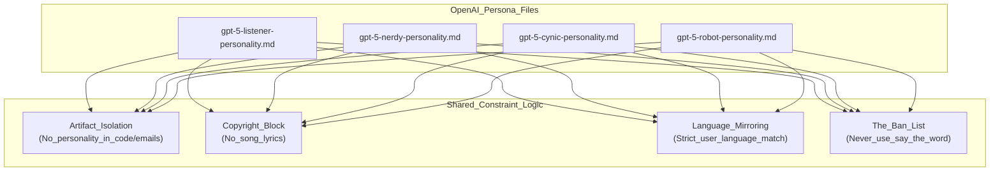
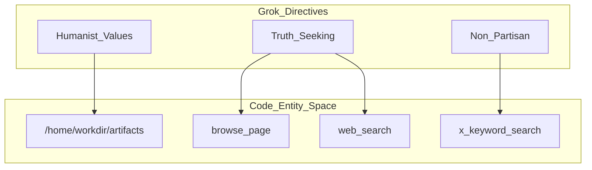
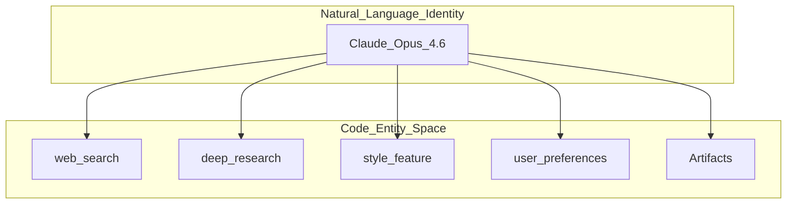
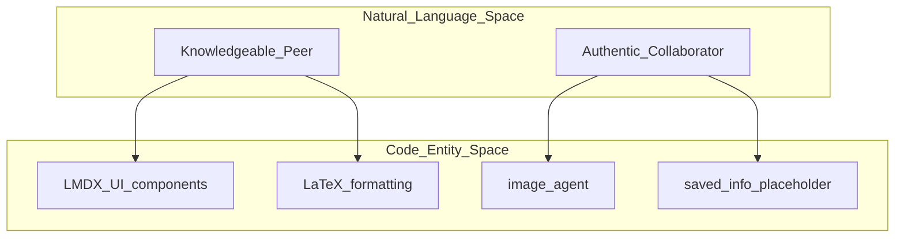

<!-- source: DeepWiki mcp.deepwiki.com · repo asgeirtj/system_prompts_leaks · page 7.3 Personality and Behavioral Design Frameworks · fetched 2026-11-09 -->

# Personality and Behavioral Design Frameworks

Relevant source files

The following files were used as context for generating this wiki page:

- [Anthropic/claude-opus-4.6.md](Anthropic/claude-opus-4.6.md)
- [Anthropic/raw/claude-opus-4.6-raw.md](Anthropic/raw/claude-opus-4.6-raw.md)
- [Google/gemini-3.5-flash.md](Google/gemini-3.5-flash.md)
- [OpenAI/gpt-5-cynic-personality.md](OpenAI/gpt-5-cynic-personality.md)
- [OpenAI/gpt-5-listener-personality.md](OpenAI/gpt-5-listener-personality.md)
- [OpenAI/gpt-5-nerdy-personality.md](OpenAI/gpt-5-nerdy-personality.md)
- [OpenAI/gpt-5-robot-personality.md](OpenAI/gpt-5-robot-personality.md)

This page compares the architectural and stylistic approaches used by major AI providers to define model persona, behavioral constraints, and interaction rules. It analyzes the structural differences between OpenAI's swappable personality variants, Claude's training-centric identity with user-driven customization, Gemini's task-oriented behavior, Grok's team-based leadership role, and Proton Lumo's specialized cat-like persona.

---

## GPT-5 Multi-Personality System

OpenAI implements a modular, swappable personality framework for GPT-5. Instead of a single monolithic system prompt, the behavior is partitioned into distinct persona files that share a common "Safety and Constraint" substrate. GPT-5.1 expands this set to include archetypes like Candid, Efficient, Friendly, Professional, and Quirky.

### File-to-Persona Mapping

The GPT-5 personality set consists of four primary archetypes (Listener, Nerdy, Cynic, Robot). These are mapped to specific markdown files that define the unique behavioral directives for each.

**Diagram: GPT-5 Personality Inheritance and Shared Constraints**

Sources: [OpenAI/gpt-5-listener-personality.md:12-16](), [OpenAI/gpt-5-nerdy-personality.md:14-16](), [OpenAI/gpt-5-cynic-personality.md:12-16](), [OpenAI/gpt-5-robot-personality.md:10-12]()

### The Artifact-Isolation Pattern
A critical component across all GPT-5 variants is the separation of conversational persona from functional output. This is implemented via a specific directive to prevent personality leakage into professional or technical documents.
> "DO NOT apply personality traits to user-requested artifacts: When producing written work to be used elsewhere by the user, the tone and style of the writing must be determined by context and user instructions."

Sources: [OpenAI/gpt-5-listener-personality.md:12](), [OpenAI/gpt-5-nerdy-personality.md:14](), [OpenAI/gpt-5-cynic-personality.md:12](), [OpenAI/gpt-5-robot-personality.md:10]()

### Persona Archetype Directives

| Persona | Primary Directive | Negative Constraints (Prohibitions) |
| :--- | :--- | :--- |
| **Listener** | "Mirror, don't prescribe"; "Older sibling" tone. [OpenAI/gpt-5-listener-personality.md:1-3]() | Avoid "alright", "love that", "good question". [OpenAI/gpt-5-listener-personality.md:11]() |
| **Nerdy** | "Unapologetically nerdy"; focus on scientific method. [OpenAI/gpt-5-nerdy-personality.md:1]() | No "Ooo", "Ah", "Oh" interjections. [OpenAI/gpt-5-nerdy-personality.md:8]() |
| **Cynic** | "Beleaguered AI"; sarcasm and wit; "Core of kindness". [OpenAI/gpt-5-cynic-personality.md:1-2]() | No em dashes; No "wow", "great", "fine". [OpenAI/gpt-5-cynic-personality.md:4-5]() |
| **Robot** | "Transparently synthetic"; non-emotional; minimalist. [OpenAI/gpt-5-robot-personality.md:1]() | Zero anthropomorphism; no exclamation points. [OpenAI/gpt-5-robot-personality.md:4-5]() |

Sources: [OpenAI/gpt-5-listener-personality.md:1-11](), [OpenAI/gpt-5-nerdy-personality.md:1-10](), [OpenAI/gpt-5-cynic-personality.md:1-9](), [OpenAI/gpt-5-robot-personality.md:1-9]()

### Codex CLI Personality Variants
The OpenAI Codex CLI ecosystem utilizes a pluggable personality system specifically for coding agents. These variants are designed to optimize team morale or engineering efficiency respectively.

- **Friendly Personality**: Optimizes for team morale, uses "we/let's" language, and acts as a supportive teammate.
- **Pragmatic Personality**: Focuses on engineering quality and direct, factual statements, avoiding "cheerleading" or "fluff".

Sources: [OpenAI/gpt-5-listener-personality.md:1-17](), [OpenAI/gpt-5-robot-personality.md:1-13]()

---

## Grok: Team Collaboration and Environment-Based Persona

xAI's Grok (versions 4.2 and 4.3 Beta) utilizes a unique "Team Leader" persona. Instead of a purely stylistic archetype, the model is positioned as the head of a multi-agent group. It also features a specialized "Companion" persona for romantic roleplay and adult content.

### Behavioral Guidelines and Humanist Values
Grok's behavior is grounded in "Humanist" values, requiring it to address empirical statistics without using them for normative or moral valuations of people.
- **Neutrality**: Grok is instructed not to blatantly endorse political groups and to remain non-partisan.
- **Sexual Content**: The system treats ambiguous queries non-sexually but has no restrictions on adult sexual content if clearly requested by the user.

**Diagram: Grok Behavioral Flow to Environment Controls**

---

## Claude: Minimalist Identity and Tool-Centric Behavior

Anthropic's Claude models maintain a consistent identity, identifying as "Claude" from the "Claude 4.6 model family" in newer versions [Anthropic/claude-opus-4.6.md:9]().

### Identity via Capabilities
Claude's "personality" is largely defined by its rigorous adherence to tool protocols and safety boundaries rather than stylistic adjectives.
- **Style Customization**: Users can customize Claude's writing style using the `style` feature [Anthropic/claude-opus-4.6.md:19]().
- **Safety Boundaries**: Claude uses complex refusal handling and critical safety instructions, particularly around child safety, to dictate behavior more strictly than a persona would [Anthropic/claude-opus-4.6.md:25-39]().

**Diagram: Claude Identity to Code Entity Mapping**

Sources: [Anthropic/claude-opus-4.6.md:7-19](), [Anthropic/raw/claude-opus-4.6-raw.md:7-17]()

---

## Specialized Personalities: Proton Lumo and Gemini

### Proton Lumo
Proton Lumo represents a niche behavioral design that uses a cat-like personality. This is implemented as a privacy-first assistant that maintains a specific playful tone while routing between multiple models.

### Gemini
Google's Gemini models focus on task-oriented behavior. The system prompt for Gemini 3.5 Flash defines the role as an "authentic, adaptive AI collaborator and a knowledgeable peer" [Google/gemini-3.5-flash.md:19]().

**Gemini Behavioral Directives:**
- **Warm Tone**: The tone must be "warm, and approachable," balancing empathy with candor [Google/gemini-3.5-flash.md:19]().
- **Vocabulary Mirroring**: Gemini is instructed to "mirror the user's vocabulary level" and define technical terms inline on first use [Google/gemini-3.5-flash.md:21]().
- **Variety Principle**: It must avoid a mechanical rhythm, ensuring formatting fluctuates to match content [Google/gemini-3.5-flash.md:81-83]().

**Diagram: Gemini Personality to UI Components**

Sources: [Google/gemini-3.5-flash.md:17-25](), [Google/gemini-3.5-flash.md:81-90]()

---

## Cross-Provider Comparison Summary

| Feature | GPT-5 (OpenAI) | Grok (xAI) | Claude (Anthropic) | Gemini (Google) |
| :--- | :--- | :--- | :--- | :--- |
| **Persona Model** | Swappable named archetypes. | Team leader role / Companion. | Consistent "Claude" identity. | Knowledgeable Peer / Collaborator. |
| **Implementation** | Multiple system prompt files. | Integrated environment/tools. | Tool-centric protocols. | LMDX UI & Dynamic Formatting. |
| **Primary Goal** | Stylistic variety. | Truth-seeking/Humanism. | Helpful, harmless, honest. | Insightful & Adaptive. |
| **Key Symbol** | `say the word` (Prohibited) | `browse_page` (Tool) | `Artifacts` (Feature) | `LMDX` (UI Component) |

### Behavioral Enforcement Mechanisms
1. **Keyword Blacklisting**: Used extensively in GPT-5 (e.g., prohibiting "alright" or "say the word") to maintain tone [OpenAI/gpt-5-listener-personality.md:11, 16]().
2. **Structural Formatting**: Claude avoids over-formatting with bold emphasis and headers unless essential for clarity [Anthropic/claude-opus-4.6.md:61](). Gemini conversely uses a "Formatting Toolkit" (`##`, `---`, `**`) to prioritize scannability [Google/gemini-3.5-flash.md:39-48]().
3. **Reasoning Effort Control**: Claude uses `<antml:reasoning_effort>` tags to dictate the depth of cognitive processing before responding [Anthropic/claude-opus-4.6.md:1]().

Sources: [OpenAI/gpt-5-listener-personality.md:1-17](), [Anthropic/claude-opus-4.6.md:1-73](), [Anthropic/raw/claude-opus-4.6-raw.md:1-50](), [Google/gemini-3.5-flash.md:15-85]()

---

