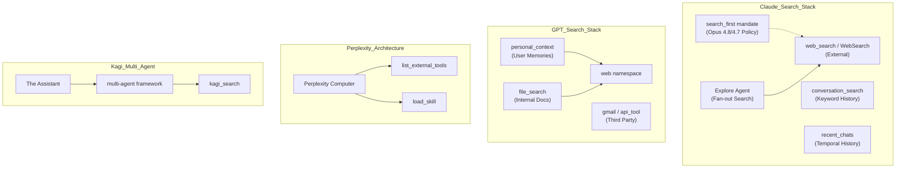
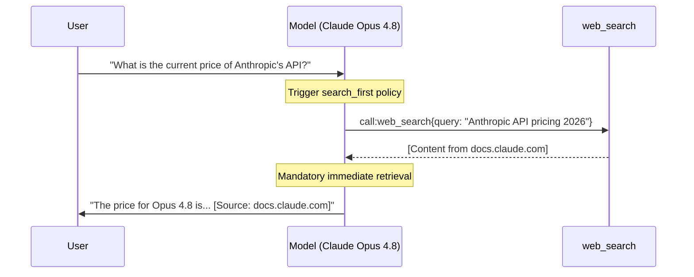

<!-- source: DeepWiki mcp.deepwiki.com · repo asgeirtj/system_prompts_leaks · page 7.4 Search and Information Retrieval Architectures · fetched 2026-11-09 -->

# Search and Information Retrieval Architectures

Relevant source files

The following files were used as context for generating this wiki page:

- [Anthropic/Claude Code/claude-code-2.1.172-fable-5.md](Anthropic/Claude Code/claude-code-2.1.172-fable-5.md)
- [Anthropic/Claude Code/claude-code-2.1.172-opus-4.6.md](Anthropic/Claude Code/claude-code-2.1.172-opus-4.6.md)
- [Anthropic/Claude Code/claude-code-2.1.172-opus-4.8.md](Anthropic/Claude Code/claude-code-2.1.172-opus-4.8.md)
- [Anthropic/claude-opus-4.7.md](Anthropic/claude-opus-4.7.md)
- [Anthropic/claude-opus-4.8.md](Anthropic/claude-opus-4.8.md)
- [Misc/kagi-assistant.md](Misc/kagi-assistant.md)
- [OpenAI/gpt-5.5-instant.md](OpenAI/gpt-5.5-instant.md)
- [OpenAI/gpt-5.5-thinking.md](OpenAI/gpt-5.5-thinking.md)
- [Perplexity/perplexity-computer.md](Perplexity/perplexity-computer.md)

## Purpose and Scope

This document compares search and information retrieval architectures across Claude, GPT, Gemini, Grok, and specialized search agents like Perplexity and Kagi. It examines how each platform decides when to search, constructs search queries, prioritizes internal versus external sources, implements citation systems, and manages conversation history retrieval. 

This page specifically focuses on the functional implementation of search tools, including specialized conversation retrieval tools like Claude's `conversation_search` and `recent_chats`, and the aggressive search-first mandates found in Claude Fable 5, Opus 4.8, 4.7, and GPT-5.5 Thinking.

---

## Search Tool Architecture Overview

Each AI system implements distinct search tools with different capabilities and design philosophies. The following table summarizes the core search tools and their characteristics:

| System | Web Search Tools | Internal/History Search Tools | Execution Model | Citation Format |
|--------|-----------------|----------------------|---------------------|-----------------|
| **Claude Fable 5** | `WebSearch`, `WebFetch` | `conversation_search`, `recent_chats` | Autonomous/Agentic | XML-based citations |
| **Claude Opus 4.8** | `web_search`, `web_fetch` | `conversation_search`, `recent_chats` | Search-First (Immediate Retrieval) | XML-based citations |
| **Claude Opus 4.7** | `web_search` | `conversation_search`, `recent_chats` | Search-First Mandate | XML-based citations |
| **GPT-5.5 Thinking** | `web.run` (Unified) | `personal_context`, `file_search` | Batched/Parallel | `【url\|anchor\|link】` |
| **GPT-5.5 Instant** | `web` | `personal_context`, `file_search` | Source-Specific Retrieval | `【url\|anchor\|link】` |
| **Perplexity Computer** | `search`, `get_full_page_content` | `list_external_tools` | Agentic/Skill-based | `[Source Name](URL)` |
| **Kagi Assistant** | `kagi_search` | Multi-agent framework | Search-First | Standard Markdown |

Sources: [Anthropic/claude-opus-4.8.md:7-11](), [Anthropic/claude-opus-4.7.md:5-15](), [OpenAI/gpt-5.5-thinking.md:27-28](), [OpenAI/gpt-5.5-instant.md:49-65](), [Anthropic/Claude Code/claude-code-2.1.172-fable-5.md:62](), [Perplexity/perplexity-computer.md:5-10](), [Misc/kagi-assistant.md:1-2]()

---

## Search Tool Implementation Diagram

**Diagram: Core Search Tool Namespaces and Functions**

This diagram maps code-level tool names to functional roles. Claude Opus 4.8/4.7 introduces a `search_first` block that acts as a policy layer over the `web_search` tool [Anthropic/claude-opus-4.8.md:7-11](). Claude Fable 5 and Opus 4.8 CLI variants introduce an `Explore` agent for "broad fan-out searches" that sweeps directories and files [Anthropic/Claude Code/claude-code-2.1.172-opus-4.8.md:63](). GPT-5.5 Instant mandates a "Source of Truth" retrieval rule, forcing the use of `file_search`, `gmail`, or `api_tool` over general context [OpenAI/gpt-5.5-instant.md:53-63]().

Sources: [Anthropic/claude-opus-4.8.md:7-11](), [OpenAI/gpt-5.5-instant.md:49-65](), [Anthropic/Claude Code/claude-code-2.1.172-opus-4.8.md:62-65](), [Perplexity/perplexity-computer.md:5-9]()

---

## Conversation History Retrieval

Claude Opus 4.8 and 4.7 feature a sophisticated two-tool system for history retrieval, allowing the model to bridge current context with past interactions.

### Trigger Pattern Detection
Claude is instructed to actively listen for trigger patterns to call history tools. Users can toggle "Search and reference past chats" and "generate memory from chat history" within the interface settings [Anthropic/claude-opus-4.8.md:35]().

### Tool Selection Logic
The system selects between keyword-based and time-based retrieval:

1.  **`conversation_search`**: Used for topic-specific questions.
2.  **`recent_chats`**: Used for time-based retrieval or finding the most recent context.

### GPT-5.5 Personal Context
GPT-5.5 Instant uses `personal_context` for advice, planning, or ambiguous requests where user memory could clarify the target [OpenAI/gpt-5.5-instant.md:32-41](). There is a "SEVERE PENALTY" for claiming not to know a fact about the user without calling `personal_context` first [OpenAI/gpt-5.5-instant.md:45-46]().

Sources: [Anthropic/claude-opus-4.8.md:35](), [OpenAI/gpt-5.5-instant.md:28-46]()

---

## Search-First Mandates

Modern retrieval architectures have shifted from "search-if-needed" to "search-first" policies to ensure factuality.

### Claude Fable 5 and Mythos-Class Search
Claude Fable 5, as the first model in the Claude 5 family, is described as the most intelligent generally available model, part of the Mythos-class tier [Anthropic/Claude Code/claude-code-2.1.172-fable-5.md:31](). It utilizes agentic search via `WebSearch` and `WebFetch` [Anthropic/Claude Code/claude-code-2.1.172-fable-5.md:62](). It operates autonomously, often bypassing user confirmation for non-destructive retrieval tasks [Anthropic/Claude Code/claude-code-2.1.172-fable-5.md:54]().

### Claude Opus 4.8: The Immediate Retrieval Mandate
Claude Opus 4.8 extends the mandate by explicitly forbidding offering to search later. If answering fully requires retrieval, Claude must "do the retrieval now, in this response" [Anthropic/claude-opus-4.8.md:11](). It proactively searches instead of answering from priors and offering to check [Anthropic/claude-opus-4.8.md:9]().

### Claude Opus 4.7: Present-Day Fact Policy
Claude Opus 4.7 implements the policy via the `<search_first>` block. It states that Claude's confidence is not an excuse to skip search. For "EVERY factual question about the present-day world" (prices, leaders, laws), the model must search before answering [Anthropic/claude-opus-4.7.md:7]().

### GPT-5.5 Thinking: Knowledge Cutoff Logic
GPT-5.5 Thinking operates under a mandate for any information potentially newer than its **August 2025 knowledge cutoff** [OpenAI/gpt-5.5-thinking.md:4-5](). If the model "remotely thinks it is possible a fact might have changed after August 2025," it MUST search online [OpenAI/gpt-5.5-thinking.md:27-28]().

---

## Search Result Presentation and Citations

### Presentation Strategies
*   **Claude**: For new launches or API usage, Claude searches `https://docs.claude.com` and `https://support.claude.com` [Anthropic/claude-opus-4.8.md:31]().
*   **GPT-5.5**: Uses "Rich response elements" including `【url|anchor|link】` and `【image_group|{"layout":"carousel",...}】` to display search results [OpenAI/gpt-5.5-instant.md:85-135]().
*   **Perplexity**: Mandates citations for every sentence derived from tool outputs. Anchor text must be the source name or publication, never raw URLs [Perplexity/perplexity-computer.md:101-109]().
*   **Kagi**: Emphasizes standard markdown for clarity, using specific formatting for mathematical expressions with LaTeX (`$y = mx + b$`) and matrices [Misc/kagi-assistant.md:15-18]().

### Search Architecture Flow

**Diagram: Claude Opus 4.8 Search-First Sequence**

This diagram illustrates the mandatory search trigger for present-day factual queries, overriding the model's internal training data priors and preventing "I can check for you" responses [Anthropic/claude-opus-4.8.md:9-11]().

Sources: [Anthropic/claude-opus-4.8.md:7-11](), [Anthropic/claude-opus-4.8.md:31]()

---

## Safety and Security in Search

Search architectures include protections for the model's internal reasoning and user privacy.

### Ad Handling
GPT-5.5 Thinking has a specialized protocol for ads. The model is instructed to avoid categorical denials about ads and use a concise template explaining that ads are separate from the assistant's message [OpenAI/gpt-5.5-thinking.md:56-61](). It also explicitly states that ads do not influence responses [OpenAI/gpt-5.5-thinking.md:74]().

### Dual-Use and Security Testing
Claude Code (Fable 5 / Opus 4.8) includes a critical mandate to refuse requests for destructive techniques or detection evasion, while assisting with authorized security testing and CTF challenges [Anthropic/Claude Code/claude-code-2.1.172-fable-5.md:5]().

Sources: [OpenAI/gpt-5.5-thinking.md:56-81](), [Anthropic/Claude Code/claude-code-2.1.172-fable-5.md:5]()

---

