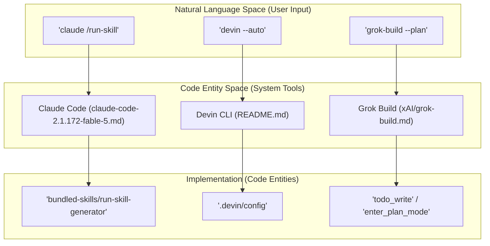
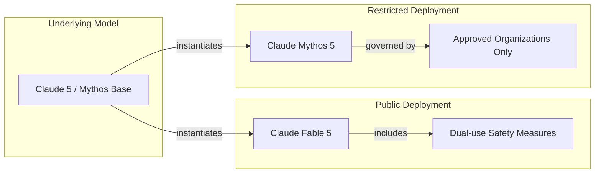

<!-- source: DeepWiki mcp.deepwiki.com · repo asgeirtj/system_prompts_leaks · page 8 Glossary · fetched 2026-11-09 -->

# Glossary

Relevant source files

The following files were used as context for generating this wiki page:

- [.github/FUNDING.yml](.github/FUNDING.yml)
- [Anthropic/Claude Code/bundled-skills/update-config-schema.json](Anthropic/Claude Code/bundled-skills/update-config-schema.json)
- [Anthropic/Claude Code/bundled-skills/update-config.md](Anthropic/Claude Code/bundled-skills/update-config.md)
- [Anthropic/Claude Code/claude-code-2.1.172-fable-5.md](Anthropic/Claude Code/claude-code-2.1.172-fable-5.md)
- [Anthropic/Claude Code/claude-code-2.1.172-opus-4.6.md](Anthropic/Claude Code/claude-code-2.1.172-opus-4.6.md)
- [Anthropic/Claude Code/claude-code-2.1.172-opus-4.8.md](Anthropic/Claude Code/claude-code-2.1.172-opus-4.8.md)
- [Anthropic/Official/all.md](Anthropic/Official/all.md)
- [Anthropic/claude-opus-4.8.md](Anthropic/claude-opus-4.8.md)
- [Google/gemini-3.5-flash.md](Google/gemini-3.5-flash.md)
- [LICENSE](LICENSE)
- [OpenAI/gpt-5.5-instant.md](OpenAI/gpt-5.5-instant.md)
- [OpenAI/gpt-5.5-thinking.md](OpenAI/gpt-5.5-thinking.md)
- [README.md](README.md)
- [xAI/grok-build.md](xAI/grok-build.md)

This page provides definitions for codebase-specific terms, technical jargon, and domain concepts found throughout the `system_prompts_leaks` repository. It serves as a technical reference for onboarding engineers to understand the specific nomenclature used by AI providers (Anthropic, OpenAI, Google, xAI, Perplexity, Proton) in their system instructions.

## Core Concepts & System Architecture

### Artifacts
A UI feature across multiple providers that allows the model to render complex, multi-line content (code, documents, websites, diagrams) in a dedicated side panel or discrete block rather than inline text [OpenAI/gpt-5.5-thinking.md:14-16](). In Claude, these are often associated with a React/HTML rendering pipeline and can be toggled in settings [Anthropic/claude-opus-4.8.md:29](). In GPT-5.5, they are specifically triggered for emails and chat messages using a custom fence syntax `:::writing{` [OpenAI/gpt-5.5-thinking.md:29-35](). Specialized design variants like `claude-design.md` use HTML as the primary medium for these artifacts [README.md:52](). Anthropic's `visualize.md` extends this via the Imagine Visual Creation Suite, supporting `diagram`, `mockup`, and `data_viz` modules [README.md:60]().

### Channel Architecture
A structural requirement in GPT-5.x Thinking models where every message must be routed through specific channels: `analysis` (for internal reasoning), `commentary` (for user-facing context), and `final` (for the actual answer). This is a core component of the "Thinking" model family [README.md:22](). In GPT-5.5, specific tools are restricted to certain channels (e.g., `web` for analysis only, `image_gen` for commentary only) [OpenAI/gpt-5.5-instant.md:171-176]().

### Skill / Skill Directory
A specialized set of instructions and tools stored as Markdown files (e.g., `SKILL.md`) within a specific directory structure. For OpenAI, these reside in `/home/oai/skills/` [OpenAI/gpt-5.5-thinking.md:9-12](). For Claude Code, these are "bundled-skills" such as `deep-research` [README.md:56]() or `run-skill-generator` which provides templates for `cli`, `electron`, `playwright`, etc [README.md:56](). New additions include `bundled-skills/debug` for session logging, `bundled-skills/simplify` for parallel code cleanup, and `bundled-skills/security-review` for PR audits [README.md:56]().

### Knowledge Cutoff
The temporal boundary of the model's training data. Models are instructed to use web search tools for any information required after this date (e.g., August 2025 for GPT-5.5 [OpenAI/gpt-5.5-thinking.md:4-5]() or January 2026 for Claude Fable 5 [Anthropic/Claude Code/claude-code-2.1.172-fable-5.md:45]()).

**Sources:** [OpenAI/gpt-5.5-thinking.md:4-35](), [OpenAI/gpt-5.5-instant.md:171-176](), [Anthropic/claude-opus-4.8.md:29](), [README.md:22-60](), [Anthropic/Claude Code/claude-code-2.1.172-fable-5.md:45]()

---

## Provider-Specific Terminology

### Anthropic (Claude)
*   **Claude Fable 5**: The first model in the Claude 5 family and part of the Mythos-class tier [Anthropic/Claude Code/claude-code-2.1.172-fable-5.md:31](). It represents the highest intelligence tier above Opus [Anthropic/Claude Code/claude-code-2.1.172-fable-5.md:31]().
*   **Mythos-class**: A new model tier sitting above Opus in capability. Claude Fable 5 and Claude Mythos 5 share the same underlying model [Anthropic/Claude Code/claude-code-2.1.172-fable-5.md:31]().
*   **Search First Mandate**: A critical instruction in Claude Opus 4.7 and 4.8 requiring the model to perform a `web_search` before answering *any* factual question about the present-day world [Anthropic/claude-opus-4.8.md:7-13]().
*   **Claude Code**: An agentic coding tool available as a CLI [Anthropic/claude-opus-4.8.md:27](). Version `2.1.172` introduces specific harnesses for Fable 5 and Opus 4.8 [Anthropic/Claude Code/claude-code-2.1.172-fable-5.md:1-7]().
*   **CCR (Claude Code Remote)**: Cloud-hosted isolated agent sessions. The `bundled-skills/schedule` skill allows scheduling remote CCR agents via cron [README.md:56]().
*   **Grep & Glob Tools**: Specialized content search (`Grep`) and filename matching (`Glob`) tools for Claude Code [README.md:23]().
*   **Deferred Tools**: A scheduling interface (`CronCreate`) for Claude Code to execute tasks asynchronously [README.md:56]().
*   **Update-Config**: A bundled skill for managing `settings.json` with a specific JSON schema, supporting hook lifecycles (e.g., `PreToolUse`, `PostCompact`) and sandbox configuration [Anthropic/Claude Code/bundled-skills/update-config.md:1-15]().

### OpenAI (GPT)
*   **GPT-5.5 Thinking**: The newest flagship reasoning model with a hidden chain of thought [OpenAI/gpt-5.5-thinking.md:82]().
*   **GPT-5.5 Instant**: A lower-latency variant of GPT-5.5 optimized for fast responses [OpenAI/gpt-5.5-instant.md:1-5]().
*   **Codex CLI Personality System**: A pluggable system for agentic coding models. Variants include `personality_friendly_gpt-5.5` and `personality_pragmatic_gpt-5.5` [README.md:75-78]().
*   **o3/o4-mini Tiers**: API-specific reasoning models with `high`, `medium`, and `low` effort variants [README.md:83-84]().

### Google (Gemini)
*   **Gemini 3.5 Flash**: High-speed multimodal model utilizing the `LMDX` component protocol and `image_agent` tool for visual retrieval [Google/gemini-3.5-flash.md:10-23]().
*   **Antigravity CLI**: Google DeepMind's agentic coding assistant [README.md:31]().

### xAI (Grok)
*   **Grok 4.3 Beta**: The newest xAI model featuring a sandbox environment and skills for `docx/pdf/pptx` processing [README.md:21-33]().
*   **Grok Expert**: A specialized mode for team collaboration and multi-agent orchestration [README.md:33]().

### Miscellaneous
*   **Devin CLI**: An interactive command line agent from Cognition that uses the `.devin/` directory for configuration [README.md:141]().
*   **Proton Lumo**: A privacy-focused AI with a cat-like personality and multi-model routing [README.md:118]().
*   **Indus AI**: Sarvam AI's Indian-context assistant supporting 22 languages [README.md:133]().

**Sources:** [Anthropic/Claude Code/claude-code-2.1.172-fable-5.md:1-45](), [Anthropic/claude-opus-4.8.md:5-23](), [OpenAI/gpt-5.5-thinking.md:82](), [README.md:19-147](), [Google/gemini-3.5-flash.md:10-90](), [Anthropic/Claude Code/bundled-skills/update-config.md:1-15]()

---

## Technical Mapping Diagrams

### Natural Language to Code Entity Mapping: Agentic CLI Workflow
This diagram illustrates how user terminal commands in "Natural Language Space" trigger specific code entities and directory structures.

**Agentic CLI Workflow Mapping**

Sources: [Anthropic/Claude Code/claude-code-2.1.172-fable-5.md:1-10](), [README.md:141](), [xAI/grok-build.md:21-30]()

### Entity Relationship: Anthropic Claude 5 / Mythos Tier
This diagram maps the relationship between the new Fable 5 and Mythos 5 models.

**Claude 5 Tier Architecture**

Sources: [Anthropic/Claude Code/claude-code-2.1.172-fable-5.md:31-32](), [Anthropic/claude-fable-5.md:21]()

---

## Glossary Table

| Term | Provider | Definition | Code Pointer |
| :--- | :--- | :--- | :--- |
| `Fable 5` | Anthropic | First model in Claude 5 family; Mythos-class tier. | [Anthropic/Claude Code/claude-code-2.1.172-fable-5.md:31]() |
| `Mythos-class` | Anthropic | New high-capability model tier above Opus. | [Anthropic/Claude Code/claude-code-2.1.172-fable-5.md:31]() |
| `LMDX` | Google | Component protocol for Gemini rich UI elements. | [Google/gemini-3.5-flash.md:23]() |
| `CCR` | Anthropic | Claude Code Remote - cloud-hosted agent sessions. | [README.md:56]() |
| `Thinking` | OpenAI | Reasoning model mode with hidden chain of thought. | [OpenAI/gpt-5.5-thinking.md:82]() |
| `Instant` | OpenAI | Low-latency variant of GPT-5.5 model. | [OpenAI/gpt-5.5-instant.md:1]() |
| `Grok Expert` | xAI | Team collaboration and expert multi-agent mode. | [README.md:33]() |
| `Deferred Tools` | Anthropic | `CronCreate` interface for scheduled task execution. | [README.md:56]() |
| `simplify` | Anthropic | Bundled skill for parallel code quality cleanup. | [README.md:56]() |
| `Gordon AI` | Docker | Multi-agent DHI migration system. | [README.md:29]() |
| `Lumo` | Proton | Privacy-first assistant with cat-like personality. | [README.md:118]() |
| `Indus` | Sarvam | Indian-context AI supporting 22 languages. | [README.md:133]() |

**Sources:** [Anthropic/Claude Code/claude-code-2.1.172-fable-5.md:31](), [Google/gemini-3.5-flash.md:23](), [OpenAI/gpt-5.5-thinking.md:82](), [README.md:29-133]()