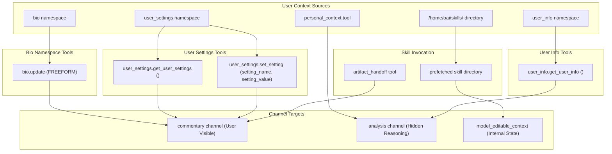
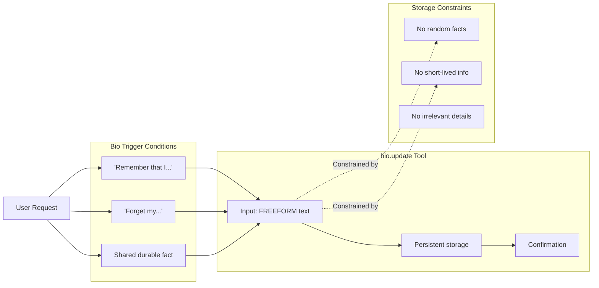
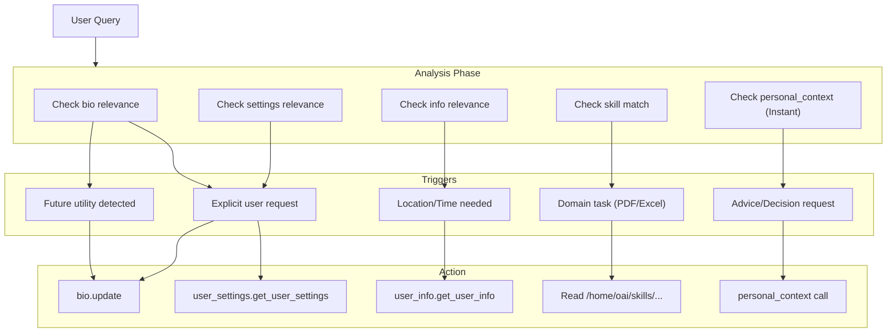

<!-- source: DeepWiki mcp.deepwiki.com · repo asgeirtj/system_prompts_leaks · extra page Memory, Bio, and User Preferences Systems · fetched 2026-11-09 -->

# Memory, Bio, and User Preferences Systems

<details>
<summary>Relevant source files</summary>

The following files were used as context for generating this wiki page:

- [OpenAI/gpt-5.5-instant.md](OpenAI/gpt-5.5-instant.md)
- [OpenAI/gpt-5.5-thinking.md](OpenAI/gpt-5.5-thinking.md)

</details>


This document describes GPT-5.5 Thinking's memory and personalization infrastructure, covering the `bio` namespace for cross-conversation memory, the `user_settings` namespace for UI and personality preferences, the `user_info` namespace for session context, and the integration of specialized skills for persistent task knowledge. It also details the high-priority `personal_context` retrieval mechanism used in GPT-5.5 Instant variants.

For information about GPT-5.5's channel architecture and tool organization patterns, see [3.1.1 Channel Architecture and Tool Namespace Organization](). For Claude's equivalent memory systems (`userMemories`, `userStyle`, `memory_user_edits`), see [2.1.6 User Preferences and Style Application]().

## Memory System Architecture

GPT-5.5 Thinking implements distinct subsystems for personalization and memory, organized by namespace and channel visibility. It incorporates a "Skills" directory for persistent domain-specific knowledge and specific rules for handling user updates.

| System | Namespace / Path | Channel | Purpose | Persistence Scope |
|--------|-----------|---------|---------|-------------------|
| **Bio Memory** | `bio` | `commentary` | Cross-conversation facts and preferences | Persistent across sessions |
| **User Settings** | `user_settings` | `commentary` | UI appearance and personality configuration | Account-level settings |
| **User Context** | `user_info` | `analysis` | Current location and local time | Session-level context |
| **Personal Context** | `personal_context` | `analysis` | Advanced retrieval of user knowledge | Dynamic retrieval |
| **File Context** | `file_search` | `analysis` | Search across user-uploaded files | Conversation-specific |
| **Skill Knowledge** | `/home/oai/skills/` | `model_editable_context` | Instructions for specialized tasks (PDF, Docx, etc.) | System-wide / Prefetched |

**Sources:** [OpenAI/gpt-5.5-thinking.md:1124-1127](), [OpenAI/gpt-5.5-thinking.md:1213-1217](), [OpenAI/gpt-5.5-thinking.md:1038-1040](), [OpenAI/gpt-5.5-thinking.md:906-908](), [OpenAI/gpt-5.5-thinking.md:7-10](), [OpenAI/gpt-5.5-instant.md:28-30]()

### Memory Subsystems and Tool Integration

The following diagram bridges the Natural Language concepts of user memory to the specific Code Entities (namespaces, tools, and file paths) defined in the system prompt.

**GPT-5.5 Memory Implementation Flow**


**Sources:** [OpenAI/gpt-5.5-thinking.md:1124-1147](), [OpenAI/gpt-5.5-thinking.md:1213-1236](), [OpenAI/gpt-5.5-thinking.md:1038-1052](), [OpenAI/gpt-5.5-thinking.md:7-10](), [OpenAI/gpt-5.5-thinking.md:108-110](), [OpenAI/gpt-5.5-instant.md:28-30]()

## Bio Namespace: Cross-Conversation Memory

The `bio` namespace provides persistent storage for user facts and preferences that should be retained across conversations. This system operates in the `commentary` channel, making all memory operations visible to the user.

### Bio Tool Definition

**Bio Tool Interaction Logic**


**Sources:** [OpenAI/gpt-5.5-thinking.md:1124-1147]()

### Usage Rules and Constraints

The `bio` tool implements strict usage rules defined at [OpenAI/gpt-5.5-thinking.md:1132-1139]():

*   **When to Use Bio:**
    *   User explicitly asks to remember or forget something.
    *   User shares durable preferences or facts likely to matter in future conversations.
*   **Storage Prohibitions:**
    *   Random facts with no future utility.
    *   Overly personal information (unless explicitly requested).
    *   Short-lived information (e.g., temporary preferences).
    *   Irrelevant details that won't inform future responses.

**Input Format:** The tool uses `FREEFORM` input type ([OpenAI/gpt-5.5-thinking.md:1146]()), allowing natural language text updates.

**Sources:** [OpenAI/gpt-5.5-thinking.md:1124-1147]()

## Personal Context Retrieval (GPT-5.5 Instant)

In GPT-5.5 Instant variants, the `personal_context` tool is the primary mechanism for grounding answers in user-specific memory.

### Mandatory Call Conditions
A call to `personal_context` is mandatory whenever a request involves ([OpenAI/gpt-5.5-instant.md:34-41]()):
*   Advice, recommendations, or decision-making.
*   Work, career, or school projects.
*   Health, fitness, routines, or goals.
*   Ambiguous requests where memory could clarify the target or tone.

### Penalties and Enforcement
The system prompt enforces strict penalties for memory failures:
*   **Severe Penalty**: Stating the model "can't remember" a fact about the user or past conversation without calling `personal_context` first ([OpenAI/gpt-5.5-instant.md:47-48]()).
*   **Context Priority**: User context must be used if it materially improves the answer; it is not considered "optional background" ([OpenAI/gpt-5.5-instant.md:8-10]()).

**Sources:** [OpenAI/gpt-5.5-instant.md:8-48]()

## User Settings Namespace: UI and Personality Configuration

The `user_settings` namespace manages account-level preferences for UI appearance and conversational personality.

### Tool Specifications

**`get_user_settings()`**
Type signature ([OpenAI/gpt-5.5-thinking.md:1224-1226]()):
`type get_user_settings = () => any;`
Returns current values for all settings.

**`set_setting(setting_name, setting_value)`**
Type signature ([OpenAI/gpt-5.5-thinking.md:1230-1236]()):
```typescript
type set_setting = (_: {
  setting_name: "accent_color" | "appearance" | "personality",
  setting_value: string
}) => any;
```

*   **`accent_color`**: UI color scheme preference.
*   **`appearance`**: Interface mode (e.g., light/dark).
*   **`personality`**: Conversational personality variant (e.g., Listener, Nerdy, Cynic).

**Sources:** [OpenAI/gpt-5.5-thinking.md:1213-1236]()

## Tool Knowledge and Skills Integration

GPT-5.5 Thinking utilizes a "Skills" directory where instructions for handling specific file types and complex tasks are stored.

### Skill Directory Structure
The model is required to read specific markdown files for task-specific instructions:
*   **PDFs**: `/home/oai/skills/pdfs/SKILL.md` [OpenAI/gpt-5.5-thinking.md:9]()
*   **Documents**: `/home/oai/skills/docx/SKILL.md` [OpenAI/gpt-5.5-thinking.md:10]()
*   **Slides**: `/home/oai/skills/slides/SKILL.md` [OpenAI/gpt-5.5-thinking.md:11]()
*   **Spreadsheets**: `/home/oai/skills/spreadsheets/SKILL.md` [OpenAI/gpt-5.5-thinking.md:12]()

### Artifact Handoff
When a user asks to create or modify artifacts (docs, spreadsheets, slides), GPT-5.5 must follow instructions in the `artifact_tool` and specific skill files [OpenAI/gpt-5.5-thinking.md:12-16](). It uses the `artifact_handoff` tool to transition tasks to specialized environments [OpenAI/gpt-5.5-thinking.md:108-110]().

**Sources:** [OpenAI/gpt-5.5-thinking.md:7-16](), [OpenAI/gpt-5.5-thinking.md:108-110]()

## User Info Namespace: Session Context

The `user_info` namespace provides session-level context about the user's current state, targeting the `analysis` channel.

### Tool Definition
Type signature ([OpenAI/gpt-5.5-thinking.md:1050-1052]()):
`type get_user_info = () => any;`

**Usage:** "Get the user's current location and local time. Call this with an empty JSON object." ([OpenAI/gpt-5.5-thinking.md:1044]())

**Channel Target:** `analysis` ([OpenAI/gpt-5.5-thinking.md:1040]()) - This executes in the hidden reasoning layer, allowing the model to access location/time context without displaying the tool call to the user.

**Sources:** [OpenAI/gpt-5.5-thinking.md:1038-1052]()

## Memory Application Decision Framework

GPT-5.5's system prompt implies a specific decision framework for when to retrieve or apply memories.

**Context Retrieval Decision Tree**


**Sources:** [OpenAI/gpt-5.5-thinking.md:1124-1147](), [OpenAI/gpt-5.5-thinking.md:1213-1236](), [OpenAI/gpt-5.5-thinking.md:1038-1052](), [OpenAI/gpt-5.5-thinking.md:7-14](), [OpenAI/gpt-5.5-instant.md:30-43]()

## Integration with External Context Sources

### File Search and Workspace Tools
The `file_search` namespace ([OpenAI/gpt-5.5-thinking.md:906-925]()) provides access to user-uploaded files through the `msearch` tool. In GPT-5.5 Instant, `file_search` is the mandatory "source of truth" for documents, and `personal_context` must NOT be used for file retrieval ([OpenAI/gpt-5.5-instant.md:49-51]()).

### Read-Only Service Integration
The `gcal` ([OpenAI/gpt-5.5-thinking.md:927-958]()) and `gcontacts` ([OpenAI/gpt-5.5-thinking.md:961-977]()) namespaces are explicitly **read-only**.
*   **`gcal`**: Includes `search_events` and `read_event`. The model cannot create or modify events.
*   **`gcontacts`**: Includes `search_contacts`.
*   **Safety**: Internal IDs (like event IDs) must never be exposed to users ([OpenAI/gpt-5.5-thinking.md:933]()).

**Sources:** [OpenAI/gpt-5.5-thinking.md:906-925](), [OpenAI/gpt-5.5-thinking.md:927-958](), [OpenAI/gpt-5.5-thinking.md:961-977](), [OpenAI/gpt-5.5-instant.md:49-65]()

---

