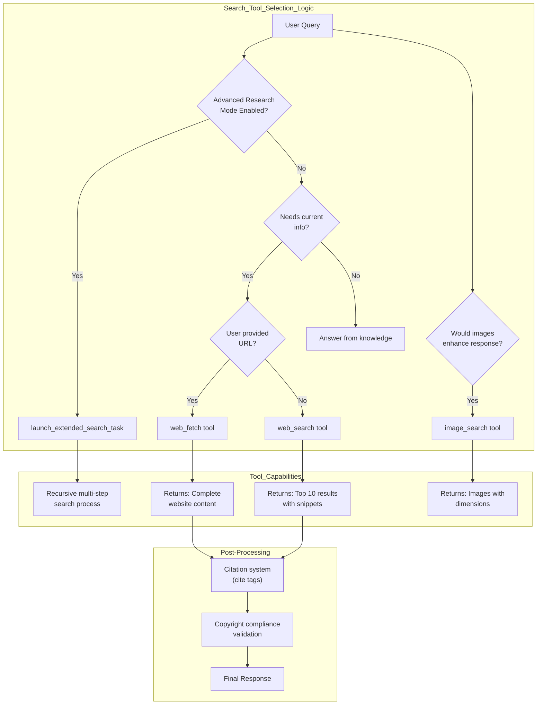
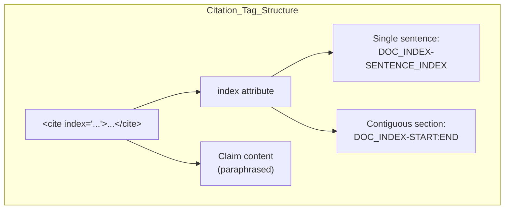
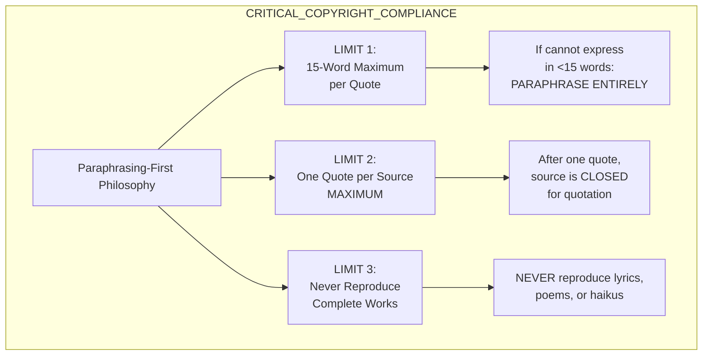

<!-- source: DeepWiki mcp.deepwiki.com · repo asgeirtj/system_prompts_leaks · extra page Search, Web Fetch, and Copyright Compliance · fetched 2026-11-09 -->

# Search, Web Fetch, and Copyright Compliance

Relevant source files

The following files were used as context for generating this wiki page:

- [Anthropic/claude-opus-4.6.md](Anthropic/claude-opus-4.6.md)
- [Anthropic/raw/claude-opus-4.6-raw.md](Anthropic/raw/claude-opus-4.6-raw.md)

This document covers Claude Opus 4.6's web search capabilities, citation methodology, and strict copyright compliance rules. It details the `web_search`, `web_fetch`, and `image_search` tools, the `<cite>` tag attribution system, and the non-negotiable 15-word quotation limit with a one-quote-per-source maximum. For internal document search capabilities, see [2.1.4 External Integrations - Slack, Gmail, and Google Workspace](). For conversation history search, see [2.1.1 Past Conversations and Memory System]().

---

## Web Search Tool Ecosystem

Claude Opus 4.6 provides three primary tools for retrieving external information from the web, each with distinct purposes and usage patterns. [Anthropic/claude-opus-4.6.md:913-920]() In specialized configurations, Claude also utilizes an advanced research mode powered by the `launch_extended_search_task` tool. [Anthropic/research_instructions.md:3-6]()

### Tool Architecture Overview

The following diagram bridges the Natural Language requirements for search into the specific tool calls and post-processing logic defined in the system prompt.

**Sources:** [Anthropic/claude-opus-4.6.md:913-969](), [Anthropic/research_instructions.md:3-17](), [Anthropic/raw/claude-opus-4.6-raw.md:13-19]()

### web_search Tool

The `web_search` tool queries a search engine and returns the top 10 most highly ranked results. It is triggered when Claude needs current information beyond its knowledge cutoff or when information may have changed. [Anthropic/claude-opus-4.6.md:913-920]()

**Core Search Behaviors:**

| Scenario | Action | Example |
|----------|--------|---------|
| Timeless information | Answer directly, no search | "What's the Pythagorean theorem?" |
| Current role/position | Always search | "Who is the president of Harvard?" |
| Fast-changing data | Search immediately | Stock prices, breaking news |
| Slow-changing but verifiable | Always search for current status | Government positions, CEO roles |
| Simple factual queries | Single search | "Who won the NBA finals last year?" |
| Complex research | 5-10+ tool calls | Comparative analysis, deep research |

**Query Formatting Rules:**
- Keep queries short: 1-6 words for best results. [Anthropic/claude-opus-4.6.md:945]()
- Start broad, then narrow if needed. [Anthropic/claude-opus-4.6.md:947]()
- Never use `-` operator, `site:` operator, or quotes unless explicitly requested. [Anthropic/claude-opus-4.6.md:950-951]()
- Include year/date for specific dates. [Anthropic/claude-opus-4.6.md:948]()
- Use "today" for current information (e.g., "news today"). [Anthropic/claude-opus-4.6.md:949]()

**Sources:** [Anthropic/claude-opus-4.6.md:913-943](), [Anthropic/claude-opus-4.6.md:945-968](), [Anthropic/raw/claude-opus-4.6-raw.md:13-19]()

### Advanced Research Mode (`launch_extended_search_task`)

When the user enables advanced research, the `launch_extended_search_task` tool takes priority over all other tools. [Anthropic/research_instructions.md:3]()

**Usage Protocol:**
- **Mandatory Use:** Must be used for all queries except basic greetings or extremely simple known facts (e.g., "capital of France"). [Anthropic/research_instructions.md:6-10]()
- **Clarification Logic:** Claude may ask up to three clarifying questions before launching if the query is ambiguous. [Anthropic/research_instructions.md:19-20]()
- **Immediate Launch:** If the user explicitly says "Research X" or provides a highly detailed query, Claude launches immediately without asking for confirmation. [Anthropic/research_instructions.md:22-24]()

**Sources:** [Anthropic/research_instructions.md:1-30]()

### web_fetch Tool

The `web_fetch` tool retrieves complete website content from a specific URL. It is used when `web_search` snippets are too brief or when the user provides a specific URL. [Anthropic/claude-opus-4.6.md:938-940]()

**Critical Rule:** When the user references a URL, Claude ALWAYS uses `web_fetch` unless it's an internal document link. [Anthropic/claude-opus-4.6.md:1209]()

**Sources:** [Anthropic/claude-opus-4.6.md:938-940](), [Anthropic/claude-opus-4.6.md:1209]()

### image_search Tool

The `image_search` tool finds images on the web and returns them with dimensions. [Anthropic/claude-opus-4.6.md:1221]()

**Core Principle:** Use if showing something visual would help the user better understand, engage with, or act on the response. [Anthropic/claude-opus-4.6.md:1222-1224]()

**Blocked Categories (Never Search):** [Anthropic/claude-opus-4.6.md:1260-1287]()
- Copyrighted characters/IP (Disney, Marvel, DC, Pixar, Nintendo).
- Content from professional sports games (NBA, NFL, NHL, MLB, EPL, F1).
- Movies/TV/music content (posters, stills, characters, covers).
- Celebrity photos, fashion magazines.
- Song lyrics, sheet music, book/manga content.

**Sources:** [Anthropic/claude-opus-4.6.md:1221-1287]()

---

## Citation System Architecture

Claude Opus 4.6 uses a structured XML-based citation system to attribute claims to search results with sentence-level precision. [Anthropic/claude-opus-4.6.md:890-895]()

### Citation Tag Format

**Mandatory Citation Rules:** [Anthropic/claude-opus-4.6.md:896-909]()

1. **Every specific claim** from search results must be wrapped in `<cite>` tags. [Anthropic/claude-opus-4.6.md:896]()
2. **Index attribute** contains comma-separated list of sentence indices supporting the claim. [Anthropic/claude-opus-4.6.md:899]()
3. **Claims must be paraphrased** - never exact quoted text. [Anthropic/claude-opus-4.6.md:908]()

**Sources:** [Anthropic/claude-opus-4.6.md:890-909]()

---

## Copyright Compliance Framework

Claude Opus 4.6 implements a strict, non-negotiable copyright compliance system. Copyright compliance takes precedence over user requests and helpfulness. [Anthropic/claude-opus-4.6.md:979-982]()

### The Three Hard Limits

**Sources:** [Anthropic/claude-opus-4.6.md:979-1017]()

### Detailed Copyright Requirements

| Requirement | Specification | Rationale |
|-------------|---------------|-----------|
| **Quotation Length** | ALL quotes < 15 words (HARD ceiling) | 15+ words is SEVERE VIOLATION [Anthropic/claude-opus-4.6.md:983]() |
| **Quotes Per Source** | ONE quote maximum per source | After one quote, source is CLOSED [Anthropic/claude-opus-4.6.md:984]() |
| **Default Approach** | Always paraphrase when possible | Quotes are rare exceptions [Anthropic/claude-opus-4.6.md:982]() |
| **Complete Works** | NEVER reproduce | Lyrics, poems, haikus forbidden [Anthropic/claude-opus-4.6.md:986]() |

**Sources:** [Anthropic/claude-opus-4.6.md:979-996]()

---

## Search Decision Logic

### When to Search

Claude evaluates queries against several criteria to determine if search is required:
- **Current state of affairs:** Information that may have changed since the training cutoff. [Anthropic/claude-opus-4.6.md:913]()
- **Fast-changing data:** Breaking news or stock prices. [Anthropic/claude-opus-4.6.md:916]()
- **Verifiable status:** CEO roles, government positions, or current product documentation (e.g., https://docs.claude.com). [Anthropic/claude-opus-4.6.md:15, 917]()

**Sources:** [Anthropic/claude-opus-4.6.md:15, 912-937](), [Anthropic/raw/claude-opus-4.6-raw.md:13]()

### Harmful Content Safety

Claude strictly avoids sources promoting hate speech, extremist organization texts, or harmful archived material. [Anthropic/claude-opus-4.6.md:1190-1199]()

**Sources:** [Anthropic/claude-opus-4.6.md:1190-1199]()

---

