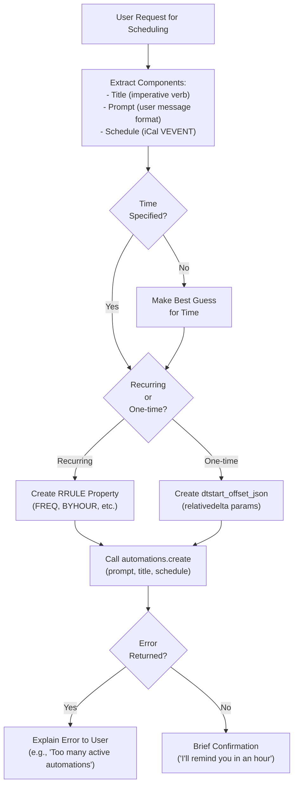
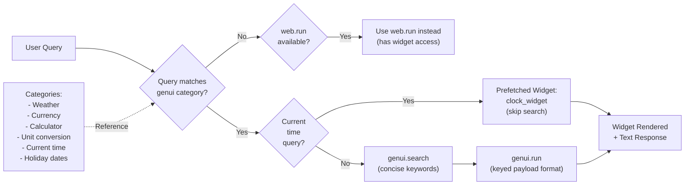

<!-- source: DeepWiki mcp.deepwiki.com · repo asgeirtj/system_prompts_leaks · extra page Tool Ecosystem and Automation Systems · fetched 2026-11-09 -->

# Tool Ecosystem and Automation Systems

<details>
<summary>Relevant source files</summary>

The following files were used as context for generating this wiki page:

- [OpenAI/gpt-5.2-thinking.md](OpenAI/gpt-5.2-thinking.md)
- [OpenAI/gpt-5.4-thinking.md](OpenAI/gpt-5.4-thinking.md)

</details>


This document describes the tool ecosystem and automation capabilities for the GPT-5.x Thinking model family, specifically focusing on GPT-5.4 and its predecessor GPT-5.2. It covers the namespace-based tool organization, the channel architecture that routes tool calls, the `automations` namespace for task scheduling, and the `genui` namespace for UI widget generation.

## Namespace Architecture Overview

GPT-5.4 and GPT-5.2 organize tools into distinct namespaces, each targeting either the `analysis` or `commentary` channel. This architecture separates internal reasoning tools (private) from user-facing tools.

### Namespace-to-Channel Mapping Diagram

```mermaid
graph TB
    subgraph AnalysisChannel["Analysis Channel (Private)"]
        python["python"]
        web["web"]
        file_search["file_search"]
        gmail["gmail"]
        gcal["gcal"]
        gcontacts["gcontacts"]
        user_info["user_info"]
        summary_reader["summary_reader"]
        container["container"]
    end
    
    subgraph CommentaryChannel["Commentary Channel (User-Visible)"]
        genui["genui"]
        automations["automations"]
        canmore["canmore"]
        python_user_visible["python_user_visible"]
        bio["bio"]
        image_gen["image_gen"]
        artifact_handoff["artifact_handoff"]
    end
    
    subgraph ToolCalls["Tool Call Format"]
        json_format["JSON Object (default)"]
        freeform_format["FREEFORM (specified in schema)"]
    end
    
    python --> json_format
    web --> json_format
    automations --> json_format
    genui --> json_format
    bio --> freeform_format
    python_user_visible --> freeform_format
    image_gen --> json_format
```



**Sources:** [OpenAI/gpt-5.2-thinking.md:333-336](), [OpenAI/gpt-5.2-thinking.md:340-1131]()

### Tool Calling Convention

All tool calls use JSON object inputs by default. If a tool schema contains the word `FREEFORM` as its input type, the function description specifies the exact input format required [OpenAI/gpt-5.2-thinking.md:333-336]().

| Namespace | Target Channel | Input Format | Primary Purpose |
|-----------|---------------|--------------|-----------------|
| `python` | analysis | FREEFORM | Private code execution for reasoning |
| `web` | analysis | JSON | Internet access (search, fetch, browse) |
| `file_search` | analysis | JSON | Search user uploads and connected sources |
| `gmail` | analysis | JSON | Read-only email access |
| `gcal` | analysis | JSON | Read-only calendar access |
| `gcontacts` | analysis | JSON | Read-only contacts search |
| `user_info` | analysis | JSON | Location and time information |
| `summary_reader` | analysis | JSON | Access previous CoT messages |
| `container` | analysis | JSON | Docker container interaction |
| `genui` | commentary | JSON | UI widget generation |
| `automations` | commentary | JSON | Task scheduling system |
| `canmore` | commentary | JSON | Canvas document creation |
| `python_user_visible` | commentary | FREEFORM | User-visible code execution |
| `bio` | commentary | FREEFORM | User profile management |
| `image_gen` | commentary | JSON | Image generation and editing |
| `artifact_handoff` | commentary | JSON | Spreadsheet/slide preparation |

**Sources:** [OpenAI/gpt-5.2-thinking.md:340-1131]()

## Automation Systems

### The `automations` Namespace

The `automations` namespace enables task scheduling for future execution. It targets the `commentary` channel and provides capabilities for reminders, scheduled searches, and conditional monitoring tasks [OpenAI/gpt-5.2-thinking.md:676-678]().

### Function Signatures

```typescript
type create = (_: {
  prompt: string,
  title: string,
  schedule?: string,
  dtstart_offset_json?: string,
}) => any;

type update = (_: {
  jawbone_id: string,
  schedule?: string,
  dtstart_offset_json?: string,
  prompt?: string,
  title?: string,
  is_enabled?: boolean,
}) => any;

type list = () => any;
```

**Sources:** [OpenAI/gpt-5.2-thinking.md:721-739]()

### iCal VEVENT Schedule Format

The `automations.create` function requires schedules in iCal VEVENT format. The VEVENT must follow specific constraints:

- **Prohibited properties**: `SUMMARY` and `DTEND` must not be specified [OpenAI/gpt-5.2-thinking.md:692-693]()
- **Preferred approach**: Use the `RRULE` property for recurring schedules [OpenAI/gpt-5.2-thinking.md:695-697]()
- **Start time calculation**: Use `dtstart_offset_json` parameter with JSON-encoded Python `dateutil.relativedelta` arguments [OpenAI/gpt-5.2-thinking.md:709-712]()

**Sources:** [OpenAI/gpt-5.2-thinking.md:692-712]()

#### RRULE Examples

Daily morning task:
```
schedule="BEGIN:VEVENT
RRULE:FREQ=DAILY;BYHOUR=9;BYMINUTE=0;BYSECOND=0
END:VEVENT"
```

Relative offset (15 minutes from now):
```
schedule=""
dtstart_offset_json='{"minutes":15}'
```

**Sources:** [OpenAI/gpt-5.2-thinking.md:699-712]()

### Task Creation Workflow



**Sources:** [OpenAI/gpt-5.2-thinking.md:676-720]()

## Widget System (genui Namespace)

The `genui` namespace provides rich UI widget generation for the commentary channel. It handles utilities like weather, currency conversion, calculators, unit conversion, time display, and holiday information [OpenAI/gpt-5.2-thinking.md:360-408]().

### genui Tool Architecture



**Sources:** [OpenAI/gpt-5.2-thinking.md:360-408]()

### clock_widget Function Signature

```typescript
type clock_widget = (_: {
  location: string,         // city, state/country
  tz_name: string,          // IANA timezone name
  tz_alias?: string | null, // optional short alias like EST
  fixed_timestamp?: string | null,
  locale_override?: string,
}) => "Widget output to show to the user.";
```

**Sources:** [OpenAI/gpt-5.2-thinking.md:392-399]()

## Skill System and Artifacts (GPT-5.4)

GPT-5.4 introduces a formalized Skill system and artifact generation workflow. These skills are provided as pre-fetched model-editable contexts that the model must read before invocation [OpenAI/gpt-5.4-thinking.md:32-44]().

### Skill Directory Structure

| Path | Purpose |
|------|---------|
| `/home/oai/skills/pdfs/SKILL.md` | PDF creation and editing instructions [OpenAI/gpt-5.4-thinking.md:7]() |
| `/home/oai/skills/docx/SKILL.md` | Document creation and editing instructions [OpenAI/gpt-5.4-thinking.md:8]() |
| `/home/oai/skills/slides/SKILL.md` | Slide creation and editing instructions [OpenAI/gpt-5.4-thinking.md:9]() |
| `/home/oai/skills/spreadsheets/SKILL.md` | Spreadsheet task instructions and style guidelines [OpenAI/gpt-5.4-thinking.md:10]() |

### Artifact Generation Rules

When creating artifacts (docs, spreadsheets, slides), the model must:
1. Link to generated artifacts using sandbox citations: `[Label](sandbox:/mnt/data/<filename>.<ext>)` [OpenAI/gpt-5.4-thinking.md:17]().
2. Use `artifact_tool` and `openpyxl` for spreadsheets, specifically avoiding PDF skills for spreadsheet tasks [OpenAI/gpt-5.4-thinking.md:10]().
3. Never share font files from the container [OpenAI/gpt-5.4-thinking.md:18]().

**Sources:** [OpenAI/gpt-5.4-thinking.md:7-18]()

### Writing Blocks (UI-only)

GPT-5.4 uses `writing` blocks for rendering emails in the UI as discrete artifacts [OpenAI/gpt-5.4-thinking.md:62]().

**Syntax Structure:**
```markdown
:::writing{id="51231" variant="email" subject="..."}
<content>
:::
```
- **Required fields**: `id` (5-digit string), `variant` ("email"), `subject` [OpenAI/gpt-5.4-thinking.md:99-103]().
- **Constraint**: Only used for emails; planning goes in normal chat [OpenAI/gpt-5.4-thinking.md:79-85]().

**Sources:** [OpenAI/gpt-5.4-thinking.md:60-113]()

## Analysis Channel Tools (GPT-5.2/5.4)

### python Namespace

The `python` tool executes code in a stateful Jupyter notebook environment:
- **Timeout**: 300 seconds [OpenAI/gpt-5.2-thinking.md:347]().
- **Storage**: Persistent `/mnt/data` drive [OpenAI/gpt-5.2-thinking.md:347]().
- **Connectivity**: No internet access [OpenAI/gpt-5.2-thinking.md:347]().
- **multimodal assets**: Uses `python_tool_assets_upload` to load assets into the kernel [OpenAI/gpt-5.2-thinking.md:351-356]().

### web Namespace

The `web.run` function provides unified internet access.

| Command | Description |
|---------|-------------|
| `search_query` | Search engine query (max 4 per call) [OpenAI/gpt-5.2-thinking.md:417]() |
| `open` | Open specific URLs [OpenAI/gpt-5.2-thinking.md:598]() |
| `finance` | Ticker-based stock/market data [OpenAI/gpt-5.2-thinking.md:607]() |
| `weather` | Location-based weather data [OpenAI/gpt-5.2-thinking.md:608]() |
| `sports` | League/team scores and standings [OpenAI/gpt-5.2-thinking.md:606]() |

**Sources:** [OpenAI/gpt-5.2-thinking.md:340-356](), [OpenAI/gpt-5.2-thinking.md:597-672]()

## Integration and Connected Sources

### Read-Only Integration Constraints

GPT-5.2/5.4 integrations for Google Workspace are strictly read-only [OpenAI/gpt-5.2-thinking.md:851, 877]().

| Namespace | Search Function | Read Function |
|-----------|-----------------|---------------|
| `gmail` | `search_email_ids` | `batch_read_email` |
| `gcal` | `search_events` | `read_event` |
| `gcontacts` | `search_contacts` | N/A |

**Workflow Pattern:** Before setting up an automation that uses these tools, the model performs a "dummy" search (e.g., `gmail.search_email_ids({"query": ""})`) to verify the connection is active [OpenAI/gpt-5.2-thinking.md:854, 880, 904]().

**Sources:** [OpenAI/gpt-5.2-thinking.md:843-910]()

---

