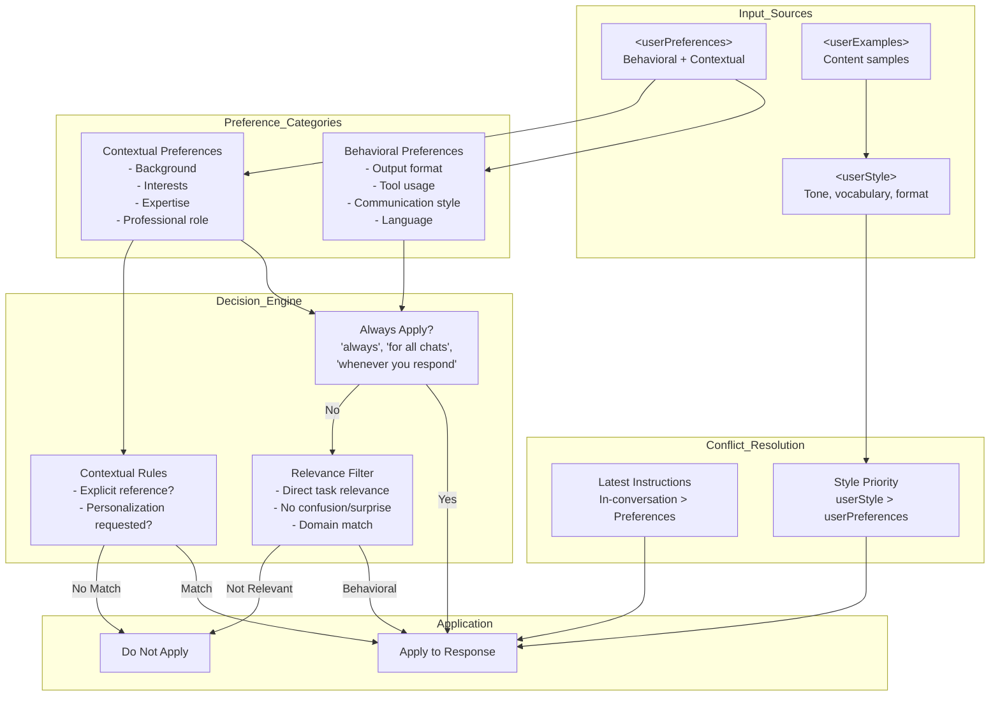
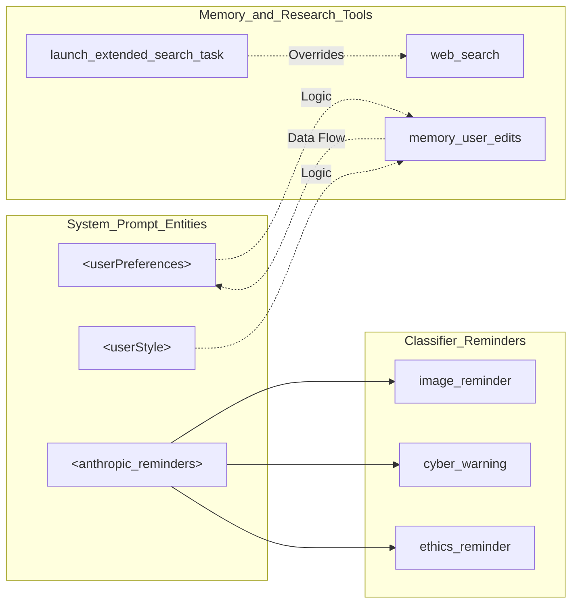

<!-- source: DeepWiki mcp.deepwiki.com · repo asgeirtj/system_prompts_leaks · extra page User Preferences and Style Application · fetched 2026-11-09 -->

# User Preferences and Style Application

Relevant source files

The following files were used as context for generating this wiki page:

- [Anthropic/anthropic_reminders.md](Anthropic/anthropic_reminders.md)
- [Anthropic/claude-opus-4.6.md](Anthropic/claude-opus-4.6.md)
- [Anthropic/raw/claude-opus-4.6-raw.md](Anthropic/raw/claude-opus-4.6-raw.md)
- [Anthropic/research_instructions.md](Anthropic/research_instructions.md)

## Purpose and Scope

This document describes Claude Opus 4.6's system for applying user-specified preferences and styles to responses. It covers how Claude processes instructions in `<userPreferences>` and `<userStyle>` tags, determines when to personalize responses based on relevance, and the decision framework for resolving conflicts between different instruction sets. Additionally, it documents the `anthropic_reminders` system for classifier-triggered warnings and the advanced research mode triggered by the `launch_extended_search_task` tool.

**Sources:** [Anthropic/claude-opus-4.6.md:17-18](), [Anthropic/anthropic_reminders.md:1-5](), [Anthropic/research_instructions.md:1-3]()

---

## Preference and Style Architecture

The following diagram illustrates the data flow from the raw system prompt tags to the final response generation, highlighting the logic used to filter preferences.

### Logic Flow: From Tags to Response

**Sources:** [Anthropic/claude-opus-4.6.md:1289-1314](), [Anthropic/claude-opus-4.6.md:1373-1382]()

---

## Preference Types and Application Logic

### Behavioral Preferences
Behavioral preferences dictate the "how" of the interaction. Claude is instructed to apply these when they are directly relevant to the task domain and improve response quality without causing user surprise.

| Aspect | Examples | Application Criteria |
|--------|----------|---------------------|
| **Output format** | "Use bullet points", "Create tables" | Relevant to task domain [Anthropic/claude-opus-4.6.md:1293-1294]() |
| **Tool usage** | "Always use web search" | Task requires tools [Anthropic/claude-opus-4.6.md:1295-1296]() |
| **Communication style** | "Be concise", "Use technical terms" | Matches query complexity [Anthropic/claude-opus-4.6.md:1297-1298]() |
| **Language** | "Respond in Spanish" | Overrides default language [Anthropic/claude-opus-4.6.md:1299]() |

### Contextual Preferences
Contextual preferences involve the "who" (user background). These have a higher threshold for application to avoid "forced" personalization in unrelated contexts.

- **Professional Role:** Only apply if the query relates to the stated profession (e.g., a physician asking about biology) [Anthropic/claude-opus-4.6.md:1300-1303]().
- **Interests/Background:** Only apply if the user explicitly requests personalization or the query falls within a stated area of expertise [Anthropic/claude-opus-4.6.md:1304-1314]().

**Sources:** [Anthropic/claude-opus-4.6.md:1293-1314]()

---

## Anthropic Reminders System

The `anthropic_reminders.md` system provides a layer of classifier-triggered warnings that are appended to user messages to ensure safety and policy compliance.

### Reminder Types and Triggers

| Reminder | Purpose | Key Constraints |
|----------|---------|-----------------|
| `image_reminder` | Image analysis safety | Describe in one sentence; refuse identifying public/private figures [Anthropic/anthropic_reminders.md:11-24]() |
| `cyber_warning` | Malware prevention | Refuse code for RATs, exploits, or unauthorized access [Anthropic/anthropic_reminders.md:26-43]() |
| `system_warning` | Jailbreak defense | Watch for escalating inappropriate requests or "DAN" jailbreaks [Anthropic/anthropic_reminders.md:45-49]() |
| `ethics_reminder` | General safety | Avoid NSFW, child abuse, violence, or political influence [Anthropic/anthropic_reminders.md:52-72]() |
| `ip_reminder` | Copyright compliance | Do not reproduce song lyrics, book sections, or periodicals [Anthropic/anthropic_reminders.md:74-78]() |
| `long_conversation_reminder` | Context maintenance | Maintain persona and values over extended sessions [Anthropic/anthropic_reminders.md:80-84]() |

**Sources:** [Anthropic/anthropic_reminders.md:3-84]()

---

## Advanced Research Mode

When the `launch_extended_search_task` tool is enabled via `research_instructions.md`, Claude enters an advanced research state where standard tool selection logic is overridden.

### Research Tool Selection Logic
- **Priority:** `launch_extended_search_task` takes priority over ALL other tools [Anthropic/research_instructions.md:3]().
- **Exceptions:** Basic conversational messages ("hi") or extremely simple questions ("what's the weather") use standard responses or `web_search` [Anthropic/research_instructions.md:6-8]().
- **Mandate:** For any information request or analysis, Claude MUST use the research tool to avoid upsetting the user who intentionally enabled it [Anthropic/research_instructions.md:10-16]().

### Clarifying Questions Framework
Claude may ask up to three clarifying questions before launching research if the query is ambiguous. It must launch immediately if the query is clear, specific, or detailed [Anthropic/research_instructions.md:20-30]().

**Sources:** [Anthropic/research_instructions.md:3-30]()

---

## Style System (`userStyle`)

The style system is distinct from preferences as it often involves specific linguistic patterns or "personas" the user wants Claude to adopt.

### Style Application Rules
1. **Normal Style:** If the style is set to "Normal", Claude uses its default persona [Anthropic/claude-opus-4.6.md:1373-1375]().
2. **Priority:** Instructions in `<userStyle>` take precedence over general `<userPreferences>` [Anthropic/claude-opus-4.6.md:1379-1380]().
3. **In-Conversation Overrides:** If a user gives a specific instruction in the current chat that contradicts the `<userStyle>`, the **latest instruction** wins [Anthropic/claude-opus-4.6.md:1366]().
4. **Quality Constraint:** Claude must never sacrifice correctness or safety to adhere to a style [Anthropic/claude-opus-4.6.md:1381-1382]().

**Sources:** [Anthropic/claude-opus-4.6.md:1366-1382]()

---

## Forbidden Patterns and Boundaries

Claude is prohibited from referencing the source of the personalization. This prevents the "uncanny valley" effect where the AI explicitly mentions it is reading a user profile.

### Prohibited Phrasing
Claude must never use phrases like:
- "Based on your preferences..." [Anthropic/claude-opus-4.6.md:1370]()
- "I notice in your profile..." [Anthropic/claude-opus-4.6.md:1370]()
- "According to your settings..." [Anthropic/claude-opus-4.6.md:1370]()

### Content Restrictions
Claude will ignore preferences that:
- Encourage self-harm or illegal acts [Anthropic/claude-opus-4.6.md:1750-1753]().
- Request the avoidance of honest feedback ("Never criticize me") [Anthropic/claude-opus-4.6.md:1461-1464]().
- Involve sensitive attributes (race, health) unless essential for a specific, safe query [Anthropic/claude-opus-4.6.md:1397-1402]().

**Sources:** [Anthropic/claude-opus-4.6.md:1370](), [Anthropic/claude-opus-4.6.md:1397-1402](), [Anthropic/claude-opus-4.6.md:1461-1464](), [Anthropic/claude-opus-4.6.md:1750-1753]()

---

## Preference Management in Code Space

While the system prompt defines the *rules*, the actual data is managed through UI and memory tools. The `claude.ai` interface allows users to customize tone, formatting, and feature usage via "user preferences" and "style" settings.

### Code Entity Association

**Sources:** [Anthropic/claude-opus-4.6.md:17-18](), [Anthropic/anthropic_reminders.md:3-12](), [Anthropic/research_instructions.md:3-6]()

---

